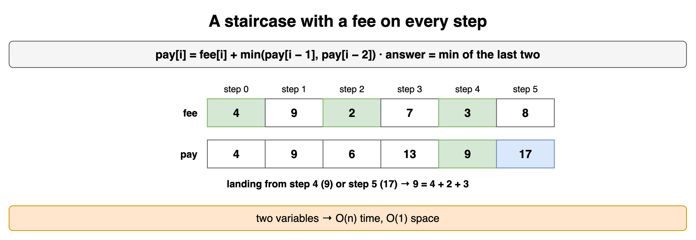
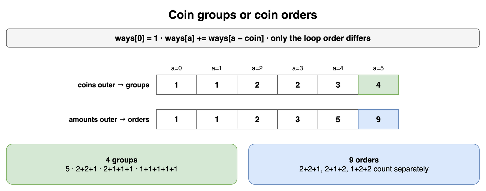
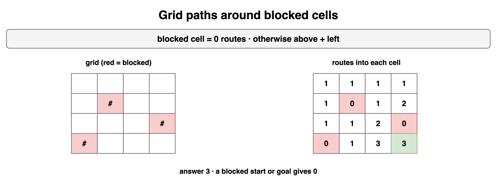
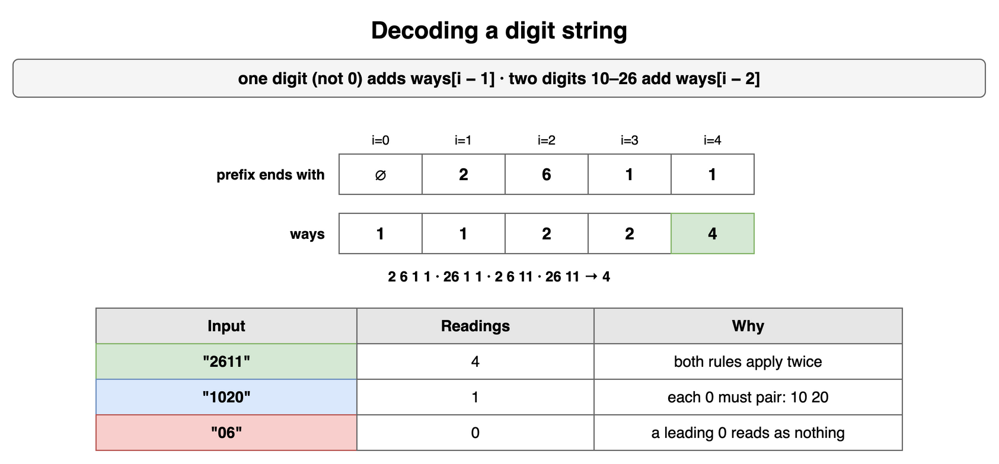
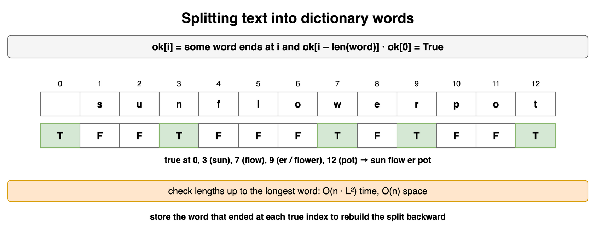
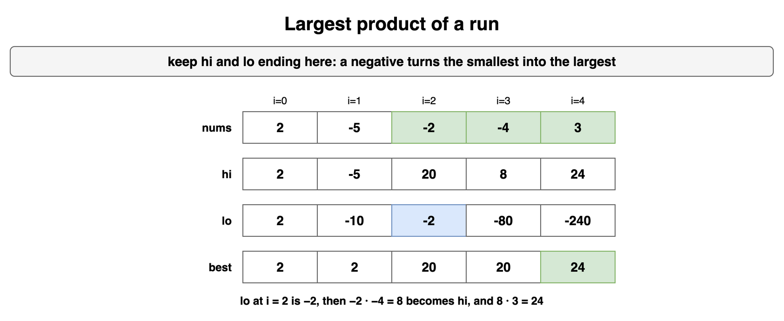
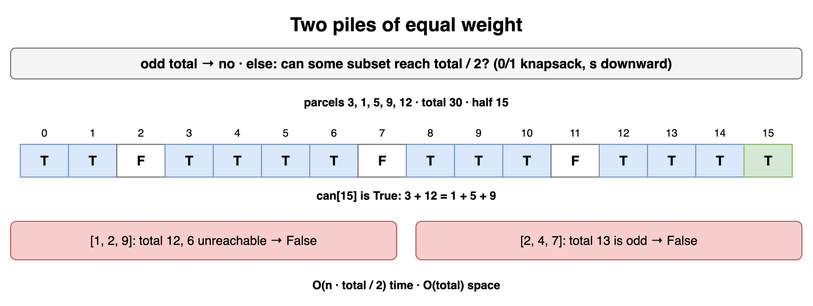
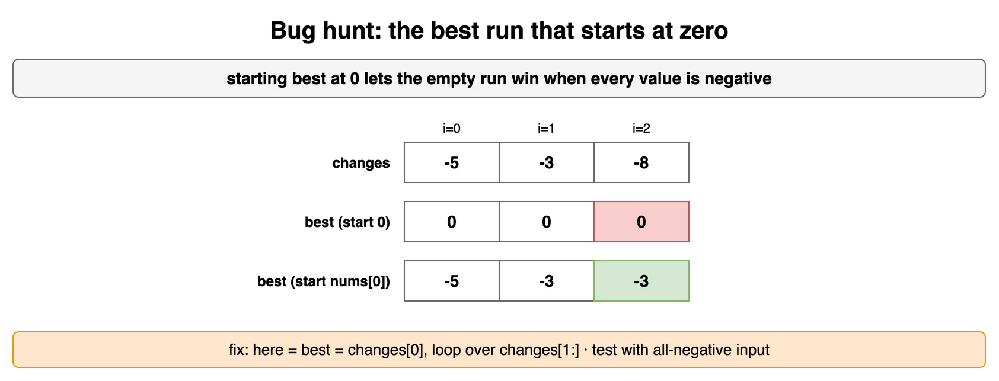
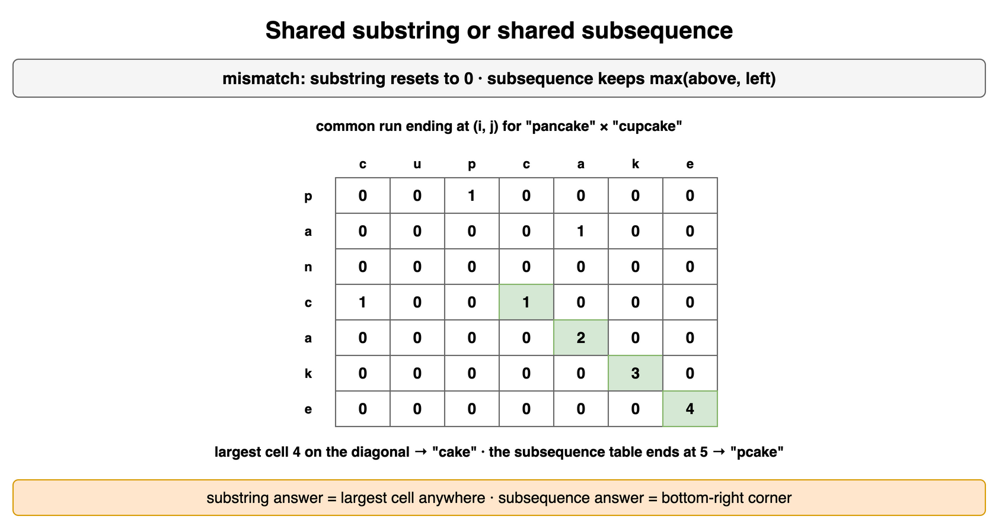

# Dynamic Programming — Drills

Original drills for a paid staircase, coin groups versus coin orders, a grid with blocked cells, decoding digits, splitting text into words, products of a run, equal-sum piles, a Kadane bug, and shared substrings versus subsequences. Each answer has a recurrence, a cost, and Python. The numbers, words, and grids are exercise values.

## A staircase with a fee on every step

Standing on step i costs `fee[i]`. You may start on step 0 or step 1, each move goes up one or two steps, and the goal is the landing just above the last step. With `fee = [4, 9, 2, 7, 3, 8]`, what is the cheapest climb, and how much memory does it need?

**Answer:** 9, by standing on steps 0, 2, and 4 (4 + 2 + 3) and jumping two steps to the landing. Let `pay[i]` be the cheapest total that ends standing on step i: `pay[i] = fee[i] + min(pay[i - 1], pay[i - 2])`, where the two imaginary steps below step 0 cost 0, which is what allows starting on step 0 or 1. The landing is reached from either of the last two steps, so the answer is `min(pay[-1], pay[-2])`. Only two earlier values are read, so two variables give O(n) time and O(1) space. It is [Climbing stairs](#11_Coding_Problems/23_Dynamic_Programming/concepts/climbing-stairs) with a minimum instead of a sum.

```python
def cheapest_climb(fee: list[int]) -> int:
    two_back, one_back = 0, 0
    for f in fee:
        two_back, one_back = one_back, f + min(two_back, one_back)
    return min(two_back, one_back)


print(cheapest_climb([4, 9, 2, 7, 3, 8]))
print(cheapest_climb([5]), cheapest_climb([5, 1]))
# 9
# 0 1
```



*Source: [`diagrams/dynamic-programming-drills.drawio`](/content/11_Coding_Problems/23_Dynamic_Programming/diagrams/dynamic-programming-drills.drawio), page 1.*

## Coin groups or coin orders

With coins worth 1, 2, and 5 (unlimited supply), how many ways make 5? Answer twice: once counting `2 + 2 + 1` and `1 + 2 + 2` as the same group, once counting them as different orders. Which loop order gives which count?

**Answer:** 4 groups and 9 orders. Both use `ways[0] = 1` and `ways[a] += ways[a - coin]`. With coins in the outer loop and amounts inside, each coin is offered once, so a group is built in one fixed coin order and counted once: 4 (`5`, `2+2+1`, `2+1+1+1`, `1+1+1+1+1`). With amounts outside and coins inside, every coin can be the last one added at every amount, so each ordering counts separately: 9. Both cost O(amount · coins) time and O(amount) space. Swapping the loops by accident is the usual bug when a count comes out too large. Compare [Fewest coins for a target](#11_Coding_Problems/23_Dynamic_Programming/concepts/fewest-coins-for-a-target), where the loop order does not matter because only a minimum is kept.

```python
def coin_groups(coins: list[int], amount: int) -> int:
    ways = [1] + [0] * amount
    for coin in coins:
        for a in range(coin, amount + 1):
            ways[a] += ways[a - coin]
    return ways[amount]


def coin_orders(coins: list[int], amount: int) -> int:
    ways = [1] + [0] * amount
    for a in range(1, amount + 1):
        for coin in coins:
            if coin <= a:
                ways[a] += ways[a - coin]
    return ways[amount]


print(coin_groups([1, 2, 5], 5), coin_orders([1, 2, 5], 5))
print(coin_groups([2, 5, 10], 20), coin_orders([2, 5, 10], 20))
# 4 9
# 6 33
```



*Source: [`diagrams/dynamic-programming-drills.drawio`](/content/11_Coding_Problems/23_Dynamic_Programming/diagrams/dynamic-programming-drills.drawio), page 2.*

## Grid paths around blocked cells

A robot moves only right or down from the top-left to the bottom-right of this grid, where `1` marks a blocked cell. How many routes are there? What changes if the start cell itself is blocked?

```text
0 0 0 0
0 1 0 0
0 0 0 1
1 0 0 0
```

**Answer:** 3. Use the [Counting grid paths](#11_Coding_Problems/23_Dynamic_Programming/concepts/counting-grid-paths) recurrence with one change: a blocked cell holds 0 routes, so nothing flows through it. The first row and column are no longer all 1s; they stay 1 only until the first block, which is why the base cases are best handled by the same loop, seeding `row[0] = 1` before the first row. If the start or the goal is blocked, the answer is 0. With one row updated left to right the cost is O(m · n) time and O(n) space.

```python
def open_paths(grid: list[list[int]]) -> int:
    row = [0] * len(grid[0])
    row[0] = 1
    for cells in grid:
        for c, blocked in enumerate(cells):
            if blocked:
                row[c] = 0
            elif c:
                row[c] += row[c - 1]
    return row[-1]


grid = [
    [0, 0, 0, 0],
    [0, 1, 0, 0],
    [0, 0, 0, 1],
    [1, 0, 0, 0],
]
print(open_paths(grid))
print(open_paths([[1, 0], [0, 0]]), open_paths([[0, 0], [0, 0]]))
# 3
# 0 2
```



*Source: [`diagrams/dynamic-programming-drills.drawio`](/content/11_Coding_Problems/23_Dynamic_Programming/diagrams/dynamic-programming-drills.drawio), page 3.*

## Decoding a digit string

A message maps letters to numbers, A = 1 through Z = 26, and the separators were lost. In how many ways can `"2611"` be read back? What about `"1020"` and `"06"`?

**Answer:** 4 (`2 6 1 1`, `26 1 1`, `2 6 11`, `26 11`), 1 (`10 20`), and 0. Let `ways[i]` count the readings of the first i digits. The last letter used either one digit, allowed when that digit is not 0 (add `ways[i - 1]`), or two digits, allowed when they form 10 to 26 (add `ways[i - 2]`); `ways[0] = 1`. A leading zero or a `0` that cannot pair with the digit before it makes the count 0. Each entry reads two earlier ones, so two variables give O(n) time and O(1) space. The shape is [Climbing stairs](#11_Coding_Problems/23_Dynamic_Programming/concepts/climbing-stairs) with conditions on each step.

```python
def readings(digits: str) -> int:
    two_back, one_back = 0, 1
    for i, ch in enumerate(digits):
        here = one_back if ch != "0" else 0
        if i and digits[i - 1] != "0" and 10 <= int(digits[i - 1 : i + 1]) <= 26:
            here += two_back
        two_back, one_back = one_back, here
    return one_back


print(readings("2611"), readings("1020"), readings("06"))
print(readings("1111111111"))
# 4 1 0
# 89
```



*Source: [`diagrams/dynamic-programming-drills.drawio`](/content/11_Coding_Problems/23_Dynamic_Programming/diagrams/dynamic-programming-drills.drawio), page 4.*

## Splitting text into dictionary words

Can `"sunflowerpot"` be split into words from `{"sun", "flow", "flower", "er", "pot", "pots"}`? Show one split, and give the cost for a text of length n and a longest word of length L.

**Answer:** Yes: `sun flow er pot`, and also `sun flower pot`. Let `ok[i]` say whether the first i characters split into words. `ok[0]` is true (the empty prefix), and `ok[i]` is true when some word ends at i and `ok[i - len(word)]` is true. Checking only lengths up to L, with a set for lookups, costs O(n · L) slices of length up to L, so O(n · L²) time and O(n) space. Storing which word ended at each true position lets the split be rebuilt backward. Word segmentation of run-together text, such as a domain name or a hashtag, uses the same table but scores each split by word frequency instead of only checking it. It is a prefix table from [Table shapes: one and two dimensions](#11_Coding_Problems/23_Dynamic_Programming/concepts/table-shapes-one-and-two-dimensions).

```python
def split_words(text: str, words: set[str]) -> list[str] | None:
    longest = max(map(len, words), default=0)
    last_word: list[str | None] = [""] + [None] * len(text)
    for i in range(1, len(text) + 1):
        for size in range(1, min(i, longest) + 1):
            piece = text[i - size : i]
            if last_word[i - size] is not None and piece in words:
                last_word[i] = piece
                break
    if last_word[-1] is None:
        return None
    out: list[str] = []
    i = len(text)
    while i:
        out.append(last_word[i])
        i -= len(last_word[i])
    return out[::-1]


words = {"sun", "flow", "flower", "er", "pot", "pots"}
print(split_words("sunflowerpot", words))
print(split_words("sunflowerpo", words), split_words("", words))
# ['sun', 'flow', 'er', 'pot']
# None []
```



*Source: [`diagrams/dynamic-programming-drills.drawio`](/content/11_Coding_Problems/23_Dynamic_Programming/diagrams/dynamic-programming-drills.drawio), page 5.*

## Largest product of a run

What is the largest product of a non-empty run of consecutive values in `[2, -5, -2, -4, 3]`? Why does Kadane's single running value fail here?

**Answer:** 24, from `-2 · -4 · 3`. A negative value turns the smallest product ending at the previous index into the largest one, so a single running maximum throws away exactly the value that matters. Keep two: `hi` and `lo`, the largest and smallest products of a run ending here, and for each x take `max(x, hi · x, lo · x)` and `min(x, hi · x, lo · x)` from the old pair. A 0 resets both, since the run restarts after it. One pass, O(n) time and O(1) space. It extends [Maximum subarray sum](#11_Coding_Problems/23_Dynamic_Programming/concepts/maximum-subarray-sum).

```python
def max_product_run(nums: list[int]) -> int:
    hi = lo = best = nums[0]
    for x in nums[1:]:
        hi, lo = max(x, hi * x, lo * x), min(x, hi * x, lo * x)
        best = max(best, hi)
    return best


print(max_product_run([2, -5, -2, -4, 3]))
print(max_product_run([-3, 0, -2]), max_product_run([-2]))
# 24
# 0 -2
```



*Source: [`diagrams/dynamic-programming-drills.drawio`](/content/11_Coding_Problems/23_Dynamic_Programming/diagrams/dynamic-programming-drills.drawio), page 6.*

## Two piles of equal weight

Parcels weigh `[3, 1, 5, 9, 12]`. Can they be loaded onto two vans so each van carries the same weight? What about `[1, 2, 9]`?

**Answer:** Yes for the first (3 + 12 = 1 + 5 + 9 = 15) and no for the second. If the total is odd the answer is immediately no. Otherwise ask whether some subset reaches half the total, which is [0/1 knapsack](#11_Coding_Problems/23_Dynamic_Programming/concepts/0-1-knapsack) with true/false instead of values: `can[s]` is true when a subset of the parcels seen so far sums to s, and each parcel w sets `can[s] |= can[s - w]`. Run s downward so each parcel is used at most once. The cost is O(n · total / 2) time and O(total) space.

```python
def equal_vans(weights: list[int]) -> bool:
    total = sum(weights)
    if total % 2:
        return False
    half = total // 2
    can = [True] + [False] * half
    for w in weights:
        for s in range(half, w - 1, -1):
            can[s] = can[s] or can[s - w]
    return can[half]


print(equal_vans([3, 1, 5, 9, 12]), equal_vans([1, 2, 9]), equal_vans([2, 4, 7]))
# True False False
```



*Source: [`diagrams/dynamic-programming-drills.drawio`](/content/11_Coding_Problems/23_Dynamic_Programming/diagrams/dynamic-programming-drills.drawio), page 7.*

## Bug hunt: the best run that starts at zero

This function should return the largest sum of a non-empty run of daily temperature changes. It passes `[2, -1, 3]` but returns 0 for `[-5, -3, -8]`. Why, and what is the fix?

```python
def best_change(changes):
    here = best = 0
    for x in changes:
        here = max(x, here + x)
        best = max(best, here)
    return best


print(best_change([2, -1, 3]), best_change([-5, -3, -8]))
# 4 0
```

**Answer:** Starting `best` at 0 means "no run at all" scores 0, which beats every run when all values are negative. The problem asks for a non-empty run, so the true answer is -3. Start both `here` and `best` from the first value and loop over the rest, as in [Maximum subarray sum](#11_Coding_Problems/23_Dynamic_Programming/concepts/maximum-subarray-sum); decide separately what an empty input should return (raise, or return None). The cost stays O(n) time and O(1) space. A test with only negative values catches this bug every time.

```python
def best_change(changes: list[int]) -> int:
    here = best = changes[0]
    for x in changes[1:]:
        here = max(x, here + x)
        best = max(best, here)
    return best


print(best_change([2, -1, 3]), best_change([-5, -3, -8]), best_change([0, -1]))
# 4 -3 0
```



*Source: [`diagrams/dynamic-programming-drills.drawio`](/content/11_Coding_Problems/23_Dynamic_Programming/diagrams/dynamic-programming-drills.drawio), page 8.*

## Shared substring or shared subsequence

What is the longest piece that `"pancake"` and `"cupcake"` share as consecutive letters, and the longest they share as letters in order with gaps allowed? Which one-line change in the table turns one into the other?

**Answer:** The longest shared substring is `"cake"` (4); the longest shared subsequence is `"pcake"` (5). Both use a table over prefix pairs. For subsequences, a mismatch keeps the better neighbour, `max(t[i - 1][j], t[i][j - 1])`, as in [Longest common subsequence](#11_Coding_Problems/23_Dynamic_Programming/concepts/longest-common-subsequence). For substrings, the state is "common run ending at i and j", so a mismatch resets the cell to 0 and the answer is the largest cell anywhere, not the corner. Both cost O(m · n) time; the substring version needs only the previous row, O(n) space.

```python
def shared(a: str, b: str) -> tuple[str, int]:
    run = [[0] * (len(b) + 1) for _ in range(len(a) + 1)]
    seq = [[0] * (len(b) + 1) for _ in range(len(a) + 1)]
    best, end = 0, 0
    for i in range(1, len(a) + 1):
        for j in range(1, len(b) + 1):
            if a[i - 1] == b[j - 1]:
                run[i][j] = run[i - 1][j - 1] + 1
                seq[i][j] = seq[i - 1][j - 1] + 1
                if run[i][j] > best:
                    best, end = run[i][j], i
            else:
                seq[i][j] = max(seq[i - 1][j], seq[i][j - 1])
    return a[end - best : end], seq[-1][-1]


print(shared("pancake", "cupcake"))
print(shared("abc", "xyz"), shared("ababc", "babca"))
# ('cake', 5)
# ('', 0) ('babc', 4)
```



*Source: [`diagrams/dynamic-programming-drills.drawio`](/content/11_Coding_Problems/23_Dynamic_Programming/diagrams/dynamic-programming-drills.drawio), page 9.*
