## Spotting a greedy problem

A greedy algorithm builds its answer one step at a time, takes the choice that looks best right now, and never goes back to change it. The idea is introduced on [Greedy choice](#07_Data_Structures_and_Algorithms/11_Problem_Solving_Patterns/concepts/greedy-choice); this topic is the problem set. Greedy solutions are usually a sort followed by one scan, or one scan that keeps a single running value, so they cost O(n log n) or O(n) time and O(1) extra space, far below the DP table that the same question would need.

The signals are an optimisation question ("most", "fewest", "can we reach") together with an ordering or a choice that obviously dominates the others: the cheapest item, the earliest finish, the farthest reach. The example buys as many items as a budget allows. Taking the cheapest remaining item is never worse than taking a dearer one, because swapping a dearer item for a cheaper one leaves at least as much money for the rest. An empty list or a budget below the cheapest price buys nothing.

```python
def most_items(prices: list[int], budget: int) -> int:
    bought = 0
    for price in sorted(prices):
        if price > budget:
            break
        budget -= price
        bought += 1
    return bought


print(most_items([12, 3, 25, 7, 9, 4], 30))
print(most_items([12, 3, 25, 7, 9, 4], 2), most_items([], 10))
# 4
# 0 0
```

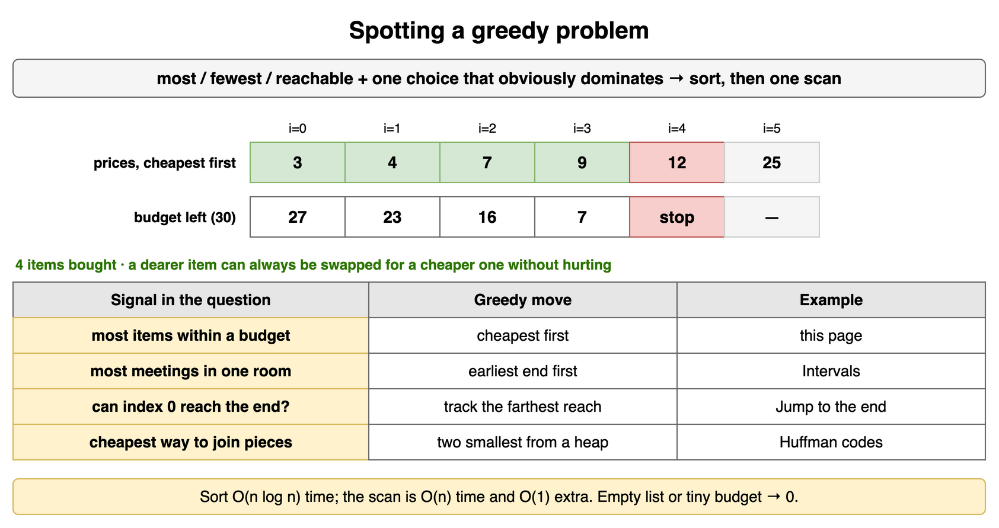

*Source: [`diagrams/greedy.drawio`](/content/11_Coding_Problems/24_Greedy/diagrams/greedy.drawio), page 1.*

## Greedy choice and optimal substructure

A greedy algorithm is correct when two properties hold. The greedy choice property says that some optimal solution starts with the choice greedy makes, so committing to it loses nothing. Optimal substructure says that after that choice, what is left is a smaller copy of the same problem whose best answer completes the best overall answer. DP needs the same optimal substructure ([Optimal substructure](#07_Data_Structures_and_Algorithms/08_Recursion_and_Dynamic_Programming/concepts/optimal-substructure)); the difference is that DP compares every choice through stored subproblems, while greedy commits to one and solves a single subproblem.

The example packs people into boats that carry at most two people and a weight limit. Sort by weight and look at the heaviest person. If even the lightest person cannot ride with them, they ride alone in every solution. Otherwise pairing them with the lightest is safe: in any optimal plan, swapping the lightest person into the heaviest person's boat keeps both boats under the limit. Either way the rest is the same problem on fewer people. Two pointers give O(n log n) for the sort and O(n) for the scan.

```python
def fewest_boats(weights: list[int], limit: int) -> int:
    weights = sorted(weights)
    light, heavy, boats = 0, len(weights) - 1, 0
    while light <= heavy:
        if weights[light] + weights[heavy] <= limit:
            light += 1
        heavy -= 1
        boats += 1
    return boats


print(fewest_boats([70, 50, 80, 50, 30, 60], 100))
print(fewest_boats([40, 40, 40], 100), fewest_boats([], 100))
# 4
# 2 0
```

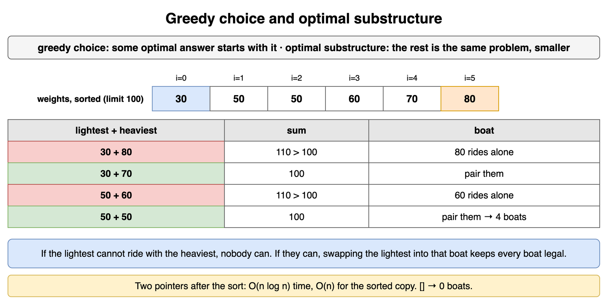

*Source: [`diagrams/greedy.drawio`](/content/11_Coding_Problems/24_Greedy/diagrams/greedy.drawio), page 2.*

## The exchange argument

The exchange argument is the most common way to prove a greedy rule. Take any optimal answer that differs from the greedy one. Find the first place they disagree and swap the optimal answer's choice for the greedy choice. Show that the swap keeps the answer valid and no worse. Repeating the swap turns the optimal answer into the greedy answer without losing quality, so greedy is optimal too. [Minimum intervals to remove](#11_Coding_Problems/17_Intervals/concepts/minimum-intervals-to-remove) uses this argument for earliest-end-first.

The example orders jobs on one machine to minimise the total time jobs spend waiting. Shortest job first is right: if a longer job runs directly before a shorter one, swapping them leaves every other job's wait the same and lowers the wait of the moved short job by more than it raises the long one's. With jobs 6, 2, 8, 3 the given order waits 30 in total and the sorted order waits 18, which matches a brute force over all 24 orders. The sort is O(n log n).

```python
from itertools import permutations


def total_wait(order: list[int]) -> int:
    waited, clock = 0, 0
    for duration in order:
        waited += clock
        clock += duration
    return waited


jobs = [6, 2, 8, 3]
print(total_wait(jobs), total_wait(sorted(jobs)))
print(min(total_wait(list(p)) for p in permutations(jobs)))
# 30 18
# 18
```

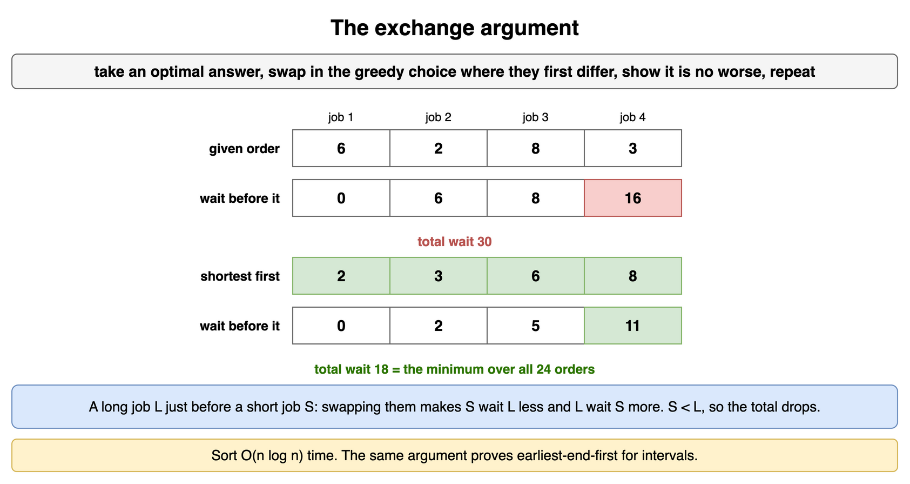

*Source: [`diagrams/greedy.drawio`](/content/11_Coding_Problems/24_Greedy/diagrams/greedy.drawio), page 3.*

## The stays-ahead argument

The second standard proof shows that greedy is never behind. Pick a measure of progress and prove by induction that after k steps greedy has made at least as much progress as any other valid strategy after k steps. If greedy is always at least level, no strategy can finish in fewer steps.

The example drives along a road with a tank that covers `tank` kilometres and fuel stations at known positions. Drive to the farthest station still in reach before refuelling. After k stops, greedy is at least as far down the road as any other plan after k stops, because from at least as far ahead it can reach every station the other plan reaches next. If no new station is in reach, the goal cannot be reached. Sorting costs O(n log n); the scan visits each station once, so it is O(n).

```python
def fewest_stops(stations: list[int], tank: int, goal: int) -> int:
    stations = sorted(stations)
    stops, position, i = 0, 0, 0
    while position + tank < goal:
        farthest = None
        while i < len(stations) and stations[i] <= position + tank:
            farthest = stations[i]
            i += 1
        if farthest is None:
            return -1
        position = farthest
        stops += 1
    return stops


print(fewest_stops([10, 25, 30, 45, 60, 75, 90], 30, 100))
print(fewest_stops([10, 50], 30, 100), fewest_stops([], 120, 100))
# 3
# -1 0
```

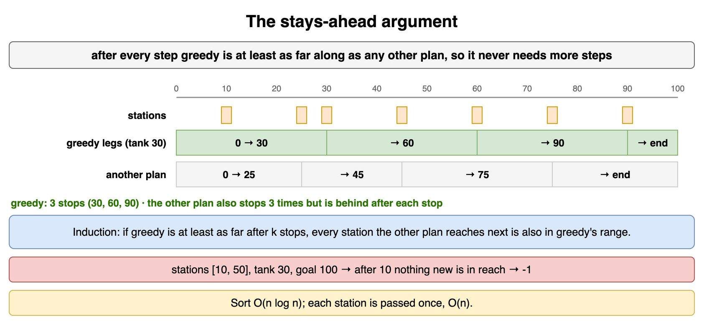

*Source: [`diagrams/greedy.drawio`](/content/11_Coding_Problems/24_Greedy/diagrams/greedy.drawio), page 4.*

## Fractional and 0/1 knapsack

Small wording changes decide whether greedy works. In the fractional knapsack, items can be cut, so filling the bag with the best value per kilogram first is optimal: any kilogram of a worse item can be exchanged for a kilogram of a better one. In the 0/1 knapsack, items are whole, and the same ratio rule can leave capacity unused that a different pair of items would have filled.

With a capacity of 24 and items worth 30 (weight 6), 48 (weight 12), and 48 (weight 12), the ratio rule takes the first two items for 78 and has no room for the third. Packing the two heavier items gives 96. The fractional version takes the first two and half of the third, for 102. Fractional greedy is O(n log n); 0/1 needs the DP on [0/1 knapsack](#11_Coding_Problems/23_Dynamic_Programming/concepts/0-1-knapsack), here checked by trying every subset.

```python
from itertools import combinations


def fractional(items: list[tuple[int, int]], capacity: int) -> float:
    total = 0.0
    for value, weight in sorted(items, key=lambda it: it[0] / it[1], reverse=True):
        take = min(weight, capacity)
        total += value * take / weight
        capacity -= take
    return total


def whole_by_ratio(items: list[tuple[int, int]], capacity: int) -> int:
    total = 0
    for value, weight in sorted(items, key=lambda it: it[0] / it[1], reverse=True):
        if weight <= capacity:
            total += value
            capacity -= weight
    return total


def whole_best(items: list[tuple[int, int]], capacity: int) -> int:
    return max(
        sum(v for v, _ in pick)
        for r in range(len(items) + 1)
        for pick in combinations(items, r)
        if sum(w for _, w in pick) <= capacity
    )


goods = [(30, 6), (48, 12), (48, 12)]
print(fractional(goods, 24), whole_by_ratio(goods, 24), whole_best(goods, 24))
# 102.0 78 96
```

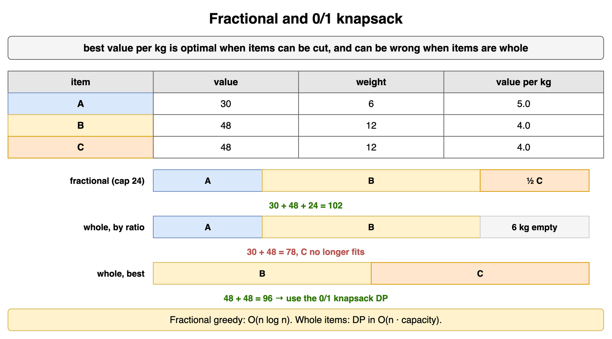

*Source: [`diagrams/greedy.drawio`](/content/11_Coding_Problems/24_Greedy/diagrams/greedy.drawio), page 5.*

## Greedy or dynamic programming

Paying an amount with the fewest coins shows the line between the two. Taking the largest coin that fits is optimal for coin systems called canonical, such as euro cents (1, 2, 5, 10, 20, 50, 100, 200) or US cents (1, 5, 10, 25); cashiers make change this way. For other systems it fails: with coins 1, 4, 5 and amount 8, greedy pays 5 + 1 + 1 + 1 while 4 + 4 needs two coins. The safe general method is the DP on [Fewest coins for a target](#11_Coding_Problems/23_Dynamic_Programming/concepts/fewest-coins-for-a-target), and the "Greedy trap" drill on [Recursion and Dynamic Programming](#07_Data_Structures_and_Algorithms/08_Recursion_and_Dynamic_Programming) works another example.

Whether a coin system is canonical can be tested rather than guessed. A known result says that if greedy ever fails, it fails below the sum of the two largest coins, so comparing greedy with the DP up to that bound settles it in O(bound · coins) time. Greedy commits to one coin and runs in O(coins) per amount; DP compares every last coin and is always right.

```python
def greedy_count(coins: list[int], amount: int) -> int:
    used = 0
    for coin in sorted(coins, reverse=True):
        used += amount // coin
        amount %= coin
    return used


def first_failure(coins: list[int]) -> tuple[int, int, int] | None:
    top = sorted(coins)[-2:]
    best = [0] + [0] * sum(top)
    for a in range(1, len(best)):
        best[a] = 1 + min(best[a - c] for c in coins if c <= a)
        if greedy_count(coins, a) != best[a]:
            return a, greedy_count(coins, a), best[a]
    return None


print(first_failure([1, 4, 5]))
print(first_failure([1, 2, 5, 10, 20, 50, 100, 200]), first_failure([1, 5, 10, 25]))
# (8, 4, 2)
# None None
```

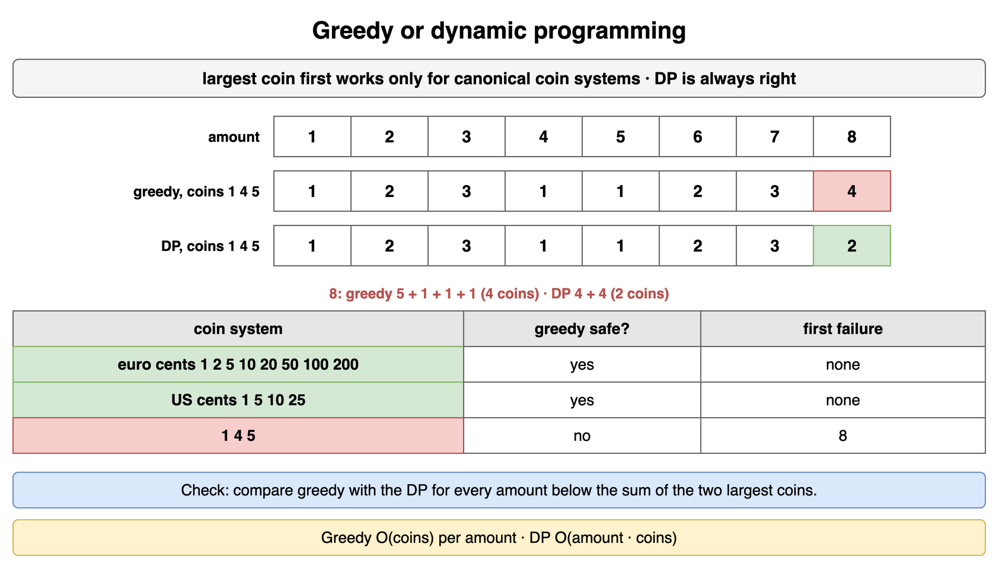

*Source: [`diagrams/greedy.drawio`](/content/11_Coding_Problems/24_Greedy/diagrams/greedy.drawio), page 6.*

## Common greedy moves

There is no single greedy template, but a few moves come up again and again. Sort by end time to fit the most intervals ([Minimum arrows](#11_Coding_Problems/17_Intervals/concepts/minimum-arrows)). Sort by deadline to keep the worst lateness low. Run the shortest job first to keep total waiting low. Track the farthest reach for jump and coverage questions. Pair the extremes with two pointers. Run two passes when a rule looks at both neighbours. Keep a heap when the cheapest or largest item must be picked again after every step ([Heaps](#11_Coding_Problems/16_Heaps)).

The sort key is the whole algorithm, so name it and say why it is safe. The example schedules tasks with a duration and a deadline on one machine and minimises the largest lateness (finish time minus deadline, or 0 if on time). Earliest deadline first is optimal by an exchange: two adjacent tasks out of deadline order can be swapped without raising the worse lateness. Brute force over all orders agrees. The cost is O(n log n).

```python
from itertools import permutations


def worst_lateness(tasks: list[tuple[int, int]]) -> int:
    clock, worst = 0, 0
    for duration, deadline in tasks:
        clock += duration
        worst = max(worst, clock - deadline)
    return worst


tasks = [(4, 4), (2, 3), (3, 5)]
by_deadline = sorted(tasks, key=lambda t: t[1])
print(by_deadline, worst_lateness(by_deadline))
print(min(worst_lateness(list(p)) for p in permutations(tasks)))
# [(2, 3), (4, 4), (3, 5)] 4
# 4
```

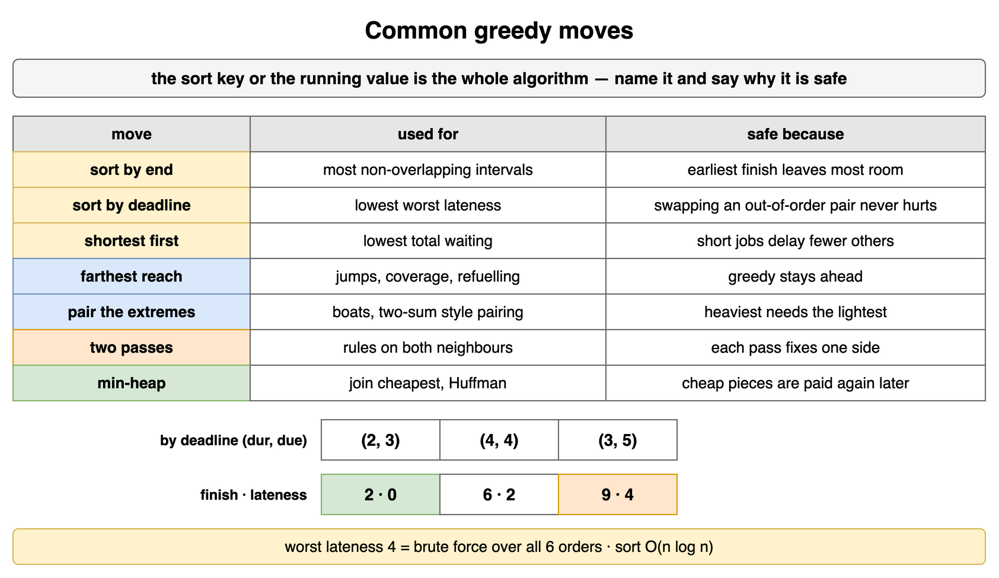

*Source: [`diagrams/greedy.drawio`](/content/11_Coding_Problems/24_Greedy/diagrams/greedy.drawio), page 7.*

## Merging the cheapest pair first

Some greedy problems need the best choice again after every step, and the set of candidates changes as choices are made. Joining ropes is the standard one: joining two ropes costs their total length, and the goal is the cheapest way to join them all into one. Always join the two shortest ropes. A rope that is joined early is paid for again in every later join, so the shortest lengths should be joined first. A min-heap gives the two shortest in O(log n), so the whole job is O(n log n).

The same rule builds Huffman codes, which compress data inside DEFLATE (gzip, zlib, PNG). Join the two rarest symbols into one node, repeat, and each symbol's depth in the final tree is its code length, so common symbols get short codes. With frequencies e 30, t 20, s 15, x 5, q 2 the code uses 143 bits instead of 216 for a fixed 3-bit code. Ties can produce different trees with the same total length.

```python
import heapq


def join_cost(lengths: list[int]) -> int:
    heap = list(lengths)
    heapq.heapify(heap)
    cost = 0
    while len(heap) > 1:
        joined = heapq.heappop(heap) + heapq.heappop(heap)
        cost += joined
        heapq.heappush(heap, joined)
    return cost


def code_lengths(freq: dict[str, int]) -> dict[str, int]:
    heap = [(f, i, {ch: 0}) for i, (ch, f) in enumerate(freq.items())]
    heapq.heapify(heap)
    tie = len(heap)
    while len(heap) > 1:
        f1, _, left = heapq.heappop(heap)
        f2, _, right = heapq.heappop(heap)
        merged = {ch: depth + 1 for ch, depth in {**left, **right}.items()}
        heapq.heappush(heap, (f1 + f2, tie, merged))
        tie += 1
    return heap[0][2]


print(join_cost([4, 3, 2, 6]), join_cost([5]))
freq = {"e": 30, "t": 20, "s": 15, "x": 5, "q": 2}
depths = code_lengths(freq)
print(depths, sum(freq[ch] * depths[ch] for ch in freq))
# 29 0
# {'e': 1, 't': 2, 'q': 4, 'x': 4, 's': 3} 143
```

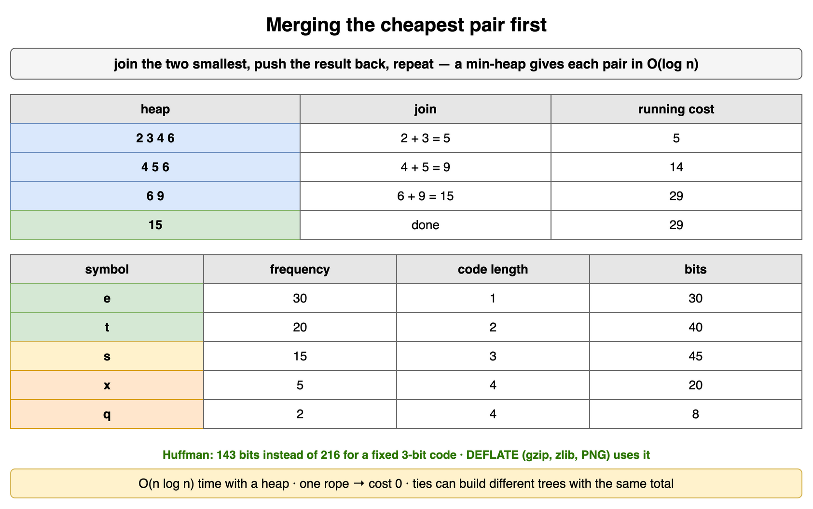

*Source: [`diagrams/greedy.drawio`](/content/11_Coding_Problems/24_Greedy/diagrams/greedy.drawio), page 8.*

## Jump to the end

Each entry `jumps[i]` is the longest jump allowed from index i; can index 0 reach the last index? A DP that marks every index reachable from each earlier one is O(n²). Greedy needs one pass. Scanning right to left, keep `target`, the leftmost index known to reach the end; index i can reach it if `i + jumps[i] >= target`, and then i becomes the new target. The answer is whether the target ends at 0. Scanning left to right instead, keep the farthest index reached so far and fail as soon as the scan passes it.

Both are O(n) time and O(1) space. A zero is only a problem if nothing before it jumps past it: in `[3, 0, 2, 0, 1, 0]` index 0 clears the first zero and index 2 clears the second. The last index needs no jump, so a one-element list is reachable, and the last value is never read. Counting routes instead of asking yes/no needs DP, as on [DP, greedy, or backtracking](#11_Coding_Problems/23_Dynamic_Programming/concepts/dp-greedy-or-backtracking).

```python
def reaches_end(jumps: list[int]) -> bool:
    target = len(jumps) - 1
    for i in range(len(jumps) - 2, -1, -1):
        if i + jumps[i] >= target:
            target = i
    return target == 0


def reaches_end_forward(jumps: list[int]) -> bool:
    farthest = 0
    for i, j in enumerate(jumps):
        if i > farthest:
            return False
        farthest = max(farthest, i + j)
    return True


for row in ([3, 0, 2, 0, 1, 0], [2, 1, 0, 3], [0]):
    print(reaches_end(row), reaches_end_forward(row))
# True True
# False False
# True True
```

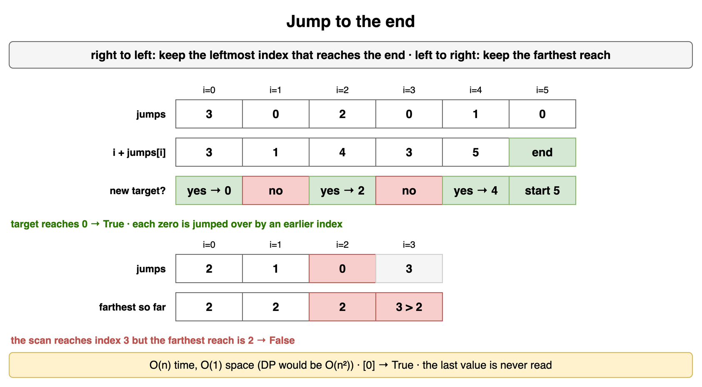

*Source: [`diagrams/greedy.drawio`](/content/11_Coding_Problems/24_Greedy/diagrams/greedy.drawio), page 9.*

## Gas stations around a loop

Stations sit on a circular road. Station i gives `gas[i]` and driving on to station i + 1 costs `cost[i]`. Starting with an empty tank, from which station can the car drive the whole loop? Return -1 if none can; when an answer exists it is unique. Simulating from every start is O(n²). First, if total gas is below total cost, no start works. Otherwise scan once with a running tank; when the tank goes negative at station i, restart at i + 1 with an empty tank.

Skipping all those stations at once is safe. Every station between the old start and i was reached with a tank of zero or more, so starting there with an empty tank only has less fuel and would fail at i too. Once the total check passes, the last restart point is the answer: the scan shows it reaches the end of the array, and the fuel left over covers the deficit of the stations before it. The scan is O(n) time and O(1) space; the brute-force simulation below checks it.

```python
def loop_start(gas: list[int], cost: list[int]) -> int:
    if sum(gas) < sum(cost):
        return -1
    start, tank = 0, 0
    for i in range(len(gas)):
        tank += gas[i] - cost[i]
        if tank < 0:
            start, tank = i + 1, 0
    return start


def completes(gas: list[int], cost: list[int], start: int) -> bool:
    tank, n = 0, len(gas)
    for k in range(n):
        i = (start + k) % n
        tank += gas[i] - cost[i]
        if tank < 0:
            return False
    return True


gas, cost = [4, 1, 5, 2, 3], [3, 4, 1, 3, 3]
print(loop_start(gas, cost), [s for s in range(5) if completes(gas, cost, s)])
print(loop_start([1, 2], [2, 2]))
# 2 [2]
# -1
```

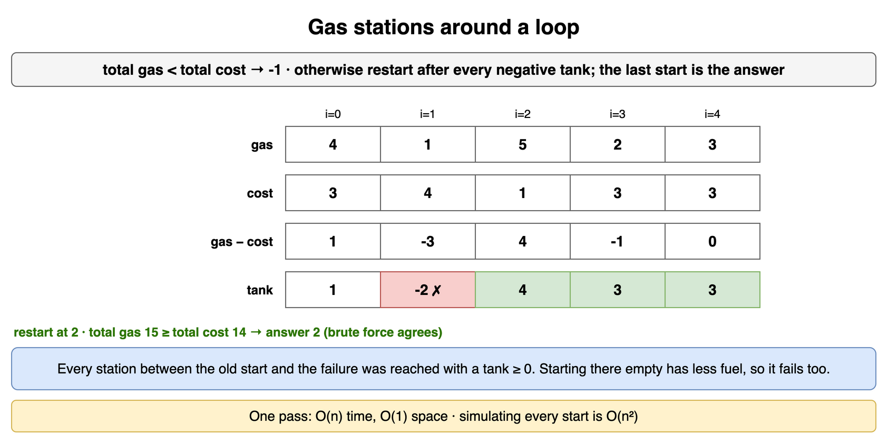

*Source: [`diagrams/greedy.drawio`](/content/11_Coding_Problems/24_Greedy/diagrams/greedy.drawio), page 10.*

## Candies by rating

Children stand in a row with ratings. Every child gets at least one candy, and a child rated higher than a neighbour must get more than that neighbour. What is the fewest total? Each child has two constraints, one per side, and one pass can only satisfy one direction. Left to right, give `candies[i] = candies[i - 1] + 1` when the rating rises, else 1; this fixes every left constraint. Right to left, when `ratings[i] > ratings[i + 1]`, raise `candies[i]` to `max(candies[i], candies[i + 1] + 1)`.

The `max` matters: overwriting would break the left constraint set in the first pass, as at a peak. Equal neighbours impose nothing, so a child next to an equal rating can drop back to 1. Each pass gives every child the least it needs on that side, so the result is the smallest valid total. The cost is O(n) time and O(n) space.

```python
def fewest_candies(ratings: list[int]) -> list[int]:
    candies = [1] * len(ratings)
    for i in range(1, len(ratings)):
        if ratings[i] > ratings[i - 1]:
            candies[i] = candies[i - 1] + 1
    for i in range(len(ratings) - 2, -1, -1):
        if ratings[i] > ratings[i + 1]:
            candies[i] = max(candies[i], candies[i + 1] + 1)
    return candies


given = fewest_candies([3, 6, 6, 2, 1, 5])
print(given, sum(given))
print(sum(fewest_candies([5, 4, 3, 2, 1])), sum(fewest_candies([2, 2, 2])))
# [1, 2, 3, 2, 1, 2] 11
# 15 3
```

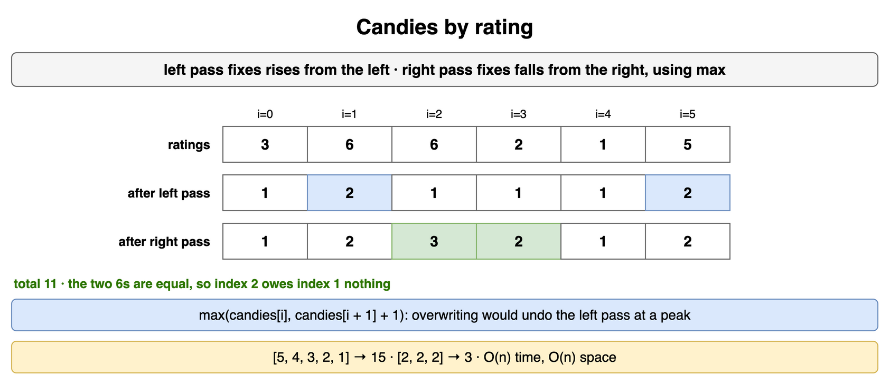

*Source: [`diagrams/greedy.drawio`](/content/11_Coding_Problems/24_Greedy/diagrams/greedy.drawio), page 11.*

## Greedy in an interview

Greedy answers are short, which makes them easy to get wrong with confidence. Work in three steps. State the rule in one sentence ("sort by end time, keep anything that starts after the last kept end"). Try to break it on small inputs: ties, one element, all equal, a long item next to short ones. Then give the reason it works, an exchange or a stays-ahead argument, before coding. If a formal proof will not come, a few well-chosen examples that probe the risky cases are an honest substitute, and say so.

A brute-force stress test settles doubt quickly. The example compares two rules for keeping the most non-overlapping meetings against trying every subset on random small inputs. Shortest meeting first sounds reasonable but breaks within a few trials; earliest end first never disagrees. Brute force is O(2^n · n), fine for n up to about 10. The same harness checks any greedy against any slow but correct solution.

```python
import random
from itertools import combinations


def fits(chosen: list[tuple[int, int]]) -> bool:
    chosen = sorted(chosen)
    return all(a[1] <= b[0] for a, b in zip(chosen, chosen[1:]))


def most_by(meetings: list[tuple[int, int]], key) -> int:
    kept: list[tuple[int, int]] = []
    for m in sorted(meetings, key=key):
        if fits(kept + [m]):
            kept.append(m)
    return len(kept)


def most_brute(meetings: list[tuple[int, int]]) -> int:
    return max(r for r in range(len(meetings) + 1)
               for pick in combinations(meetings, r) if fits(list(pick)))


rng = random.Random(3)
shortest_fails = end_fails = 0
for _ in range(300):
    meetings = [(s, s + rng.randint(1, 4)) for s in (rng.randint(0, 8) for _ in range(5))]
    best = most_brute(meetings)
    shortest_fails += most_by(meetings, lambda m: m[1] - m[0]) != best
    end_fails += most_by(meetings, lambda m: m[1]) != best
print(shortest_fails > 0, end_fails)
print(most_by([(0, 4), (3, 5), (4, 8)], lambda m: m[1] - m[0]), most_brute([(0, 4), (3, 5), (4, 8)]))
# True 0
# 1 2
```

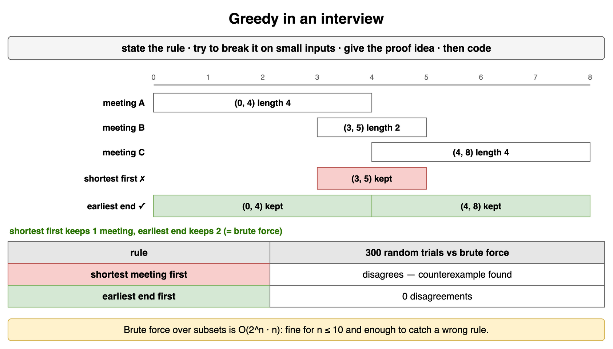

*Source: [`diagrams/greedy.drawio`](/content/11_Coding_Problems/24_Greedy/diagrams/greedy.drawio), page 12.*
