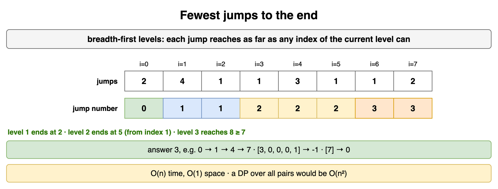
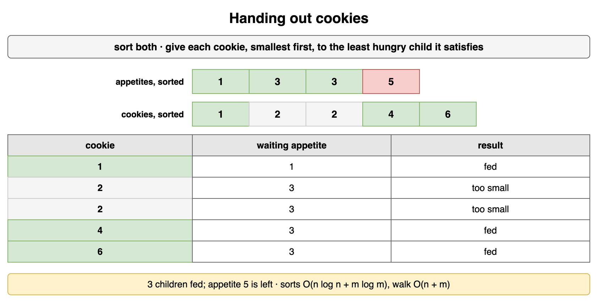
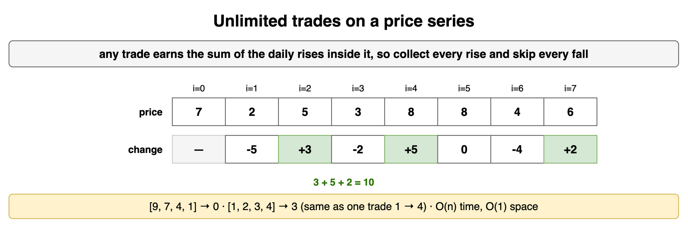
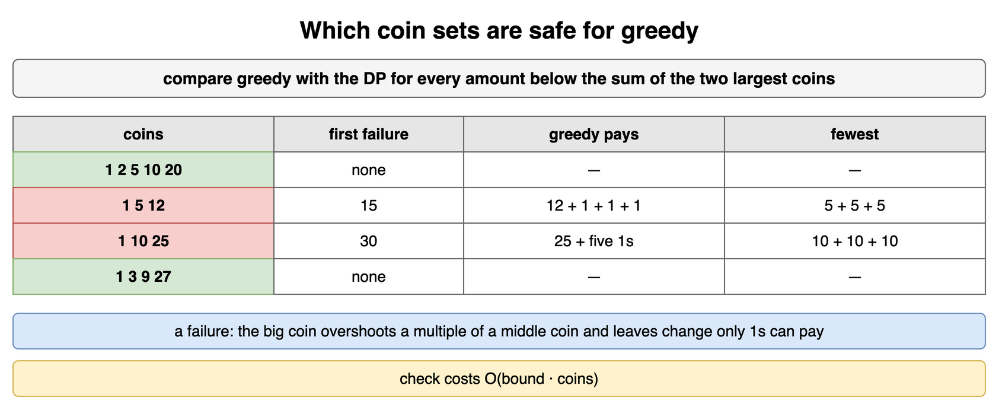
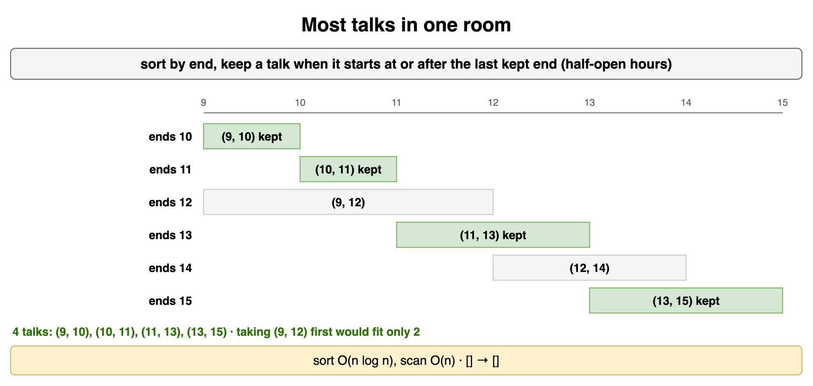
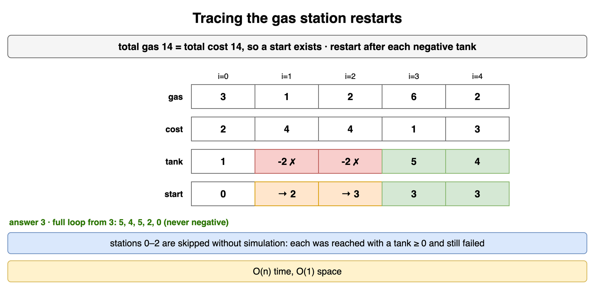
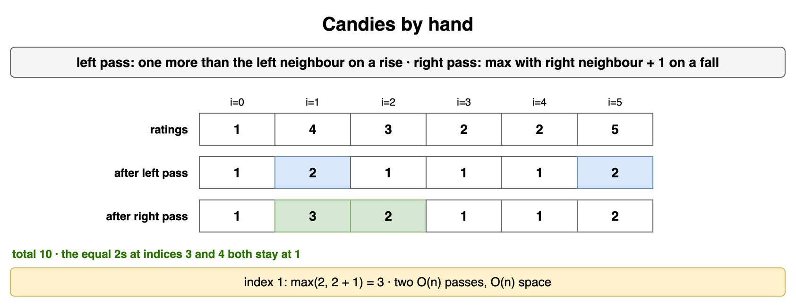
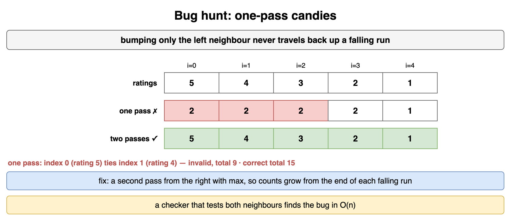
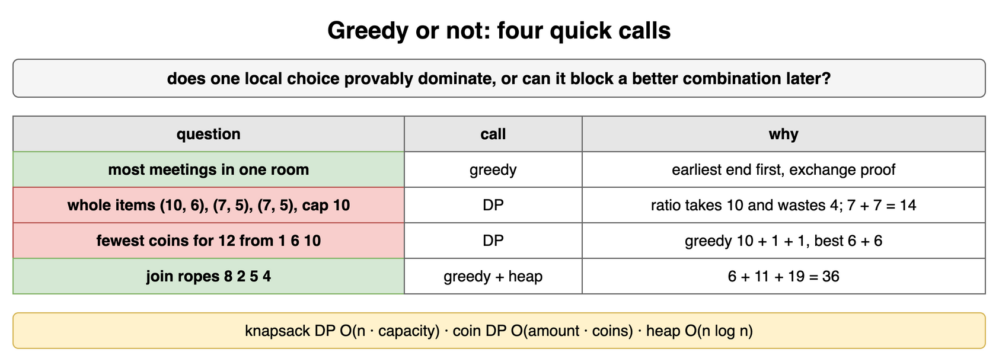

# Greedy — Drills

Original drills for fewest jumps, handing out cookies, unlimited trades, safe coin systems, talks in one room, a gas station trace, candies by hand, a one-pass candies bug, and choosing greedy or not. Each answer names the rule, why it is safe, the cost, and Python. The numbers are exercise values.

## Fewest jumps to the end

Each entry is the longest jump allowed from that index. With `jumps = [2, 4, 1, 1, 3, 1, 1, 2]`, what is the fewest number of jumps from index 0 to the last index? Assume the end is reachable unless the scan proves otherwise.

**Answer:** 3, for example 0 → 1 → 4 → 7. Treat the indices like breadth-first levels: the first jump reaches indices 1 to 2, the second reaches up to the farthest index any of those can reach (5), and the third reaches 8, past the end. Scan left to right, keep `farthest` (the best reach from the current level) and `level_end` (the last index of the current level). When i reaches `level_end`, one more jump is needed and the next level ends at `farthest`; if `farthest` has not moved past i, the end is unreachable. It is O(n) time and O(1) space, against O(n²) for a DP over every pair. The yes/no version is [Jump to the end](#11_Coding_Problems/24_Greedy/concepts/jump-to-the-end).

```python
def fewest_jumps(jumps: list[int]) -> int:
    count, level_end, farthest = 0, 0, 0
    for i in range(len(jumps) - 1):
        farthest = max(farthest, i + jumps[i])
        if i == level_end:
            if farthest <= i:
                return -1
            count += 1
            level_end = farthest
    return count


print(fewest_jumps([2, 4, 1, 1, 3, 1, 1, 2]))
print(fewest_jumps([1, 1, 1, 1]), fewest_jumps([3, 0, 0, 0, 1]), fewest_jumps([7]))
# 3
# 3 -1 0
```



*Source: [`diagrams/greedy-drills.drawio`](/content/11_Coding_Problems/24_Greedy/diagrams/greedy-drills.drawio), page 1.*

## Handing out cookies

Each child needs a cookie at least as large as their appetite, and each child gets at most one cookie. Appetites are `[1, 3, 3, 5]` and cookie sizes are `[2, 2, 4, 6, 1]`. How many children can be satisfied, and which rule finds the maximum?

**Answer:** 3. Sort both lists and walk them with two pointers: give each cookie, smallest first, to the child with the smallest unmet appetite if it is big enough, otherwise discard that cookie. The size-1 cookie feeds appetite 1, the size-2 cookies are too small for appetite 3, size 4 and size 6 feed the two appetite-3 children, and appetite 5 is left over. Using the smallest cookie that works keeps the bigger ones for hungrier children, which is an exchange argument ([The exchange argument](#11_Coding_Problems/24_Greedy/concepts/the-exchange-argument)). Sorting is O(n log n + m log m); the walk is O(n + m).

```python
def fed_children(appetites: list[int], cookies: list[int]) -> int:
    appetites, cookies = sorted(appetites), sorted(cookies)
    child = 0
    for size in cookies:
        if child < len(appetites) and size >= appetites[child]:
            child += 1
    return child


print(fed_children([1, 3, 3, 5], [2, 2, 4, 6, 1]))
print(fed_children([4, 4], [1, 2, 3]), fed_children([1, 1], [9, 9, 9]))
# 3
# 0 2
```



*Source: [`diagrams/greedy-drills.drawio`](/content/11_Coding_Problems/24_Greedy/diagrams/greedy-drills.drawio), page 2.*

## Unlimited trades on a price series

A share's daily prices are `[7, 2, 5, 3, 8, 8, 4, 6]`. You may buy and sell as often as you like but hold at most one share at a time. What is the largest total profit?

**Answer:** 10. Add up every rise from one day to the next: 2 → 5 gives 3, 3 → 8 gives 5, 4 → 6 gives 2. Any longer trade from a low day to a high day earns exactly the sum of the daily rises inside it, and skipping the falling days can only help, so collecting every positive difference is optimal. Flat days add nothing. It is O(n) time and O(1) space. With a single trade allowed the greedy no longer works this way; that version tracks the lowest price so far. The pattern of committing to each local gain is [Spotting a greedy problem](#11_Coding_Problems/24_Greedy/concepts/spotting-a-greedy-problem).

```python
def all_rises(prices: list[int]) -> int:
    return sum(max(0, b - a) for a, b in zip(prices, prices[1:]))


print(all_rises([7, 2, 5, 3, 8, 8, 4, 6]))
print(all_rises([9, 7, 4, 1]), all_rises([1, 2, 3, 4]), all_rises([5]))
# 10
# 0 3 0
```



*Source: [`diagrams/greedy-drills.drawio`](/content/11_Coding_Problems/24_Greedy/diagrams/greedy-drills.drawio), page 3.*

## Which coin sets are safe for greedy

For each coin set, does "largest coin that fits" always give the fewest coins? If not, give the smallest amount where it fails: `{1, 2, 5, 10, 20}`, `{1, 5, 12}`, `{1, 10, 25}`, `{1, 3, 9, 27}`.

**Answer:** `{1, 2, 5, 10, 20}` and `{1, 3, 9, 27}` are safe. `{1, 5, 12}` fails at 15: greedy pays 12 + 1 + 1 + 1 (4 coins), while 5 + 5 + 5 needs 3. `{1, 10, 25}` fails at 30: greedy pays 25 + five 1s (6 coins), while 10 + 10 + 10 needs 3. The pattern of a failure is a large coin that overshoots a multiple of a middle coin. To check a set, compare greedy with the DP for every amount up to the sum of the two largest coins, as on [Greedy or dynamic programming](#11_Coding_Problems/24_Greedy/concepts/greedy-or-dynamic-programming); that is O(bound · coins).

```python
def greedy_count(coins: list[int], amount: int) -> int:
    used = 0
    for coin in sorted(coins, reverse=True):
        used += amount // coin
        amount %= coin
    return used


def first_failure(coins: list[int]) -> tuple[int, int, int] | None:
    top = sorted(coins)[-2:]
    best = [0] + [0] * sum(top)
    for a in range(1, len(best)):
        best[a] = 1 + min(best[a - c] for c in coins if c <= a)
        if greedy_count(coins, a) != best[a]:
            return a, greedy_count(coins, a), best[a]
    return None


for coins in ([1, 2, 5, 10, 20], [1, 5, 12], [1, 10, 25], [1, 3, 9, 27]):
    print(coins, first_failure(coins))
# [1, 2, 5, 10, 20] None
# [1, 5, 12] (15, 4, 3)
# [1, 10, 25] (30, 6, 3)
# [1, 3, 9, 27] None
```



*Source: [`diagrams/greedy-drills.drawio`](/content/11_Coding_Problems/24_Greedy/diagrams/greedy-drills.drawio), page 4.*

## Most talks in one room

A conference room can host one talk at a time. Talks run over half-open hours: `(9, 12)`, `(10, 11)`, `(11, 13)`, `(12, 14)`, `(13, 15)`, `(9, 10)`. How many talks fit at most, and which ones?

**Answer:** 4: `(9, 10)`, `(10, 11)`, `(11, 13)`, `(13, 15)`. Sort by end time and keep a talk when it starts at or after the last kept end. The earliest finish leaves the most room for everything after it, which is the exchange argument on [Minimum intervals to remove](#11_Coding_Problems/17_Intervals/concepts/minimum-intervals-to-remove). Any rule that commits to the long `(9, 12)` talk first fits only 2, because it blocks the three talks that end by 13. Half-open hours let a talk start when the previous one ends. The sort is O(n log n) and the scan O(n). See also [Greedy choice](#07_Data_Structures_and_Algorithms/11_Problem_Solving_Patterns/concepts/greedy-choice).

```python
def most_talks(talks: list[tuple[int, int]]) -> list[tuple[int, int]]:
    kept: list[tuple[int, int]] = []
    for start, end in sorted(talks, key=lambda t: t[1]):
        if not kept or start >= kept[-1][1]:
            kept.append((start, end))
    return kept


talks = [(9, 12), (10, 11), (11, 13), (12, 14), (13, 15), (9, 10)]
print(most_talks(talks))
print(len(most_talks([(1, 5), (2, 3), (3, 4)])), most_talks([]))
# [(9, 10), (10, 11), (11, 13), (13, 15)]
# 2 []
```



*Source: [`diagrams/greedy-drills.drawio`](/content/11_Coding_Problems/24_Greedy/diagrams/greedy-drills.drawio), page 5.*

## Tracing the gas station restarts

Around a loop, `gas = [3, 1, 2, 6, 2]` and `cost = [2, 4, 4, 1, 3]`. Trace the one-pass scan: where does the tank go negative, where does the start move, and which station is the answer?

**Answer:** Station 3. Total gas and total cost are both 14, so a start exists. The tank after each station is 1, then 1 + 1 - 4 = -2 at station 1, so the start moves to 2 with an empty tank; station 2 gives 2 - 4 = -2 again, so the start moves to 3. From there the tank reads 5 and 4 to the end of the array. Starting at 3 the full loop reads 5, 4, 5, 2, 0, never negative. Stations 0 to 2 are skipped without being simulated, because each was reached with a non-negative tank and still failed. The scan is O(n) time and O(1) space ([Gas stations around a loop](#11_Coding_Problems/24_Greedy/concepts/gas-stations-around-a-loop)).

```python
def trace_start(gas: list[int], cost: list[int]) -> int:
    if sum(gas) < sum(cost):
        return -1
    start, tank = 0, 0
    for i in range(len(gas)):
        tank += gas[i] - cost[i]
        print(i, tank, *(["restart"] if tank < 0 else []))
        if tank < 0:
            start, tank = i + 1, 0
    return start


print(trace_start([3, 1, 2, 6, 2], [2, 4, 4, 1, 3]))
# 0 1
# 1 -2 restart
# 2 -2 restart
# 3 5
# 4 4
# 3
```



*Source: [`diagrams/greedy-drills.drawio`](/content/11_Coding_Problems/24_Greedy/diagrams/greedy-drills.drawio), page 6.*

## Candies by hand

Ratings are `[1, 4, 3, 2, 2, 5]`. Write out both passes of the two-pass candy rule and give the total.

**Answer:** 10. Left to right gives `[1, 2, 1, 1, 1, 2]`: only the rises at index 1 (1 → 4) and index 5 (2 → 5) get one more than their left neighbour. Right to left, index 2 (3 > 2) becomes 2 and index 1 (4 > 3) becomes `max(2, 2 + 1) = 3`; the two equal 2s at indices 3 and 4 constrain nothing, so both stay at 1. The result is `[1, 3, 2, 1, 1, 2]`. Two O(n) passes and one O(n) array; see [Candies by rating](#11_Coding_Problems/24_Greedy/concepts/candies-by-rating).

```python
def candy_passes(ratings: list[int]) -> tuple[list[int], list[int]]:
    candies = [1] * len(ratings)
    for i in range(1, len(ratings)):
        if ratings[i] > ratings[i - 1]:
            candies[i] = candies[i - 1] + 1
    after_left = candies[:]
    for i in range(len(ratings) - 2, -1, -1):
        if ratings[i] > ratings[i + 1]:
            candies[i] = max(candies[i], candies[i + 1] + 1)
    return after_left, candies


left, final = candy_passes([1, 4, 3, 2, 2, 5])
print(left)
print(final, sum(final))
# [1, 2, 1, 1, 1, 2]
# [1, 3, 2, 1, 1, 2] 10
```



*Source: [`diagrams/greedy-drills.drawio`](/content/11_Coding_Problems/24_Greedy/diagrams/greedy-drills.drawio), page 7.*

## Bug hunt: one-pass candies

This version tries to do the candy rule in one left-to-right pass: on a rise it adds one, and on a drop it bumps the left neighbour instead. Find an input where it breaks the rules, and explain the fix.

```python
def one_pass(ratings: list[int]) -> list[int]:
    candies = [1] * len(ratings)
    for i in range(1, len(ratings)):
        if ratings[i] > ratings[i - 1]:
            candies[i] = candies[i - 1] + 1
        elif ratings[i] < ratings[i - 1]:
            candies[i - 1] = max(candies[i - 1], candies[i] + 1)
    return candies
```

**Answer:** Any falling run of three or more, such as `[5, 4, 3, 2, 1]`, which gets `[2, 2, 2, 2, 1]`. Bumping index i - 1 never travels further back, so index 0 (rating 5) ends up equal to index 1 (rating 4). A falling run needs counts that grow from its right end, and the right end is only known after the run is over. The fix is the second pass from the right with `max`, as on [Candies by rating](#11_Coding_Problems/24_Greedy/concepts/candies-by-rating); the correct answer here is `[5, 4, 3, 2, 1]`, total 15. A checker that tests both neighbours catches the bug in O(n).

```python
def one_pass(ratings: list[int]) -> list[int]:
    candies = [1] * len(ratings)
    for i in range(1, len(ratings)):
        if ratings[i] > ratings[i - 1]:
            candies[i] = candies[i - 1] + 1
        elif ratings[i] < ratings[i - 1]:
            candies[i - 1] = max(candies[i - 1], candies[i] + 1)
    return candies


def two_pass(ratings: list[int]) -> list[int]:
    candies = [1] * len(ratings)
    for i in range(1, len(ratings)):
        if ratings[i] > ratings[i - 1]:
            candies[i] = candies[i - 1] + 1
    for i in range(len(ratings) - 2, -1, -1):
        if ratings[i] > ratings[i + 1]:
            candies[i] = max(candies[i], candies[i + 1] + 1)
    return candies


def valid(ratings: list[int], candies: list[int]) -> bool:
    return all(
        (ratings[i] <= ratings[i + 1] or candies[i] > candies[i + 1])
        and (ratings[i] >= ratings[i + 1] or candies[i] < candies[i + 1])
        for i in range(len(ratings) - 1)
    )


falling = [5, 4, 3, 2, 1]
print(one_pass(falling), valid(falling, one_pass(falling)))
print(two_pass(falling), valid(falling, two_pass(falling)))
# [2, 2, 2, 2, 1] False
# [5, 4, 3, 2, 1] True
```



*Source: [`diagrams/greedy-drills.drawio`](/content/11_Coding_Problems/24_Greedy/diagrams/greedy-drills.drawio), page 8.*

## Greedy or not: four quick calls

For each question, say whether a greedy rule is safe or DP is needed: (a) the most meetings that fit in one room; (b) the most value from whole items in a bag of capacity 10, with items (value 10, weight 6), (7, 5), (7, 5); (c) the fewest coins making 12 from `{1, 6, 10}`; (d) the cheapest way to join ropes of lengths 8, 2, 5, 4.

**Answer:** (a) Greedy: earliest end first, proved by exchange. (b) DP: the best value per unit of weight is the 10-value item, but after taking it only 4 units are left and nothing else fits, for 10; the two 7s fill the bag exactly for 14. Whole items need the knapsack DP ([Fractional and 0/1 knapsack](#11_Coding_Problems/24_Greedy/concepts/fractional-and-0-1-knapsack)). (c) DP: greedy pays 10 + 1 + 1 (3 coins) but 6 + 6 needs 2. (d) Greedy with a min-heap: join the two shortest each time for a cost of 6 + 11 + 19 = 36 ([Merging the cheapest pair first](#11_Coding_Problems/24_Greedy/concepts/merging-the-cheapest-pair-first)). The test for each: does one local choice provably dominate, or can it block a better combination later?

```python
import heapq


def knapsack(items: list[tuple[int, int]], capacity: int) -> int:
    best = [0] * (capacity + 1)
    for value, weight in items:
        for c in range(capacity, weight - 1, -1):
            best[c] = max(best[c], best[c - weight] + value)
    return best[capacity]


def fewest_coins(coins: list[int], amount: int) -> int:
    best = [0] + [amount + 1] * amount
    for a in range(1, amount + 1):
        best[a] = 1 + min(best[a - c] for c in coins if c <= a)
    return best[amount]


def join_cost(lengths: list[int]) -> int:
    heap, cost = list(lengths), 0
    heapq.heapify(heap)
    while len(heap) > 1:
        joined = heapq.heappop(heap) + heapq.heappop(heap)
        cost += joined
        heapq.heappush(heap, joined)
    return cost


print(knapsack([(10, 6), (7, 5), (7, 5)], 10))
print(fewest_coins([1, 6, 10], 12), join_cost([8, 2, 5, 4]))
# 14
# 2 36
```



*Source: [`diagrams/greedy-drills.drawio`](/content/11_Coding_Problems/24_Greedy/diagrams/greedy-drills.drawio), page 9.*
