## Sorting as a first step

Many problems get easy once the input is in order. After a sort, equal values sit next to each other, the closest pair of values is always a neighbouring pair, and a two-pointer or single scan replaces a nested loop. The sort costs O(n log n) and usually dominates, so the whole solution is O(n log n) time with O(1) to O(n) extra space depending on whether the sort runs in place. The algorithms themselves are taught in [Sorting and Searching](#07_Data_Structures_and_Algorithms/09_Sorting_and_Searching); this topic is the problem set.

Sort first when the answer depends on relative order rather than original positions: closest values, duplicates, meeting rooms, pairing extremes. Do not sort when the question needs the original indices (keep `(value, index)` pairs instead), when a hash map answers in O(n), or when the input is already sorted. The example finds the smallest gap between any two readings. Without sorting it compares every pair in O(n²); sorted, only neighbours need checking. Fewer than two values have no gap, and a duplicate gives 0.

```python
def smallest_gap(readings: list[int]) -> int | None:
    ordered = sorted(readings)
    if len(ordered) < 2:
        return None
    return min(b - a for a, b in zip(ordered, ordered[1:]))


print(smallest_gap([31, 4, 18, 9, 27, 20]))
print(smallest_gap([5, 12, 5]), smallest_gap([8]))
# 2
# 0 None
```

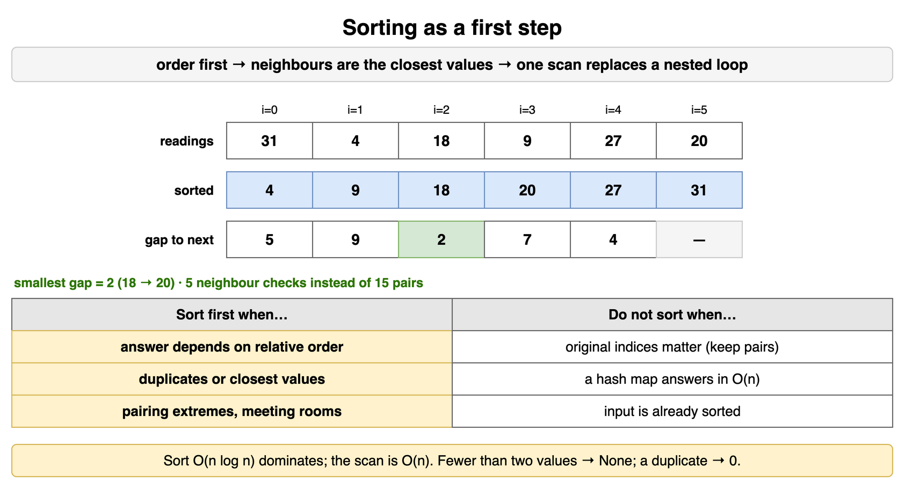

*Source: [`diagrams/sort-and-search.drawio`](/content/11_Coding_Problems/25_Sort_and_Search/diagrams/sort-and-search.drawio), page 1.*

## Picking a sort by the constraints

Interview questions rarely ask "which sort is fastest"; they add a constraint that picks the sort for you. Stability (equal keys keep their input order) matters when you sort by one key after another, see [Stability](#07_Data_Structures_and_Algorithms/09_Sorting_and_Searching/concepts/stability). In place with little extra memory points to quicksort or heap sort. A linked list has no random access, so merge sort wins. Small non-negative integers point to counting sort. Mostly sorted data favours insertion sort or Timsort, which finds existing runs.

Real libraries follow the same rules. Python's `sorted` and `list.sort` use Timsort, which is stable, so a sort by name followed by a sort by team leaves each team in name order. Java sorts object arrays with a stable Timsort but primitive arrays with dual-pivot quicksort, because equal primitives cannot be told apart and stability buys nothing. The full table is on [Sorting algorithm comparison](#07_Data_Structures_and_Algorithms/09_Sorting_and_Searching/concepts/sorting-algorithm-comparison).

```python
people = [("Rui", "ops"), ("Ana", "web"), ("Kim", "ops"), ("Bo", "web"), ("Eli", "ops")]
by_name = sorted(people)
by_team = sorted(by_name, key=lambda person: person[1])
print([name for name, team in by_team])
# ['Eli', 'Kim', 'Rui', 'Ana', 'Bo']
```

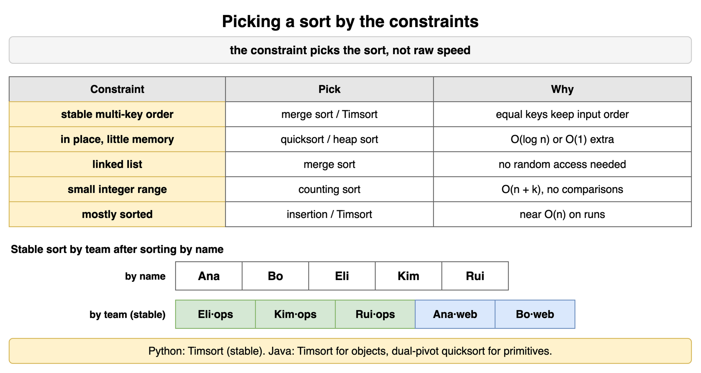

*Source: [`diagrams/sort-and-search.drawio`](/content/11_Coding_Problems/25_Sort_and_Search/diagrams/sort-and-search.drawio), page 2.*

## Sort costs at a glance

Insertion, selection, and bubble sort are O(n²) on average and worst case; insertion and bubble drop to O(n) on sorted input, and all three use O(1) extra space. Merge sort is O(n log n) in every case with O(n) extra space and is stable. Quicksort averages O(n log n) with O(log n) stack but degrades to O(n²) on bad pivots. Heap sort is O(n log n) in every case and in place but not stable. Counting, bucket, and radix sort are not comparison sorts: they run in O(n + k) or O(d(n + k)) time when the key range k or digit count d is small.

No comparison sort can beat Ω(n log n) in the worst case. Each comparison has two outcomes, and the algorithm must tell apart all n! orderings, so it needs at least log₂(n!) comparisons, which grows like n log₂ n ([Comparison sort lower bound](#07_Data_Structures_and_Algorithms/09_Sorting_and_Searching/concepts/comparison-sort-lower-bound)). The only ways under it are to use more than comparisons (counting on digits or values) or to ask a smaller question than a full sort, such as the k-th value.

```python
import math


for n in (5, 10, 1000):
    lower = math.ceil(math.log2(math.factorial(n)))
    print(n, lower, round(n * math.log2(n)))
# 5 7 12
# 10 22 33
# 1000 8530 9966
```

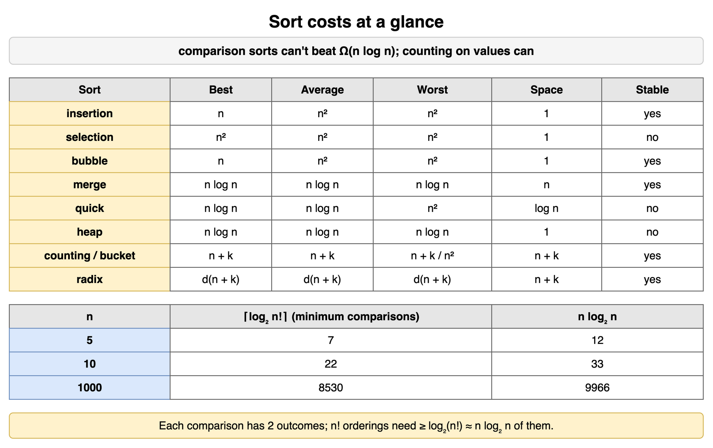

*Source: [`diagrams/sort-and-search.drawio`](/content/11_Coding_Problems/25_Sort_and_Search/diagrams/sort-and-search.drawio), page 3.*

## Merging two sorted runs

Merge sort's real work is the merge. Two sorted runs are walked with one pointer each, the smaller head is appended to the output, and the run that is left over is attached whole. On linked lists a dummy head ([Dummy head](#11_Coding_Problems/11_Linked_Lists/concepts/dummy-head)) removes the special case for the first node, and the merge relinks existing nodes, so it needs O(1) extra space and O(n + m) time. The array version is [Merging sorted sequences](#07_Data_Structures_and_Algorithms/09_Sorting_and_Searching/concepts/merging-sorted-sequences).

Take from the left run on ties (`<=`, not `<`). That keeps equal keys in input order and makes the whole sort stable. Either run may be empty, and once one run is exhausted the other must be attached without further comparisons. The example merges two runs that share a value and shows the tagged copy from the left run comes first.

```python
class Node:
    def __init__(self, val, next=None):
        self.val, self.next = val, next


def build(values):
    head = None
    for value in reversed(values):
        head = Node(value, head)
    return head


def to_list(node):
    out = []
    while node:
        out.append(node.val)
        node = node.next
    return out


def merge(left, right):
    dummy = tail = Node(None)
    while left and right:
        if left.val[0] <= right.val[0]:
            tail.next, left = left, left.next
        else:
            tail.next, right = right, right.next
        tail = tail.next
    tail.next = left or right
    return dummy.next


left = build([(2, "L"), (5, "L"), (9, "L")])
right = build([(1, "R"), (5, "R"), (6, "R")])
print(to_list(merge(left, right)))
print(to_list(merge(None, build([(3, "R")]))))
# [(1, 'R'), (2, 'L'), (5, 'L'), (5, 'R'), (6, 'R'), (9, 'L')]
# [(3, 'R')]
```

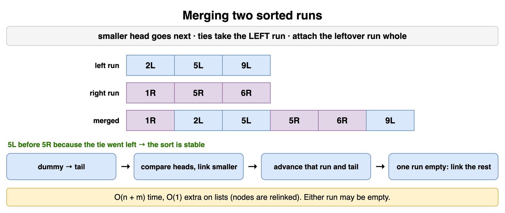

*Source: [`diagrams/sort-and-search.drawio`](/content/11_Coding_Problems/25_Sort_and_Search/diagrams/sort-and-search.drawio), page 4.*

## Sort a linked list

A linked list cannot jump to an index, so quicksort's partition and heap sort's sift both lose their advantage. Merge sort needs only sequential access: find the middle with fast and slow pointers ([Middle of a linked list](#11_Coding_Problems/12_Fast_and_Slow_Pointers/concepts/middle-of-a-linked-list)), cut the list there, sort both halves, and merge them. It is O(n log n) time; the recursion is O(log n) deep, and a bottom-up version that merges runs of length 1, 2, 4, and so on brings the extra space to O(1).

The cut is the classic bug. Start `fast` one node ahead so that `slow` stops at the end of the first half, then set `slow.next = None`. Without the cut both "halves" still reach the end and the recursion never shrinks; with `slow` on the second middle of a two-node list, the left half is the whole list again. An empty list and a single node are already sorted.

```python
class Node:
    def __init__(self, val, next=None):
        self.val, self.next = val, next


def build(values):
    head = None
    for value in reversed(values):
        head = Node(value, head)
    return head


def to_list(node):
    out = []
    while node:
        out.append(node.val)
        node = node.next
    return out


def merge(a, b):
    dummy = tail = Node(0)
    while a and b:
        if a.val <= b.val:
            tail.next, a = a, a.next
        else:
            tail.next, b = b, b.next
        tail = tail.next
    tail.next = a or b
    return dummy.next


def sort_list(head):
    if head is None or head.next is None:
        return head
    slow, fast = head, head.next
    while fast and fast.next:
        slow, fast = slow.next, fast.next.next
    second, slow.next = slow.next, None
    return merge(sort_list(head), sort_list(second))


print(to_list(sort_list(build([7, 3, 9, 1, 3, 6]))))
print(to_list(sort_list(build([2, 1]))), to_list(sort_list(None)))
# [1, 3, 3, 6, 7, 9]
# [1, 2] []
```

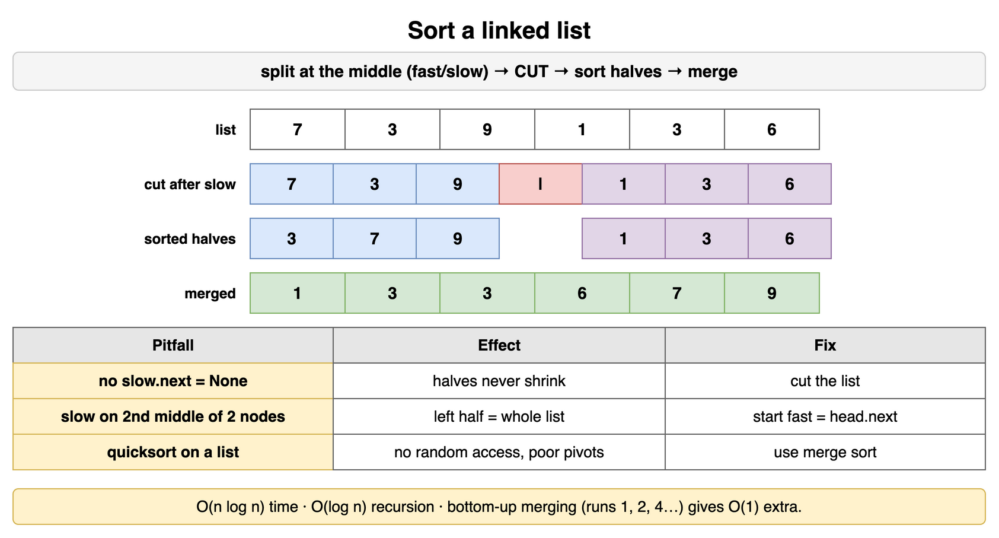

*Source: [`diagrams/sort-and-search.drawio`](/content/11_Coding_Problems/25_Sort_and_Search/diagrams/sort-and-search.drawio), page 5.*

## Partitioning around a pivot

A partition rearranges a range so that every value less than a pivot comes before it and every other value comes after, leaving the pivot at its final sorted position. It is one O(n) pass with O(1) extra space and is the engine of both quicksort and quickselect. The two common schemes are compared on [Partition schemes](#07_Data_Structures_and_Algorithms/09_Sorting_and_Searching/concepts/partition-schemes).

Lomuto keeps a boundary `store`: everything left of it is smaller than the pivot. Scan with `i`; whenever `nums[i]` is smaller, swap it to `store` and move the boundary. Finally swap the pivot (kept at the right end) into `store`. Hoare instead walks two pointers inward and swaps pairs that are on the wrong side; it does about three times fewer swaps but does not place the pivot at a known index. Lomuto is easier to get right on a whiteboard. Equal values all go to the right side, which matters later for duplicates.

```python
def lomuto(nums: list[int], lo: int, hi: int) -> int:
    pivot, store = nums[hi], lo
    for i in range(lo, hi):
        if nums[i] < pivot:
            nums[i], nums[store] = nums[store], nums[i]
            store += 1
    nums[store], nums[hi] = nums[hi], nums[store]
    return store


nums = [8, 3, 11, 5, 14, 2, 7]
p = lomuto(nums, 0, len(nums) - 1)
print(p, nums)
# 3 [3, 5, 2, 7, 14, 11, 8]
```

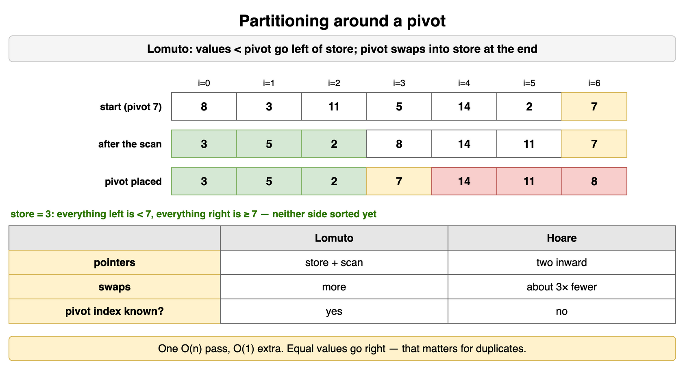

*Source: [`diagrams/sort-and-search.drawio`](/content/11_Coding_Problems/25_Sort_and_Search/diagrams/sort-and-search.drawio), page 6.*

## Pivot choice and the worst case

Quicksort's speed depends entirely on how evenly each pivot splits its range. Even splits give O(log n) levels of O(n) work, so O(n log n) time and O(log n) stack. A pivot that is always the smallest or largest value leaves one side empty, the depth becomes n, and the cost becomes n(n − 1)/2 comparisons with O(n) stack. The last element as pivot hits this on input that is already sorted or reverse sorted, which is common in real data such as timestamps.

A random pivot removes the dependence on input order: no fixed input is bad, and the chance of a quadratic run is tiny. Median-of-three (first, middle, last) fixes sorted input cheaply but can still be beaten by crafted input. Recursing into the smaller side first and looping on the larger side caps the stack at O(log n) even when splits are uneven. The example counts comparisons on 200 sorted values.

```python
import random


def comparisons(nums: list[int], pick) -> int:
    count, stack = 0, [(0, len(nums) - 1)]
    while stack:
        lo, hi = stack.pop()
        if lo >= hi:
            continue
        r = pick(lo, hi)
        nums[r], nums[hi] = nums[hi], nums[r]
        pivot, store = nums[hi], lo
        for i in range(lo, hi):
            count += 1
            if nums[i] < pivot:
                nums[i], nums[store] = nums[store], nums[i]
                store += 1
        nums[store], nums[hi] = nums[hi], nums[store]
        stack += [(lo, store - 1), (store + 1, hi)]
    return count


last = comparisons(list(range(200)), lambda lo, hi: hi)
rand = comparisons(list(range(200)), random.randint)
print(last, rand < 4000)
# 19900 True
```

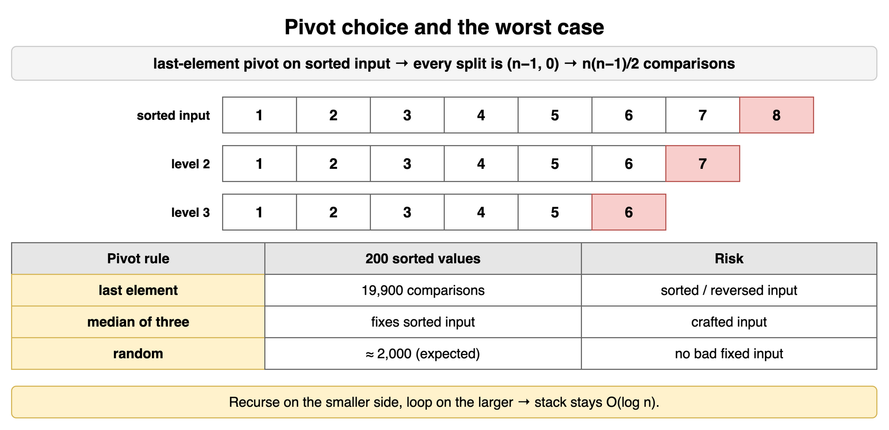

*Source: [`diagrams/sort-and-search.drawio`](/content/11_Coding_Problems/25_Sort_and_Search/diagrams/sort-and-search.drawio), page 7.*

## Sort an array with quicksort

Quicksort partitions the range, then sorts the parts on either side of the pivot in place. With a random pivot it runs in O(n log n) expected time and O(log n) expected stack ([Quick sort](#07_Data_Structures_and_Algorithms/09_Sorting_and_Searching/concepts/quick-sort)). The remaining weak spot is duplicates: Lomuto sends every copy of the pivot to one side, so an array of identical values still costs O(n²).

A three-way partition (less, equal, greater) fixes that. It keeps `lt`, `i`, and `gt` pointers, finishes all copies of the pivot in one pass, and recurses only on the strictly smaller and strictly larger parts, so identical values sort in O(n). Choose quicksort when sorting in place matters and stability does not; choose merge sort for stability or linked lists; mention counting sort if the values turn out to be small.

```python
import random


def quicksort(nums: list[int], lo: int = 0, hi: int | None = None) -> None:
    if hi is None:
        hi = len(nums) - 1
    if lo >= hi:
        return
    pivot = nums[random.randint(lo, hi)]
    lt, i, gt = lo, lo, hi
    while i <= gt:
        if nums[i] < pivot:
            nums[lt], nums[i] = nums[i], nums[lt]
            lt, i = lt + 1, i + 1
        elif nums[i] > pivot:
            nums[i], nums[gt] = nums[gt], nums[i]
            gt -= 1
        else:
            i += 1
    quicksort(nums, lo, lt - 1)
    quicksort(nums, gt + 1, hi)


data = [9, -2, 4, 4, 7, 0, 4, 13, -2]
quicksort(data)
same = [5] * 6
quicksort(same)
print(data, same)
# [-2, -2, 0, 4, 4, 4, 7, 9, 13] [5, 5, 5, 5, 5, 5]
```

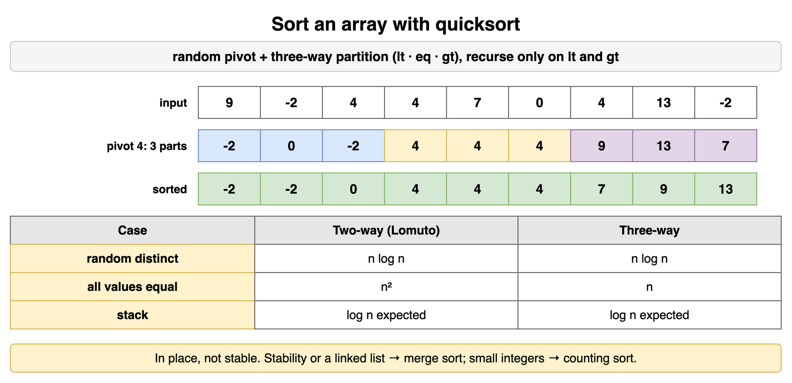

*Source: [`diagrams/sort-and-search.drawio`](/content/11_Coding_Problems/25_Sort_and_Search/diagrams/sort-and-search.drawio), page 8.*

## Counting sort for small ranges

When values are integers in a small range of size k, count how often each value appears and write them back in order. That takes O(n + k) time and O(k) extra space and beats the comparison bound because it never compares two values ([Counting sort](#07_Data_Structures_and_Algorithms/09_Sorting_and_Searching/concepts/counting-sort)). It is the right follow-up to "sort an array" when the interviewer reveals that values are, say, exam scores from 0 to 100.

Negative values need an offset: shift every value by the minimum so the smallest one lands in slot 0. The range, not n, decides whether it pays off; ten numbers spread between 0 and a billion would need a billion counters. To sort records rather than bare numbers, turn the counts into starting positions with a prefix sum and place records left to right, which keeps the sort stable.

```python
def counting_sort(nums: list[int]) -> list[int]:
    if not nums:
        return []
    low = min(nums)
    counts = [0] * (max(nums) - low + 1)
    for value in nums:
        counts[value - low] += 1
    out = []
    for offset, count in enumerate(counts):
        out.extend([offset + low] * count)
    return out


print(counting_sort([3, -1, 2, 3, 0, -1, 5]))
print(counting_sort([]), counting_sort([4, 4]))
# [-1, -1, 0, 2, 3, 3, 5]
# [] [4, 4]
```

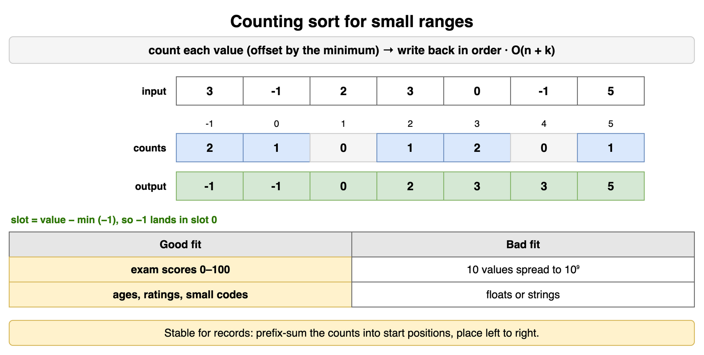

*Source: [`diagrams/sort-and-search.drawio`](/content/11_Coding_Problems/25_Sort_and_Search/diagrams/sort-and-search.drawio), page 9.*

## Kth largest with a heap

The k-th largest value can be found by sorting in O(n log n), but a min-heap of size k does better: push each value, and when the heap grows past k, pop the smallest. The heap always holds the k largest values seen so far, so its root is the k-th largest. That is O(n log k) time and O(k) extra space, and it works on a stream that never ends ([Top-K with a bounded heap](#07_Data_Structures_and_Algorithms/06_Heaps_and_Tries/concepts/top-k-with-a-bounded-heap)).

Duplicates count separately: in `[6, 6, 3]` the second largest is 6, not 3. A min-heap, not a max-heap, is correct because the value to evict is the smallest of the kept ones. Validate that 1 ≤ k ≤ n. For distinct-value variants, deduplicate first with a set.

```python
import heapq


def kth_largest_heap(nums: list[int], k: int) -> int:
    heap: list[int] = []
    for value in nums:
        heapq.heappush(heap, value)
        if len(heap) > k:
            heapq.heappop(heap)
    return heap[0]


print(kth_largest_heap([12, 5, 31, 8, 19, 5, 27], 3))
print(kth_largest_heap([6, 6, 3], 2), kth_largest_heap([4], 1))
# 19
# 6 4
```

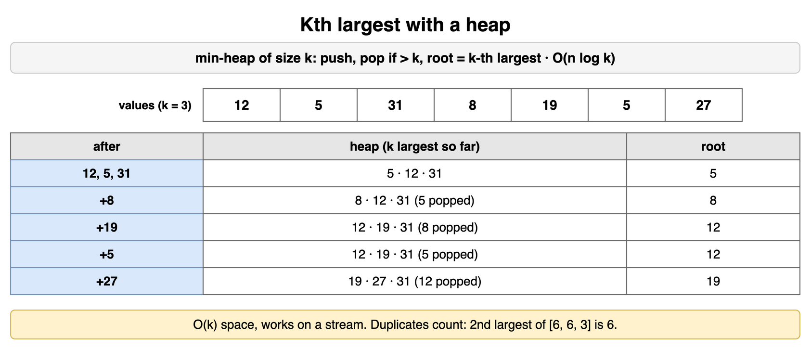

*Source: [`diagrams/sort-and-search.drawio`](/content/11_Coding_Problems/25_Sort_and_Search/diagrams/sort-and-search.drawio), page 10.*

## Quickselect

Quickselect partitions like quicksort but recurses into only the side that contains the target index. In ascending order the k-th largest sits at index n − k. After a partition places the pivot at `p`, stop if `p` is the target, otherwise keep only the left or right part. The expected work is n + n/2 + n/4 + … = O(n), with O(1) extra space when written as a loop; an unlucky pivot sequence is O(n²), which a random pivot makes very unlikely ([Quickselect](#07_Data_Structures_and_Algorithms/09_Sorting_and_Searching/concepts/quickselect)).

Quickselect rearranges the input, so copy it if the caller needs the original order. It also needs the whole array in memory, unlike the heap. Libraries ship it: C++ `std::nth_element` and NumPy's `partition` use introselect, a quickselect that falls back to a guaranteed linear method when the pivots go badly.

```python
import random


def kth_largest_select(nums: list[int], k: int) -> int:
    nums = list(nums)
    target, lo, hi = len(nums) - k, 0, len(nums) - 1
    while True:
        r = random.randint(lo, hi)
        nums[r], nums[hi] = nums[hi], nums[r]
        pivot, store = nums[hi], lo
        for i in range(lo, hi):
            if nums[i] < pivot:
                nums[i], nums[store] = nums[store], nums[i]
                store += 1
        nums[store], nums[hi] = nums[hi], nums[store]
        if store == target:
            return nums[store]
        if store < target:
            lo = store + 1
        else:
            hi = store - 1


print(kth_largest_select([12, 5, 31, 8, 19, 5, 27], 3))
print(kth_largest_select([6, 6, 3], 2), kth_largest_select([3, 1, 2], 3))
# 19
# 6 1
```

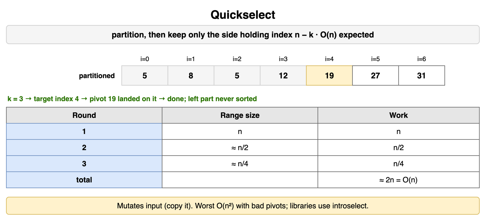

*Source: [`diagrams/sort-and-search.drawio`](/content/11_Coding_Problems/25_Sort_and_Search/diagrams/sort-and-search.drawio), page 11.*

## Three values in one pass

An array holding only 0, 1, and 2 can be sorted in place in one pass with three pointers. Everything before `low` is 0, everything after `high` is 2, and `i` scans the unknown middle. A 0 is swapped to `low` and both move on; a 1 just advances `i`; a 2 is swapped to `high` and only `high` moves. It is O(n) time and O(1) space, and it is the three-way partition from quicksort with a fixed pivot of 1.

Two details are the whole problem. After swapping with `high`, do not advance `i`: the value that arrived from the right has not been looked at yet. After swapping with `low`, advancing is safe because everything between `low` and `i` is already a 1. The loop runs while `i <= high`, since the slot at `high` itself is still unknown. A two-pass counting sort also works and is a fine first answer.

```python
def sort_three(nums: list[int]) -> list[int]:
    low, i, high = 0, 0, len(nums) - 1
    while i <= high:
        if nums[i] == 0:
            nums[low], nums[i] = nums[i], nums[low]
            low, i = low + 1, i + 1
        elif nums[i] == 2:
            nums[i], nums[high] = nums[high], nums[i]
            high -= 1
        else:
            i += 1
    return nums


print(sort_three([2, 0, 1, 2, 1, 0, 0]))
print(sort_three([2, 2, 0]), sort_three([]))
# [0, 0, 0, 1, 1, 2, 2]
# [0, 2, 2] []
```

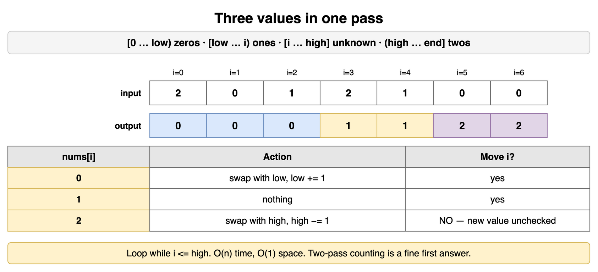

*Source: [`diagrams/sort-and-search.drawio`](/content/11_Coding_Problems/25_Sort_and_Search/diagrams/sort-and-search.drawio), page 12.*

## Search after a sort

Sorting pays for itself when the same data is searched many times. One O(n log n) sort turns each later lookup into an O(log n) binary search, so q queries cost O((n + q) log n) instead of O(nq) for repeated linear scans. A hash set is faster for plain membership, but only sorted data answers order questions: how many values are below x, the nearest value to x, every value in a range ([Lower and upper bound](#11_Coding_Problems/14_Binary_Search/concepts/lower-and-upper-bound)).

Python's `bisect_left` returns the first index whose value is at least x and `bisect_right` the first index whose value is greater than x, so their difference counts copies and `bisect_right(hi) - bisect_left(lo)` counts a closed range. The nearest value is one of the two neighbours of the insertion point; check both and guard the ends. The example answers price questions against one sorted list.

```python
from bisect import bisect_left, bisect_right


prices = sorted([40, 15, 90, 15, 60, 25, 75])


def count_between(lo: int, hi: int) -> int:
    return bisect_right(prices, hi) - bisect_left(prices, lo)


def nearest(x: int) -> int:
    i = bisect_left(prices, x)
    candidates = prices[max(0, i - 1):i + 1]
    return min(candidates, key=lambda p: (abs(p - x), p))


print(prices)
print(count_between(15, 40), count_between(91, 99), nearest(52), nearest(100), nearest(0))
# [15, 15, 25, 40, 60, 75, 90]
# 4 0 60 90 15
```

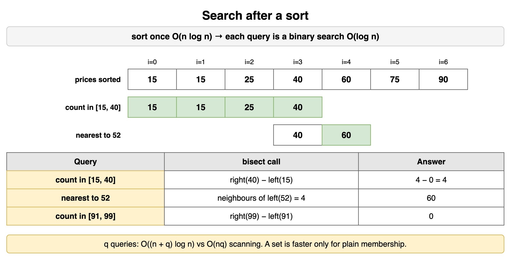

*Source: [`diagrams/sort-and-search.drawio`](/content/11_Coding_Problems/25_Sort_and_Search/diagrams/sort-and-search.drawio), page 13.*

## Sort, heap, or select

Pick by what the question actually needs. Need everything in order, or need the order many times: sort once, O(n log n). Need only the k-th value or the top k once, with the whole array in memory: quickselect, O(n) expected. Need the top k from a stream, or k is much smaller than n and memory is tight: a size-k heap, O(n log k) time and O(k) space. Values are small integers: counting, O(n + k). The Heaps topic covers the same choice from the heap side on [Heap, sort, quickselect, or buckets](#11_Coding_Problems/16_Heaps/concepts/heap-sort-quickselect-or-buckets).

State the baseline first ("sort and index, O(n log n)"), then improve it and name the trade: quickselect mutates the input and has an O(n²) worst case, the heap streams but costs log k per value, counting sort depends on the range. The example checks that all three approaches agree on random inputs, which is also how to test any of them.

```python
import heapq
import random


def by_sort(nums, k):
    return sorted(nums)[-k]


def by_heap(nums, k):
    return heapq.nlargest(k, nums)[-1]


def by_select(nums, k):
    nums, target = list(nums), len(nums) - k
    while True:
        pivot = random.choice(nums)
        lower = [x for x in nums if x < pivot]
        equal = [x for x in nums if x == pivot]
        if target < len(lower):
            nums = lower
        elif target < len(lower) + len(equal):
            return pivot
        else:
            target -= len(lower) + len(equal)
            nums = [x for x in nums if x > pivot]


agree = True
for _ in range(300):
    nums = [random.randint(-20, 20) for _ in range(random.randint(1, 30))]
    k = random.randint(1, len(nums))
    agree &= by_sort(nums, k) == by_heap(nums, k) == by_select(nums, k)
print(agree)
# True
```

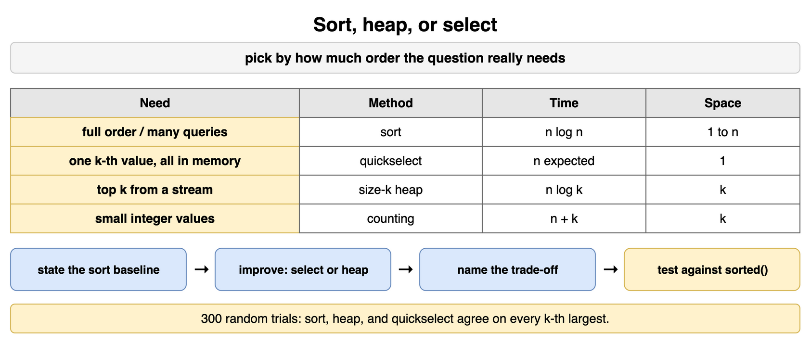

*Source: [`diagrams/sort-and-search.drawio`](/content/11_Coding_Problems/25_Sort_and_Search/diagrams/sort-and-search.drawio), page 14.*
