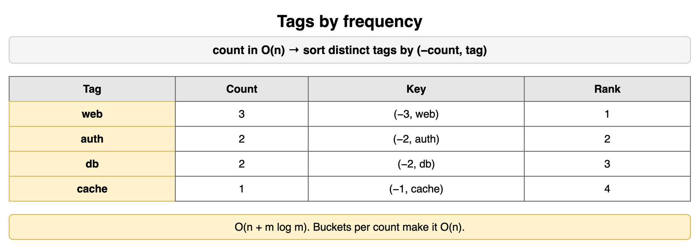
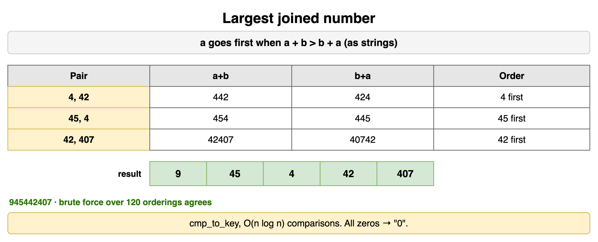
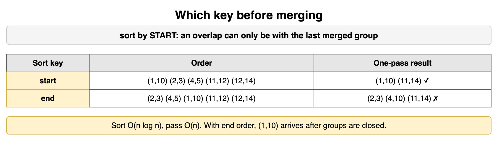
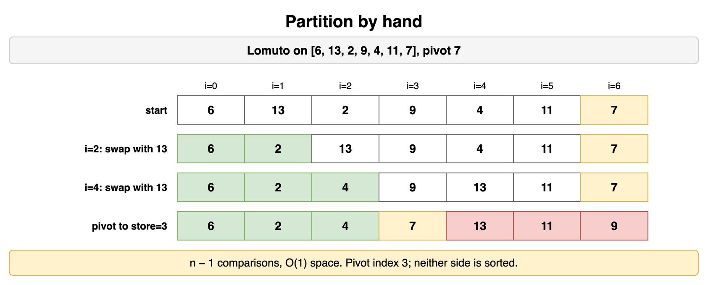
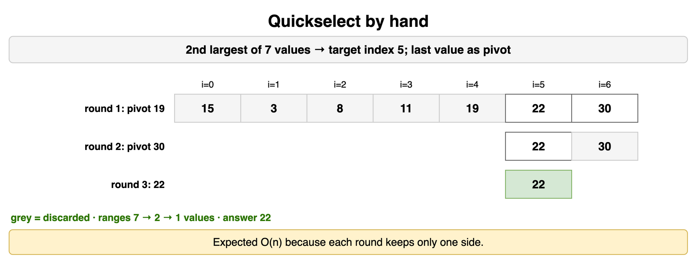
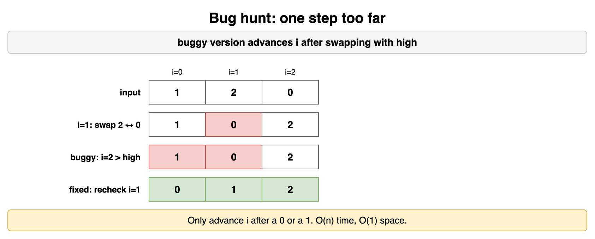
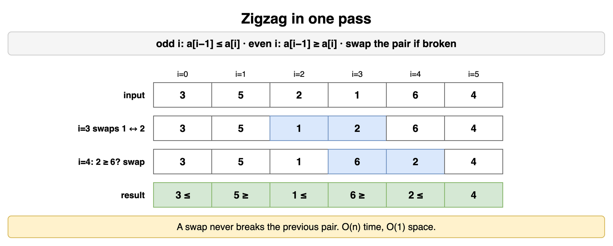
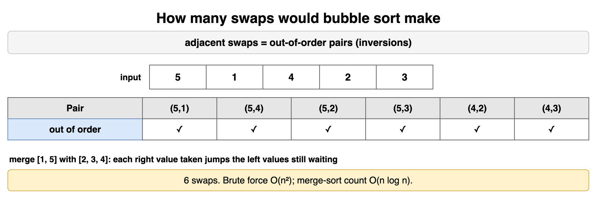
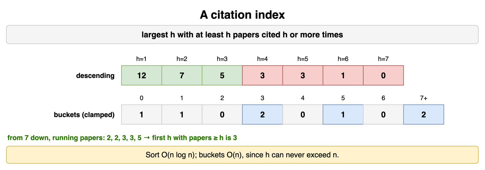

# Sort and Search — Drills

Original drills for frequency order, the largest joined number, the key that merging needs, a partition by hand, a quickselect trace, a three-value bug, a one-pass zigzag, counting swaps, and a citation index. Each answer names the approach, the cost, and Python. The numbers are exercise values.

## Tags by frequency

A log lists the tags `["db", "web", "auth", "web", "db", "web", "cache", "auth"]`. Return the distinct tags with the most frequent first, breaking ties alphabetically.

**Answer:** `['web', 'auth', 'db', 'cache']`. Count with a hash map in O(n), then sort the m distinct tags by the key `(-count, tag)`: the negated count puts high counts first while the tag sorts ties in ascending order, all in one stable sort. That is O(n + m log m) time and O(m) space. When counts are bounded by n, a bucket per count avoids the comparison sort entirely, which is the counting idea from [Counting sort for small ranges](#11_Coding_Problems/25_Sort_and_Search/concepts/counting-sort-for-small-ranges).

```python
from collections import Counter


def by_frequency(tags: list[str]) -> list[str]:
    counts = Counter(tags)
    return sorted(counts, key=lambda tag: (-counts[tag], tag))


print(by_frequency(["db", "web", "auth", "web", "db", "web", "cache", "auth"]))
print(by_frequency([]), by_frequency(["x", "y"]))
# ['web', 'auth', 'db', 'cache']
# [] ['x', 'y']
```



*Source: [`diagrams/sort-and-search-drills.drawio`](/content/11_Coding_Problems/25_Sort_and_Search/diagrams/sort-and-search-drills.drawio), page 1.*

## Largest joined number

Arrange `[4, 42, 9, 407, 45]` so that writing them side by side gives the largest possible number. Return it as a string.

**Answer:** `"945442407"`. No single key like "largest first" works, because 4 should come before 42 (442 beats 424) yet 45 should come before 4 (454 beats 445). Compare two numbers a and b as strings: a goes first when `a + b > b + a`. This comparison is transitive, so `functools.cmp_to_key` turns it into a valid sort, O(n log n) comparisons each costing the digit length. The exercise gives 9, 45, 4, 42, 407, and a brute force over all 120 orderings agrees. All zeros must collapse to `"0"`. Custom orderings are covered on [Custom sort keys](#07_Data_Structures_and_Algorithms/09_Sorting_and_Searching/concepts/custom-sort-keys) and [Picking a sort by the constraints](#11_Coding_Problems/25_Sort_and_Search/concepts/picking-a-sort-by-the-constraints).

```python
from functools import cmp_to_key
from itertools import permutations


def largest_joined(nums: list[int]) -> str:
    parts = [str(n) for n in nums]
    parts.sort(key=cmp_to_key(lambda a, b: (b + a > a + b) - (b + a < a + b)))
    joined = "".join(parts)
    return "0" if joined.startswith("0") else joined


print(largest_joined([4, 42, 9, 407, 45]))
print(max("".join(map(str, p)) for p in permutations([4, 42, 9, 407, 45])))
print(largest_joined([0, 0]), largest_joined([10, 2]))
# 945442407
# 945442407
# 0 210
```



*Source: [`diagrams/sort-and-search-drills.drawio`](/content/11_Coding_Problems/25_Sort_and_Search/diagrams/sort-and-search-drills.drawio), page 2.*

## Which key before merging

Bookings `[(1, 10), (2, 3), (4, 5), (12, 14), (11, 12)]` are closed intervals. A one-pass merge keeps a result list and either extends the last merged interval or starts a new one. Should the bookings be sorted by start or by end, and what goes wrong with the other key?

**Answer:** By start. After sorting by start, any interval that overlaps an earlier group must overlap the last one in the result, because nothing later can begin before it; one pass gives `[(1, 10), (11, 14)]`. Sorting by end puts `(2, 3)` and `(4, 5)` first, and `(1, 10)` arrives later and must swallow groups already closed, so the one-pass merge returns `[(2, 3), (4, 10), (11, 14)]`: `(1, 10)` is glued onto `(4, 5)`, the start 1 is lost, and `(2, 3)` is left as a separate group inside it. Sorting is O(n log n) and the pass is O(n). The full merge walkthrough is [Merge intervals](#11_Coding_Problems/06_Moderate_Problems/concepts/merge-intervals); the sort-first idea is [Sorting as a first step](#11_Coding_Problems/25_Sort_and_Search/concepts/sorting-as-a-first-step).

```python
def merge_by(bookings, key):
    merged = []
    for start, end in sorted(bookings, key=key):
        if merged and start <= merged[-1][1]:
            merged[-1] = (merged[-1][0], max(merged[-1][1], end))
        else:
            merged.append((start, end))
    return merged


bookings = [(1, 10), (2, 3), (4, 5), (12, 14), (11, 12)]
print(merge_by(bookings, key=lambda b: b[0]))
print(merge_by(bookings, key=lambda b: b[1]))
# [(1, 10), (11, 14)]
# [(2, 3), (4, 10), (11, 14)]
```



*Source: [`diagrams/sort-and-search-drills.drawio`](/content/11_Coding_Problems/25_Sort_and_Search/diagrams/sort-and-search-drills.drawio), page 3.*

## Partition by hand

Run a Lomuto partition on `[6, 13, 2, 9, 4, 11, 7]` with the last value, 7, as pivot. List each swap and the final array, and say where the pivot ends.

**Answer:** The pivot ends at index 3 and the array is `[6, 2, 4, 7, 13, 11, 9]`. `store` starts at 0. 6 < 7 swaps with itself (store 1). 13 is skipped. 2 swaps with 13 (store 2). 9 is skipped. 4 swaps with 13 (store 3). 11 is skipped. Finally the pivot swaps with index 3, sending 9 to the end. Everything left of index 3 is below 7 and everything right is at least 7, but neither side is sorted. One pass, n − 1 comparisons, O(1) space; see [Partitioning around a pivot](#11_Coding_Problems/25_Sort_and_Search/concepts/partitioning-around-a-pivot).

```python
def lomuto_trace(nums: list[int]) -> int:
    pivot, store = nums[-1], 0
    for i in range(len(nums) - 1):
        if nums[i] < pivot:
            nums[i], nums[store] = nums[store], nums[i]
            print(f"swap i={i} store={store}: {nums}")
            store += 1
    nums[store], nums[-1] = nums[-1], nums[store]
    return store


nums = [6, 13, 2, 9, 4, 11, 7]
p = lomuto_trace(nums)
print(p, nums)
# swap i=0 store=0: [6, 13, 2, 9, 4, 11, 7]
# swap i=2 store=1: [6, 2, 13, 9, 4, 11, 7]
# swap i=4 store=2: [6, 2, 4, 9, 13, 11, 7]
# 3 [6, 2, 4, 7, 13, 11, 9]
```



*Source: [`diagrams/sort-and-search-drills.drawio`](/content/11_Coding_Problems/25_Sort_and_Search/diagrams/sort-and-search-drills.drawio), page 4.*

## Quickselect by hand

Find the 2nd largest value of `[15, 3, 22, 8, 30, 11, 19]` with quickselect, always taking the last value of the current range as pivot. Show what each round throws away.

**Answer:** 22. With n = 7, the target index in ascending order is 7 − 2 = 5. Round 1 pivots on 19, which lands at index 4: `[15, 3, 8, 11, 19, 22, 30]`, so indices 0 to 4 are discarded and the search continues on `[22, 30]`. Round 2 pivots on 30, which lands at index 6; the target is lower, so index 6 is discarded. Round 3 is the single value 22 at index 5, the answer. The rounds touched 7, 2, and 1 values, which is why the expected cost is O(n) rather than O(n log n); see [Quickselect](#11_Coding_Problems/25_Sort_and_Search/concepts/quickselect).

```python
def select_trace(nums: list[int], k: int) -> int:
    target, lo, hi = len(nums) - k, 0, len(nums) - 1
    while True:
        pivot, store = nums[hi], lo
        for i in range(lo, hi):
            if nums[i] < pivot:
                nums[i], nums[store] = nums[store], nums[i]
                store += 1
        nums[store], nums[hi] = nums[hi], nums[store]
        print(f"pivot {pivot} -> index {store}, range {lo}..{hi}")
        if store == target:
            return nums[store]
        lo, hi = (store + 1, hi) if store < target else (lo, store - 1)


print(select_trace([15, 3, 22, 8, 30, 11, 19], 2))
# pivot 19 -> index 4, range 0..6
# pivot 30 -> index 6, range 5..6
# pivot 22 -> index 5, range 5..5
# 22
```



*Source: [`diagrams/sort-and-search-drills.drawio`](/content/11_Coding_Problems/25_Sort_and_Search/diagrams/sort-and-search-drills.drawio), page 5.*

## Bug hunt: one step too far

This version of the three-value sort fails on some inputs. Find an input that breaks it and fix it.

```python
def sort_three_buggy(nums):
    low, i, high = 0, 0, len(nums) - 1
    while i <= high:
        if nums[i] == 0:
            nums[low], nums[i] = nums[i], nums[low]
            low += 1
        elif nums[i] == 2:
            nums[i], nums[high] = nums[high], nums[i]
            high -= 1
        else:
            pass
        i += 1
    return nums
```

**Answer:** `[1, 2, 0]` comes back as `[1, 0, 2]`. The bug is that `i` advances after the swap with `high`, so the value that arrives from the right is never examined. At i = 1 the 2 swaps with the 0 at the end, `i` moves past index 1, the loop ends, and the 0 never reaches the front. Only move `i` after handling a 0 or a 1. The fix keeps O(n) time and O(1) space; the reasoning is on [Three values in one pass](#11_Coding_Problems/25_Sort_and_Search/concepts/three-values-in-one-pass).

```python
def sort_three_buggy(nums):
    low, i, high = 0, 0, len(nums) - 1
    while i <= high:
        if nums[i] == 0:
            nums[low], nums[i] = nums[i], nums[low]
            low += 1
        elif nums[i] == 2:
            nums[i], nums[high] = nums[high], nums[i]
            high -= 1
        i += 1
    return nums


def sort_three(nums):
    low, i, high = 0, 0, len(nums) - 1
    while i <= high:
        if nums[i] == 0:
            nums[low], nums[i] = nums[i], nums[low]
            low, i = low + 1, i + 1
        elif nums[i] == 2:
            nums[i], nums[high] = nums[high], nums[i]
            high -= 1
        else:
            i += 1
    return nums


print(sort_three_buggy([1, 2, 0]), sort_three([1, 2, 0]))
print(sort_three([1, 2, 0, 2, 0]))
# [1, 0, 2] [0, 1, 2]
# [0, 0, 1, 2, 2]
```



*Source: [`diagrams/sort-and-search-drills.drawio`](/content/11_Coding_Problems/25_Sort_and_Search/diagrams/sort-and-search-drills.drawio), page 6.*

## Zigzag in one pass

Rearrange `[3, 5, 2, 1, 6, 4]` so that `a[0] <= a[1] >= a[2] <= a[3] >= ...`. Can it be done without sorting?

**Answer:** Yes, in one pass. Walk i from 1: at an odd i the value should be at least its left neighbour, at an even i at most. If the pair breaks that rule, swap it. The swap never breaks the previous pair: if i is odd and `a[i-1] > a[i]`, the earlier step already made `a[i-1]` at most `a[i-2]`, so the smaller value moved to `i-1` is still at most `a[i-2]`. The exercise gives `[3, 5, 1, 6, 2, 4]`. It is O(n) time and O(1) space, against O(n log n) for sorting and then swapping pairs. The same local-fix reasoning is in [Three values in one pass](#11_Coding_Problems/25_Sort_and_Search/concepts/three-values-in-one-pass).

```python
def zigzag(nums: list[int]) -> list[int]:
    for i in range(1, len(nums)):
        if (i % 2 == 1) == (nums[i - 1] > nums[i]):
            nums[i - 1], nums[i] = nums[i], nums[i - 1]
    return nums


def is_zigzag(nums):
    return all((nums[i - 1] <= nums[i]) if i % 2 else (nums[i - 1] >= nums[i]) for i in range(1, len(nums)))


result = zigzag([3, 5, 2, 1, 6, 4])
print(result, is_zigzag(result))
print(zigzag([1, 1, 1]), zigzag([9]))
# [3, 5, 1, 6, 2, 4] True
# [1, 1, 1] [9]
```



*Source: [`diagrams/sort-and-search-drills.drawio`](/content/11_Coding_Problems/25_Sort_and_Search/diagrams/sort-and-search-drills.drawio), page 7.*

## How many swaps would bubble sort make

Bubble sort swaps only adjacent values that are out of order. On `[5, 1, 4, 2, 3]`, how many swaps does it make in total, and how can you know without running it?

**Answer:** 6. Each adjacent swap fixes exactly one out-of-order pair, so bubble sort makes exactly as many swaps as there are pairs `i < j` with `a[i] > a[j]`: (5,1), (5,4), (5,2), (5,3), (4,2), (4,3). Counting those pairs takes O(n²) by brute force but O(n log n) with merge sort: whenever the merge takes a value from the right half, it jumps over every value still waiting in the left half, and each one is a pair. The merge is [Merging two sorted runs](#11_Coding_Problems/25_Sort_and_Search/concepts/merging-two-sorted-runs); the Hard Problems topic counts the same pairs from a different angle.

```python
def bubble_swaps(nums: list[int]) -> int:
    nums, swaps = list(nums), 0
    for end in range(len(nums) - 1, 0, -1):
        for i in range(end):
            if nums[i] > nums[i + 1]:
                nums[i], nums[i + 1] = nums[i + 1], nums[i]
                swaps += 1
    return swaps


def count_by_merge(nums: list[int]) -> tuple[list[int], int]:
    if len(nums) <= 1:
        return nums, 0
    mid = len(nums) // 2
    left, a = count_by_merge(nums[:mid])
    right, b = count_by_merge(nums[mid:])
    merged, i, j, jumped = [], 0, 0, 0
    while i < len(left) and j < len(right):
        if left[i] <= right[j]:
            merged.append(left[i])
            i += 1
        else:
            merged.append(right[j])
            jumped += len(left) - i
            j += 1
    merged += left[i:] + right[j:]
    return merged, a + b + jumped


print(bubble_swaps([5, 1, 4, 2, 3]), count_by_merge([5, 1, 4, 2, 3])[1])
print(count_by_merge([1, 2, 3])[1], count_by_merge([3, 2, 1])[1], count_by_merge([2, 2])[1])
# 6 6
# 0 3 0
```



*Source: [`diagrams/sort-and-search-drills.drawio`](/content/11_Coding_Problems/25_Sort_and_Search/diagrams/sort-and-search-drills.drawio), page 8.*

## A citation index

A researcher's papers have citation counts `[7, 0, 12, 3, 5, 3, 1]`. Their index is the largest h such that at least h papers have h or more citations each. Find it by sorting, then without a comparison sort.

**Answer:** 3. Sorted in descending order the counts are `12, 7, 5, 3, 3, 1, 0`; the h-th paper (1-based) still has at least h citations for h = 1, 2, 3 and fails at h = 4 (3 < 4). That is O(n log n). Because h can never exceed n, every count above n can be clamped to n and counted in n + 1 buckets; walking the buckets from n down while adding up papers finds the first h whose running total reaches h, for O(n) time and O(n) space. That is [Counting sort for small ranges](#11_Coding_Problems/25_Sort_and_Search/concepts/counting-sort-for-small-ranges) on a range the problem itself bounds.

```python
def index_by_sort(cites: list[int]) -> int:
    ordered = sorted(cites, reverse=True)
    h = 0
    while h < len(ordered) and ordered[h] >= h + 1:
        h += 1
    return h


def index_by_buckets(cites: list[int]) -> int:
    n = len(cites)
    buckets = [0] * (n + 1)
    for c in cites:
        buckets[min(c, n)] += 1
    papers = 0
    for h in range(n, -1, -1):
        papers += buckets[h]
        if papers >= h:
            return h
    return 0


cites = [7, 0, 12, 3, 5, 3, 1]
print(index_by_sort(cites), index_by_buckets(cites))
print(index_by_buckets([]), index_by_buckets([0, 0]), index_by_buckets([9, 9, 9]))
# 3 3
# 0 0 3
```



*Source: [`diagrams/sort-and-search-drills.drawio`](/content/11_Coding_Problems/25_Sort_and_Search/diagrams/sort-and-search-drills.drawio), page 9.*
