## Spotting a bit manipulation problem

Bit problems announce themselves through their constraints. "Use O(1) extra space" next to "every value appears twice" hints at XOR. "Unsigned 32-bit integer" or "without using + or *" means the answer works on the binary form directly. A handful of yes/no flags, or every subset of up to about 20 items, fits in one integer used as a set. "Is it a power of two" and "count the 1-bits" are bit questions by name. The operators themselves are taught in [Bit Manipulation](#07_Data_Structures_and_Algorithms/10_Bit_Manipulation); this topic is the problem set.

The payoff is constant factors and memory, not a better big-O class in most cases: an integer holds 64 flags in one machine word, and AND/OR/XOR run in a single CPU cycle. Real systems lean on this. Unix file permissions pack read, write, and execute into three bits per user class, RAID 5 stores the XOR of the data disks so any one lost disk can be rebuilt, and x86 has a `POPCNT` instruction that counts set bits in hardware. The example shows the XOR rebuild with three small data blocks.

```python
disks = [0b1011_0010, 0b0110_1100, 0b1110_0001]
parity = disks[0] ^ disks[1] ^ disks[2]
lost = 1
rebuilt = parity
for i, block in enumerate(disks):
    if i != lost:
        rebuilt ^= block
print(f"{parity:08b}", f"{rebuilt:08b}", rebuilt == disks[lost])
# 00111111 01101100 True
```

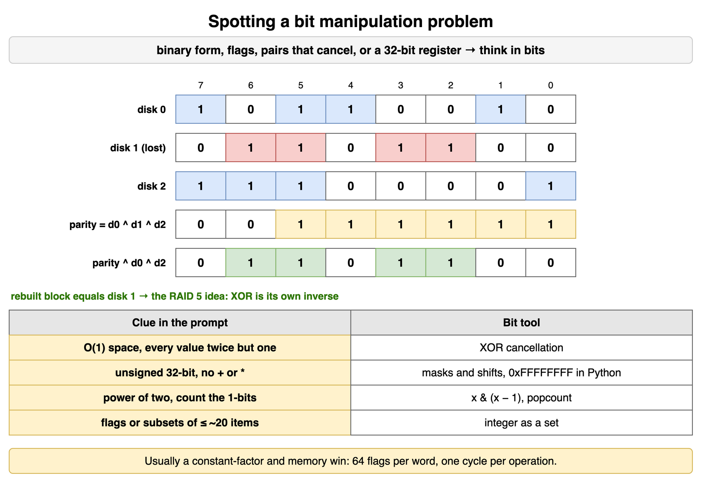

*Source: [`diagrams/bit-manipulation.drawio`](/content/11_Coding_Problems/26_Bit_Manipulation/diagrams/bit-manipulation.drawio), page 1.*

## The six operators

AND (`&`) keeps a bit only where both inputs have it, OR (`|`) keeps it where either has it, and XOR (`^`) keeps it where exactly one has it. NOT (`~`) flips every bit; in Python `~x == -x - 1`, because integers behave like two's complement with infinitely many sign bits. Left shift `x << k` multiplies by 2ᵏ and right shift `x >> k` floor-divides by 2ᵏ, so `-7 >> 1` is `-4`, not `-3`. Each operator is detailed on [Bitwise AND, OR, XOR, NOT](#07_Data_Structures_and_Algorithms/10_Bit_Manipulation/concepts/bitwise-and-or-xor-not) and [Left and right shift](#07_Data_Structures_and_Algorithms/10_Bit_Manipulation/concepts/left-and-right-shift).

Three XOR identities carry most of the problems: `a ^ 0 == a`, `a ^ a == 0`, and XOR is commutative and associative, so order never matters. Precedence trips people up: arithmetic binds tighter than shifts, and shifts tighter than `&`, `^`, `|`, so `1 << i - 1` means `1 << (i - 1)` and `x & y + 1` means `x & (y + 1)`. In C and Java `x & 1 == 0` even parses as `x & (1 == 0)`. Parenthesize every bit expression. Every operator is O(1) for word-sized values; Python's big integers cost O(number of words).

```python
a, b = 0b1100, 0b1010
print(f"{a & b:04b} {a | b:04b} {a ^ b:04b}", ~a, a << 2, a >> 2)
print(-7 >> 1, 5 ^ 0, 5 ^ 5, 3 ^ 9 ^ 3)
print(1 << 3 - 1, (1 << 3) - 1, 6 & 3 + 1, (6 & 3) + 1)
# 1000 1110 0110 -13 48 3
# -4 5 0 9
# 4 7 4 3
```

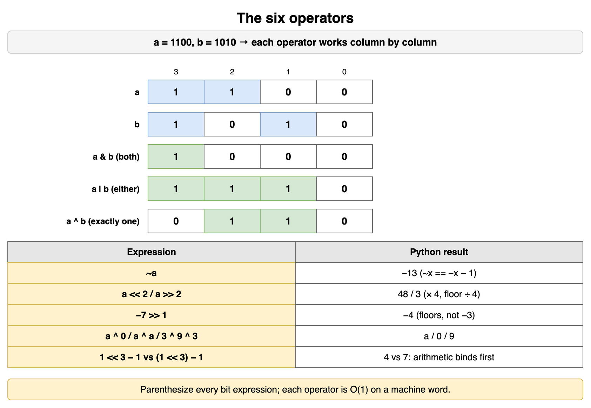

*Source: [`diagrams/bit-manipulation.drawio`](/content/11_Coding_Problems/26_Bit_Manipulation/diagrams/bit-manipulation.drawio), page 2.*

## Masks: test, set, clear, toggle

A mask is an integer whose 1-bits mark the positions you care about, usually `1 << i` for bit i (counting from 0 at the right). Four idioms cover almost every update: test with `x & (1 << i)` (non-zero means set) or `(x >> i) & 1` for a clean 0 or 1; set with `x | (1 << i)`; clear with `x & ~(1 << i)`; toggle with `x ^ (1 << i)`. Parity is `x & 1`: 1 for odd, 0 for even, and it works for negative Python integers too. The single-bit versions are on [Get bit](#07_Data_Structures_and_Algorithms/10_Bit_Manipulation/concepts/get-bit), [Set bit](#07_Data_Structures_and_Algorithms/10_Bit_Manipulation/concepts/set-bit), [Clear bit](#07_Data_Structures_and_Algorithms/10_Bit_Manipulation/concepts/clear-bit), and [Toggle bit](#07_Data_Structures_and_Algorithms/10_Bit_Manipulation/concepts/toggle-bit).

Wider masks work the same way: `(1 << k) - 1` is k ones, so `x & ((1 << k) - 1)` keeps the low k bits and `x >> k` drops them. The common bug is clearing with `x & (1 << i)`, which keeps only bit i instead of removing it, or testing with `== 1` after `x & (1 << i)`, which fails for every i above 0. A feature-flag field shows all four in a row.

```python
DARK, BETA, ADMIN = 0, 2, 3
flags = 0b0101
print(bool(flags & (1 << DARK)), (flags >> BETA) & 1)
flags |= 1 << ADMIN
flags &= ~(1 << DARK)
flags ^= 1 << BETA
print(f"{flags:04b}", 0b1101_0110 & ((1 << 4) - 1), -3 & 1)
# True 1
# 1000 6 1
```

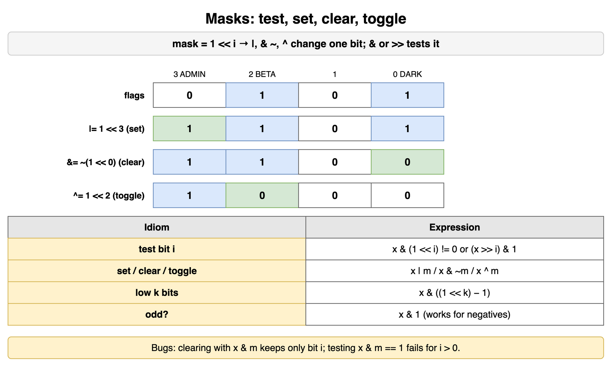

*Source: [`diagrams/bit-manipulation.drawio`](/content/11_Coding_Problems/26_Bit_Manipulation/diagrams/bit-manipulation.drawio), page 3.*

## The lowest set bit

Subtracting 1 from x flips its lowest 1-bit to 0 and every 0 below it to 1. So `x & (x - 1)` removes the lowest set bit, and `x & -x` isolates it (in two's complement, `-x == ~x + 1`). A positive x is a power of two exactly when it has one set bit, so the test is `x > 0 and x & (x - 1) == 0`; the `x > 0` guard rejects 0, which would otherwise pass. The DSA versions are [Turn off lowest set bit](#07_Data_Structures_and_Algorithms/10_Bit_Manipulation/concepts/turn-off-lowest-set-bit), [Isolate lowest set bit](#07_Data_Structures_and_Algorithms/10_Bit_Manipulation/concepts/isolate-lowest-set-bit), and [Power-of-two tests](#07_Data_Structures_and_Algorithms/10_Bit_Manipulation/concepts/power-of-two-tests).

These two moves let a loop visit only the set bits: repeat `x &= x - 1` and the loop runs once per 1-bit, not once per bit position. Fenwick trees step through their index with `i & -i`, and memory allocators round sizes to powers of two with the same tests. `x.bit_length()` gives the position of the highest set bit plus one, which pairs naturally with these when you need the top bit instead of the bottom one.

```python
x = 0b1011_0100
print(f"{x & (x - 1):08b} {x & -x:08b}", x.bit_length())
print([n for n in range(-1, 20) if n > 0 and n & (n - 1) == 0])
positions = []
while x:
    low = x & -x
    positions.append(low.bit_length() - 1)
    x &= x - 1
print(positions)
# 10110000 00000100 8
# [1, 2, 4, 8, 16]
# [2, 4, 5, 7]
```

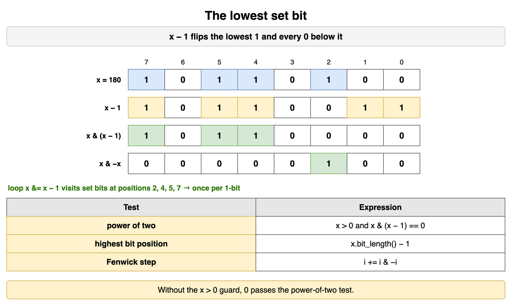

*Source: [`diagrams/bit-manipulation.drawio`](/content/11_Coding_Problems/26_Bit_Manipulation/diagrams/bit-manipulation.drawio), page 4.*

## XOR cancellation

Because `a ^ a == 0` and order does not matter, XOR-ing a whole collection cancels every value that appears an even number of times and leaves the XOR of the values that appear an odd number of times. That single fact solves "find the one unpaired value", "find the missing number in 0..n" (XOR the indices with the values), and parity checks, all in O(n) time and O(1) space. [XOR properties](#07_Data_Structures_and_Algorithms/10_Bit_Manipulation/concepts/xor-properties) has the algebra.

XOR only cancels in pairs. If values repeat three times, three copies XOR to the value itself, so the trick breaks and you count bits per position instead. If two values are unpaired, the total is their XOR, and you need one more split on a differing bit to separate them. XOR is also its own inverse, which is why it appears in parity disks, simple stream ciphers, and the swap-without-a-temporary trick on [Swap without a temporary](#11_Coding_Problems/06_Moderate_Problems/concepts/swap-without-a-temporary).

```python
from functools import reduce
from operator import xor


readings = [14, 3, 9, 3, 14, 9, 9]
print(reduce(xor, readings), reduce(xor, [5, 5, 5]), reduce(xor, [], 0))
# 9 5 0
```

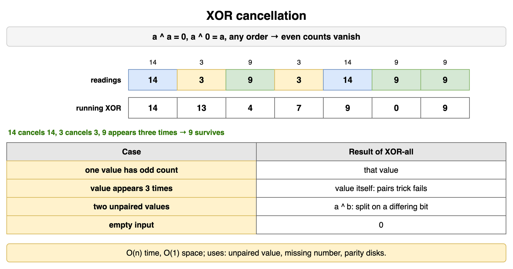

*Source: [`diagrams/bit-manipulation.drawio`](/content/11_Coding_Problems/26_Bit_Manipulation/diagrams/bit-manipulation.drawio), page 5.*

## Fixed width in Python

Most bit problems assume a 32-bit or 64-bit register: values wrap around, the top bit is the sign, and `>>>` in Java or `unsigned` in C shifts in zeros. Python integers have no width. Left shifts grow forever, `~5` is `-6` rather than `4294967290`, and `>>` on a negative number keeps shifting in ones. To simulate a 32-bit register, mask after every step with `MASK = 0xFFFFFFFF`, and convert back to a signed value only at the end: if the result is at or above `1 << 31`, subtract `1 << 32`. See [Two's complement](#07_Data_Structures_and_Algorithms/10_Bit_Manipulation/concepts/two-s-complement) and [Arithmetic vs logical right shift](#07_Data_Structures_and_Algorithms/10_Bit_Manipulation/concepts/arithmetic-vs-logical-right-shift).

Masking matters whenever a loop relies on overflow to stop (adding without `+`), when a NOT must stay unsigned (reversing or complementing bits), or when the answer must print as an unsigned 32-bit value. Forgetting the mask is the usual source of infinite loops and huge numbers in Python ports of C solutions. In Java or C++ the matching bug is using an arithmetic shift where a logical one was intended.

```python
MASK = 0xFFFFFFFF


def to_signed(x: int) -> int:
    x &= MASK
    return x - (1 << 32) if x >= 1 << 31 else x


print(~5, ~5 & MASK, (1 << 31) << 1, ((1 << 31) << 1) & MASK)
print(to_signed(0xFFFFFFFE), to_signed(7), (-8 & MASK) >> 1)
# -6 4294967290 4294967296 0
# -2 7 2147483644
```

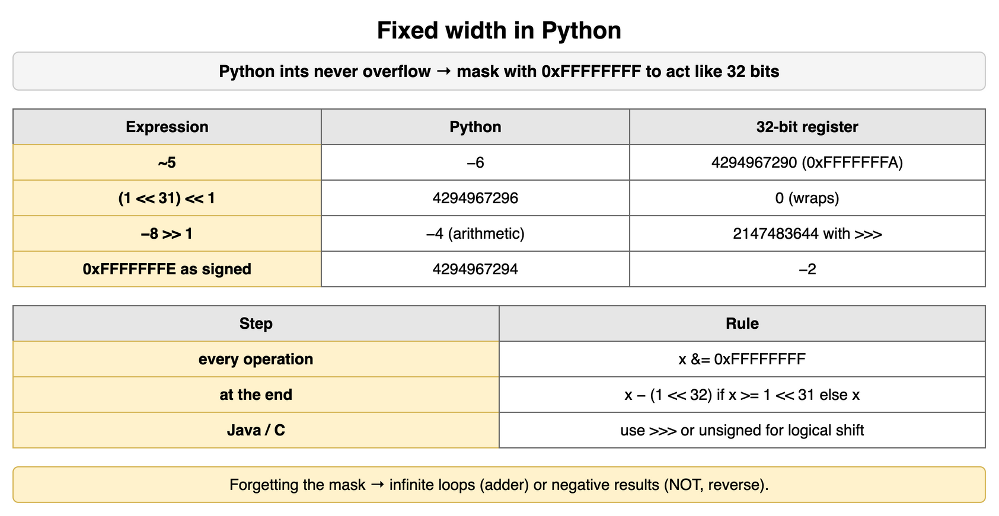

*Source: [`diagrams/bit-manipulation.drawio`](/content/11_Coding_Problems/26_Bit_Manipulation/diagrams/bit-manipulation.drawio), page 6.*

## Bitmasks as small sets

An integer with n bits can stand for any subset of n items: bit i is 1 when item i is in the set. Union is `a | b`, intersection `a & b`, difference `a & ~b`, membership `a >> i & 1`, and size `a.bit_count()`. Counting from 0 to `2**n - 1` visits every subset exactly once, which gives an iterative alternative to the recursive search on [All subsets](#11_Coding_Problems/22_Backtracking/concepts/all-subsets); the cost is O(n · 2ⁿ), so it is practical up to about n = 20. [Flags and bitmask subsets](#07_Data_Structures_and_Algorithms/10_Bit_Manipulation/concepts/flags-and-bitmask-subsets) covers the basics.

Masks also make compact DP state: "which cities are already visited" becomes one integer index into a table of size 2ⁿ, the basis of the bitmask DP for small travelling-salesman instances. To walk all sub-masks of a mask m, use `s = (s - 1) & m` until it reaches 0. The example finds which pairs of three team members share a free afternoon, where each bit of a schedule is one weekday.

```python
free = {"ana": 0b10110, "raj": 0b00111, "lee": 0b11001}
names = list(free)
for mask in range(1, 1 << len(names)):
    group = [names[i] for i in range(len(names)) if mask >> i & 1]
    if len(group) == 2:
        common = free[group[0]] & free[group[1]]
        print(group, f"{common:05b}", common.bit_count())
# ['ana', 'raj'] 00110 2
# ['ana', 'lee'] 10000 1
# ['raj', 'lee'] 00001 1
```

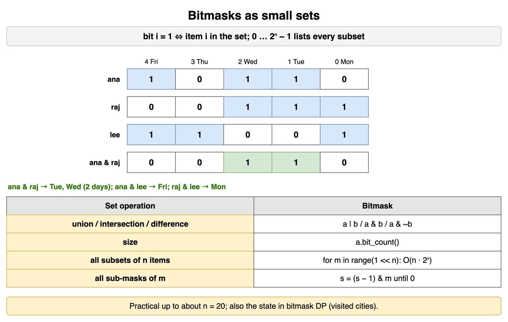

*Source: [`diagrams/bit-manipulation.drawio`](/content/11_Coding_Problems/26_Bit_Manipulation/diagrams/bit-manipulation.drawio), page 7.*

## Counting set bits

The number of 1-bits in x is its Hamming weight or population count. Shifting right and adding `x & 1` costs one step per bit position, O(log x). Brian Kernighan's loop `x &= x - 1` costs one step per set bit, which is faster for sparse values. Python 3.10+ has `int.bit_count()`, and `bin(x).count("1")` works everywhere; both are fine in an interview if you say what they do and offer the loop when asked. The DSA card [Counting set bits](#07_Data_Structures_and_Algorithms/10_Bit_Manipulation/concepts/counting-set-bits) compares the methods.

Negative Python integers have infinitely many 1-bits in two's complement, so the shifting loop never ends on them. Mask to a fixed width first (`x & 0xFFFFFFFF`) when the problem means a 32-bit register. Hamming weight shows up in error-correcting codes, chess engines (count pieces on a 64-bit board), and similarity search, where the Hamming distance between two hashes is `(a ^ b).bit_count()`.

```python
def ones_by_shift(x: int) -> int:
    count = 0
    while x:
        count += x & 1
        x >>= 1
    return count


def ones_by_clearing(x: int) -> int:
    count = 0
    while x:
        x &= x - 1
        count += 1
    return count


print(ones_by_shift(0b1001_0000_0001), ones_by_clearing(0b1001_0000_0001), (2024).bit_count())
print(ones_by_clearing(-1 & 0xFFFFFFFF), bin(0).count("1"))
# 3 3 7
# 32 0
```

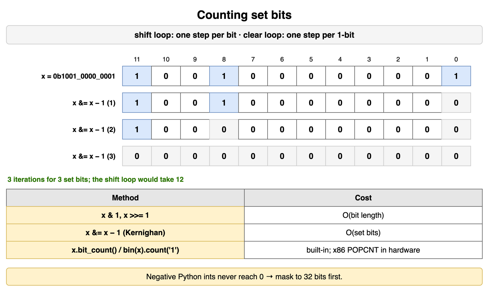

*Source: [`diagrams/bit-manipulation.drawio`](/content/11_Coding_Problems/26_Bit_Manipulation/diagrams/bit-manipulation.drawio), page 8.*

## Building answers from smaller numbers

Every positive x is a smaller number with one bit changed. `x >> 1` is x with its lowest bit dropped, so any property that adds up bit by bit satisfies `f(x) = f(x >> 1) + (x & 1)`. `x & (x - 1)` is x with its lowest set bit removed, so a count of set bits satisfies `f(x) = f(x & (x - 1)) + 1`. Both smaller numbers are below x, so a table filled in increasing order already holds them, which turns per-number work into O(1) per entry. This is ordinary [dynamic programming](#11_Coding_Problems/23_Dynamic_Programming/concepts/state-recurrence-and-base-cases) whose state is the number itself.

The same idea gives other per-number tables in one pass: the highest power of two not above x (`high[x] = high[x >> 1] << 1`), the number of trailing zeros, or whether x is a power of two. Base case `f(0)` is usually 0. The example builds the lowest-set-bit position for 1..8 from smaller entries: odd numbers have it at 0, and an even x has it one higher than `x >> 1`.

```python
n = 8
low = [0] * (n + 1)
for x in range(2, n + 1):
    low[x] = 0 if x & 1 else low[x >> 1] + 1
print(low[1:])
# [0, 1, 0, 2, 0, 1, 0, 3]
```

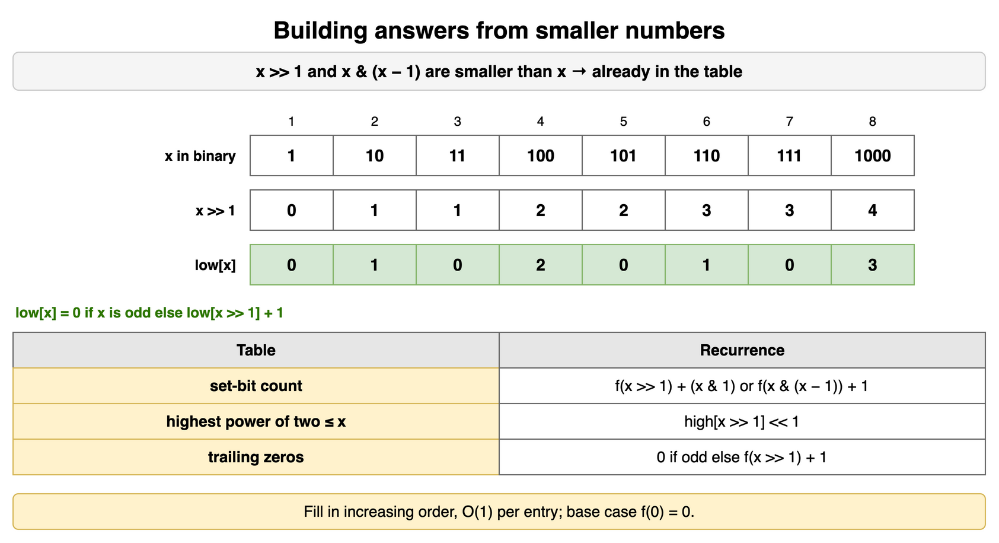

*Source: [`diagrams/bit-manipulation.drawio`](/content/11_Coding_Problems/26_Bit_Manipulation/diagrams/bit-manipulation.drawio), page 9.*

## Set-bit counts from 0 to n

Given n, return a list whose entry i is the number of 1-bits in i, for every i from 0 to n inclusive. The direct way counts each number separately with a shifting loop: O(n log n) time and O(1) extra space beyond the output. The table way reuses earlier answers with `bits[x] = bits[x >> 1] + (x & 1)`, O(n) time, and the alternative `bits[x] = bits[x & (x - 1)] + 1` is equally valid.

The output has n + 1 entries, not n, and n = 0 returns `[0]`. Ask before reaching for `bin(i).count("1")` or `int.bit_count()`: they give the right answer but hide the point of the question, which is the recurrence. Check the table against the built-in on a range as a quick test.

```python
def set_bit_counts(n: int) -> list[int]:
    bits = [0] * (n + 1)
    for x in range(1, n + 1):
        bits[x] = bits[x >> 1] + (x & 1)
    return bits


print(set_bit_counts(10))
print(set_bit_counts(0), set_bit_counts(500) == [i.bit_count() for i in range(501)])
# [0, 1, 1, 2, 1, 2, 2, 3, 1, 2, 2]
# [0] True
```

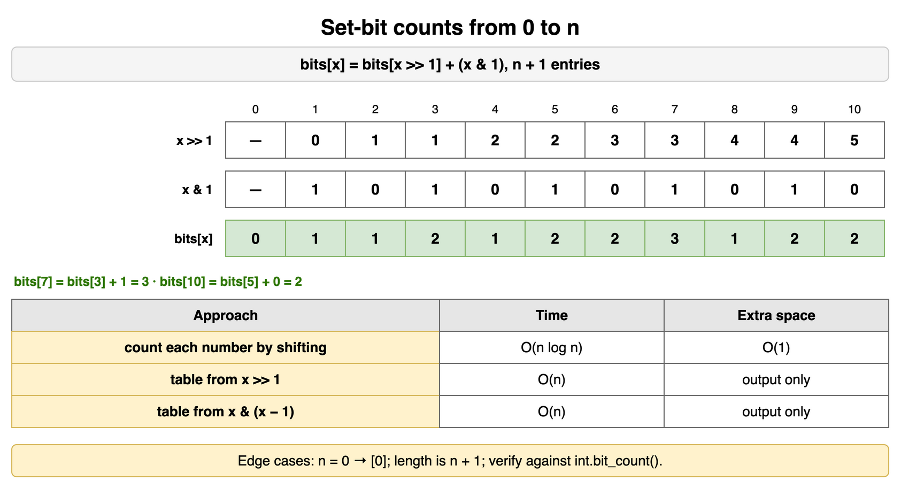

*Source: [`diagrams/bit-manipulation.drawio`](/content/11_Coding_Problems/26_Bit_Manipulation/diagrams/bit-manipulation.drawio), page 10.*

## The one unpaired value

Every value in a list appears exactly twice except one, which appears once; return it. A hash set that adds and removes values works in O(n) time but O(n) space. Sorting and scanning neighbours uses O(1) extra space but O(n log n) time. XOR-ing everything is O(n) time and O(1) space: pairs cancel to 0 and the survivor is left, as on [XOR cancellation](#11_Coding_Problems/26_Bit_Manipulation/concepts/xor-cancellation).

The input order does not matter, negatives are fine in Python, and a one-element list returns that element. The trick relies on the "exactly twice" promise: if a value could appear three times, or if two values are unpaired, the plain XOR returns the wrong thing silently. Name that assumption out loud, and know the follow-ups (per-bit counts mod 3, or splitting on a differing bit).

```python
def unpaired(values: list[int]) -> int:
    result = 0
    for value in values:
        result ^= value
    return result


print(unpaired([21, -4, 7, 21, 7]), unpaired([12]), unpaired([3, 8, 3, 0, 8]))
# -4 12 0
```

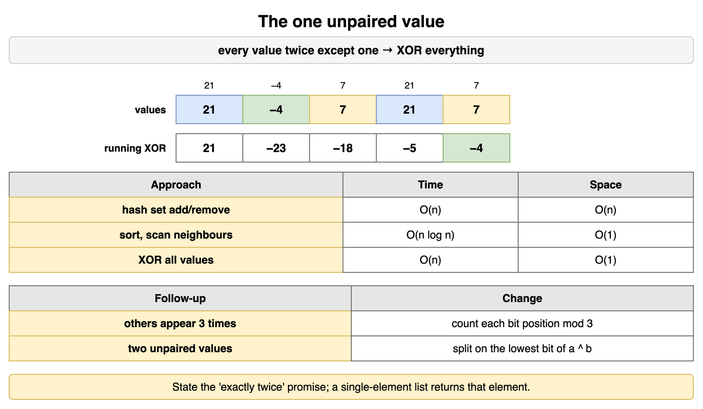

*Source: [`diagrams/bit-manipulation.drawio`](/content/11_Coding_Problems/26_Bit_Manipulation/diagrams/bit-manipulation.drawio), page 11.*

## Swap odd and even bits

Given an unsigned 32-bit integer, swap bit 0 with bit 1, bit 2 with bit 3, and so on. Looping over pairs works, but two masks do it in O(1). `0x55555555` is `0101...01` and selects the even positions (0, 2, 4, ...); `0xAAAAAAAA` is `1010...10` and selects the odd ones. Shift the even bits left by one, shift the odd bits right by one, and OR the halves: `((n & 0x55555555) << 1) | ((n & 0xAAAAAAAA) >> 1)`.

Positions count from 0 at the right, so the least significant bit is even and `0x55555555` is the even mask. Pairing a mask with the wrong shift direction (even bits shifted right) drops bit 0 and pushes bit 31 out to bit 32, so check `0b01 → 0b10` before anything else. In Python the left shift can push bit 30 into bit 31 but never beyond, since bit 31 is odd and was masked out, so the result stays within 32 bits; still mask the input if it might be negative. In Java or C use the unsigned (logical) right shift so the top bit does not smear. The same mask-and-shift move, with wider masks, reverses bytes and whole words.

```python
EVEN, ODD = 0x55555555, 0xAAAAAAAA


def swap_pairs(n: int) -> int:
    n &= 0xFFFFFFFF
    return ((n & EVEN) << 1) | ((n & ODD) >> 1)


print(f"{swap_pairs(0b1001_1110):08b}", swap_pairs(0xFFFFFFFF) == 0xFFFFFFFF)
print(hex(swap_pairs(0x80000000)), hex(swap_pairs(-1 << 31)))
# 01101101 True
# 0x40000000 0x40000000
```

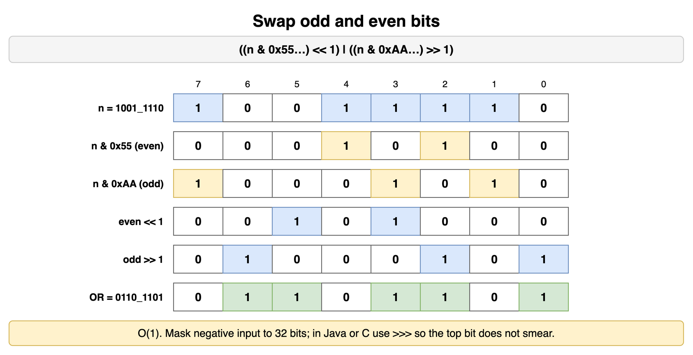

*Source: [`diagrams/bit-manipulation.drawio`](/content/11_Coding_Problems/26_Bit_Manipulation/diagrams/bit-manipulation.drawio), page 12.*

## Bits or another tool

Reach for bits when the constraint asks for O(1) space on pair-style data, when the data is already binary (permissions, flags, hashes, IP addresses), when the set has at most a few dozen members, or when the question is about the binary form itself. Reach for a hash map or set when values can repeat an arbitrary number of times, when you need counts or positions, or when the members are not small integers. A plain loop is usually fine for arithmetic: replacing `x * 2` with `x << 1` is something the compiler already does.

In an interview, write the readable version first, then name the bit trick and why it is valid ("pairs cancel under XOR", "subtracting 1 flips the lowest set bit"). Test on 0, 1, a power of two, all ones, and a negative or top-bit value. The broader set of number tricks lives on [Bit tests and masks](#11_Coding_Problems/06_Moderate_Problems/concepts/bit-tests-and-masks) and [Bit-level arithmetic](#11_Coding_Problems/07_Hard_Problems/concepts/bit-level-arithmetic).

```python
from collections import Counter


values = [6, 2, 6, 2, 6, 9]
print(Counter(values).most_common(), 6 ^ 2 ^ 6 ^ 2 ^ 6 ^ 9)
for x in (0, 1, 16, 0xFF, -8):
    print(x, x > 0 and x & (x - 1) == 0, x & 1)
# [(6, 3), (2, 2), (9, 1)] 15
# 0 False 0
# 1 True 1
# 16 True 0
# 255 False 1
# -8 False 0
```

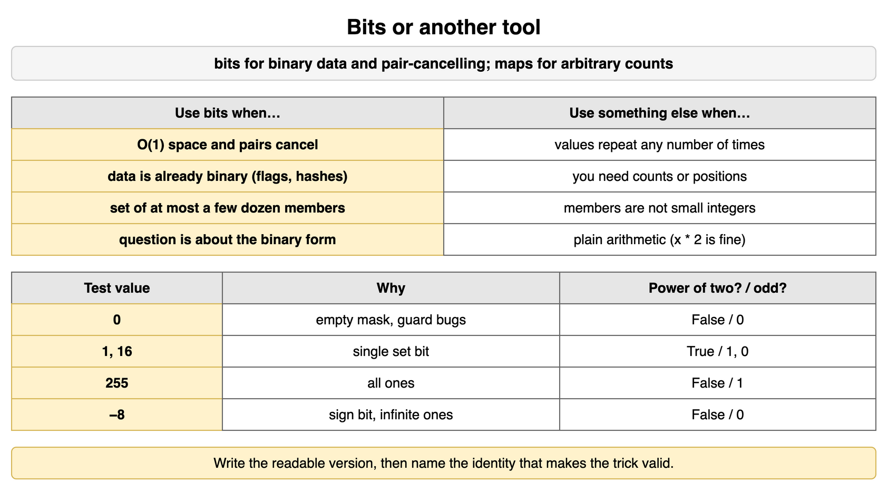

*Source: [`diagrams/bit-manipulation.drawio`](/content/11_Coding_Problems/26_Bit_Manipulation/diagrams/bit-manipulation.drawio), page 13.*
