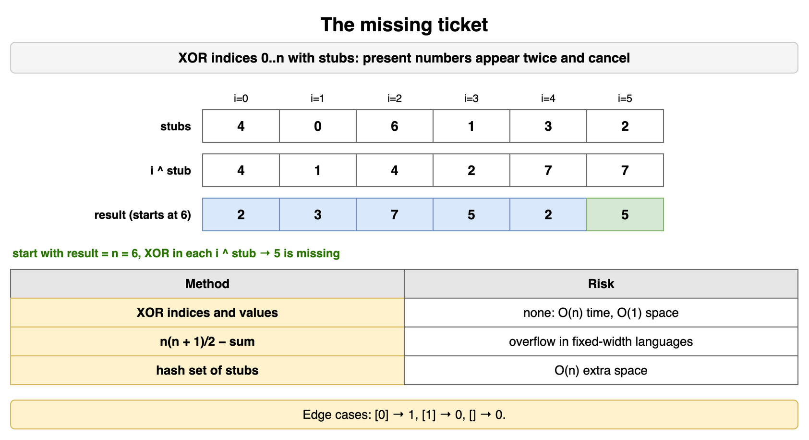
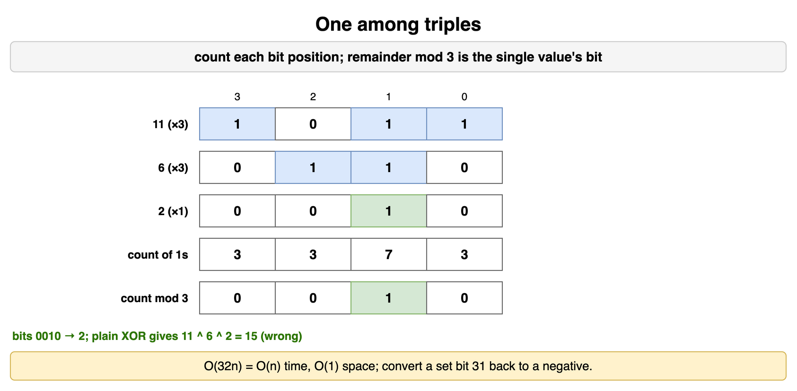
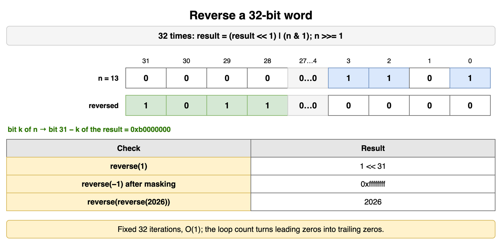
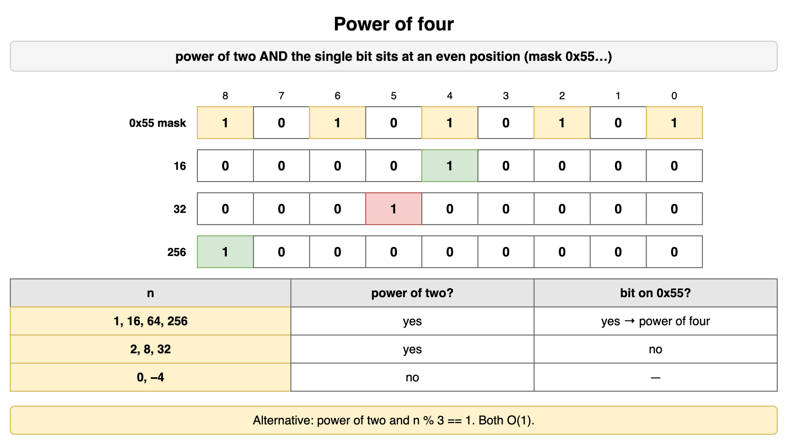
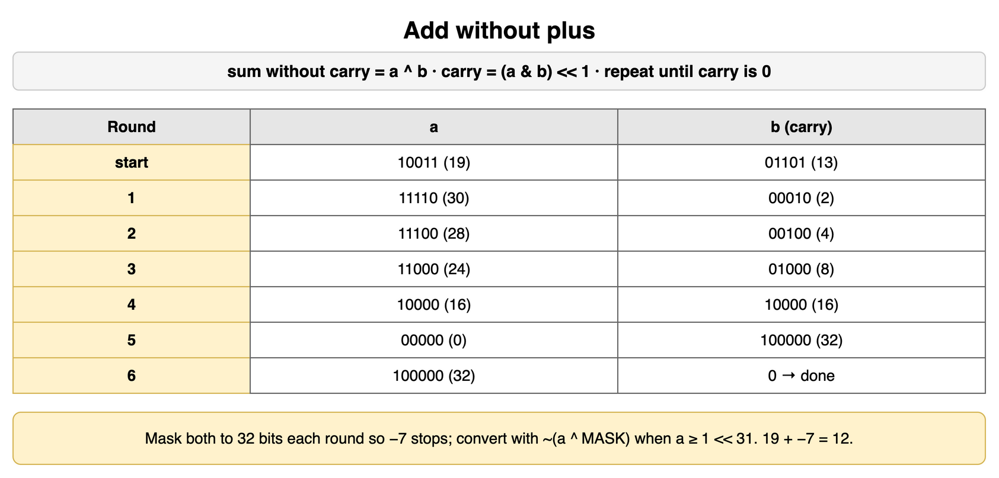
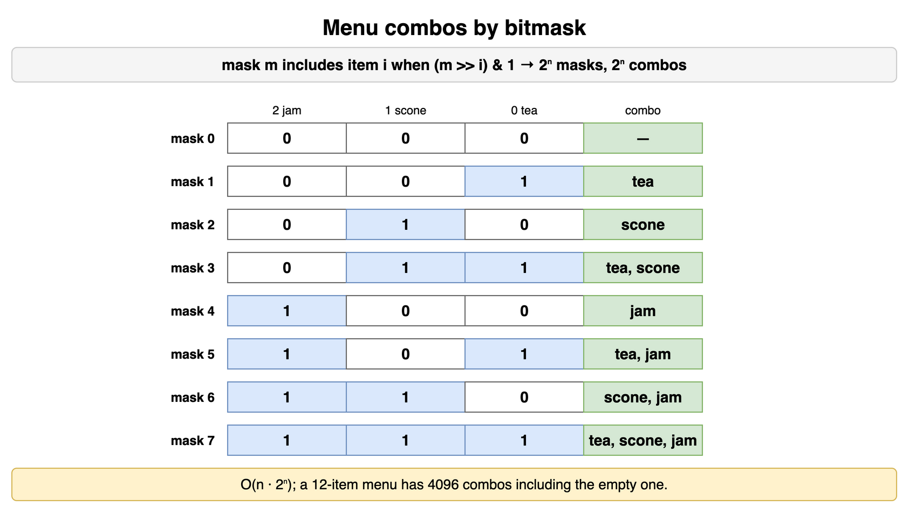
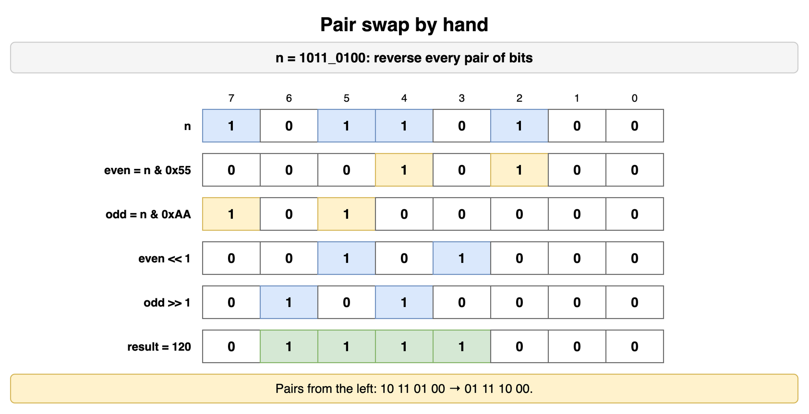
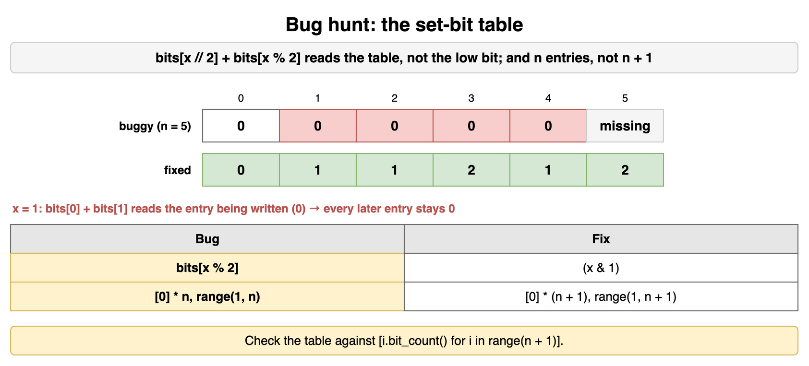
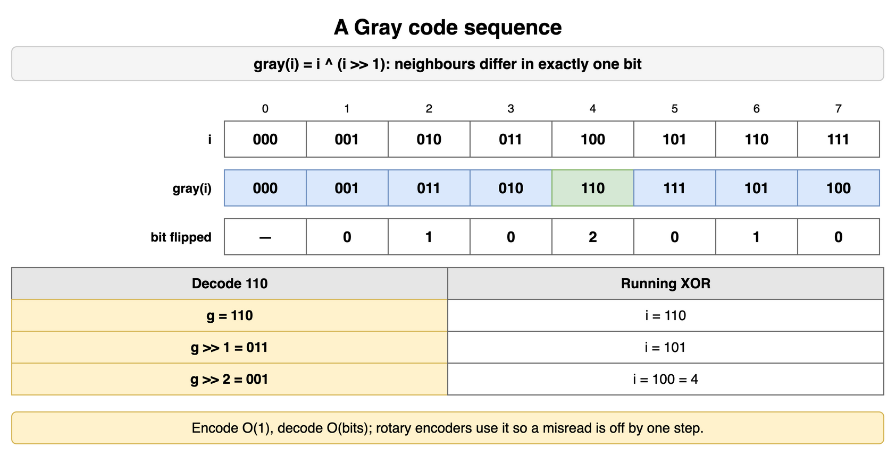

# Bit Manipulation — Drills

Original drills for a missing ticket number, a value among triples, reversing a word, powers of four, adding without plus, menu combos by bitmask, a pair swap by hand, a set-bit table bug, and a Gray code sequence. Each answer names the approach, the cost, and Python. The numbers are exercise values.

## The missing ticket

A booth hands out tickets numbered 0 to n, one each, and the stub box should hold n + 1 stubs. It holds `[4, 0, 6, 1, 3, 2]`, so n = 6 and one number is missing. Find it in O(n) time and O(1) space.

**Answer:** `5`. XOR every index 0..n together with every stub. Each number that is present appears twice (once as an index, once as a stub) and cancels; the missing one appears only as an index and survives. That is O(n) time and O(1) space, and unlike the sum formula `n(n + 1)/2 - sum(stubs)` it cannot overflow in a fixed-width language. The pairing idea is [XOR cancellation](#11_Coding_Problems/26_Bit_Manipulation/concepts/xor-cancellation).

```python
def missing_ticket(stubs: list[int]) -> int:
    result = len(stubs)
    for i, stub in enumerate(stubs):
        result ^= i ^ stub
    return result


print(missing_ticket([4, 0, 6, 1, 3, 2]))
print(missing_ticket([0]), missing_ticket([1]), missing_ticket([]))
# 5
# 1 0 0
```



*Source: [`diagrams/bit-manipulation-drills.drawio`](/content/11_Coding_Problems/26_Bit_Manipulation/diagrams/bit-manipulation-drills.drawio), page 1.*

## One among triples

Every sensor ID in `[11, 6, 11, 2, 6, 11, 6]` appears three times except one, which appears once. Find the single ID in O(n) time and O(1) space. Why does plain XOR fail?

**Answer:** `2`. Three copies XOR to the value itself (`a ^ a ^ a == a`), so plain XOR gives `11 ^ 6 ^ 2 == 15`, which is not in the list. Instead count, for each bit position, how many values have that bit set. Positions belonging only to tripled values have counts divisible by 3; the remainder mod 3 at each position is the single value's bit. With 32 positions that is O(32n) = O(n) time and O(1) space. For negatives, work in 32 bits and convert back with the sign rule from [Fixed width in Python](#11_Coding_Problems/26_Bit_Manipulation/concepts/fixed-width-in-python).

```python
def single_among_triples(ids: list[int]) -> int:
    result = 0
    for bit in range(32):
        count = sum((x >> bit) & 1 for x in ids)
        if count % 3:
            result |= 1 << bit
    return result - (1 << 32) if result >= 1 << 31 else result


print(single_among_triples([11, 6, 11, 2, 6, 11, 6]), 11 ^ 6 ^ 2)
print(single_among_triples([-5, 9, 9, 9]), single_among_triples([0, 0, 0, 7]))
# 2 15
# -5 7
```



*Source: [`diagrams/bit-manipulation-drills.drawio`](/content/11_Coding_Problems/26_Bit_Manipulation/diagrams/bit-manipulation-drills.drawio), page 2.*

## Reverse a 32-bit word

Reverse the bits of the unsigned 32-bit value `0b1101` (that is, 13), so bit 0 becomes bit 31 and so on. What is the result in hex?

**Answer:** `0xb0000000`. Read bits off the right of n with `n & 1` and push them onto the right of the result with `result << 1`, 32 times. The loop count is fixed at 32 so leading zeros of the input become trailing zeros of the output, which is why `0b1101` turns into `1011` followed by 28 zeros. It is O(32) = O(1) time and space. Mask the input first so a negative Python integer is treated as its 32-bit pattern. The shifting and masking rules are on [Masks: test, set, clear, toggle](#11_Coding_Problems/26_Bit_Manipulation/concepts/masks-test-set-clear-toggle).

```python
def reverse_word(n: int) -> int:
    n &= 0xFFFFFFFF
    result = 0
    for _ in range(32):
        result = (result << 1) | (n & 1)
        n >>= 1
    return result


print(hex(reverse_word(0b1101)), reverse_word(1) == 1 << 31)
print(hex(reverse_word(-1)), reverse_word(reverse_word(2026)))
# 0xb0000000 True
# 0xffffffff 2026
```



*Source: [`diagrams/bit-manipulation-drills.drawio`](/content/11_Coding_Problems/26_Bit_Manipulation/diagrams/bit-manipulation-drills.drawio), page 3.*

## Power of four

Which of `[1, 2, 8, 16, 32, 64, 256, 0, -4]` are powers of four? Use a constant-time test, no loop.

**Answer:** `[1, 16, 64, 256]`. A power of four is a power of two whose single set bit sits at an even position (0, 2, 4, ...). First apply the power-of-two test `n > 0 and n & (n - 1) == 0`, then check the bit lands in `0x55555555`, the even-position mask. 2, 8, and 32 pass the first test but have their bit at an odd position. An alternative second test is `n % 3 == 1`, because 4ᵏ ≡ 1 (mod 3) while 2·4ᵏ ≡ 2. Both run in O(1). The first test is on [The lowest set bit](#11_Coding_Problems/26_Bit_Manipulation/concepts/the-lowest-set-bit).

```python
def is_power_of_four(n: int) -> bool:
    return n > 0 and n & (n - 1) == 0 and n & 0x55555555 != 0


values = [1, 2, 8, 16, 32, 64, 256, 0, -4]
print([n for n in values if is_power_of_four(n)])
print([n for n in values if n > 0 and n & (n - 1) == 0 and n % 3 == 1])
# [1, 16, 64, 256]
# [1, 16, 64, 256]
```



*Source: [`diagrams/bit-manipulation-drills.drawio`](/content/11_Coding_Problems/26_Bit_Manipulation/diagrams/bit-manipulation-drills.drawio), page 4.*

## Add without plus

Add `19` and `-7` without `+` or `-`, as a 32-bit signed adder would. Trace the first loop step for 19 + 13.

**Answer:** `12` (and 19 + 13 = 32). XOR adds bits without carrying, and AND shifted left by one is the carry. Repeat `a, b = a ^ b, (a & b) << 1` until the carry is 0. For 19 + 13: `10011 ^ 01101 = 11110` (30) and `(10011 & 01101) << 1 = 00010` (2); after a few more rounds the carry runs out and the sum is 32. Each round moves the carry at least one position left, so there are at most 32 rounds, O(1). In Python the carry from a negative number would grow forever, so mask both values to 32 bits each round and convert back to signed at the end, the pattern from [Fixed width in Python](#11_Coding_Problems/26_Bit_Manipulation/concepts/fixed-width-in-python). [Bit-level arithmetic](#11_Coding_Problems/07_Hard_Problems/concepts/bit-level-arithmetic) covers the same adder.

```python
MASK = 0xFFFFFFFF


def add(a: int, b: int) -> int:
    a, b = a & MASK, b & MASK
    while b:
        a, b = (a ^ b) & MASK, ((a & b) << 1) & MASK
    return a if a < 1 << 31 else ~(a ^ MASK)


print(19 ^ 13, (19 & 13) << 1)
print(add(19, 13), add(19, -7), add(-20, 5), add(0, 0))
# 30 2
# 32 12 -15 0
```



*Source: [`diagrams/bit-manipulation-drills.drawio`](/content/11_Coding_Problems/26_Bit_Manipulation/diagrams/bit-manipulation-drills.drawio), page 5.*

## Menu combos by bitmask

A café sells `["tea", "scone", "jam"]`. List every combo (including the empty one) in the order the masks 0 to 7 produce, then say how many combos a 12-item menu has.

**Answer:** Eight combos: `[]`, `['tea']`, `['scone']`, `['tea', 'scone']`, `['jam']`, `['tea', 'jam']`, `['scone', 'jam']`, `['tea', 'scone', 'jam']`; a 12-item menu has 2¹² = 4096. Mask m includes item i when `(m >> i) & 1` is 1, so counting from 0 to 2ⁿ − 1 visits each subset exactly once with no recursion. That is O(n · 2ⁿ) time. The recursive version is [All subsets](#11_Coding_Problems/22_Backtracking/concepts/all-subsets); the mask view is [Bitmasks as small sets](#11_Coding_Problems/26_Bit_Manipulation/concepts/bitmasks-as-small-sets).

```python
def combos(items: list[str]) -> list[list[str]]:
    n = len(items)
    return [[items[i] for i in range(n) if (mask >> i) & 1] for mask in range(1 << n)]


menu = combos(["tea", "scone", "jam"])
print(menu[:4])
print(menu[4:])
print(len(combos([str(i) for i in range(12)])), combos([]))
# [[], ['tea'], ['scone'], ['tea', 'scone']]
# [['jam'], ['tea', 'jam'], ['scone', 'jam'], ['tea', 'scone', 'jam']]
# 4096 [[]]
```



*Source: [`diagrams/bit-manipulation-drills.drawio`](/content/11_Coding_Problems/26_Bit_Manipulation/diagrams/bit-manipulation-drills.drawio), page 6.*

## Pair swap by hand

Swap each even-position bit with its odd neighbour in `n = 0b1011_0100` (180) using the masks, step by step on 8 bits: what are the even part, the odd part, and the result?

**Answer:** even part `0b0001_0100`, odd part `0b1010_0000`, result `0b0111_1000` (120). `n & 0x55` keeps positions 0, 2, 4, 6, which hold `0001_0100`; shifted left by one it becomes `0010_1000`. `n & 0xAA` keeps positions 1, 3, 5, 7, which hold `1010_0000`; shifted right it becomes `0101_0000`. OR gives `0111_1000`. Reading in pairs from the left, `10 11 01 00` becomes `01 11 10 00`: every pair is reversed. The 32-bit version is [Swap odd and even bits](#11_Coding_Problems/26_Bit_Manipulation/concepts/swap-odd-and-even-bits).

```python
n = 0b1011_0100
even, odd = n & 0x55, n & 0xAA
result = (even << 1) | (odd >> 1)
print(f"{even:08b} {odd:08b} {even << 1:08b} {odd >> 1:08b}")
print(f"{result:08b}", result)
# 00010100 10100000 00101000 01010000
# 01111000 120
```



*Source: [`diagrams/bit-manipulation-drills.drawio`](/content/11_Coding_Problems/26_Bit_Manipulation/diagrams/bit-manipulation-drills.drawio), page 7.*

## Bug hunt: the set-bit table

This should return the set-bit counts for 0 to n. For n = 5 it returns `[0, 0, 0, 0, 0]` instead of `[0, 1, 1, 2, 1, 2]`. Find both bugs.

```python
def set_bit_counts(n):
    bits = [0] * n
    for x in range(1, n):
        bits[x] = bits[x // 2] + bits[x % 2]
    return bits
```

**Answer:** First, `bits[x % 2]` looks up the table at index 0 or 1 instead of adding the low bit itself. At x = 1 it reads `bits[0] + bits[1]`, and `bits[1]` is the entry being computed, still 0, so `bits[1]` stays 0 and every later entry adds zeros. The intended recurrence is `bits[x >> 1] + (x & 1)`. Second, the table has n entries and the loop stops at n − 1, but 0..n needs n + 1 entries. Fixed, n = 5 gives `[0, 1, 1, 2, 1, 2]` in O(n). The recurrence is on [Building answers from smaller numbers](#11_Coding_Problems/26_Bit_Manipulation/concepts/building-answers-from-smaller-numbers).

```python
def buggy(n):
    bits = [0] * n
    for x in range(1, n):
        bits[x] = bits[x // 2] + bits[x % 2]
    return bits


def fixed(n):
    bits = [0] * (n + 1)
    for x in range(1, n + 1):
        bits[x] = bits[x >> 1] + (x & 1)
    return bits


print(buggy(5), fixed(5))
# [0, 0, 0, 0, 0] [0, 1, 1, 2, 1, 2]
```



*Source: [`diagrams/bit-manipulation-drills.drawio`](/content/11_Coding_Problems/26_Bit_Manipulation/diagrams/bit-manipulation-drills.drawio), page 8.*

## A Gray code sequence

A rotary encoder reports positions 0 to 7 so that consecutive positions differ in exactly one bit. List the 3-bit codes in order, and decode `0b110` back to its position.

**Answer:** `000 001 011 010 110 111 101 100`; `0b110` is position 4. The i-th Gray code is `i ^ (i >> 1)`: each output bit is the XOR of an input bit and its higher neighbour, so incrementing i flips exactly one output bit. Decoding undoes that with a running XOR of the code shifted right by 1, 2, 3, ... until it is 0. Encoding is O(1) and decoding O(bits). Encoders and Karnaugh maps use Gray codes so a misread during a transition is off by at most one step. The XOR algebra is on [The six operators](#11_Coding_Problems/26_Bit_Manipulation/concepts/the-six-operators).

```python
def gray(i: int) -> int:
    return i ^ (i >> 1)


def from_gray(g: int) -> int:
    i = 0
    while g:
        i ^= g
        g >>= 1
    return i


codes = [gray(i) for i in range(8)]
print(" ".join(f"{c:03b}" for c in codes))
print(from_gray(0b110), all((a ^ b).bit_count() == 1 for a, b in zip(codes, codes[1:])))
# 000 001 011 010 110 111 101 100
# 4 True
```



*Source: [`diagrams/bit-manipulation-drills.drawio`](/content/11_Coding_Problems/26_Bit_Manipulation/diagrams/bit-manipulation-drills.drawio), page 9.*
