## Spotting a math and geometry problem

Math problems hide in plain sight. Watch for digits of a number ("reverse it", "sum them"), a fixed-width register ("signed 32-bit", "return 0 on overflow"), points and slopes on a plane, a matrix walked in an unusual order, people standing in a circle, or a prompt that asks for row 10⁹ of something and expects O(1). Brute force is often available but too slow or numerically fragile, and the real answer is a small identity: an exact fraction, a recurrence, or a pattern found on small inputs. The number theory basics (divisibility, primes, gcd, modular arithmetic) are taught on [Math and Logic Puzzles](#11_Coding_Problems/01_Math_and_Logic_Puzzles); this topic is the problem set.

Geometry questions in interviews stay on integer grids on purpose, so the safe move is to keep every computation in integers: compare cross products instead of angles, compare fractions by cross-multiplying, and double an area instead of halving it. Surveying software uses the same trick: the shoelace formula gives a polygon's area from its corner coordinates with only multiplications and one subtraction per edge. The example computes a lot's area exactly, doubled to stay an integer.

```python
def doubled_area(corners: list[tuple[int, int]]) -> int:
    total = 0
    for i, (x1, y1) in enumerate(corners):
        x2, y2 = corners[(i + 1) % len(corners)]
        total += x1 * y2 - x2 * y1
    return abs(total)


lot = [(0, 0), (6, 0), (6, 3), (2, 5)]
print(doubled_area(lot), doubled_area(lot) / 2)
print(doubled_area([(0, 0), (4, 0), (0, 3)]))
# 42 21.0
# 12
```

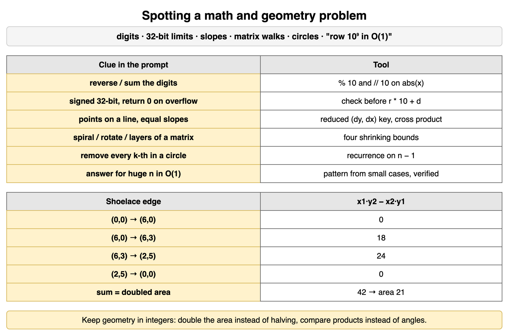

*Source: [`diagrams/math-and-geometry.drawio`](/content/11_Coding_Problems/27_Math_and_Geometry/diagrams/math-and-geometry.drawio), page 1.*

## Floats and exact answers

A double stores 53 bits of mantissa, so most decimal fractions are rounded on the way in: `0.1 + 0.2 == 0.3` is `False` in every IEEE-754 language, not just Python. Two slopes that are mathematically equal can therefore land on different floats, and two different slopes far apart in magnitude can collide. Equality tests on floats are a bug waiting to happen; when a float is unavoidable, compare with a tolerance such as `math.isclose(a, b, rel_tol=1e-9)`.

The better fix is to avoid floats entirely. Compare `a/b` with `c/d` (positive denominators) by testing `a * d` against `c * b`. Test whether three points are collinear with the integer cross product `(x2 - x1)(y3 - y1) - (y2 - y1)(x3 - x1)`: zero means collinear, positive means a left turn, negative a right turn. Python's `fractions.Fraction` keeps exact rationals when you need arithmetic, at the cost of gcd work on every operation. Python integers never overflow, so the cross product stays exact; in Java or C++ use 64-bit for products of 32-bit coordinates.

```python
import math
from fractions import Fraction


def cross(o, a, b):
    return (a[0] - o[0]) * (b[1] - o[1]) - (a[1] - o[1]) * (b[0] - o[0])


print(0.1 + 0.2 == 0.3, math.isclose(0.1 + 0.2, 0.3), Fraction(1, 10) + Fraction(2, 10))
print(1 * 6 == 2 * 3, cross((0, 0), (2, 4), (5, 10)), cross((0, 0), (2, 4), (5, 9)))
# False True 3/10
# True 0 -2
```

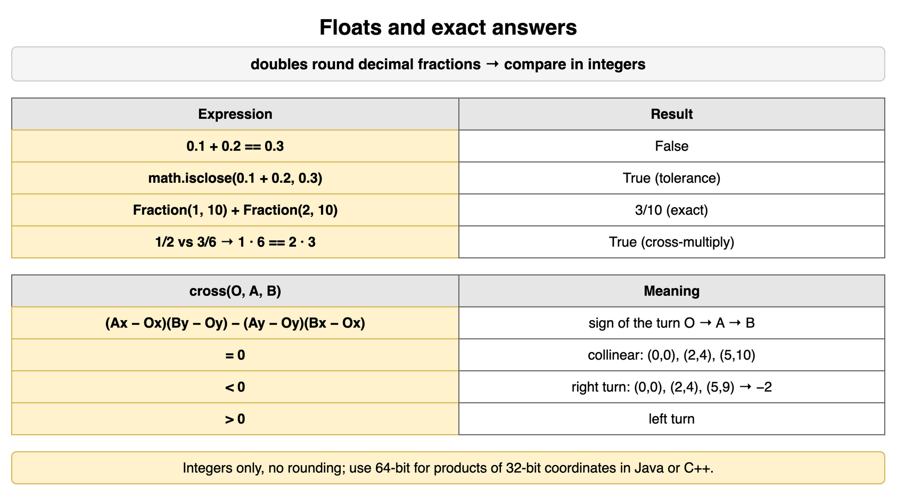

*Source: [`diagrams/math-and-geometry.drawio`](/content/11_Coding_Problems/27_Math_and_Geometry/diagrams/math-and-geometry.drawio), page 2.*

## Overflow checks before the operation

A fixed-width integer silently wraps (or, in C, triggers undefined behaviour) when a result leaves its range. A signed 32-bit int covers −2³¹ to 2³¹ − 1, that is −2,147,483,648 to 2,147,483,647. The check must happen before the risky step, because afterwards the wrapped value looks like an ordinary number. To append a digit d to a non-negative result r safely, test `r > (LIMIT - d) // 10` first, which is equivalent to `r * 10 + d > LIMIT` without computing it. The general rules are on [Overflow awareness](#11_Coding_Problems/01_Math_and_Logic_Puzzles/concepts/overflow-awareness) and [Overflow-safe arithmetic](#11_Coding_Problems/06_Moderate_Problems/concepts/overflow-safe-arithmetic).

Python integers are unbounded, so an interviewer who says "assume only 32-bit values can be stored" expects you to enforce the bound yourself. Work on the magnitude and pick the limit by sign: 2³¹ − 1 for positive results, 2³¹ for negative ones, since the negative side is one larger. Real failures show why: signed 32-bit Unix time runs out at 03:14:07 UTC on 19 January 2038, and Ariane 5 flight 501 was lost in 1996 when a 64-bit float was converted into a 16-bit signed integer that could not hold it.

```python
INT_MAX = 2**31 - 1


def append_digit(r: int, d: int, limit: int = INT_MAX) -> int | None:
    if r > (limit - d) // 10:
        return None
    return r * 10 + d


print(append_digit(214748364, 7), append_digit(214748364, 8))
print(append_digit(214748364, 8, limit=2**31), INT_MAX + 1 - 2**32)
# 2147483647 None
# 2147483648 -2147483648
```

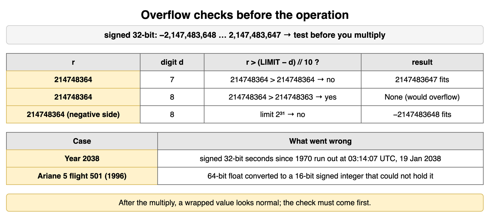

*Source: [`diagrams/math-and-geometry.drawio`](/content/11_Coding_Problems/27_Math_and_Geometry/diagrams/math-and-geometry.drawio), page 3.*

## Digits with truncating division

Peeling digits is `d = x % 10` then `x //= 10`, O(number of digits), which is O(log₁₀ x). The trap is negative numbers: Python's `//` floors toward −∞ and `%` takes the sign of the divisor, so `-123 % 10` is `7` and `-123 // 10` is `-13`. C, C++, Java, and Go truncate toward zero instead and give `-3` and `-12`. Code that ports a C solution digit-for-digit will loop wrongly or produce garbage on negatives. Digit peeling for non-negative numbers is covered on [Digits, not the whole number](#11_Coding_Problems/06_Moderate_Problems/concepts/digits-not-the-whole-number).

The portable fix is to strip the sign first: remember `sign = -1 if x < 0 else 1`, work on `abs(x)`, and multiply the sign back at the end. If you need C-style truncation directly, `math.fmod(x, 10)` returns a float with the dividend's sign, and `int(x / 10)` truncates but goes through a float and loses precision past 2⁵³. Zero is one digit, and `abs` of the most negative fixed-width value does not fit in that width, which matters in Java but not in Python.

```python
import math


def digits(x: int) -> list[int]:
    x = abs(x)
    out = []
    while True:
        out.append(x % 10)
        x //= 10
        if x == 0:
            return out[::-1]


print(-123 % 10, -123 // 10, math.fmod(-123, 10), int(-123 / 10))
print(digits(-4072), digits(0))
# 7 -13 -3.0 -12
# [4, 0, 7, 2] [0]
```

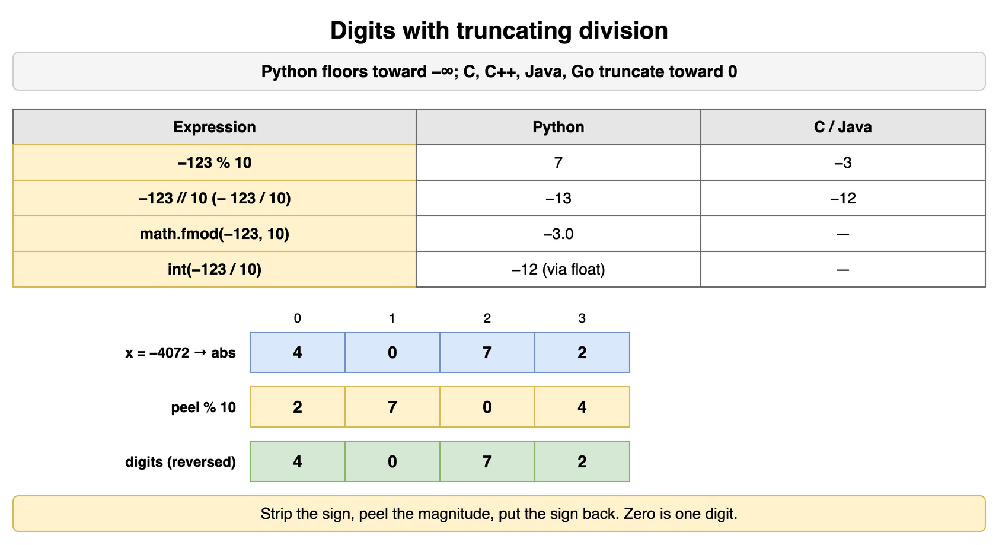

*Source: [`diagrams/math-and-geometry.drawio`](/content/11_Coding_Problems/27_Math_and_Geometry/diagrams/math-and-geometry.drawio), page 4.*

## Reduced fractions as keys

A ratio such as a slope `dy / dx` becomes a reliable hash key once it is in canonical form. Divide both parts by `gcd(|dy|, |dx|)`, then fix the sign so equal ratios look equal: make `dx` positive, and when `dx` is 0 store a single vertical key such as `(1, 0)`. Without the sign rule, `(1, -2)` and `(-1, 2)` describe the same line direction but hash differently. Euclid's algorithm runs in O(log min(a, b)), and `math.gcd` handles negatives and zero (`gcd(0, 5) == 5`). The algorithm itself is on [GCD and LCM](#11_Coding_Problems/01_Math_and_Logic_Puzzles/concepts/gcd-and-lcm) and [Modulo and gcd](#11_Coding_Problems/06_Moderate_Problems/concepts/modulo-and-gcd).

The same canonical-key idea groups anything that compares by ratio: aspect ratios of screens (1920×1080 and 1280×720 are both 16:9), recipe scaling, or gear ratios. The key costs one gcd and two integer divisions, and it never suffers float rounding. A pair of identical points has `dx == dy == 0` and no direction at all; handle it before calling the function.

```python
from math import gcd


def ratio_key(dy: int, dx: int) -> tuple[int, int]:
    if dx == 0:
        return (1, 0)
    g = gcd(dy, dx)
    dy, dx = dy // g, dx // g
    return (-dy, -dx) if dx < 0 else (dy, dx)


print(ratio_key(1, -2), ratio_key(-1, 2), ratio_key(6, 4), ratio_key(-7, 0))
print(ratio_key(1080, 1920) == ratio_key(720, 1280), ratio_key(0, -5))
# (-1, 2) (-1, 2) (3, 2) (1, 0)
# True (0, 1)
```

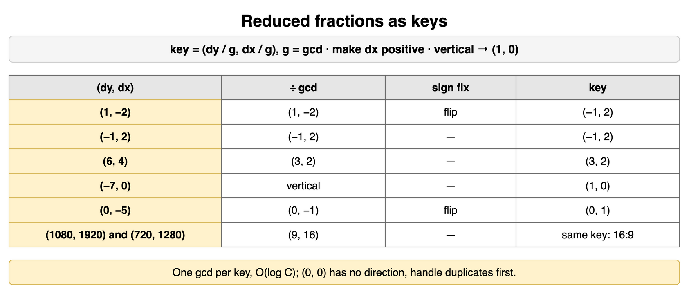

*Source: [`diagrams/math-and-geometry.drawio`](/content/11_Coding_Problems/27_Math_and_Geometry/diagrams/math-and-geometry.drawio), page 5.*

## Modular answers for huge counts

When the true answer has thousands of digits (number of paths, arrangements, codes), prompts ask for it modulo a prime, usually 10⁹ + 7. Reduce after every addition and multiplication: `(a + b) % M` and `(a * b) % M` depend only on `a % M` and `b % M`, so intermediate values never exceed about M². In Java or C++ that means 64-bit products of two 32-bit residues. Division is not allowed directly; multiply by the modular inverse `pow(b, M - 2, M)` instead, which works because M is prime. The rules are on [Modular arithmetic](#11_Coding_Problems/01_Math_and_Logic_Puzzles/concepts/modular-arithmetic) and fast powers on [Fast exponentiation](#11_Coding_Problems/01_Math_and_Logic_Puzzles/concepts/fast-exponentiation).

Subtraction is the language trap: `(a - b) % M` is non-negative in Python but can be negative in C, C++, and Java, so write `((a - b) % M + M) % M` there. Python hides the cost of skipping reductions behind big integers, so the code is correct but slow; reduce anyway to show you know the fixed-width rule. Cryptography relies on the same arithmetic: RSA encrypts with modular powers of numbers hundreds of digits long.

```python
M = 10**9 + 7


def factorial_mod(n: int) -> int:
    result = 1
    for i in range(2, n + 1):
        result = result * i % M
    return result


f = factorial_mod(100_000)
print(f, (3 - 10) % M, 12 * pow(4, M - 2, M) % M)
print(len(str(__import__("math").factorial(1000))))
# 457992974 1000000000 3
# 2568
```

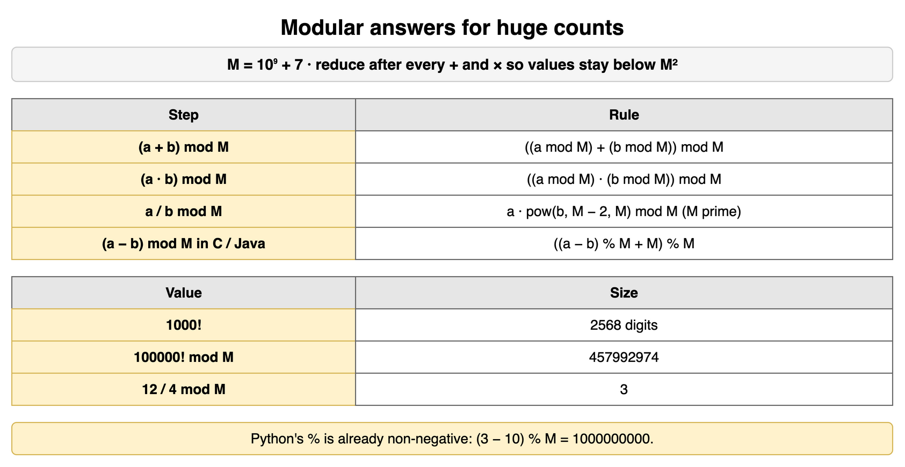

*Source: [`diagrams/math-and-geometry.drawio`](/content/11_Coding_Problems/27_Math_and_Geometry/diagrams/math-and-geometry.drawio), page 6.*

## Walking shrinking boundaries

Many matrix problems peel the grid like an onion. Keep four bounds, `top`, `bottom`, `left`, `right`, walk one side, then move that bound inward. A layer is finished when all four sides are walked; the walk ends when `top > bottom` or `left > right`. Each cell is visited once, so the cost is O(m · n) time and O(1) extra space. Index work for 2D arrays is reviewed on [Matrix as 2D array](#07_Data_Structures_and_Algorithms/02_Arrays_Strings_and_Hash_Tables/concepts/matrix-as-2d-array).

The same bounds drive spiral order, spiral fill, layer-by-layer rotation of a square matrix, and per-ring sums (useful for image borders and padding checks). The edge cases are always the same: an empty matrix, a single row, a single column, and an odd-sized square whose centre is a ring of one cell. The example sums each ring of a 4 × 5 grid.

```python
def ring_sums(grid: list[list[int]]) -> list[int]:
    if not grid:
        return []
    top, bottom, left, right = 0, len(grid) - 1, 0, len(grid[0]) - 1
    sums = []
    while top <= bottom and left <= right:
        ring = sum(grid[top][left:right + 1])
        if bottom > top:
            ring += sum(grid[bottom][left:right + 1])
        for r in range(top + 1, bottom):
            ring += grid[r][left] + (grid[r][right] if right > left else 0)
        sums.append(ring)
        top, bottom, left, right = top + 1, bottom - 1, left + 1, right - 1
    return sums


grid = [[1, 1, 1, 1, 1], [1, 5, 5, 5, 1], [1, 5, 9, 5, 1], [1, 1, 1, 1, 1]]
print(ring_sums(grid), ring_sums([[4, 2, 7]]), ring_sums([]))
# [14, 34] [13] []
```

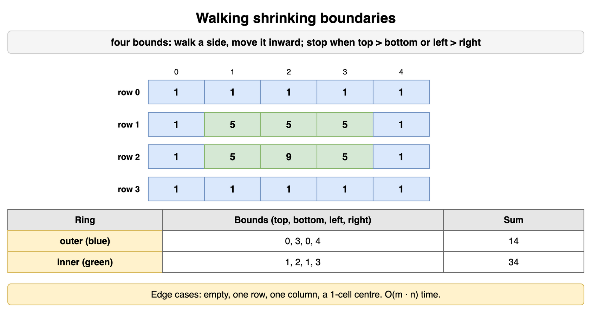

*Source: [`diagrams/math-and-geometry.drawio`](/content/11_Coding_Problems/27_Math_and_Geometry/diagrams/math-and-geometry.drawio), page 7.*

## Patterns from small cases

When a prompt asks about input size 10⁹ or wants O(1), the answer is usually a pattern you can see on small inputs. Write the brute force first, print its answers for n = 1 to 20 or so, look for a cycle, a closed form, or a parity rule, then check the guess against the brute force on many more values before trusting it. Reduce what you track to what the question needs: last digits only need arithmetic mod 10, even or odd only needs mod 2, and that keeps the brute force fast and the pattern visible. The puzzle version of this habit is [Develop rules and patterns](#11_Coding_Problems/01_Math_and_Logic_Puzzles/concepts/develop-rules-and-patterns).

A pattern that holds for ten values is a conjecture, not a proof. In an interview, say how you checked it (brute force up to some bound) and, if you can, why it holds: the last digit of 7ⁿ depends only on the previous last digit, there are at most 10 of them, so the sequence must cycle. The example finds the cycle of length 4 and checks the O(1) rule against brute force for 500 exponents.

```python
def last_digit_brute(n: int) -> int:
    digit = 1
    for _ in range(n):
        digit = digit * 7 % 10
    return digit


def last_digit_fast(n: int) -> int:
    return 1 if n == 0 else [7, 9, 3, 1][(n - 1) % 4]


print([last_digit_brute(n) for n in range(1, 9)])
print(all(last_digit_fast(n) == last_digit_brute(n) for n in range(500)), last_digit_fast(10**18))
# [7, 9, 3, 1, 7, 9, 3, 1]
# True 1
```

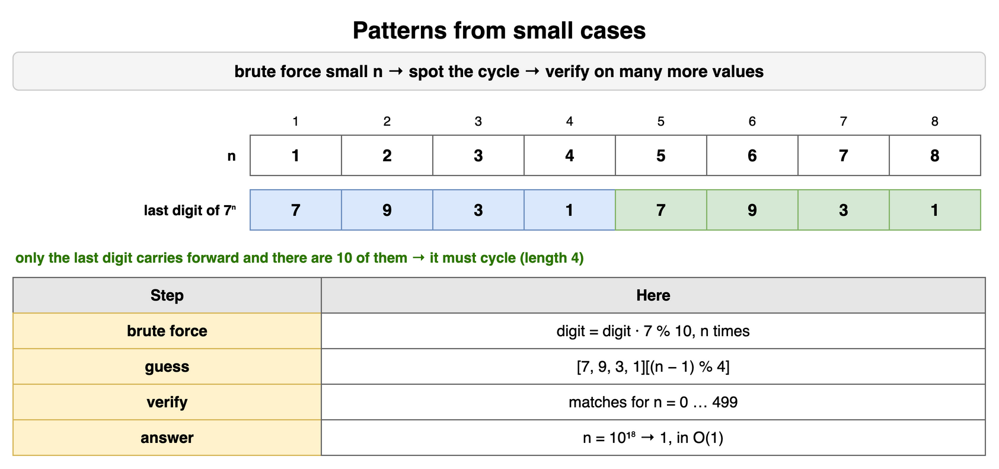

*Source: [`diagrams/math-and-geometry.drawio`](/content/11_Coding_Problems/27_Math_and_Geometry/diagrams/math-and-geometry.drawio), page 8.*

## Recurrences that shrink the problem

Some counting problems become easy once you express the answer for n through the answer for n − 1. Ask: "if I add one more item (or remove one), what changes?" Each new straight line on a plane, placed so it crosses every earlier line at a distinct point, is cut into n pieces by the n − 1 earlier lines, and each piece splits one region in two. So `R(n) = R(n - 1) + n` with `R(0) = 1`, which sums to the closed form `n(n + 1)/2 + 1`. Moving a stack of n discs in the classic peg puzzle is `T(n) = 2T(n - 1) + 1`, which is `2ⁿ − 1`.

A recurrence gives you three implementations in order of preference: a closed form (O(1)) if you can find or guess and verify one, an iterative loop (O(n) time, O(1) space), or recursion (O(n) stack, which hits Python's default limit near 1000). The same shape drives [Dynamic Programming](#11_Coding_Problems/23_Dynamic_Programming); here the state is a single number, so no table is needed.

```python
def regions(n: int) -> int:
    count = 1
    for lines in range(1, n + 1):
        count += lines
    return count


def disc_moves(n: int) -> int:
    return 0 if n == 0 else 2 * disc_moves(n - 1) + 1


print([regions(n) for n in range(6)], regions(100) == 100 * 101 // 2 + 1)
print([disc_moves(n) for n in range(6)], disc_moves(20) == 2**20 - 1)
# [1, 2, 4, 7, 11, 16] True
# [0, 1, 3, 7, 15, 31] True
```

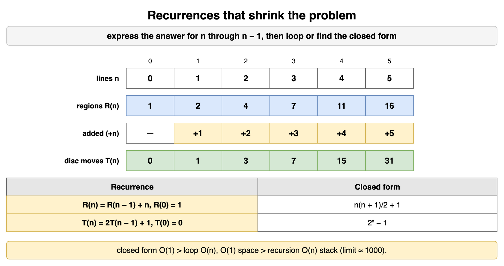

*Source: [`diagrams/math-and-geometry.drawio`](/content/11_Coding_Problems/27_Math_and_Geometry/diagrams/math-and-geometry.drawio), page 9.*

## Spiral order of a matrix

Return the cells of an m × n matrix in clockwise spiral order, starting at the top-left corner. Use the four bounds from [Walking shrinking boundaries](#11_Coding_Problems/27_Math_and_Geometry/concepts/walking-shrinking-boundaries): walk the top row left to right and move `top` down, walk the right column top to bottom and move `right` left, then walk the bottom row right to left and the left column bottom to top. Each cell is appended once, so the cost is O(m · n) time and O(1) extra space beyond the output.

The bug lives in the last two walks. After the first two sides, the remaining block may be a single row or a single column, and walking it backwards would add those cells a second time. Re-check `top <= bottom` before the bottom-row walk and `left <= right` before the left-column walk. Test on an empty matrix, one row, one column, and a non-square block such as 3 × 4.

```python
def spiral(matrix: list[list[int]]) -> list[int]:
    out = []
    if not matrix:
        return out
    top, bottom, left, right = 0, len(matrix) - 1, 0, len(matrix[0]) - 1
    while top <= bottom and left <= right:
        out.extend(matrix[top][c] for c in range(left, right + 1))
        top += 1
        out.extend(matrix[r][right] for r in range(top, bottom + 1))
        right -= 1
        if top <= bottom:
            out.extend(matrix[bottom][c] for c in range(right, left - 1, -1))
            bottom -= 1
        if left <= right:
            out.extend(matrix[r][left] for r in range(bottom, top - 1, -1))
            left += 1
    return out


print(spiral([[1, 2, 3, 4], [5, 6, 7, 8], [9, 10, 11, 12]]))
print(spiral([[1], [2], [3]]), spiral([[1, 2, 3]]), spiral([]))
# [1, 2, 3, 4, 8, 12, 11, 10, 9, 5, 6, 7]
# [1, 2, 3] [1, 2, 3] []
```

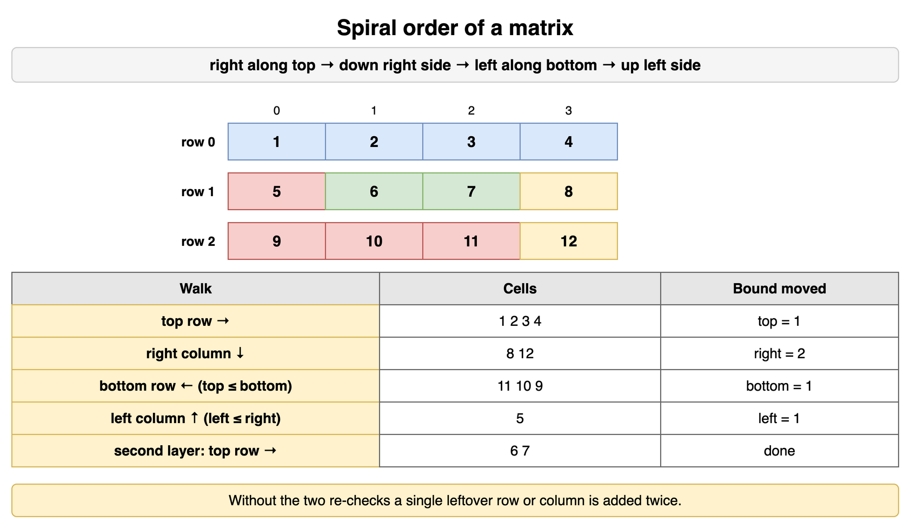

*Source: [`diagrams/math-and-geometry.drawio`](/content/11_Coding_Problems/27_Math_and_Geometry/diagrams/math-and-geometry.drawio), page 10.*

## Reverse a 32-bit integer

Reverse the decimal digits of a signed 32-bit integer, keeping the sign, and return 0 if the reversed value does not fit in 32 bits. Assume the environment can store only 32-bit values, so you may not build the big number and check it afterwards. Strip the sign, pop digits with `% 10` and `// 10` from [Digits with truncating division](#11_Coding_Problems/27_Math_and_Geometry/concepts/digits-with-truncating-division), and push each onto the result after the check from [Overflow checks before the operation](#11_Coding_Problems/27_Math_and_Geometry/concepts/overflow-checks-before-the-operation). The loop runs once per digit, so O(log₁₀ |x|) time (at most 10 iterations) and O(1) space.

Trailing zeros of the input simply vanish (1200 becomes 21), and the limit depends on the sign: a negative result may reach magnitude 2³¹, one more than a positive one. Reversing the string with `str(x)[::-1]` is a fine first answer if allowed, but it builds the oversized number before checking, which breaks the stated rule; ask before using it.

```python
def reverse_int(x: int) -> int:
    sign = -1 if x < 0 else 1
    x, limit, result = abs(x), 2**31 - 1 if sign > 0 else 2**31, 0
    while x:
        digit = x % 10
        x //= 10
        if result > (limit - digit) // 10:
            return 0
        result = result * 10 + digit
    return sign * result


print(reverse_int(1200), reverse_int(-470), reverse_int(0))
print(reverse_int(1534236469), reverse_int(-2147483412), reverse_int(2147483647))
# 21 -74 0
# 0 -2143847412 0
```

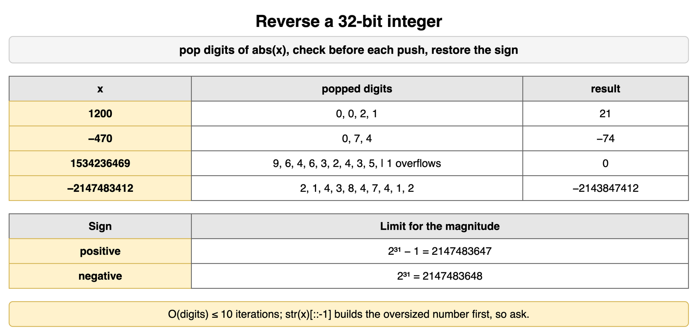

*Source: [`diagrams/math-and-geometry.drawio`](/content/11_Coding_Problems/27_Math_and_Geometry/diagrams/math-and-geometry.drawio), page 11.*

## Most points on one line

Given n points with integer coordinates, find the largest number of them that lie on one straight line. Fix each point as an anchor in turn, and group every later point by the direction from the anchor, using the canonical key from [Reduced fractions as keys](#11_Coding_Problems/27_Math_and_Geometry/concepts/reduced-fractions-as-keys). All points sharing a key with the anchor lie on one line through it, so the best line through the anchor has `1 + duplicates + largest group` points. Each pair is examined once with one gcd, so the cost is O(n² log C) time, where C is the coordinate range, and O(n) space for the per-anchor map.

Floating slopes break this: two different directions can round to the same double, and `-0.0` versus `0.0` or vertical lines need special cases anyway. Clarify duplicates: if the input may repeat a point, count copies of the anchor separately, because they lie on every line through it. With fewer than three points the answer is simply n.

```python
from collections import Counter
from math import gcd


def max_on_line(points: list[tuple[int, int]]) -> int:
    best = min(len(points), 2)
    for i, (x1, y1) in enumerate(points):
        slopes, same = Counter(), 0
        for x2, y2 in points[i + 1:]:
            dy, dx = y2 - y1, x2 - x1
            if dx == dy == 0:
                same += 1
                continue
            g = gcd(dy, dx)
            dy, dx = dy // g, dx // g
            if dx < 0 or (dx == 0 and dy < 0):
                dy, dx = -dy, -dx
            slopes[(dy, dx)] += 1
        best = max(best, 1 + same + max(slopes.values(), default=0))
    return best


print(max_on_line([(1, 1), (3, 2), (5, 3), (4, 1), (2, 3), (1, 4)]))
print(max_on_line([(0, 0), (0, 0), (2, 2), (5, 1)]), max_on_line([(7, 7)]), max_on_line([]))
# 4
# 3 1 0
```

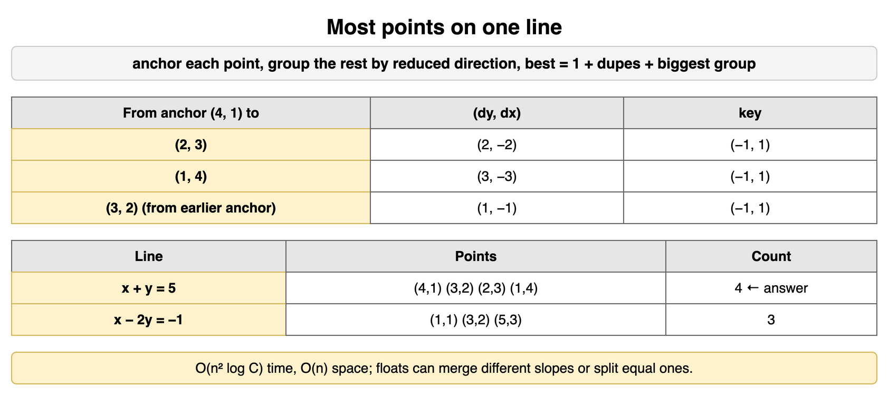

*Source: [`diagrams/math-and-geometry.drawio`](/content/11_Coding_Problems/27_Math_and_Geometry/diagrams/math-and-geometry.drawio), page 12.*

## The last survivor in a circle

n people stand in a circle, numbered 0 to n − 1. Starting at person 0, count k people and remove the k-th; counting continues from the next person. Which position survives? Simulating with a list costs O(n²) because each removal shifts the list. The recurrence is faster: after the first removal, the remaining n − 1 people form the same puzzle with positions shifted by k. So the survivor index is `J(1) = 0` and `J(n) = (J(n - 1) + k) % n`, which takes O(n) time.

Solve it bottom-up in a loop to get O(1) space; the recursive form needs O(n) stack and overflows Python's default recursion limit near n = 1000. Watch the numbering: the recurrence is 0-based, so add 1 if the prompt numbers people from 1. For k = 2 there is also a closed form (write n = 2ᵃ + l with 0 ≤ l < 2ᵃ; the 0-based survivor is 2l), but the loop works for any k. Round-robin elimination in load balancers and the "counting out" rhymes of playground games are the same process.

```python
def survivor(n: int, k: int) -> int:
    pos = 0
    for size in range(2, n + 1):
        pos = (pos + k) % size
    return pos


def survivor_sim(n: int, k: int) -> int:
    people, i = list(range(n)), 0
    while len(people) > 1:
        i = (i + k - 1) % len(people)
        people.pop(i)
    return people[0]


print(survivor(10, 3) + 1, survivor(1, 5), survivor(10**6, 2) == 2 * (10**6 - 2**19))
print(all(survivor(n, k) == survivor_sim(n, k) for n in range(1, 40) for k in range(1, 6)))
# 4 0 True
# True
```

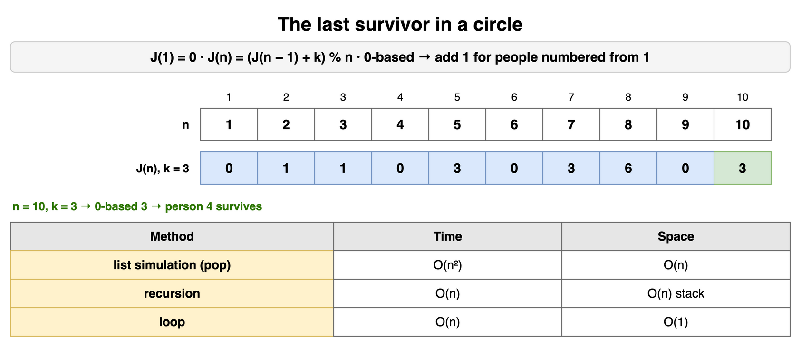

*Source: [`diagrams/math-and-geometry.drawio`](/content/11_Coding_Problems/27_Math_and_Geometry/diagrams/math-and-geometry.drawio), page 13.*

## First even number in a sum triangle

Build a triangle where row 1 is `[1]` and every later row is two cells wider; each cell is the sum of the up-to-three cells above it (above-left, directly above, above-right), with missing cells counted as 0. Row 2 is `1 1 1`, row 3 is `1 2 3 2 1`. For row n ≥ 3, return the 1-based position of the first even number. Generating rows costs O(n²) time and the values grow exponentially, but only parity matters, so build the rows mod 2 and look.

Printing parity rows for n = 3 to 20 shows a cycle of length 4: odd n gives position 2, n divisible by 4 gives 3, and n ≡ 2 (mod 4) gives 4. Rows 1 and 2 are all odd, so they have no answer (return −1). The O(1) rule is only as good as its check, so the example compares it with the parity brute force for every row up to 300. This is the workflow from [Patterns from small cases](#11_Coding_Problems/27_Math_and_Geometry/concepts/patterns-from-small-cases).

```python
def first_even_brute(n: int) -> int:
    row = [1]
    for _ in range(n - 1):
        padded = [0, 0] + row + [0, 0]
        row = [(padded[i] + padded[i + 1] + padded[i + 2]) % 2 for i in range(len(row) + 2)]
    return next((i + 1 for i, v in enumerate(row) if v == 0), -1)


def first_even(n: int) -> int:
    if n < 3:
        return -1
    return 2 if n % 2 else (3 if n % 4 == 0 else 4)


print([first_even_brute(n) for n in range(1, 11)])
print(all(first_even(n) == first_even_brute(n) for n in range(1, 301)), first_even(10**9))
# [-1, -1, 2, 3, 2, 4, 2, 3, 2, 4]
# True 3
```

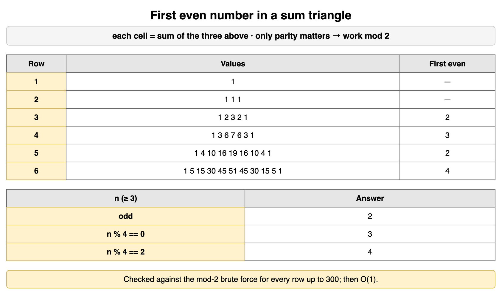

*Source: [`diagrams/math-and-geometry.drawio`](/content/11_Coding_Problems/27_Math_and_Geometry/diagrams/math-and-geometry.drawio), page 14.*

## Formula, simulation, or search

Start with the simplest correct method and move to math only when the constraints demand it. If n is small (up to about 10⁴ for O(n²)), a direct simulation is easy to get right and easy to test. If n is large or the prompt says O(1), look for a recurrence or a pattern, and keep the simulation as the test oracle. If the inputs are real geometry (points, slopes, areas), keep integers and canonical keys rather than floats.

In an interview, name the edge cases out loud: zero and negative inputs, the 32-bit boundaries, empty or one-row matrices, duplicate points, and off-by-one numbering. Then show the fast version agrees with the slow one on a range of inputs. The example times both survivor methods on a circle of 20,000 people; the recurrence finishes in milliseconds while the list simulation does about 10⁸ element shifts.

```python
import time


def survivor(n: int, k: int) -> int:
    pos = 0
    for size in range(2, n + 1):
        pos = (pos + k) % size
    return pos


def survivor_sim(n: int, k: int) -> int:
    people, i = list(range(n)), 0
    while len(people) > 1:
        i = (i + k - 1) % len(people)
        people.pop(i)
    return people[0]


start = time.perf_counter()
fast = survivor(20_000, 7)
mid = time.perf_counter()
slow = survivor_sim(20_000, 7)
end = time.perf_counter()
print(fast == slow, mid - start < end - mid)
# True True
```

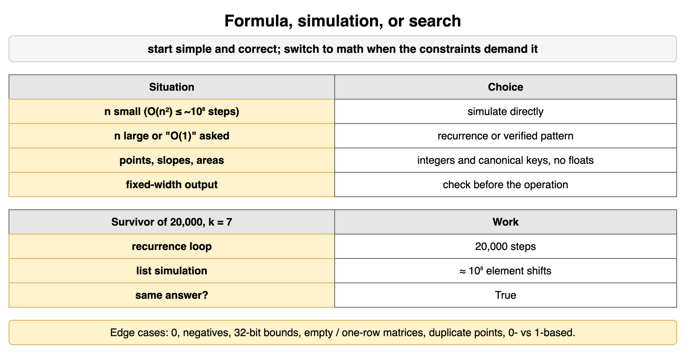

*Source: [`diagrams/math-and-geometry.drawio`](/content/11_Coding_Problems/27_Math_and_Geometry/diagrams/math-and-geometry.drawio), page 15.*
