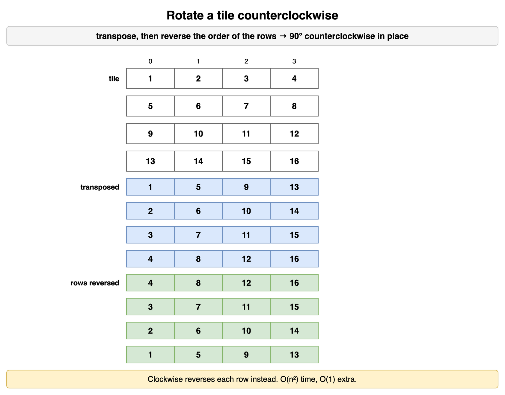
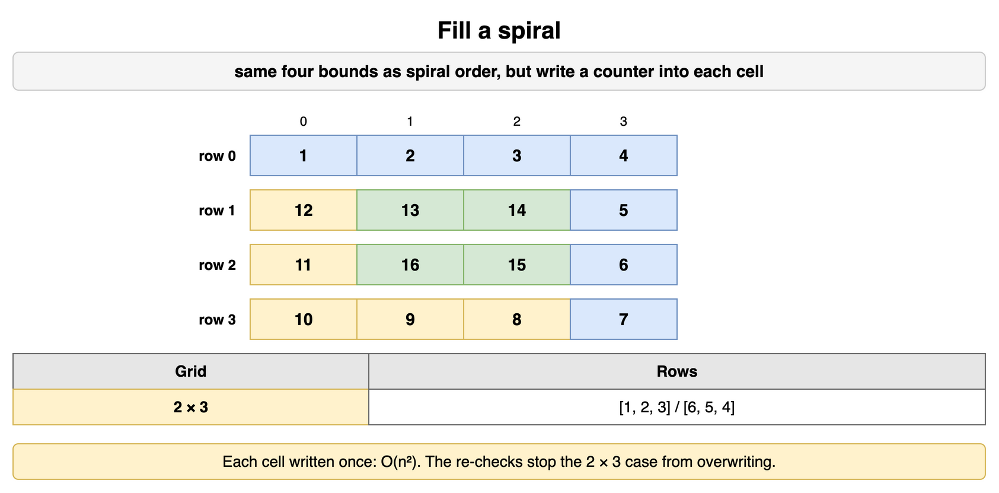
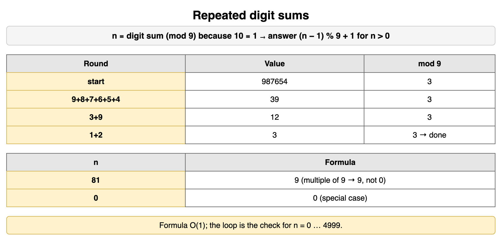
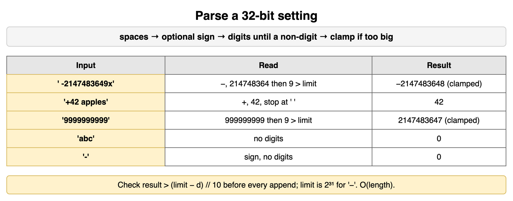
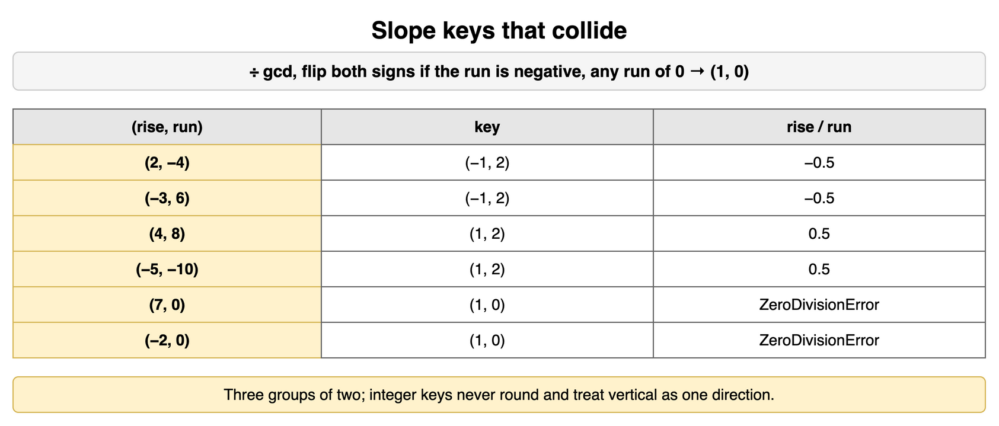
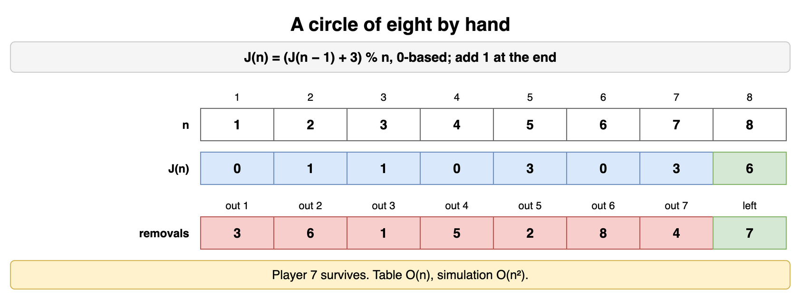
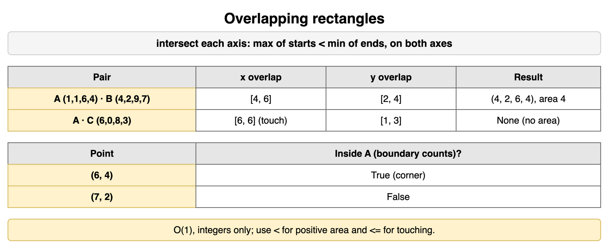
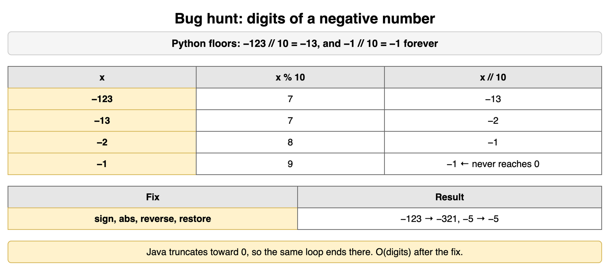
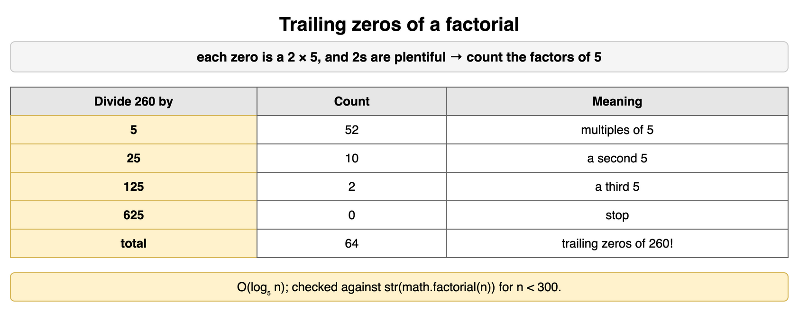

# Math and Geometry — Drills

Original drills for rotating a tile, filling a spiral, repeated digit sums, parsing a 32-bit setting, slope keys, a circle by hand, overlapping rectangles, a negative-digit bug, and trailing zeros. Each answer names the approach, the cost, and Python. The numbers are exercise values.

## Rotate a tile counterclockwise

A 4 × 4 image tile holds `[[1, 2, 3, 4], [5, 6, 7, 8], [9, 10, 11, 12], [13, 14, 15, 16]]`. Rotate it 90° counterclockwise in place (no second matrix). What is the new first row?

**Answer:** `[4, 8, 12, 16]`. Transpose (swap `m[i][j]` with `m[j][i]` above the diagonal), then reverse the order of the rows. Clockwise rotation reverses each row instead, as on [Matrix as 2D array](#07_Data_Structures_and_Algorithms/02_Arrays_Strings_and_Hash_Tables/concepts/matrix-as-2d-array). Both steps touch each cell a constant number of times: O(n²) time, O(1) extra space. The layer view from [Walking shrinking boundaries](#11_Coding_Problems/27_Math_and_Geometry/concepts/walking-shrinking-boundaries) gives the same result with four-way swaps per ring.

```python
def rotate_ccw(m: list[list[int]]) -> None:
    n = len(m)
    for i in range(n):
        for j in range(i + 1, n):
            m[i][j], m[j][i] = m[j][i], m[i][j]
    m.reverse()


tile = [[1, 2, 3, 4], [5, 6, 7, 8], [9, 10, 11, 12], [13, 14, 15, 16]]
rotate_ccw(tile)
print(tile[0], tile[3])
one = [[9]]
rotate_ccw(one)
print(one)
# [4, 8, 12, 16] [1, 5, 9, 13]
# [[9]]
```



*Source: [`diagrams/math-and-geometry-drills.drawio`](/content/11_Coding_Problems/27_Math_and_Geometry/diagrams/math-and-geometry-drills.drawio), page 1.*

## Fill a spiral

Fill a 4 × 4 grid with 1 to 16 in clockwise spiral order, starting at the top-left. What are the four rows?

**Answer:** `[1, 2, 3, 4]`, `[12, 13, 14, 5]`, `[11, 16, 15, 6]`, `[10, 9, 8, 7]`. Reuse the four bounds from [Spiral order of a matrix](#11_Coding_Problems/27_Math_and_Geometry/concepts/spiral-order-of-a-matrix), but write a counter into each cell instead of reading it. Each cell is written once: O(n²) time, and no extra space beyond the grid. The same guard (`top <= bottom`, `left <= right`) matters for non-square grids such as 2 × 3.

```python
def spiral_fill(rows: int, cols: int) -> list[list[int]]:
    grid = [[0] * cols for _ in range(rows)]
    top, bottom, left, right, value = 0, rows - 1, 0, cols - 1, 1
    while top <= bottom and left <= right:
        for c in range(left, right + 1):
            grid[top][c], value = value, value + 1
        top += 1
        for r in range(top, bottom + 1):
            grid[r][right], value = value, value + 1
        right -= 1
        if top <= bottom:
            for c in range(right, left - 1, -1):
                grid[bottom][c], value = value, value + 1
            bottom -= 1
        if left <= right:
            for r in range(bottom, top - 1, -1):
                grid[r][left], value = value, value + 1
            left += 1
    return grid


for row in spiral_fill(4, 4):
    print(row)
print(spiral_fill(2, 3))
# [1, 2, 3, 4]
# [12, 13, 14, 5]
# [11, 16, 15, 6]
# [10, 9, 8, 7]
# [[1, 2, 3], [6, 5, 4]]
```



*Source: [`diagrams/math-and-geometry-drills.drawio`](/content/11_Coding_Problems/27_Math_and_Geometry/diagrams/math-and-geometry-drills.drawio), page 2.*

## Repeated digit sums

A checksum adds the digits of a serial number, then adds the digits of that sum, and repeats until one digit is left. What is the checksum of 987654? Can you get it without a loop?

**Answer:** `3` (987654 → 39 → 12 → 3). A number and its digit sum leave the same remainder mod 9, because 10 ≡ 1 (mod 9). So the final digit is `(n - 1) % 9 + 1` for n > 0 and 0 for n = 0: O(1) time. The loop is O(log n) per round and checks the formula, as in [Patterns from small cases](#11_Coding_Problems/27_Math_and_Geometry/concepts/patterns-from-small-cases). The `- 1 ... + 1` shift makes multiples of 9 give 9 instead of 0.

```python
def digit_root_loop(n: int) -> int:
    while n >= 10:
        n = sum(int(d) for d in str(n))
    return n


def digit_root(n: int) -> int:
    return 0 if n == 0 else (n - 1) % 9 + 1


print(digit_root(987654), digit_root_loop(987654), digit_root(81), digit_root(0))
print(all(digit_root(n) == digit_root_loop(n) for n in range(5000)))
# 3 3 9 0
# True
```



*Source: [`diagrams/math-and-geometry-drills.drawio`](/content/11_Coding_Problems/27_Math_and_Geometry/diagrams/math-and-geometry-drills.drawio), page 3.*

## Parse a 32-bit setting

A config reader turns text into a signed 32-bit integer: skip leading spaces, accept one optional `+` or `-`, read digits until the first non-digit, and clamp to the 32-bit range if the value is too big. Return 0 if no digits are found. What do `"  -2147483649x"`, `"+42 apples"`, `"9999999999"`, `"abc"`, and `"-"` give?

**Answer:** `-2147483648`, `42`, `2147483647`, `0`, `0`. Scan once, building the magnitude digit by digit, and test `result > (limit - digit) // 10` before every append, where the limit is 2³¹ − 1 for `+` and 2³¹ for `-`. On overflow, return the clamped bound immediately instead of reading further digits. One pass: O(length) time, O(1) space. The check is from [Overflow checks before the operation](#11_Coding_Problems/27_Math_and_Geometry/concepts/overflow-checks-before-the-operation).

```python
def parse_int32(text: str) -> int:
    i, n = 0, len(text)
    while i < n and text[i] == " ":
        i += 1
    sign = 1
    if i < n and text[i] in "+-":
        sign = -1 if text[i] == "-" else 1
        i += 1
    limit, result = (2**31 - 1 if sign > 0 else 2**31), 0
    while i < n and text[i].isdigit():
        digit = ord(text[i]) - ord("0")
        if result > (limit - digit) // 10:
            return sign * limit
        result = result * 10 + digit
        i += 1
    return sign * result


for s in ["  -2147483649x", "+42 apples", "9999999999", "abc", "-"]:
    print(repr(s), parse_int32(s))
# '  -2147483649x' -2147483648
# '+42 apples' 42
# '9999999999' 2147483647
# 'abc' 0
# '-' 0
```



*Source: [`diagrams/math-and-geometry-drills.drawio`](/content/11_Coding_Problems/27_Math_and_Geometry/diagrams/math-and-geometry-drills.drawio), page 4.*

## Slope keys that collide

Six (rise, run) direction vectors arrive: `(2, -4)`, `(-3, 6)`, `(4, 8)`, `(-5, -10)`, `(7, 0)`, `(-2, 0)`. Normalise each into a hash key. Which ones collide, and which keys would a naive `rise / run` float get wrong?

**Answer:** Three groups: `(2, -4)` and `(-3, 6)` both become `(-1, 2)`; `(4, 8)` and `(-5, -10)` both become `(1, 2)`; `(7, 0)` and `(-2, 0)` are both vertical. Divide by the gcd, then flip both signs if the run is negative; any zero run maps to one vertical key. The float version raises `ZeroDivisionError` on the vertical pair (or gives `inf` and `-inf` in other languages, which do not match). Each key costs O(log C) for the gcd. See [Reduced fractions as keys](#11_Coding_Problems/27_Math_and_Geometry/concepts/reduced-fractions-as-keys).

```python
from collections import defaultdict
from math import gcd


def key(rise: int, run: int) -> tuple[int, int]:
    if run == 0:
        return (1, 0)
    g = gcd(rise, run)
    rise, run = rise // g, run // g
    return (-rise, -run) if run < 0 else (rise, run)


groups = defaultdict(list)
for v in [(2, -4), (-3, 6), (4, 8), (-5, -10), (7, 0), (-2, 0)]:
    groups[key(*v)].append(v)
print(dict(groups))
# {(-1, 2): [(2, -4), (-3, 6)], (1, 2): [(4, 8), (-5, -10)], (1, 0): [(7, 0), (-2, 0)]}
```



*Source: [`diagrams/math-and-geometry-drills.drawio`](/content/11_Coding_Problems/27_Math_and_Geometry/diagrams/math-and-geometry-drills.drawio), page 5.*

## A circle of eight by hand

Eight players sit in a circle, numbered 1 to 8. Counting starts at player 1, and every third player counted is out; counting resumes with the next player. Who is left? Fill in the recurrence table, then confirm by listing the removals.

**Answer:** Player `7`. With 0-based positions, `J(1) = 0` and `J(n) = (J(n - 1) + 3) % n` give 0, 1, 1, 0, 3, 0, 3, 6 for n = 1 to 8; add 1 for the 1-based answer. The removals are players 3, 6, 1, 5, 2, 8, 4. The table is O(n) time and O(1) space, while the list simulation is O(n²). See [The last survivor in a circle](#11_Coding_Problems/27_Math_and_Geometry/concepts/the-last-survivor-in-a-circle).

```python
def table(n: int, k: int) -> list[int]:
    rows = [0]
    for size in range(2, n + 1):
        rows.append((rows[-1] + k) % size)
    return rows


def removals(n: int, k: int) -> list[int]:
    people, i, out = list(range(1, n + 1)), 0, []
    while len(people) > 1:
        i = (i + k - 1) % len(people)
        out.append(people.pop(i))
    return out + people


print(table(8, 3), table(8, 3)[-1] + 1)
print(removals(8, 3))
# [0, 1, 1, 0, 3, 0, 3, 6] 7
# [3, 6, 1, 5, 2, 8, 4, 7]
```



*Source: [`diagrams/math-and-geometry-drills.drawio`](/content/11_Coding_Problems/27_Math_and_Geometry/diagrams/math-and-geometry-drills.drawio), page 6.*

## Overlapping rectangles

Two shelf labels are axis-aligned rectangles given as `(x1, y1, x2, y2)` with `x1 < x2` and `y1 < y2`: A = `(1, 1, 6, 4)` and B = `(4, 2, 9, 7)`. Do they overlap with positive area, and what is the overlap? Does C = `(6, 0, 8, 3)` overlap A? Is the point `(6, 4)` inside A?

**Answer:** A and B overlap in `(4, 2, 6, 4)`, area 4. A and C only touch along the line x = 6, so there is no positive-area overlap. `(6, 4)` is on A's corner, so it is inside if the boundary counts. Treat each axis as an interval and intersect: `max` of the starts against `min` of the ends, as in [Intersection of two intervals](#11_Coding_Problems/17_Intervals/concepts/intersection-of-two-intervals). The rectangles overlap only if both axes do, with strict `<` for positive area. O(1) time and space, all in integers.

```python
def overlap(a, b):
    x1, y1 = max(a[0], b[0]), max(a[1], b[1])
    x2, y2 = min(a[2], b[2]), min(a[3], b[3])
    return (x1, y1, x2, y2) if x1 < x2 and y1 < y2 else None


def inside(p, r):
    return r[0] <= p[0] <= r[2] and r[1] <= p[1] <= r[3]


A, B, C = (1, 1, 6, 4), (4, 2, 9, 7), (6, 0, 8, 3)
o = overlap(A, B)
print(o, (o[2] - o[0]) * (o[3] - o[1]), overlap(A, C))
print(inside((6, 4), A), inside((7, 2), A))
# (4, 2, 6, 4) 4 None
# True False
```



*Source: [`diagrams/math-and-geometry-drills.drawio`](/content/11_Coding_Problems/27_Math_and_Geometry/diagrams/math-and-geometry-drills.drawio), page 7.*

## Bug hunt: digits of a negative number

A teammate ported a reverse-the-digits function from Java. It works for 123 but never returns for -123. Why, and what is the fix?

```python
def reverse_buggy(x):
    result = 0
    while x != 0:
        result = result * 10 + x % 10
        x //= 10
    return result
```

**Answer:** Python's `//` floors toward −∞, so -123 becomes -13, -2, -1, and then -1 again forever; `x % 10` also returns 7, 7, 8, 9, 9, ... instead of -3, -2, -1. In Java, `/` and `%` truncate toward zero, so the same loop ends. Strip the sign, reverse the magnitude, and restore the sign, as in [Digits with truncating division](#11_Coding_Problems/27_Math_and_Geometry/concepts/digits-with-truncating-division). The fixed loop is O(number of digits).

```python
def trace(x, steps):
    seen = []
    for _ in range(steps):
        seen.append((x % 10, x // 10))
        x //= 10
    return seen


def reverse_fixed(x: int) -> int:
    sign, x, result = (-1 if x < 0 else 1), abs(x), 0
    while x:
        result, x = result * 10 + x % 10, x // 10
    return sign * result


print(trace(-123, 5))
print(reverse_fixed(-123), reverse_fixed(123), reverse_fixed(-5))
# [(7, -13), (7, -2), (8, -1), (9, -1), (9, -1)]
# -321 321 -5
```



*Source: [`diagrams/math-and-geometry-drills.drawio`](/content/11_Coding_Problems/27_Math_and_Geometry/diagrams/math-and-geometry-drills.drawio), page 8.*

## Trailing zeros of a factorial

How many zeros end 260! (the product 1 × 2 × ... × 260)? Do not compute the product.

**Answer:** `64`. Each trailing zero is a factor 10 = 2 × 5, and factors of 2 are far more common, so count factors of 5: 260 // 5 = 52 multiples of 5, plus 260 // 25 = 10 that give a second 5, plus 260 // 125 = 2 that give a third, for 64. The loop divides by 5 each time: O(log₅ n) time, O(1) space. Find the rule on small cases and check it against a brute force, as in [Patterns from small cases](#11_Coding_Problems/27_Math_and_Geometry/concepts/patterns-from-small-cases).

```python
import math


def trailing_zeros(n: int) -> int:
    count = 0
    while n:
        n //= 5
        count += n
    return count


def brute(n: int) -> int:
    s = str(math.factorial(n))
    return len(s) - len(s.rstrip("0"))


print(trailing_zeros(260), brute(260), trailing_zeros(4), trailing_zeros(10**9))
print(all(trailing_zeros(n) == brute(n) for n in range(300)))
# 64 64 0 249999998
# True
```



*Source: [`diagrams/math-and-geometry-drills.drawio`](/content/11_Coding_Problems/27_Math_and_Geometry/diagrams/math-and-geometry-drills.drawio), page 9.*
