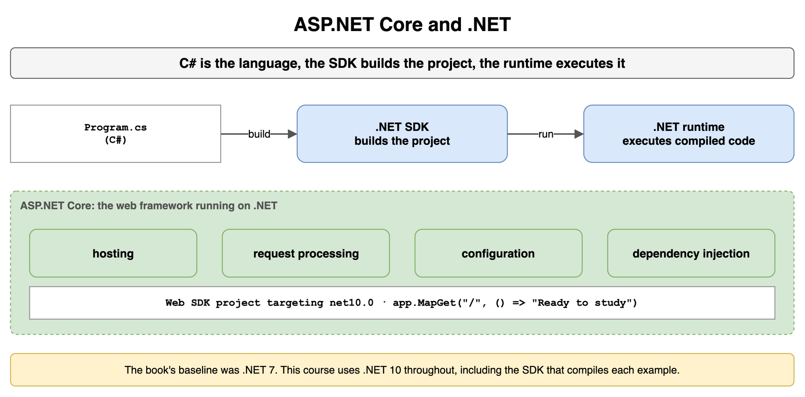
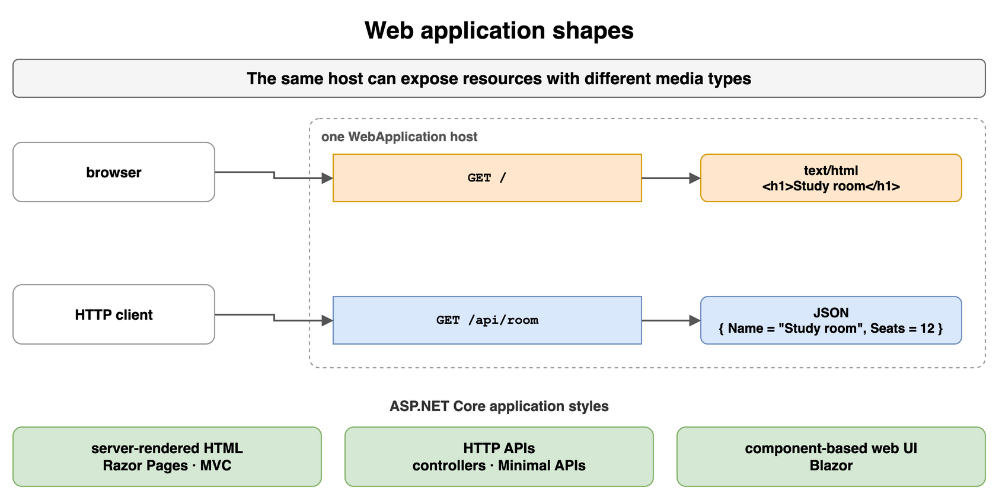
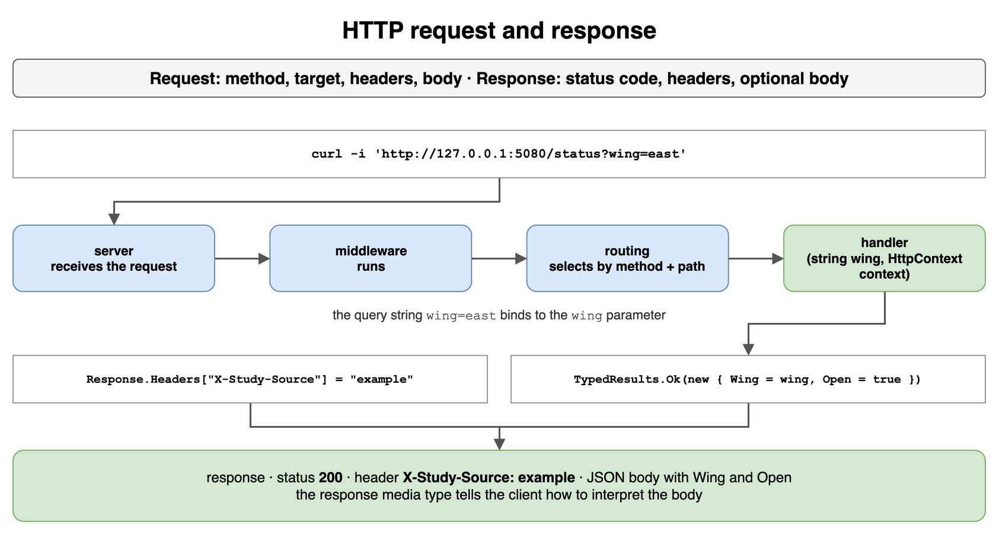

# Getting Started

## ASP.NET Core and .NET

ASP.NET Core is the web framework running on .NET. It supplies hosting, request processing, configuration, and dependency injection. C# is the language in these examples, the SDK builds the project, and the runtime executes the compiled code.

Create a Web SDK project targeting `net10.0`. Replace its `Program.cs` with the code below and request `/`. The book’s baseline was .NET 7. This course uses .NET 10 throughout, including the SDK used to compile each example.

```csharp
var app = WebApplication.CreateBuilder(args).Build();
app.MapGet("/", () => "Ready to study");
app.Run();
```

[Microsoft Learn](https://learn.microsoft.com/en-us/aspnet/core/fundamentals/?view=aspnetcore-10.0)



*Source: [`diagrams/getting-started.drawio`](/content/12_ASP.NET_Core/01_Getting_Started/diagrams/getting-started.drawio), page 1.*

## Web application shapes

A program can serve a browser page, a JSON API, or both. ASP.NET Core provides Razor Pages and MVC for server-rendered HTML, controllers and Minimal APIs for HTTP APIs, and Blazor for component-based web UI.

The same host can expose resources with different media types. Request `/` to see a page, then read `/api/room` with an HTTP client. The [application styles card](#12_ASP.NET_Core/02_Understanding_ASP.NET_Core/concepts/application-styles) explains where to put the presentation logic as the app grows.

```csharp
var app = WebApplication.CreateBuilder(args).Build();
app.MapGet("/", () => TypedResults.Content("<h1>Study room</h1>", "text/html"));
app.MapGet("/api/room", () => new { Name = "Study room", Seats = 12 });
app.Run();
```

[Microsoft Learn](https://learn.microsoft.com/en-us/aspnet/core/fundamentals/?view=aspnetcore-10.0)



*Source: [`diagrams/getting-started.drawio`](/content/12_ASP.NET_Core/01_Getting_Started/diagrams/getting-started.drawio), page 2.*

## HTTP request and response

An HTTP request carries a method, target, headers, and sometimes a body. A response carries a status code, headers, and an optional body. Query strings send inputs in the target; the response media type tells a client how to interpret its body.

Run this with `curl -i 'http://127.0.0.1:5080/status?wing=east'`. The server receives the request, middleware runs, and routing selects a handler for the method and path. The handler receives the query value, adds a header, and returns JSON with status 200. Follow the [Kestrel card](#12_ASP.NET_Core/02_Understanding_ASP.NET_Core/concepts/kestrel-and-the-request-context) for the server side of that exchange.

```csharp
var app = WebApplication.CreateBuilder(args).Build();
app.MapGet("/status", (string wing, HttpContext context) =>
{
    context.Response.Headers["X-Study-Source"] = "example";
    return TypedResults.Ok(new { Wing = wing, Open = true });
});
app.Run();
```

[Microsoft Learn](https://learn.microsoft.com/en-us/aspnet/core/fundamentals/minimal-apis/responses?view=aspnetcore-10.0)



*Source: [`diagrams/getting-started.drawio`](/content/12_ASP.NET_Core/01_Getting_Started/diagrams/getting-started.drawio), page 3.*
