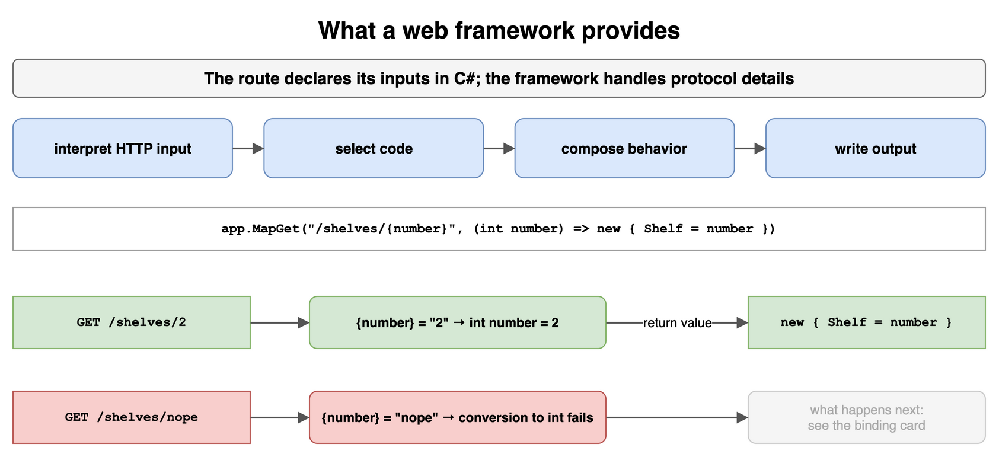
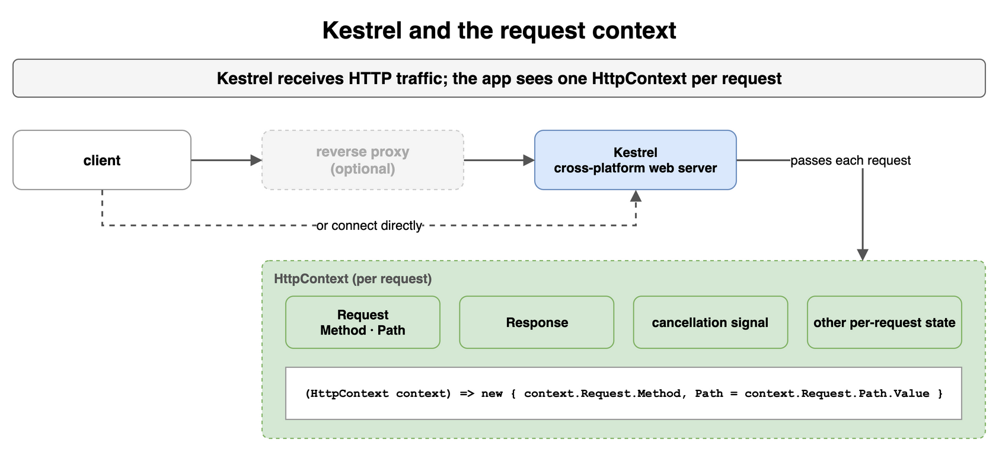
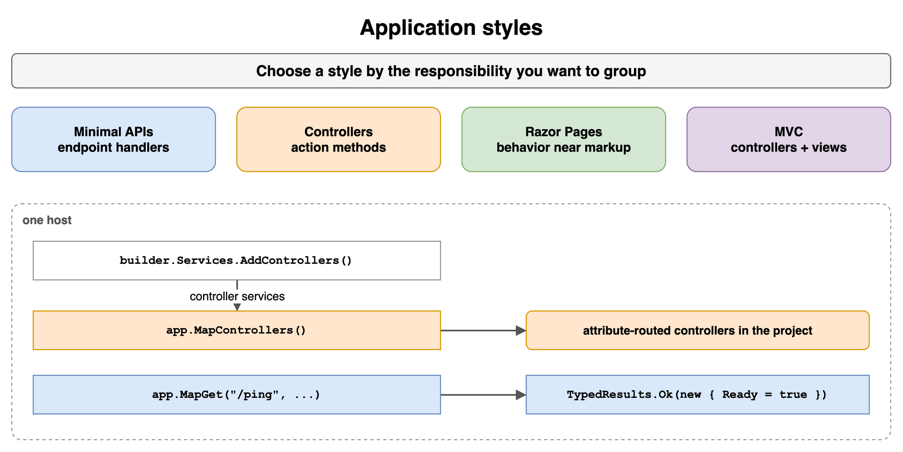
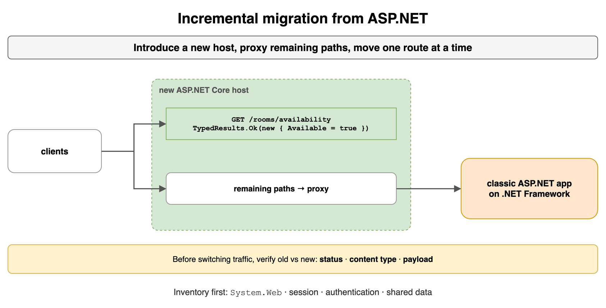

# Understanding ASP.NET Core

## What a web framework provides

A framework gives handlers shared conventions for interpreting HTTP input, selecting code, composing behavior, and writing output. For an API this means the route can declare its inputs in C# and return a value while the framework handles protocol details.

This handler accepts a number from the URL and returns structured data. Compare `/shelves/2` and `/shelves/nope`. The [binding card](#12_ASP.NET_Core/07_Minimal_API_Binding_and_Validation/concepts/binding-sources) explains how a value reaches the handler and what happens when conversion fails.

```csharp
var app = WebApplication.CreateBuilder(args).Build();
app.MapGet("/shelves/{number}", (int number) => new { Shelf = number });
app.Run();
```

[Microsoft Learn](https://learn.microsoft.com/en-us/aspnet/core/fundamentals/?view=aspnetcore-10.0)



*Source: [`diagrams/understanding-aspnet-core.drawio`](/content/12_ASP.NET_Core/02_Understanding_ASP.NET_Core/diagrams/understanding-aspnet-core.drawio), page 1.*

## Kestrel and the request context

Kestrel is ASP.NET Core’s cross-platform web server. It receives HTTP traffic and passes each request to the application, which sees an `HttpContext` with the request, response, cancellation signal, and other per-request state.

A reverse proxy may sit in front of Kestrel, or the client may connect to Kestrel directly. The application still uses the request context to read the method and path. The [middleware card](#12_ASP.NET_Core/04_Middleware/concepts/middleware-execution-order) shows where code can inspect or change that context across requests.

```csharp
var app = WebApplication.CreateBuilder(args).Build();
app.MapGet("/request", (HttpContext context) =>
    new { context.Request.Method, Path = context.Request.Path.Value });
app.Run();
```

[Microsoft Learn](https://learn.microsoft.com/en-us/aspnet/core/fundamentals/servers/kestrel?view=aspnetcore-10.0)



*Source: [`diagrams/understanding-aspnet-core.drawio`](/content/12_ASP.NET_Core/02_Understanding_ASP.NET_Core/diagrams/understanding-aspnet-core.drawio), page 2.*

## Application styles

Minimal APIs fit routes that are straightforward to express as endpoint handlers. Controllers organize endpoints into action methods. Razor Pages puts page behavior near its Razor markup, and MVC can organize an HTML site around controllers and views.

Choose a style by the responsibility you want to group. A status endpoint can stay minimal in an MVC host. The example registers controller services and maps any attribute-routed controllers in the project alongside an explicitly mapped status endpoint.

```csharp
var builder = WebApplication.CreateBuilder(args);
builder.Services.AddControllers();
var app = builder.Build();
app.MapControllers();
app.MapGet("/ping", () => TypedResults.Ok(new { Ready = true }));
app.Run();
```

[Microsoft Learn](https://learn.microsoft.com/en-us/aspnet/core/fundamentals/?view=aspnetcore-10.0)



*Source: [`diagrams/understanding-aspnet-core.drawio`](/content/12_ASP.NET_Core/02_Understanding_ASP.NET_Core/diagrams/understanding-aspnet-core.drawio), page 3.*

## Incremental migration from ASP.NET

ASP.NET Core introduced a cross-platform host and a composable middleware pipeline for .NET web apps. For a new service, target the current .NET stack. For a classic ASP.NET application on .NET Framework, inventory its dependencies on `System.Web`, session, authentication, and shared data before selecting a migration path.

A large migration can introduce a new ASP.NET Core host, proxy remaining paths to the legacy app, and move one route at a time. This small replacement endpoint illustrates the contract to retain on a migrated route. Verify the old and new status, content type, and payload before switching traffic.

```csharp
var app = WebApplication.CreateBuilder(args).Build();
app.MapGet("/rooms/availability", () => TypedResults.Ok(new { Available = true }));
app.Run();
```

[Microsoft Learn](https://learn.microsoft.com/en-us/aspnet/core/migration/fx-to-core/?view=aspnetcore-10.0)



*Source: [`diagrams/understanding-aspnet-core.drawio`](/content/12_ASP.NET_Core/02_Understanding_ASP.NET_Core/diagrams/understanding-aspnet-core.drawio), page 4.*
