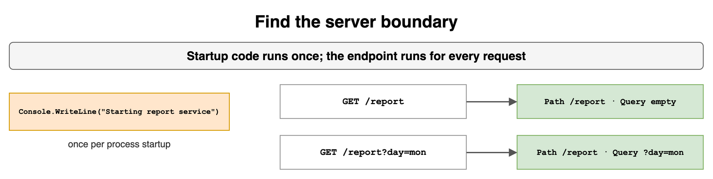
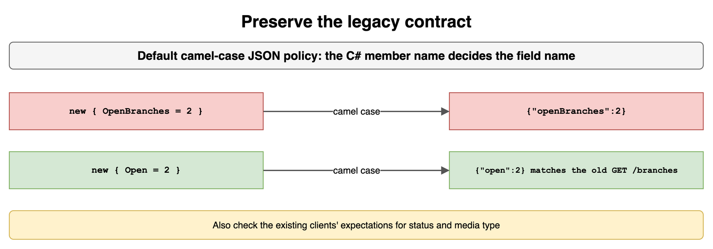

# Understanding ASP.NET Core — Drills

Predict the result before running the example.

## Find the server boundary

What prints at startup, and what changes between requests to `/report` and `/report?day=mon`?

```csharp
var app = WebApplication.CreateBuilder(args).Build();
Console.WriteLine("Starting report service");
app.MapGet("/report", (HttpContext context) =>
    new { Path = context.Request.Path.Value, Query = context.Request.QueryString.Value });
app.Run();
```

**Answer**

The console message runs once per process startup. Both responses have path `/report`. The second response has query `?day=mon`; the first has an empty query string.



*Source: [`diagrams/understanding-aspnet-core-drills.drawio`](/content/12_ASP.NET_Core/02_Understanding_ASP.NET_Core/diagrams/understanding-aspnet-core-drills.drawio), page 1.*

## Preserve the legacy contract

The old `GET /branches` returns `{"open":2}`. A replacement app has the code below. What change preserves the JSON field name?

```csharp
var app = WebApplication.CreateBuilder(args).Build();
app.MapGet("/branches", () => new { OpenBranches = 2 });
app.Run();
```

**Answer**

Return `new { Open = 2 }` under the default camel-case JSON policy. Check the existing clients’ expectations for status and media type along with the payload.



*Source: [`diagrams/understanding-aspnet-core-drills.drawio`](/content/12_ASP.NET_Core/02_Understanding_ASP.NET_Core/diagrams/understanding-aspnet-core-drills.drawio), page 2.*
