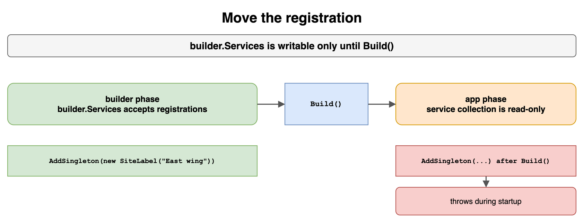

# Your First Application — Drills

Predict the result before running the example.

## Move the registration

A teammate wants to move the registration below `Build()` to keep the endpoint near its dependencies. What happens?

```csharp
var builder = WebApplication.CreateBuilder(args);
builder.Services.AddSingleton(new SiteLabel("East wing"));
var app = builder.Build();
app.MapGet("/", (SiteLabel site) => site.Name);
app.Run();

record SiteLabel(string Name);
```

**Answer**

Keep the registration above `Build()`. The application services are built at that point and the collection becomes read-only; adding the registration afterwards throws during startup.



*Source: [`diagrams/first-application-drills.drawio`](/content/12_ASP.NET_Core/03_Your_First_Application/diagrams/first-application-drills.drawio), page 1.*

## Choose the startup URL

Run this app using the course command with port 5080. Then stop it and run it with port 5090. Which file needs to change?

```csharp
var app = WebApplication.CreateBuilder(args).Build();
app.MapGet("/ready", () => "ready");
app.Run();
```

**Answer**

The command-line `--urls` value controls the binding in these runs, so keep the project and handler intact. Request `/ready` on the active port.
