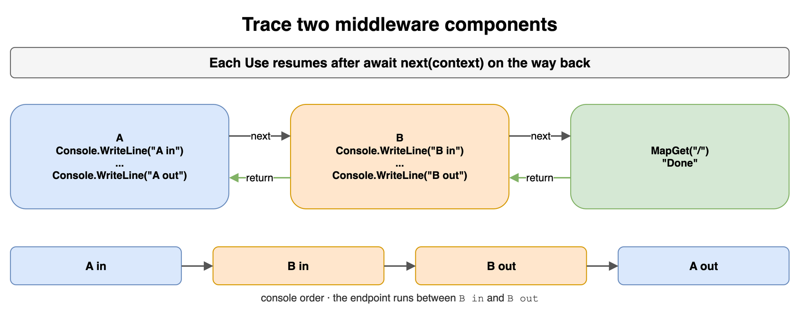
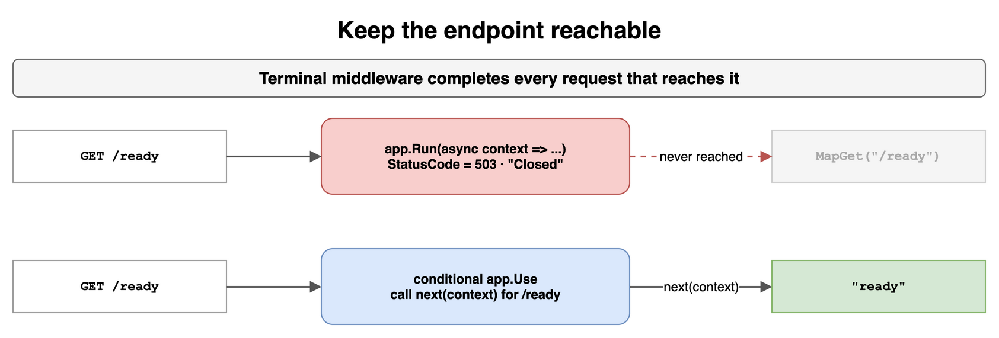

# Middleware — Drills

Predict the result before running the example.

## Trace two middleware components

Predict the console order for a request to `/`.

```csharp
var app = WebApplication.CreateBuilder(args).Build();
app.Use(async (context, next) =>
{
    Console.WriteLine("A in");
    await next(context);
    Console.WriteLine("A out");
});
app.Use(async (context, next) =>
{
    Console.WriteLine("B in");
    await next(context);
    Console.WriteLine("B out");
});
app.MapGet("/", () => "Done");
app.Run();
```

**Answer**

`A in`, `B in`, `B out`, `A out`. The endpoint runs between `B in` and `B out`.



*Source: [`diagrams/middleware-drills.drawio`](/content/12_ASP.NET_Core/04_Middleware/diagrams/middleware-drills.drawio), page 1.*

## Keep the endpoint reachable

Why does `GET /ready` return 503, and how would you keep that endpoint reachable?

```csharp
var app = WebApplication.CreateBuilder(args).Build();
app.Run(async context =>
{
    context.Response.StatusCode = 503;
    await context.Response.WriteAsync("Closed");
});
app.MapGet("/ready", () => "ready");
app.Run();
```

**Answer**

The terminal middleware completes every request that reaches it. Use a conditional `app.Use` and call `next(context)` for `/ready`, as in the [short-circuit example](#12_ASP.NET_Core/04_Middleware/concepts/short-circuit-a-request).



*Source: [`diagrams/middleware-drills.drawio`](/content/12_ASP.NET_Core/04_Middleware/diagrams/middleware-drills.drawio), page 2.*
