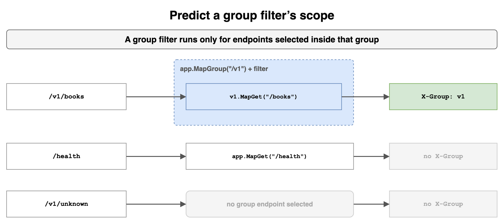

# JSON APIs with Minimal APIs — Drills

Predict the result before running the example.

## Choose a response contract

An API client needs to distinguish an absent journal from a found journal that has zero pages. What does this endpoint return for IDs 7 and 8, and how should the absent journal be represented?

```csharp
var app = WebApplication.CreateBuilder(args).Build();
app.MapGet("/journals/{id}", (int id) => new { Pages = id == 7 ? 24 : 0 });
app.Run();
```

**Answer**

Both return 200 with JSON, containing 24 or 0. Keep the pages count for a found journal and return 404 for an absent journal. The [typed results example](#12_ASP.NET_Core/05_JSON_APIs_with_Minimal_APIs/concepts/typed-http-results-and-other-response-bodies) shows a handler with those two outcomes.

## Predict a group filter’s scope

Which responses have the `X-Group` header? Check `/v1/books`, `/health`, and `/v1/unknown`.

```csharp
var app = WebApplication.CreateBuilder(args).Build();
var v1 = app.MapGroup("/v1").AddEndpointFilter((context, next) =>
{
    context.HttpContext.Response.Headers["X-Group"] = "v1";
    return next(context);
});
v1.MapGet("/books", () => new[] { "Journal" });
app.MapGet("/health", () => "ready");
app.Run();
```

**Answer**

Only `/v1/books` gets the header. The group supplies a prefix and endpoint conventions; a request with that prefix must still select a group endpoint.



*Source: [`diagrams/minimal-apis-drills.drawio`](/content/12_ASP.NET_Core/05_JSON_APIs_with_Minimal_APIs/diagrams/minimal-apis-drills.drawio), page 1.*
