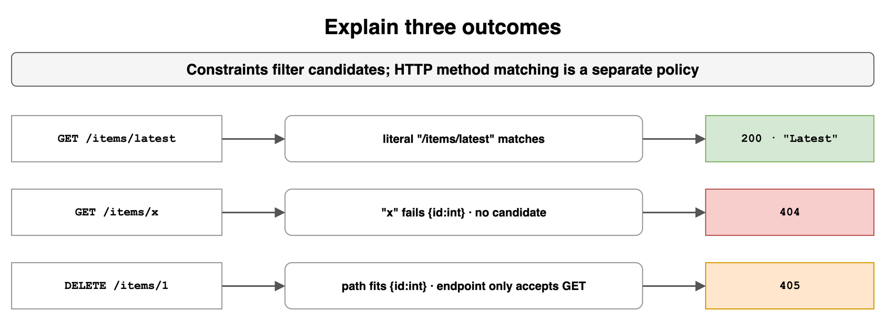
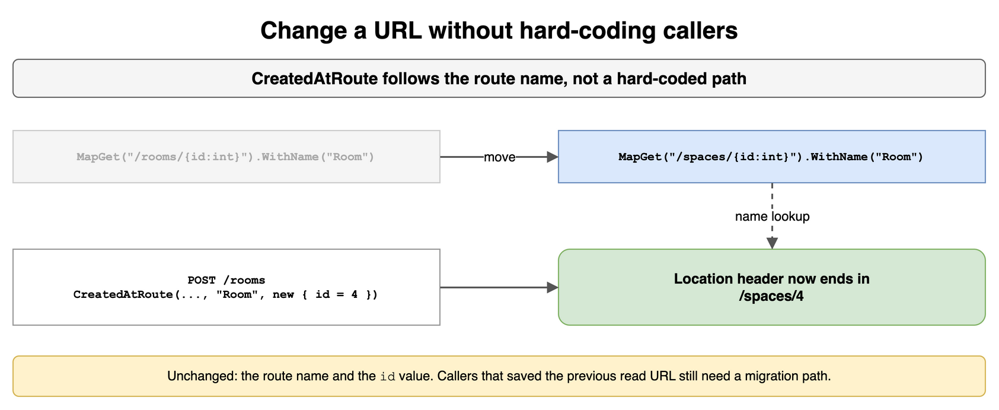

# Endpoint Routing — Drills

Predict the result before running the example.

## Explain three outcomes

Predict `GET /items/latest`, `GET /items/x`, and `DELETE /items/1`.

```csharp
var app = WebApplication.CreateBuilder(args).Build();
app.MapGet("/items/{id:int}", (int id) => $"Item {id}");
app.MapGet("/items/latest", () => "Latest");
app.Run();
```

**Answer**

The literal returns 200. `x` fails the integer constraint and returns 404. The DELETE targets a path accepted by the integer route but the endpoint only accepts GET, so the response is 405.



*Source: [`diagrams/endpoint-routing-drills.drawio`](/content/12_ASP.NET_Core/06_Endpoint_Routing/diagrams/endpoint-routing-drills.drawio), page 1.*

## Change a URL without hard-coding callers

If the read URL moves from `/rooms/{id}` to `/spaces/{id}`, what else needs to change in this example? Check the `Location` header after the move.

```csharp
var app = WebApplication.CreateBuilder(args).Build();
app.MapGet("/rooms/{id:int}", (int id) => new { Id = id }).WithName("Room");
app.MapPost("/rooms", () =>
    TypedResults.CreatedAtRoute(new { Id = 4 }, "Room", new { id = 4 }));
app.Run();
```

**Answer**

Keep the route name and the `id` value unchanged. The POST still lives at `/rooms` unless you choose to change it, and the URL in its `Location` header now ends in `/spaces/4`. Incoming callers that saved the previous read URL still need a migration path.



*Source: [`diagrams/endpoint-routing-drills.drawio`](/content/12_ASP.NET_Core/06_Endpoint_Routing/diagrams/endpoint-routing-drills.drawio), page 2.*
