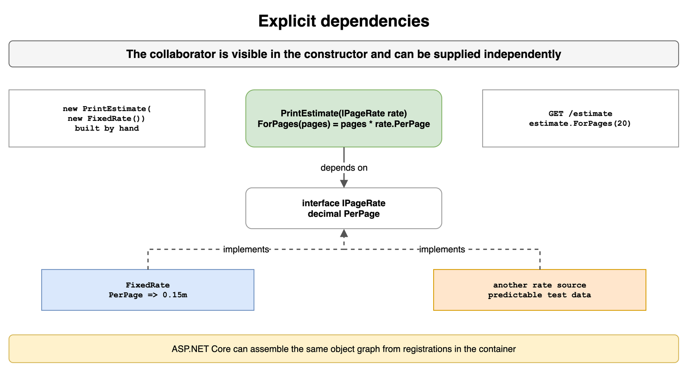
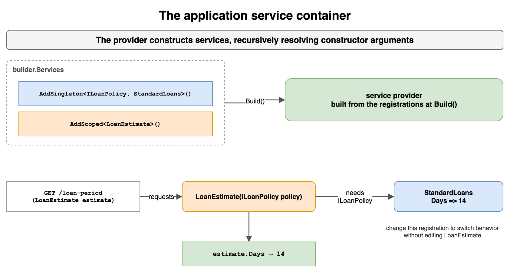
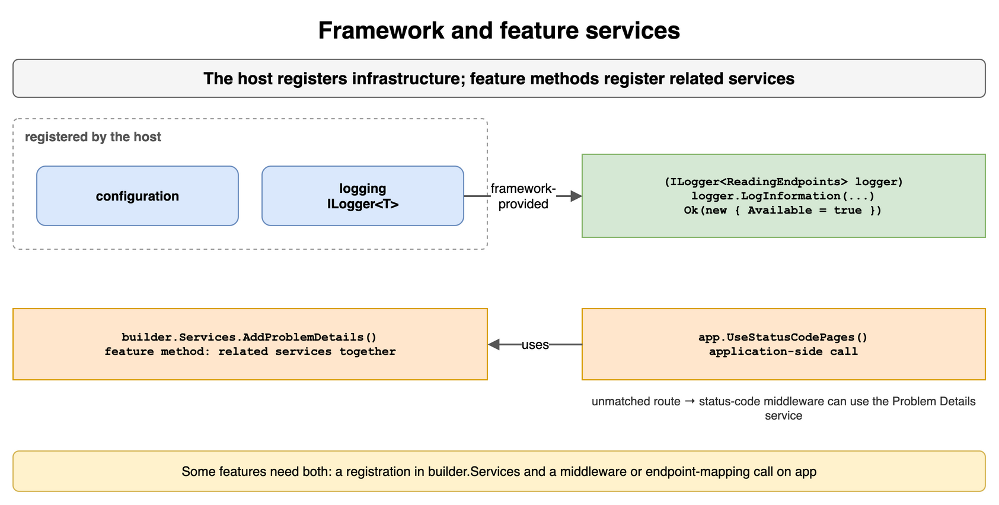
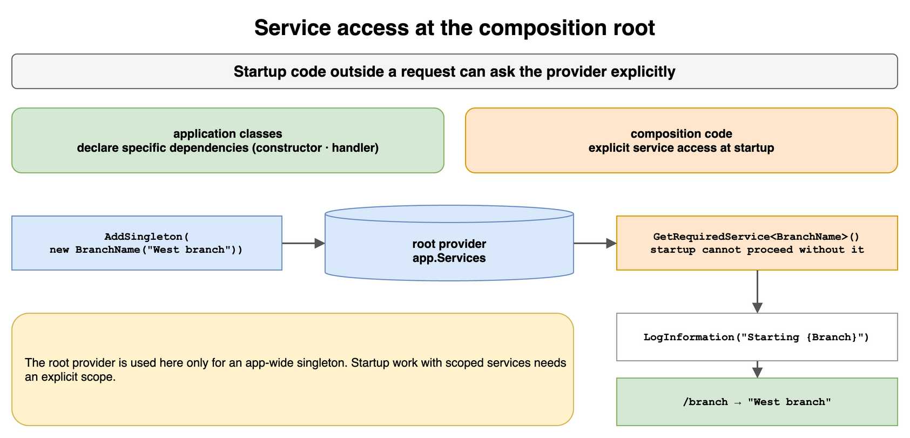

# Dependency Injection

## Explicit dependencies

Dependency injection supplies the collaborators that an object needs when it is constructed. A class that calculates an estimate can ask for a rate source through its constructor. The rate source is visible in the class signature and can be supplied independently of the estimate calculation.

The example builds the estimator by hand. Substitute another rate source to exercise the same estimator logic with predictable data. ASP.NET Core can assemble the same object graph when you [register services in the container](#12_ASP.NET_Core/08_Dependency_Injection/concepts/the-application-service-container).

```csharp
var app = WebApplication.CreateBuilder(args).Build();
var estimate = new PrintEstimate(new FixedRate());
app.MapGet("/estimate", () => estimate.ForPages(20));
app.Run();

interface IPageRate { decimal PerPage { get; } }
sealed class FixedRate : IPageRate { public decimal PerPage => 0.15m; }
sealed class PrintEstimate(IPageRate rate)
{
    public decimal ForPages(int pages) => pages * rate.PerPage;
}
```

[Microsoft Learn](https://learn.microsoft.com/en-us/aspnet/core/fundamentals/dependency-injection?view=aspnetcore-10.0)



*Source: [`diagrams/dependency-injection.drawio`](/content/12_ASP.NET_Core/08_Dependency_Injection/diagrams/dependency-injection.drawio), page 1.*

## The application service container

Register the dependency graph in `builder.Services`. ASP.NET Core builds a service provider from those registrations and uses it to construct services, recursively resolving their constructor arguments. The consumer only declares what it needs.

The handler requests `LoanEstimate`. The container creates it with the registered `ILoanPolicy` implementation. Change the policy registration to switch behavior without editing the estimate service. The [service lifetimes card](#12_ASP.NET_Core/09_Service_Registration/concepts/transient-scoped-and-singleton-lifetimes) explains how long each instance lives.

```csharp
var builder = WebApplication.CreateBuilder(args);
builder.Services.AddSingleton<ILoanPolicy, StandardLoans>();
builder.Services.AddScoped<LoanEstimate>();
var app = builder.Build();
app.MapGet("/loan-period", (LoanEstimate estimate) => estimate.Days);
app.Run();

interface ILoanPolicy { int Days { get; } }
sealed class StandardLoans : ILoanPolicy { public int Days => 14; }
sealed class LoanEstimate(ILoanPolicy policy) { public int Days => policy.Days; }
```

[Microsoft Learn](https://learn.microsoft.com/en-us/aspnet/core/fundamentals/dependency-injection?view=aspnetcore-10.0)



*Source: [`diagrams/dependency-injection.drawio`](/content/12_ASP.NET_Core/08_Dependency_Injection/diagrams/dependency-injection.drawio), page 2.*

## Framework and feature services

The host registers common infrastructure, including configuration and logging. Feature methods such as `AddProblemDetails` register related services together. Some features also need an application-side call that uses those services, such as middleware registration or endpoint mapping.

This handler receives a framework-provided `ILogger<ReadingEndpoints>`. For an unmatched route, the status-code middleware can use the registered Problem Details service. See [Problem Details for API errors](#12_ASP.NET_Core/05_JSON_APIs_with_Minimal_APIs/concepts/problem-details-for-api-errors) for the response contract.

```csharp
var builder = WebApplication.CreateBuilder(args);
builder.Services.AddProblemDetails();
var app = builder.Build();
app.UseStatusCodePages();
app.MapGet("/reading", (ILogger<ReadingEndpoints> logger) =>
{
    logger.LogInformation("Reading endpoint requested");
    return TypedResults.Ok(new { Available = true });
});
app.Run();

sealed class ReadingEndpoints;
```

[Microsoft Learn](https://learn.microsoft.com/en-us/aspnet/core/fundamentals/dependency-injection?view=aspnetcore-10.0)



*Source: [`diagrams/dependency-injection.drawio`](/content/12_ASP.NET_Core/08_Dependency_Injection/diagrams/dependency-injection.drawio), page 3.*

## Service access at the composition root

Constructor or handler injection keeps dependencies apparent to readers and tests. Some startup work runs outside a request and needs explicit access to services. Treat that access as composition code so application classes can continue to declare specific dependencies.

Use `GetRequiredService<T>()` when startup cannot proceed without the service. This example uses the root provider only for an app-wide singleton. For startup work with scoped services, [create an explicit scope](#12_ASP.NET_Core/09_Service_Registration/concepts/scoped-services-outside-requests).

```csharp
var builder = WebApplication.CreateBuilder(args);
builder.Services.AddSingleton(new BranchName("West branch"));
var app = builder.Build();
var branch = app.Services.GetRequiredService<BranchName>();
app.Logger.LogInformation("Starting {Branch}", branch.Value);
app.MapGet("/branch", () => branch.Value);
app.Run();

record BranchName(string Value);
```

[Microsoft Learn](https://learn.microsoft.com/en-us/aspnet/core/fundamentals/dependency-injection?view=aspnetcore-10.0)



*Source: [`diagrams/dependency-injection.drawio`](/content/12_ASP.NET_Core/08_Dependency_Injection/diagrams/dependency-injection.drawio), page 4.*
