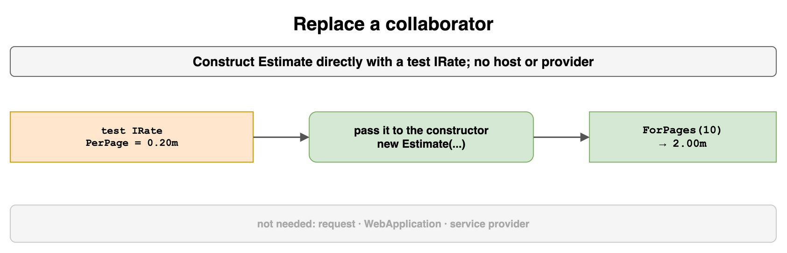
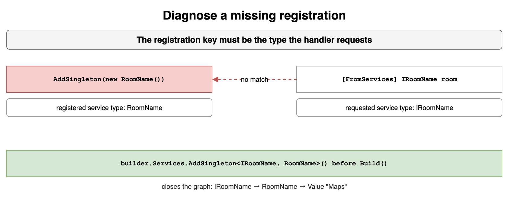

# Dependency Injection — Drills

Predict the result before running the example.

## Replace a collaborator

How can a test check `ForPages(10)` at twenty cents per page without using the web host? What result should it expect?

```csharp
var app = WebApplication.CreateBuilder(args).Build();
app.MapGet("/estimate", () => new Estimate(new StandardRate()).ForPages(10));
app.Run();

interface IRate { decimal PerPage { get; } }
sealed class StandardRate : IRate { public decimal PerPage => 0.10m; }
sealed class Estimate(IRate rate) { public decimal ForPages(int n) => n * rate.PerPage; }
```

**Answer**

Create an `IRate` test implementation with `PerPage = 0.20m` and pass it to the constructor. `ForPages(10)` returns `2.00m`. The calculation can run directly without a request or service provider.



*Source: [`diagrams/dependency-injection-drills.drawio`](/content/12_ASP.NET_Core/08_Dependency_Injection/diagrams/dependency-injection-drills.drawio), page 1.*

## Diagnose a missing registration

The app fails to resolve the endpoint's service. Which registration closes the dependency graph for `IRoomName`?

```csharp
var builder = WebApplication.CreateBuilder(args);
builder.Services.AddSingleton(new RoomName());
var app = builder.Build();
app.MapGet("/", ([Microsoft.AspNetCore.Mvc.FromServices] IRoomName room) => room.Value);
app.Run();

interface IRoomName { string Value { get; } }
sealed class RoomName : IRoomName { public string Value => "Maps"; }
```

**Answer**

Register `builder.Services.AddSingleton<IRoomName, RoomName>()` before `Build()`. The original registration is keyed by the type `RoomName`, while the handler requests `IRoomName`.



*Source: [`diagrams/dependency-injection-drills.drawio`](/content/12_ASP.NET_Core/08_Dependency_Injection/diagrams/dependency-injection-drills.drawio), page 2.*
