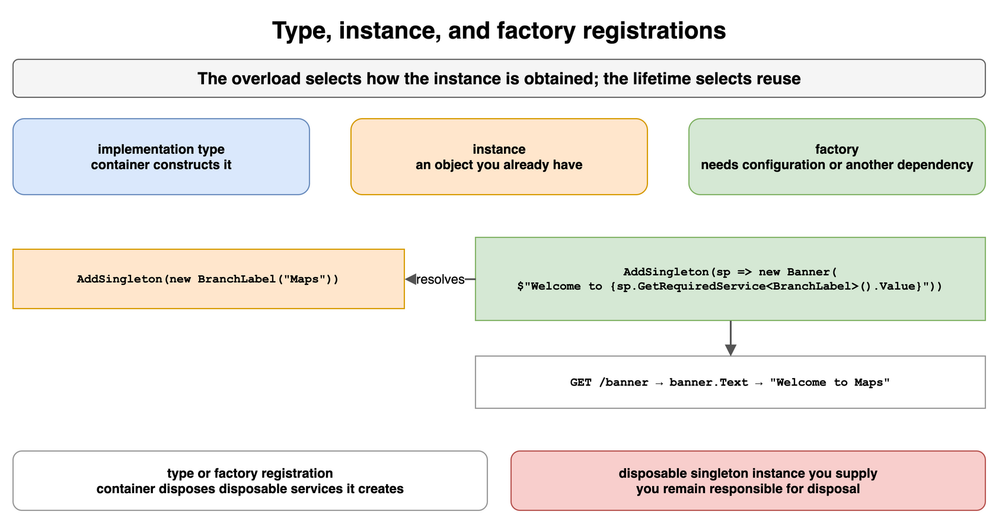
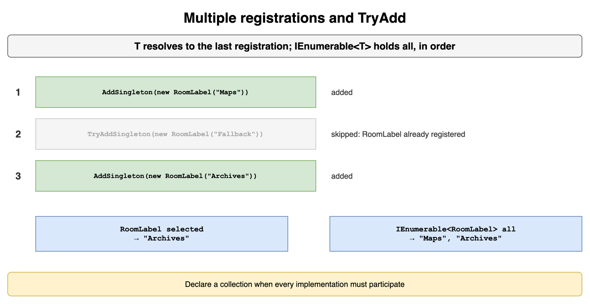
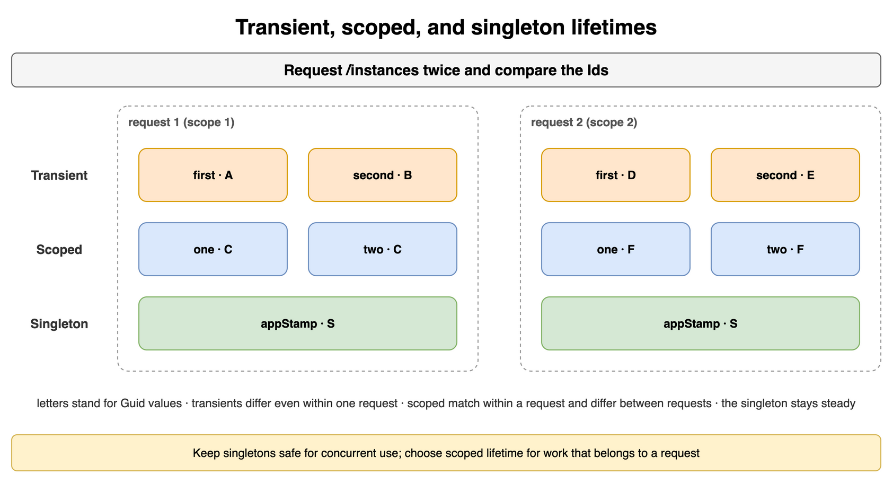
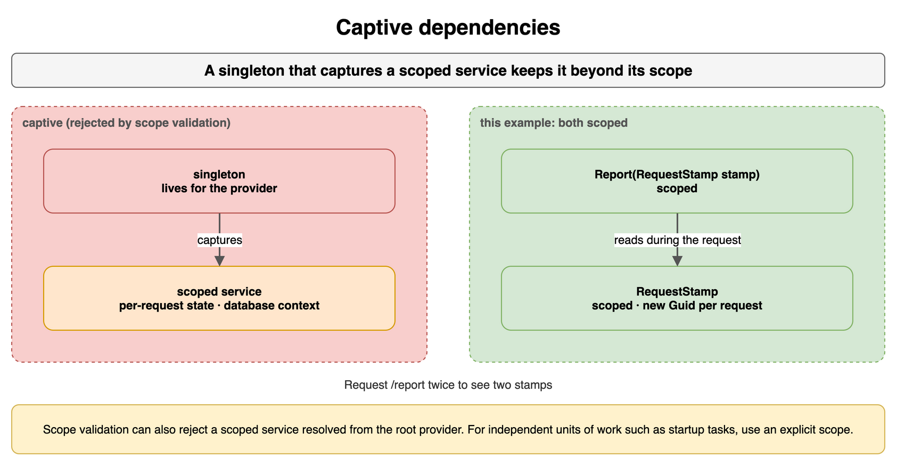
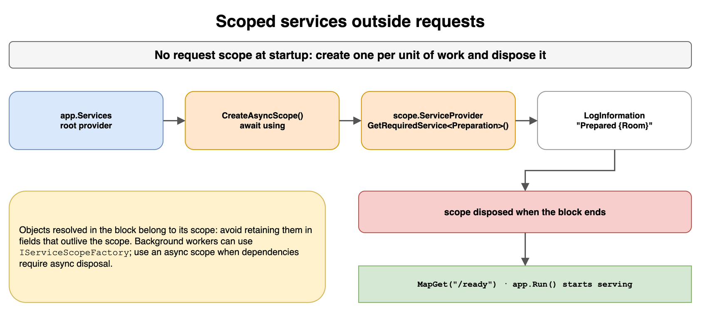
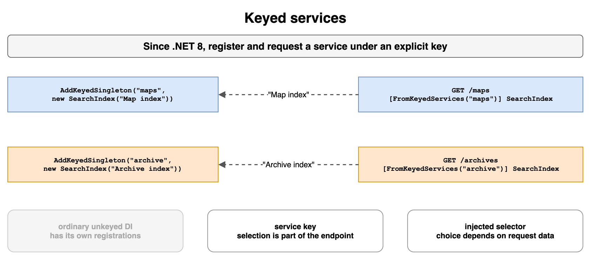

# Service Registration

## Type, instance, and factory registrations

Register an implementation type when the container should construct the service. Use an instance registration for an object you already have. A factory is suitable when construction needs configuration or another registered dependency. The registration overload selects how the instance is obtained; the lifetime selects when it is reused.

The instance in this example holds an immutable label. The factory resolves it and builds a second singleton. The container disposes disposable services it creates through type or factory registration. If you supply a disposable singleton instance, you remain responsible for its disposal.

```csharp
var builder = WebApplication.CreateBuilder(args);
builder.Services.AddSingleton(new BranchLabel("Maps"));
builder.Services.AddSingleton(sp =>
    new Banner($"Welcome to {sp.GetRequiredService<BranchLabel>().Value}"));
var app = builder.Build();
app.MapGet("/banner", (Banner banner) => banner.Text);
app.Run();

record BranchLabel(string Value);
record Banner(string Text);
```

[Microsoft Learn](https://learn.microsoft.com/en-us/aspnet/core/fundamentals/dependency-injection?view=aspnetcore-10.0)



*Source: [`diagrams/service-registration.drawio`](/content/12_ASP.NET_Core/09_Service_Registration/diagrams/service-registration.drawio), page 1.*

## Multiple registrations and TryAdd

Registering the same service type multiple times makes all implementations available through `IEnumerable<T>` in registration order. A single `T` resolves to the last registration. Declare a collection when every implementation must participate.

`TryAdd` adds a default only if that service type is still unregistered. In the example, the fallback sees an existing registration and is skipped. The later unconditional registration becomes the selected single value, while the earlier value remains in the collection.

```csharp
using Microsoft.Extensions.DependencyInjection.Extensions;

var builder = WebApplication.CreateBuilder(args);
builder.Services.AddSingleton(new RoomLabel("Maps"));
builder.Services.TryAddSingleton(new RoomLabel("Fallback"));
builder.Services.AddSingleton(new RoomLabel("Archives"));
var app = builder.Build();
app.MapGet("/labels", (RoomLabel selected, IEnumerable<RoomLabel> all) =>
    new { Selected = selected.Text, All = all.Select(label => label.Text) });
app.Run();

record RoomLabel(string Text);
```

[Microsoft Learn](https://learn.microsoft.com/en-us/aspnet/core/fundamentals/dependency-injection?view=aspnetcore-10.0)



*Source: [`diagrams/service-registration.drawio`](/content/12_ASP.NET_Core/09_Service_Registration/diagrams/service-registration.drawio), page 2.*

## Transient, scoped, and singleton lifetimes

Transient services are created each time they are resolved. A scoped instance is shared within one scope, normally one HTTP request. A singleton instance is shared for the life of the provider. Keep singletons safe for concurrent use and choose scoped lifetime for work that belongs to a request.

Request `/instances` twice. The two transient resolutions differ in the same request. The scoped resolutions match within a response and differ between requests. The singleton remains steady across both requests.

```csharp
var builder = WebApplication.CreateBuilder(args);
builder.Services.AddTransient<TransientStamp>();
builder.Services.AddScoped<RequestStamp>();
builder.Services.AddSingleton<AppStamp>();
var app = builder.Build();
app.MapGet("/instances", (TransientStamp first, TransientStamp second,
    RequestStamp one, RequestStamp two, AppStamp appStamp) =>
    new { Transients = new[] { first.Id, second.Id },
        Requests = new[] { one.Id, two.Id }, App = appStamp.Id });
app.Run();

sealed class TransientStamp { public Guid Id { get; } = Guid.NewGuid(); }
sealed class RequestStamp { public Guid Id { get; } = Guid.NewGuid(); }
sealed class AppStamp { public Guid Id { get; } = Guid.NewGuid(); }
```

[Microsoft Learn](https://learn.microsoft.com/en-us/aspnet/core/fundamentals/dependency-injection?view=aspnetcore-10.0)



*Source: [`diagrams/service-registration.drawio`](/content/12_ASP.NET_Core/09_Service_Registration/diagrams/service-registration.drawio), page 3.*

## Captive dependencies

A singleton that captures a scoped service keeps it beyond the intended scope. That can mix per-request state or retain a database context across requests. Scope validation can reject a singleton that depends on a scoped service or a scoped service resolved from the root provider.

Here both objects belong to the request. The report may read its request stamp safely during that request. Request `/report` twice to see two stamps. For independent units of work such as startup tasks, [use an explicit scope](#12_ASP.NET_Core/09_Service_Registration/concepts/scoped-services-outside-requests).

```csharp
var builder = WebApplication.CreateBuilder(args);
builder.Services.AddScoped<RequestStamp>();
builder.Services.AddScoped<Report>();
var app = builder.Build();
app.MapGet("/report", (Report report) => report.Id);
app.Run();

sealed class RequestStamp { public Guid Id { get; } = Guid.NewGuid(); }
sealed class Report(RequestStamp stamp) { public Guid Id => stamp.Id; }
```

[Microsoft Learn](https://learn.microsoft.com/en-us/aspnet/core/fundamentals/dependency-injection?view=aspnetcore-10.0)



*Source: [`diagrams/service-registration.drawio`](/content/12_ASP.NET_Core/09_Service_Registration/diagrams/service-registration.drawio), page 4.*

## Scoped services outside requests

A startup task or background worker has no request scope. Ask the root provider or `IServiceScopeFactory` to create a scope for each unit of work, resolve the scoped dependency from that scope, and dispose the scope once work completes. Use an async scope when dependencies require async disposal.

This startup block resolves a scoped preparation service and finishes before the app starts serving requests. Objects it resolves belong to the block's scope. Avoid retaining them in fields that outlive the scope.

```csharp
var builder = WebApplication.CreateBuilder(args);
builder.Services.AddScoped<Preparation>();
var app = builder.Build();
await using (var scope = app.Services.CreateAsyncScope())
{
    var preparation = scope.ServiceProvider.GetRequiredService<Preparation>();
    app.Logger.LogInformation("Prepared {Room}", preparation.Room);
}
app.MapGet("/ready", () => "ready");
app.Run();

sealed class Preparation { public string Room => "Maps"; }
```

[Microsoft Learn](https://learn.microsoft.com/en-us/aspnet/core/fundamentals/dependency-injection?view=aspnetcore-10.0)



*Source: [`diagrams/service-registration.drawio`](/content/12_ASP.NET_Core/09_Service_Registration/diagrams/service-registration.drawio), page 5.*

## Keyed services

Since .NET 8, the built-in container can register a service under an explicit key. For example, a Minimal API can request a named strategy with `[FromKeyedServices]`. This makes the selection visible when several implementations share the same type.

The two lookups below select different keys from the same service type. Ordinary unkeyed DI has its own registrations. Use the service key when selection is part of the endpoint definition, and use an injected selector when the choice depends on request data.

```csharp
var builder = WebApplication.CreateBuilder(args);
builder.Services.AddKeyedSingleton("maps", new SearchIndex("Map index"));
builder.Services.AddKeyedSingleton("archive", new SearchIndex("Archive index"));
var app = builder.Build();
app.MapGet("/maps", ([FromKeyedServices("maps")] SearchIndex index) => index.Name);
app.MapGet("/archives", ([FromKeyedServices("archive")] SearchIndex index) => index.Name);
app.Run();

record SearchIndex(string Name);
```

[Microsoft Learn](https://learn.microsoft.com/en-us/aspnet/core/fundamentals/dependency-injection?view=aspnetcore-10.0#keyed-services)



*Source: [`diagrams/service-registration.drawio`](/content/12_ASP.NET_Core/09_Service_Registration/diagrams/service-registration.drawio), page 6.*
