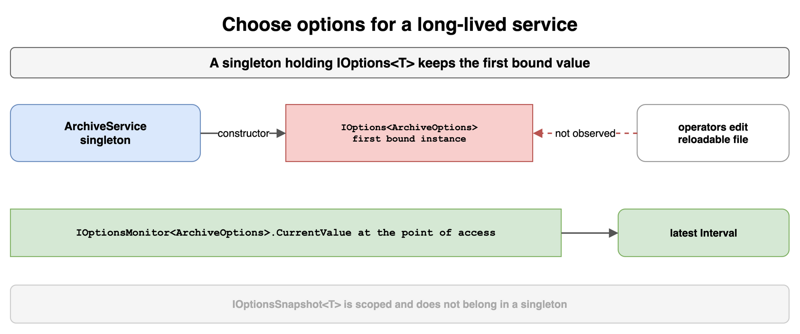

# Application Configuration — Drills

Predict the result before running the example.

## Find the effective value

Which title and limit does the endpoint return?

```csharp
var builder = WebApplication.CreateBuilder(args);
builder.Configuration.AddInMemoryCollection(new Dictionary<string, string?>
{
    ["List:Title"] = "Journals", ["List:Limit"] = "8"
});
builder.Configuration.AddInMemoryCollection(new Dictionary<string, string?>
{
    ["List:Title"] = "Maps"
});
var app = builder.Build();
app.MapGet("/list", (IConfiguration config) =>
    new { Title = config["List:Title"], Limit = config.GetValue<int>("List:Limit") });
app.Run();
```

**Answer**

The title is `Maps` and the limit is `8`. The second provider overrides the title key. The first provider still supplies the limit.

## Choose options for a long-lived service

An archive service is a singleton. Requests should use the latest poll interval after operators edit a reloadable settings file. Which options interface does this code use, and what happens if it is retained as written?

```csharp
using Microsoft.Extensions.Options;

var builder = WebApplication.CreateBuilder(args);
builder.Services.Configure<ArchiveOptions>(builder.Configuration.GetSection("Archive"));
builder.Services.AddSingleton<ArchiveService>();
var app = builder.Build();
app.MapGet("/interval", (ArchiveService service) => service.Interval);
app.Run();

sealed class ArchiveOptions { public int Interval { get; set; } = 30; }
sealed class ArchiveService(IOptions<ArchiveOptions> options)
{
    public int Interval => options.Value.Interval;
}
```

**Answer**

It uses `IOptions<ArchiveOptions>` and retains the first bound options instance. Use `IOptionsMonitor<ArchiveOptions>.CurrentValue` at the point of access when the provider can reload. `IOptionsSnapshot<T>` is scoped and does not belong in a singleton.



*Source: [`diagrams/configuration-drills.drawio`](/content/12_ASP.NET_Core/10_Application_Configuration/diagrams/configuration-drills.drawio), page 1.*
