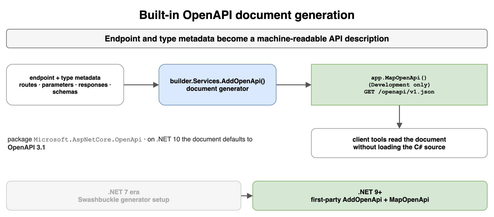
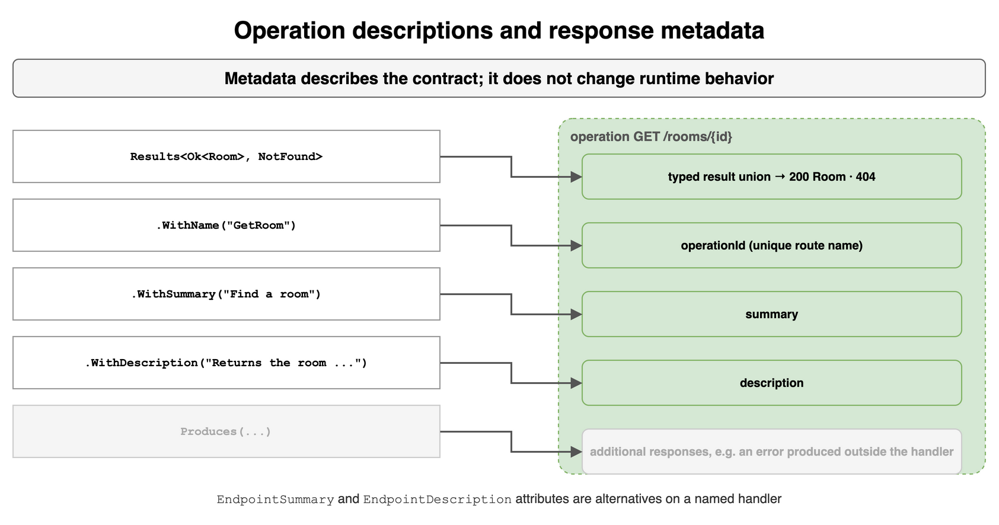
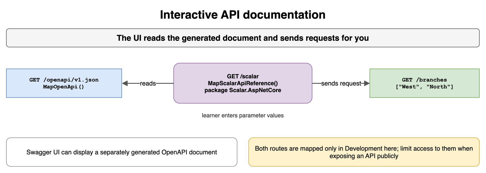
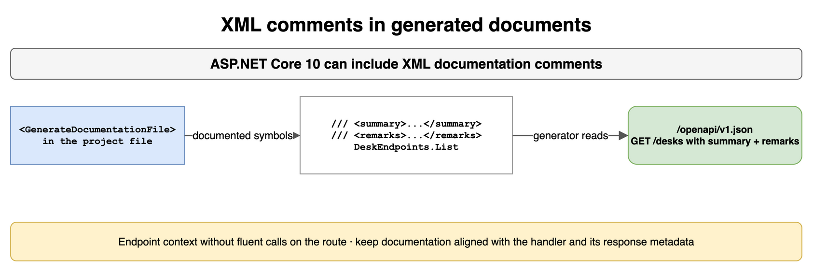
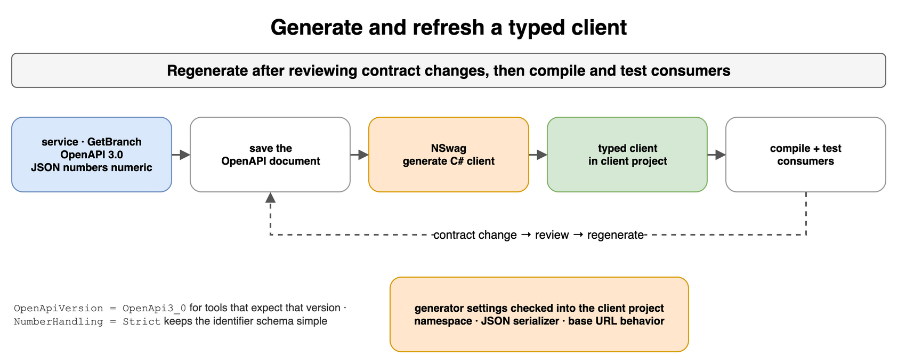
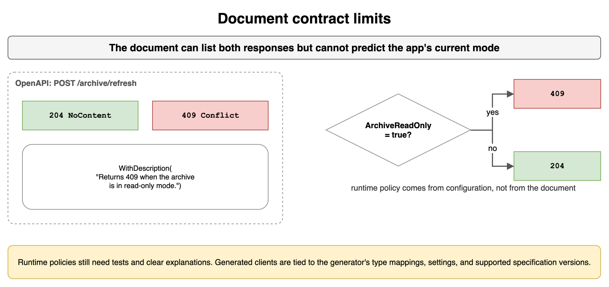

# OpenAPI

## Built-in OpenAPI document generation

OpenAPI describes an HTTP API in a machine-readable document. ASP.NET Core uses endpoint and type metadata to describe routes, parameters, responses, and schemas, which client tools can read without loading the C# source.

Use `Microsoft.AspNetCore.OpenApi`, `AddOpenApi`, and `MapOpenApi` for document generation. This is the first-party approach introduced in .NET 9 in place of the .NET 7-era Swashbuckle generator setup. On .NET 10 the generated document defaults to OpenAPI 3.1. Run in Development and fetch `/openapi/v1.json`.

```csharp
var builder = WebApplication.CreateBuilder(args);
builder.Services.AddOpenApi();
var app = builder.Build();
if (app.Environment.IsDevelopment())
    app.MapOpenApi();
app.MapGet("/rooms", () => TypedResults.Ok(new[] { "Maps", "Print" }));
app.Run();
```

[Microsoft Learn](https://learn.microsoft.com/en-us/aspnet/core/fundamentals/openapi/aspnetcore-openapi?view=aspnetcore-10.0)



*Source: [`diagrams/openapi.drawio`](/content/12_ASP.NET_Core/11_OpenAPI/diagrams/openapi.drawio), page 1.*

## Operation descriptions and response metadata

The OpenAPI generator uses endpoint metadata to describe what callers can send and receive. Typed result unions let the generator infer multiple outcomes. Use `Produces` to describe additional responses, such as an error produced outside the handler. Metadata describes the contract but does not change runtime behavior.

Set an operation identifier with a unique route name and use `WithSummary` and `WithDescription` for human-readable text. `EndpointSummary` and `EndpointDescription` attributes are alternatives on a named handler. Inspect the `/rooms/{id}` operation and call both the success and missing-room paths.

```csharp
using Microsoft.AspNetCore.Http.HttpResults;

var builder = WebApplication.CreateBuilder(args);
builder.Services.AddOpenApi();
var app = builder.Build();
if (app.Environment.IsDevelopment())
    app.MapOpenApi();
app.MapGet("/rooms/{id:int}", Results<Ok<Room>, NotFound> (int id) =>
    id == 1 ? TypedResults.Ok(new Room(id, "Print")) : TypedResults.NotFound())
    .WithName("GetRoom")
    .WithSummary("Find a room")
    .WithDescription("Returns the room with the supplied numeric identifier.");
app.Run();

record Room(int Id, string Name);
```

[Microsoft Learn](https://learn.microsoft.com/en-us/aspnet/core/fundamentals/openapi/include-metadata?view=aspnetcore-10.0)



*Source: [`diagrams/openapi.drawio`](/content/12_ASP.NET_Core/11_OpenAPI/diagrams/openapi.drawio), page 2.*

## Interactive API documentation

The generated document describes the API. An interactive UI reads it and lets a learner enter parameter values and send requests. Scalar can use the built-in document endpoint directly. Swagger UI can also display a separately generated OpenAPI document.

Install `Scalar.AspNetCore` in addition to `Microsoft.AspNetCore.OpenApi`. Run in Development, visit `/scalar`, and send a request to `/branches` from the UI. Limit access to both routes when exposing an API publicly.

```csharp
using Scalar.AspNetCore;

var builder = WebApplication.CreateBuilder(args);
builder.Services.AddOpenApi();
var app = builder.Build();
if (app.Environment.IsDevelopment())
{
    app.MapOpenApi();
    app.MapScalarApiReference();
}
app.MapGet("/branches", () => new[] { "West", "North" });
app.Run();
```

[Microsoft Learn](https://learn.microsoft.com/en-us/aspnet/core/fundamentals/openapi/using-openapi-documents?view=aspnetcore-10.0)



*Source: [`diagrams/openapi.drawio`](/content/12_ASP.NET_Core/11_OpenAPI/diagrams/openapi.drawio), page 3.*

## XML comments in generated documents

ASP.NET Core 10 can include XML documentation comments in the generated document. Enable `GenerateDocumentationFile` in the project so the generator can read documented symbols. A summary and remarks on a named handler can provide endpoint context without adding fluent calls to the route.

Use the project-file setting in the [chapter notes](#12_ASP.NET_Core/11_OpenAPI), then examine `/openapi/v1.json` in Development. Keep documentation aligned with the handler and its [response metadata](#12_ASP.NET_Core/11_OpenAPI/concepts/operation-descriptions-and-response-metadata).

```csharp
var builder = WebApplication.CreateBuilder(args);
builder.Services.AddOpenApi();
var app = builder.Build();
if (app.Environment.IsDevelopment())
    app.MapOpenApi();
app.MapGet("/desks", DeskEndpoints.List);
app.Run();

/// <summary>Endpoints for study desks.</summary>
public static class DeskEndpoints
{
    /// <summary>Lists the available desk identifiers.</summary>
    /// <remarks>Identifiers refer to desks in the main reading room.</remarks>
    public static int[] List() => [1, 3, 7];
}
```

[Microsoft Learn](https://learn.microsoft.com/en-us/aspnet/core/fundamentals/openapi/openapi-comments?view=aspnetcore-10.0)



*Source: [`diagrams/openapi.drawio`](/content/12_ASP.NET_Core/11_OpenAPI/diagrams/openapi.drawio), page 4.*

## Generate and refresh a typed client

NSwag can generate a C# client from the OpenAPI document. Check generator settings such as namespace, JSON serializer, and base URL behavior into the client project when generation becomes a team workflow. Regenerate after reviewing contract changes, then compile and test consumers against the updated service.

This endpoint supplies a stable operation identifier for client generation. It emits OpenAPI 3.0 for tools that expect that version and configures JSON numbers as numeric values, which keeps the generated identifier schema simple. Follow the chapter notes to save the document and generate and run a typed client.

```csharp
using Microsoft.OpenApi;
using System.Text.Json.Serialization;

var builder = WebApplication.CreateBuilder(args);
builder.Services.ConfigureHttpJsonOptions(options =>
    options.SerializerOptions.NumberHandling = JsonNumberHandling.Strict);
builder.Services.AddOpenApi(options => options.OpenApiVersion = OpenApiSpecVersion.OpenApi3_0);
var app = builder.Build();
if (app.Environment.IsDevelopment())
    app.MapOpenApi();
app.MapGet("/branches/{id:int}", (int id) => new Branch(id, "West"))
    .WithName("GetBranch");
app.Run();

record Branch(int Id, string Name);
```

[Microsoft Learn](https://learn.microsoft.com/en-us/aspnet/core/fundamentals/openapi/aspnetcore-openapi?view=aspnetcore-10.0)



*Source: [`diagrams/openapi.drawio`](/content/12_ASP.NET_Core/11_OpenAPI/diagrams/openapi.drawio), page 5.*

## Document contract limits

OpenAPI can describe the shape of a request or response and related constraints. Runtime policies, such as a catalogue switching to read-only mode, still need tests and clear explanations. Generated clients are tied to the generator's type mappings, settings, and supported specification versions.

This operation can return either a 204 or a 409. The document can represent both responses, but it cannot predict the app's current mode. Use `WithDescription` to state the condition and request the endpoint with and without `ArchiveReadOnly=true` in the configuration.

```csharp
using Microsoft.AspNetCore.Http.HttpResults;

var builder = WebApplication.CreateBuilder(args);
builder.Services.AddOpenApi();
var app = builder.Build();
if (app.Environment.IsDevelopment())
    app.MapOpenApi();
app.MapPost("/archive/refresh", Results<NoContent, Conflict> () =>
    app.Configuration.GetValue<bool>("ArchiveReadOnly")
        ? TypedResults.Conflict() : TypedResults.NoContent())
    .WithDescription("Returns 409 when the archive is in read-only mode.");
app.Run();
```

[Microsoft Learn](https://learn.microsoft.com/en-us/aspnet/core/fundamentals/openapi/include-metadata?view=aspnetcore-10.0)



*Source: [`diagrams/openapi.drawio`](/content/12_ASP.NET_Core/11_OpenAPI/diagrams/openapi.drawio), page 6.*
