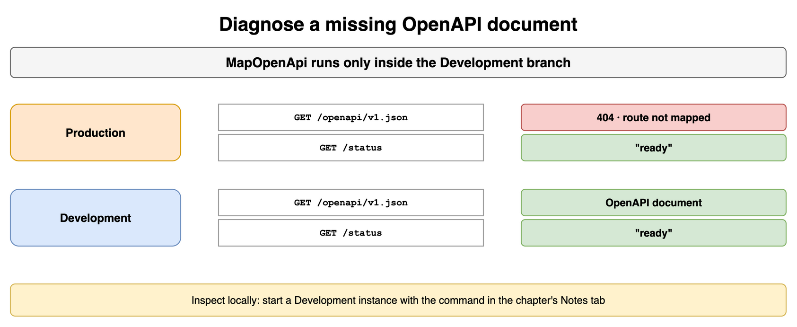
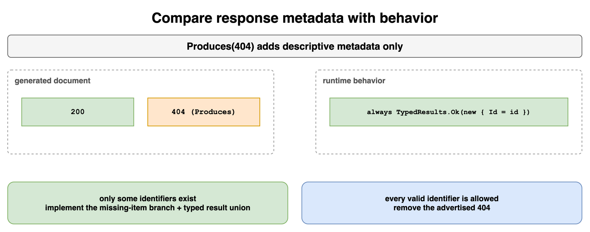

# OpenAPI — Drills

Predict the result before running the example.

## Diagnose a missing OpenAPI document

The application starts in Production. Why does `GET /openapi/v1.json` return 404, and how can you inspect the document locally?

```csharp
var builder = WebApplication.CreateBuilder(args);
builder.Services.AddOpenApi();
var app = builder.Build();
if (app.Environment.IsDevelopment())
    app.MapOpenApi();
app.MapGet("/status", () => "ready");
app.Run();
```

**Answer**

The runtime document route is mapped only in Development. Start a local Development instance using the command in the chapter's Notes tab. The status endpoint is available in both environments.



*Source: [`diagrams/openapi-drills.drawio`](/content/12_ASP.NET_Core/11_OpenAPI/diagrams/openapi-drills.drawio), page 1.*

## Compare response metadata with behavior

The endpoint always succeeds. Why does the generated document also advertise 404? How would you repair the mismatch if only some identifiers exist?

```csharp
var builder = WebApplication.CreateBuilder(args);
builder.Services.AddOpenApi();
var app = builder.Build();
if (app.Environment.IsDevelopment())
    app.MapOpenApi();
app.MapGet("/notes/{id:int}", (int id) => TypedResults.Ok(new { Id = id }))
    .Produces(404);
app.Run();
```

**Answer**

`Produces(404)` adds descriptive metadata. Implement the missing-item branch and use a typed result union as in [operation metadata](#12_ASP.NET_Core/11_OpenAPI/concepts/operation-descriptions-and-response-metadata). If every valid identifier is allowed, remove the advertised 404 instead.



*Source: [`diagrams/openapi-drills.drawio`](/content/12_ASP.NET_Core/11_OpenAPI/diagrams/openapi-drills.drawio), page 2.*
