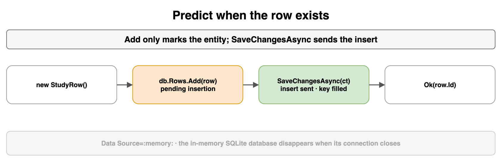
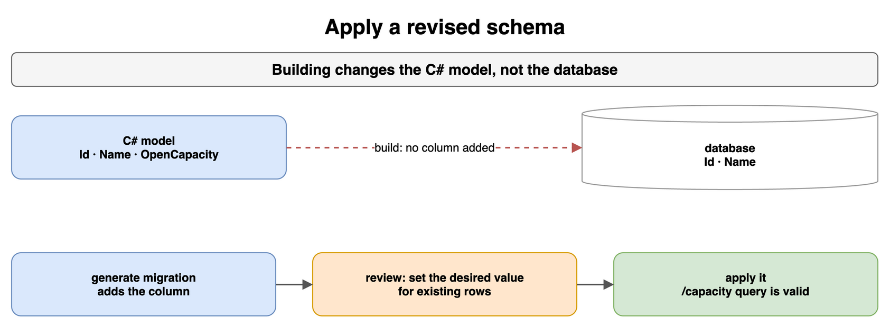

# Entity Framework Core — Drills

Predict the result before running the example.

## Predict when the row exists

At which line has EF Core actually inserted the row? Run this in a scratch project with the chapter's SQLite package.

```csharp
using Microsoft.EntityFrameworkCore;

var app = WebApplication.CreateBuilder(args).Build();
app.MapPost("/rows", async (CancellationToken ct) =>
{
    var options = new DbContextOptionsBuilder<ScratchDb>().UseSqlite("Data Source=:memory:").Options;
    await using var db = new ScratchDb(options);
    await db.Database.OpenConnectionAsync(ct);
    await db.Database.EnsureCreatedAsync(ct);
    var row = new StudyRow();
    db.Rows.Add(row);
    await db.SaveChangesAsync(ct);
    return TypedResults.Ok(row.Id);
});
app.Run();

sealed class ScratchDb(DbContextOptions<ScratchDb> options) : DbContext(options)
{
    public DbSet<StudyRow> Rows => Set<StudyRow>();
}
sealed class StudyRow { public int Id { get; set; } }
```

**Answer**

`Add` marks the entity as pending insertion. `SaveChangesAsync` sends the insert and fills in the generated key. The in-memory SQLite database in this exercise disappears when its connection closes.



*Source: [`diagrams/ef-core-drills.drawio`](/content/12_ASP.NET_Core/12_Entity_Framework_Core/diagrams/ef-core-drills.drawio), page 1.*

## Apply a revised schema

The migration-managed database currently has only `Id` and `Name`. When you add `OpenCapacity`, does rebuilding the app add the column? Which steps make the following query valid?

```csharp
using Microsoft.EntityFrameworkCore;

var builder = WebApplication.CreateBuilder(args);
builder.Services.AddDbContext<LibraryDb>(o => o.UseSqlite("Data Source=migrations-library.db"));
var app = builder.Build();
app.MapGet("/capacity", (LibraryDb db, CancellationToken ct) =>
    db.Rooms.Select(room => room.OpenCapacity).ToListAsync(ct));
app.Run();

sealed class LibraryDb(DbContextOptions<LibraryDb> options) : DbContext(options)
{
    public DbSet<Room> Rooms => Set<Room>();
}
sealed class Room
{
    public int Id { get; set; }
    public string Name { get; set; } = "";
    public int OpenCapacity { get; set; }
}
```

**Answer**

A build changes the C# model. Generate and review a migration that adds the column and sets the desired value for existing rows, then apply it. Follow the workflow in [define and apply migrations](#12_ASP.NET_Core/12_Entity_Framework_Core/concepts/define-and-apply-migrations).



*Source: [`diagrams/ef-core-drills.drawio`](/content/12_ASP.NET_Core/12_Entity_Framework_Core/diagrams/ef-core-drills.drawio), page 2.*
