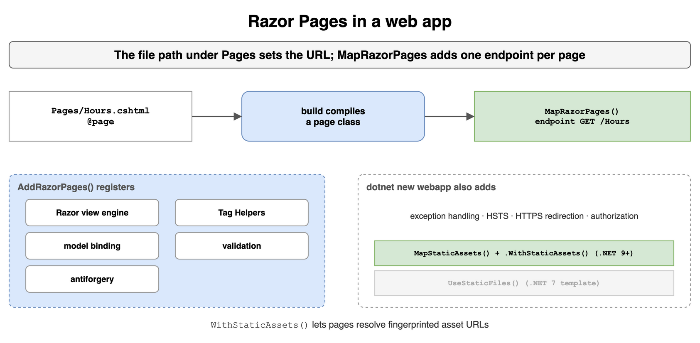
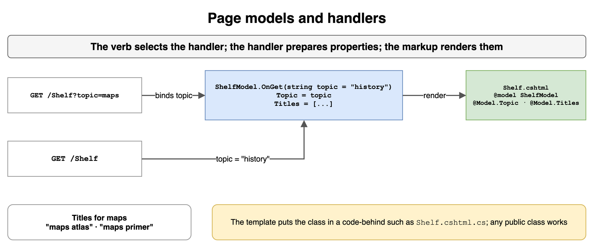
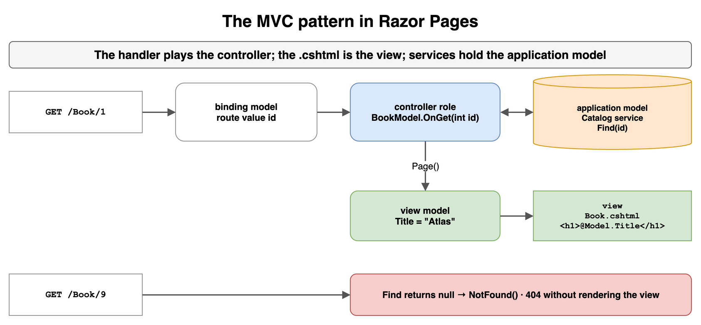
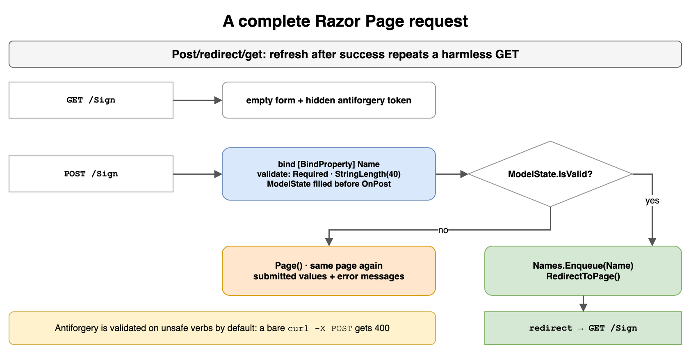

# Razor Pages

## Razor Pages in a web app

A Razor Page is a `.cshtml` file under `Pages` that starts with the `@page` directive. The build compiles each page into a class, and `MapRazorPages` adds one endpoint per page. The file's path sets the URL, so `Pages/Hours.cshtml` answers `/Hours`. `AddRazorPages` registers what pages need: the Razor view engine, Tag Helpers, model binding, validation, and antiforgery.

The `dotnet new webapp` template adds the same two calls plus exception handling, HSTS, HTTPS redirection, and authorization. Since .NET 9 the template serves `wwwroot` with `MapStaticAssets` and chains `WithStaticAssets()` on the page endpoints, so pages can resolve fingerprinted asset URLs. The .NET 7 template used `UseStaticFiles` instead. For the build-time manifest, see [build-time and runtime static files](#12_ASP.NET_Core/04_Middleware/concepts/build-time-and-runtime-static-files).

```csharp
var builder = WebApplication.CreateBuilder(args);
builder.Services.AddRazorPages();
var app = builder.Build();
app.MapStaticAssets();
app.MapRazorPages().WithStaticAssets();
app.Run();
```

```cshtml
@* Pages/Hours.cshtml *@
@page
<h1>Reading room</h1>
<p>Open today until @(DateTime.Today.AddHours(20).ToString("HH:mm")).</p>
```

[Microsoft Learn](https://learn.microsoft.com/en-us/aspnet/core/razor-pages/?view=aspnetcore-10.0)



*Source: [`diagrams/razor-pages.drawio`](/content/12_ASP.NET_Core/13_Razor_Pages/diagrams/razor-pages.drawio), page 1.*

## Page models and handlers

A page can declare a `PageModel` subclass with `@model`. The model's handler methods run before the markup renders. The verb selects the method, so a GET runs `OnGet` or `OnGetAsync`. Handlers set properties on the model, and the markup reads them through `Model`. The template puts the class in a code-behind file such as `Shelf.cshtml.cs`. Any public class works, so these examples keep it in `Program.cs`.

Request `/Shelf` and then `/Shelf?topic=maps`. The handler's `topic` parameter binds from the query string, and the default applies when the query omits it. The markup has only one job: turning the prepared properties into HTML.

```csharp
using Microsoft.AspNetCore.Mvc.RazorPages;

var builder = WebApplication.CreateBuilder(args);
builder.Services.AddRazorPages();
var app = builder.Build();
app.MapRazorPages();
app.Run();

public class ShelfModel : PageModel
{
    public string Topic { get; private set; } = "";
    public string[] Titles { get; private set; } = [];

    public void OnGet(string topic = "history")
    {
        Topic = topic;
        Titles = [$"{topic} atlas", $"{topic} primer"];
    }
}
```

```cshtml
@* Pages/Shelf.cshtml *@
@page
@model ShelfModel
<h1>@Model.Topic</h1>
<ul>
    @foreach (var title in Model.Titles) { <li>@title</li> }
</ul>
```

[Microsoft Learn](https://learn.microsoft.com/en-us/aspnet/core/razor-pages/?view=aspnetcore-10.0)



*Source: [`diagrams/razor-pages.drawio`](/content/12_ASP.NET_Core/13_Razor_Pages/diagrams/razor-pages.drawio), page 2.*

## The MVC pattern in Razor Pages

Model-view-controller separates three jobs. The model is the application's data and business logic, often behind services. The view turns data into a response. The controller accepts the request, calls the model, and chooses a view. In Razor Pages, the handler plays the controller role, the `.cshtml` markup is the view, and the services the page model calls hold the application model.

ASP.NET Core also names the data at each step. The binding model holds request input, here the route value `id`. The handler hands that input to the application model, a `Catalog` service. It then fills the view model, the `Title` property that the view renders. Request `/Book/1` to see a title and `/Book/9` to get a 404 without rendering the view.

```csharp
using Microsoft.AspNetCore.Mvc;
using Microsoft.AspNetCore.Mvc.RazorPages;

var builder = WebApplication.CreateBuilder(args);
builder.Services.AddRazorPages();
builder.Services.AddSingleton<Catalog>();
var app = builder.Build();
app.MapRazorPages();
app.Run();

public class Catalog
{
    private readonly Dictionary<int, string> titles = new() { [1] = "Atlas", [2] = "Primer" };
    public string? Find(int id) => titles.GetValueOrDefault(id);
}

public class BookModel(Catalog catalog) : PageModel
{
    public string Title { get; private set; } = "";

    public IActionResult OnGet(int id)
    {
        if (catalog.Find(id) is not { } title) return NotFound();
        Title = title;
        return Page();
    }
}
```

```cshtml
@* Pages/Book.cshtml *@
@page "{id:int}"
@model BookModel
<h1>@Model.Title</h1>
```

[Microsoft Learn](https://learn.microsoft.com/en-us/aspnet/core/mvc/overview?view=aspnetcore-10.0)



*Source: [`diagrams/razor-pages.drawio`](/content/12_ASP.NET_Core/13_Razor_Pages/diagrams/razor-pages.drawio), page 3.*

## A complete Razor Page request

A form round trip uses every step. A GET renders an empty form. The POST binds the form fields into `[BindProperty]` properties and validates them, so the handler runs with `ModelState` already filled in. If validation fails, `Page()` renders the same page again, keeping the submitted values and showing error messages. If it succeeds, the handler updates the application model and redirects to a GET.

The redirect is the post/redirect/get pattern: refreshing the page after a successful sign repeats a harmless GET, not the POST. Razor Pages validates antiforgery tokens on unsafe verbs by default. The Form Tag Helper adds the hidden token, so the form works in a browser and a bare `curl -X POST` gets 400. [Tag Helpers and forms](#12_ASP.NET_Core/18_Tag_Helpers_and_Forms/concepts/the-form-tag-helper) covers the markup.

```csharp
using System.Collections.Concurrent;
using System.ComponentModel.DataAnnotations;
using Microsoft.AspNetCore.Mvc;
using Microsoft.AspNetCore.Mvc.RazorPages;

var builder = WebApplication.CreateBuilder(args);
builder.Services.AddRazorPages();
builder.Services.AddSingleton<Guestbook>();
var app = builder.Build();
app.MapRazorPages();
app.Run();

public class Guestbook { public ConcurrentQueue<string> Names { get; } = new(); }

public class SignModel(Guestbook book) : PageModel
{
    [BindProperty, Required, StringLength(40)]
    public string? Name { get; set; }
    public IEnumerable<string> Names => book.Names;

    public IActionResult OnPost()
    {
        if (!ModelState.IsValid) return Page();
        book.Names.Enqueue(Name!);
        return RedirectToPage();
    }
}
```

```cshtml
@* Pages/Sign.cshtml *@
@page
@model SignModel
<form method="post">
    <input asp-for="Name" /> <span asp-validation-for="Name"></span>
    <button>Sign</button>
</form>
<ul>@foreach (var name in Model.Names) { <li>@name</li> }</ul>
```

[Microsoft Learn](https://learn.microsoft.com/en-us/aspnet/core/tutorials/razor-pages/razor-pages-start?view=aspnetcore-10.0)



*Source: [`diagrams/razor-pages.drawio`](/content/12_ASP.NET_Core/13_Razor_Pages/diagrams/razor-pages.drawio), page 4.*
