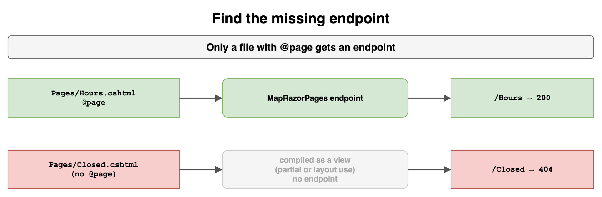
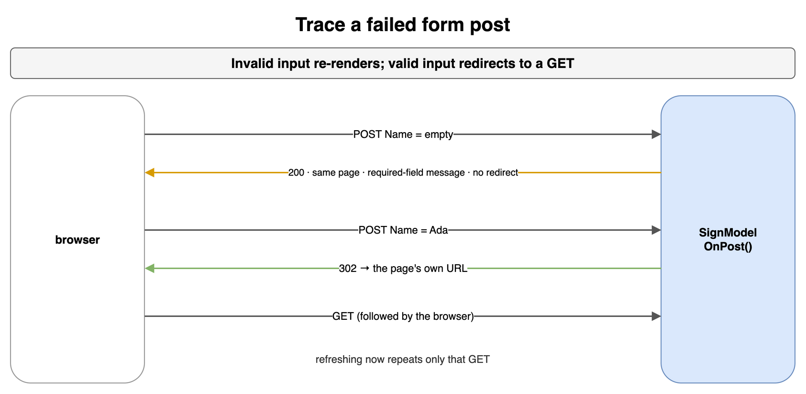

# Razor Pages — Drills

Predict the result before running the example.

## Find the missing endpoint

The app has two Razor files. What do `/Hours` and `/Closed` return? What makes the difference?

```csharp
var builder = WebApplication.CreateBuilder(args);
builder.Services.AddRazorPages();
var app = builder.Build();
app.MapRazorPages();
app.Run();
```

```cshtml
@* Pages/Hours.cshtml *@
@page
<p>Open 9 to 5.</p>
```

```cshtml
@* Pages/Closed.cshtml *@
<p>Closed on holidays.</p>
```

**Answer**

`/Hours` returns 200 with its paragraph. `/Closed` returns 404. Without `@page`, the file compiles as a view that a page can use as a partial or a layout, but `MapRazorPages` creates no endpoint for it.



*Source: [`diagrams/razor-pages-drills.drawio`](/content/12_ASP.NET_Core/13_Razor_Pages/diagrams/razor-pages-drills.drawio), page 1.*

## Trace a failed form post

This is a trimmed version of the [complete request example](#12_ASP.NET_Core/13_Razor_Pages/concepts/a-complete-razor-page-request). In a browser, a visitor submits the form with an empty name, then submits `Ada`. What status does each POST return, and what does the browser show?

```csharp
using System.ComponentModel.DataAnnotations;
using Microsoft.AspNetCore.Mvc;
using Microsoft.AspNetCore.Mvc.RazorPages;

var builder = WebApplication.CreateBuilder(args);
builder.Services.AddRazorPages();
var app = builder.Build();
app.MapRazorPages();
app.Run();

public class SignModel : PageModel
{
    [BindProperty, Required] public string? Name { get; set; }

    public IActionResult OnPost() => ModelState.IsValid ? RedirectToPage() : Page();
}
```

```cshtml
@* Pages/Sign.cshtml *@
@page
@model SignModel
<form method="post">
    <input asp-for="Name" /> <span asp-validation-for="Name"></span>
    <button>Sign</button>
</form>
```

**Answer**

The empty submission returns 200 and the same page, with the required-field message beside the input. No redirect happens. The second submission returns 302 to the page's own URL, and the browser follows it with a GET. Refreshing then repeats only that GET.



*Source: [`diagrams/razor-pages-drills.drawio`](/content/12_ASP.NET_Core/13_Razor_Pages/diagrams/razor-pages-drills.drawio), page 2.*
