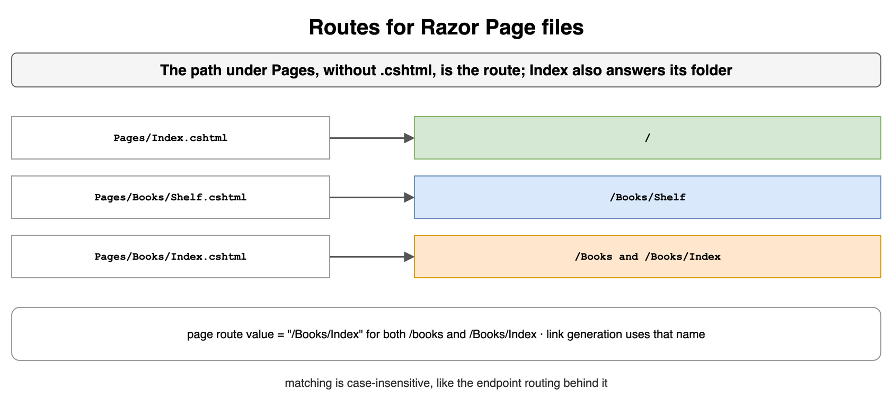
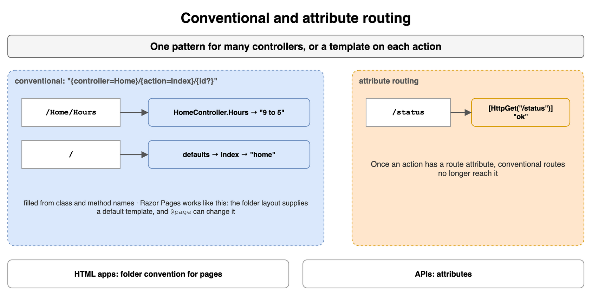
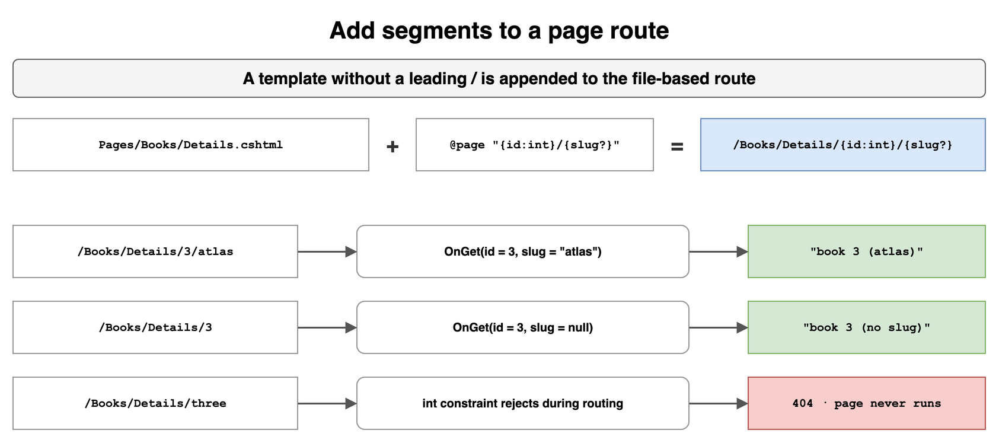
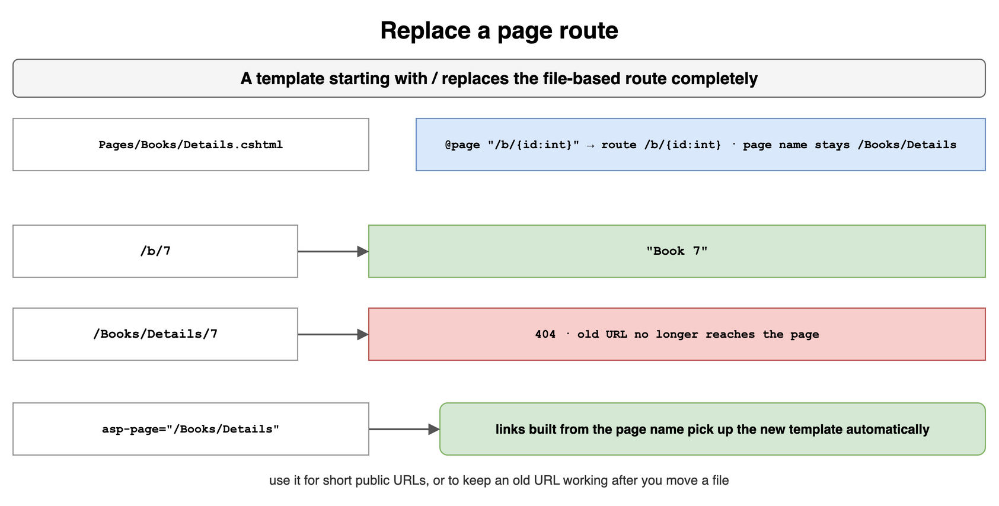
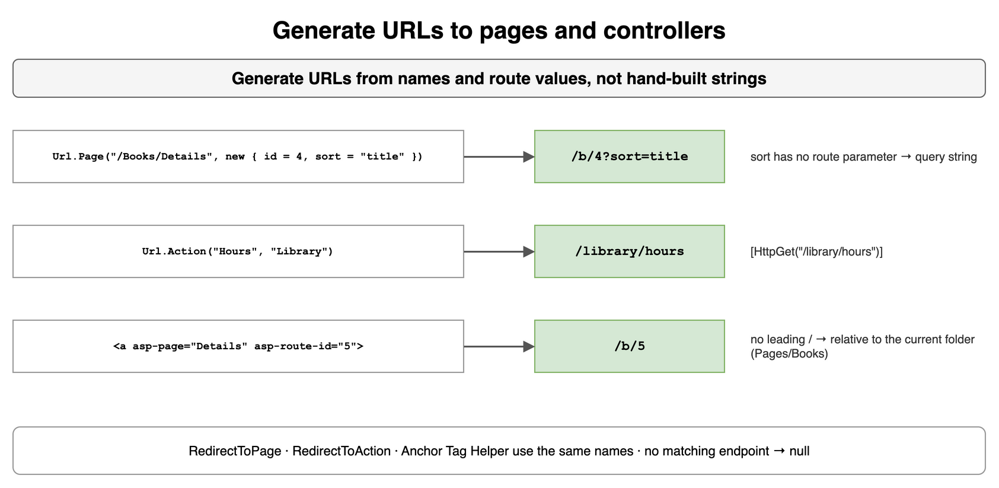
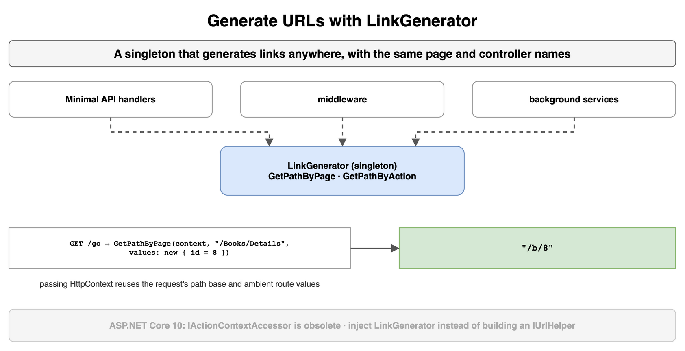
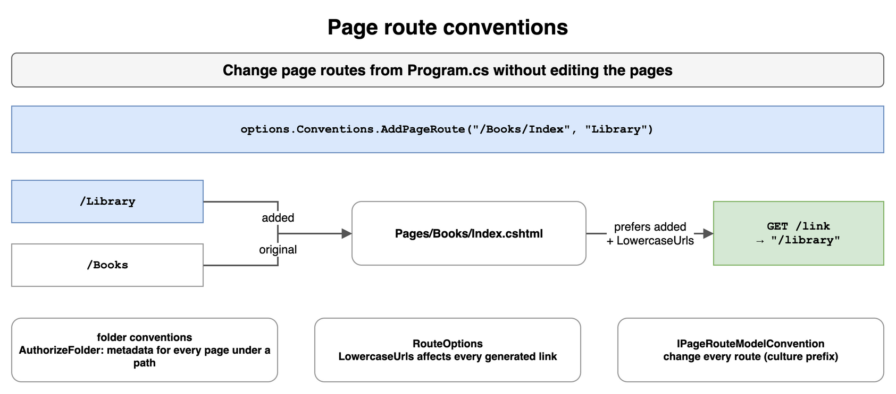

# Razor Pages Routing

## Routes for Razor Page files

Razor Pages builds each page's route from its path under `Pages`, without the `.cshtml` extension. `Pages/Books/Shelf.cshtml` answers `/Books/Shelf`. A page named `Index` also answers its folder's URL, so `Pages/Books/Index.cshtml` answers both `/Books` and `/Books/Index`, and `Pages/Index.cshtml` answers `/`. Matching is case-insensitive, like the [endpoint routing](#12_ASP.NET_Core/06_Endpoint_Routing/concepts/endpoint-selection-and-route-precedence) behind it.

Each page endpoint carries a `page` route value holding the page's name, such as `/Books/Index`. Link generation uses that name. Request `/books` and `/Books/Index` in this example: both run the same page and print the same name, with different request paths.

```csharp
var builder = WebApplication.CreateBuilder(args);
builder.Services.AddRazorPages();
var app = builder.Build();
app.MapRazorPages();
app.Run();
```

```cshtml
@* Pages/Books/Index.cshtml *@
@page
<p>Page @ViewContext.RouteData.Values["page"] served @HttpContext.Request.Path</p>
```

[Microsoft Learn](https://learn.microsoft.com/en-us/aspnet/core/razor-pages/?view=aspnetcore-10.0#razor-pages-routing)



*Source: [`diagrams/razor-pages-routing.drawio`](/content/12_ASP.NET_Core/14_Razor_Pages_Routing/diagrams/razor-pages-routing.drawio), page 1.*

## Conventional and attribute routing

ASP.NET Core supports two routing styles for MVC. Conventional routing defines one URL pattern for many controllers, such as `{controller=Home}/{action=Index}/{id?}`, and fills it from class and method names. Attribute routing writes the template on each controller or action. Razor Pages works like conventional routing. The folder layout supplies a default template for every page, and the `@page` directive can change it.

Here `/Home/Hours` matches the conventional route, and `/` uses the defaults. `/status` exists only because of its attribute. Once an action has a route attribute, conventional routes no longer reach it. Most HTML apps use the folder convention for pages, while APIs use attributes.

```csharp
using Microsoft.AspNetCore.Mvc;

var builder = WebApplication.CreateBuilder(args);
builder.Services.AddControllers();
var app = builder.Build();
app.MapControllerRoute("default", "{controller=Home}/{action=Index}/{id?}");
app.MapControllers();
app.Run();

public class HomeController : Controller
{
    public IActionResult Index() => Content("home");
    public IActionResult Hours() => Content("9 to 5");
}

public class StatusController : Controller
{
    [HttpGet("/status")]
    public IActionResult Show() => Content("ok");
}
```

[Microsoft Learn](https://learn.microsoft.com/en-us/aspnet/core/mvc/controllers/routing?view=aspnetcore-10.0)



*Source: [`diagrams/razor-pages-routing.drawio`](/content/12_ASP.NET_Core/14_Razor_Pages_Routing/diagrams/razor-pages-routing.drawio), page 2.*

## Add segments to a page route

A template after `@page` that does not start with `/` is appended to the file-based route. `@page "{id:int}/{slug?}"` in `Pages/Books/Details.cshtml` produces `/Books/Details/{id:int}/{slug?}`. Parameters use the same constraint, optional, and default syntax as [Minimal API routes](#12_ASP.NET_Core/06_Endpoint_Routing/concepts/optional-segments-and-route-defaults). Handler parameters with matching names bind from the route.

Request `/Books/Details/3/atlas`, then `/Books/Details/3`. Both match, and the second leaves `slug` null. `/Books/Details/three` returns 404 because the `int` constraint rejects it during routing, before the page runs.

```csharp
using Microsoft.AspNetCore.Mvc.RazorPages;

var builder = WebApplication.CreateBuilder(args);
builder.Services.AddRazorPages();
var app = builder.Build();
app.MapRazorPages();
app.Run();

public class DetailsModel : PageModel
{
    public string Summary { get; private set; } = "";
    public void OnGet(int id, string? slug) => Summary = $"book {id} ({slug ?? "no slug"})";
}
```

```cshtml
@* Pages/Books/Details.cshtml *@
@page "{id:int}/{slug?}"
@model DetailsModel
<p>@Model.Summary</p>
```

[Microsoft Learn](https://learn.microsoft.com/en-us/aspnet/core/razor-pages/razor-pages-conventions?view=aspnetcore-10.0)



*Source: [`diagrams/razor-pages-routing.drawio`](/content/12_ASP.NET_Core/14_Razor_Pages_Routing/diagrams/razor-pages-routing.drawio), page 3.*

## Replace a page route

A template that starts with `/` replaces the file-based route completely. The page keeps its name for link generation, `/Books/Details` here, but only the new URL reaches it. Use this for short public URLs, or to keep an old URL working after you move a file.

Request `/b/7`. The old `/Books/Details/7` now returns 404. Links built from the page name, like `asp-page="/Books/Details"`, pick up the new template automatically, so moving a URL does not mean editing every link.

```csharp
using Microsoft.AspNetCore.Mvc.RazorPages;

var builder = WebApplication.CreateBuilder(args);
builder.Services.AddRazorPages();
var app = builder.Build();
app.MapRazorPages();
app.Run();

public class DetailsModel : PageModel
{
    public int Id { get; private set; }
    public void OnGet(int id) => Id = id;
}
```

```cshtml
@* Pages/Books/Details.cshtml *@
@page "/b/{id:int}"
@model DetailsModel
<p>Book @Model.Id</p>
```

[Microsoft Learn](https://learn.microsoft.com/en-us/aspnet/core/razor-pages/razor-pages-conventions?view=aspnetcore-10.0)



*Source: [`diagrams/razor-pages-routing.drawio`](/content/12_ASP.NET_Core/14_Razor_Pages_Routing/diagrams/razor-pages-routing.drawio), page 4.*

## Generate URLs to pages and controllers

Generate URLs from route names and values rather than hand-built strings. Inside a page model, `Url.Page` takes a page name and route values, and `Url.Action` takes an action and a controller. `RedirectToPage` and `RedirectToAction` produce redirects the same way, and the Anchor Tag Helper does the same in markup. A page name without a leading `/`, such as `Details`, is resolved relative to the current page's folder.

Request `/Books/Links`. The page links to `/b/4` through a replaced route, as in the previous card, and to a controller action. A value with no matching route parameter, here `sort`, becomes a query string. If no endpoint matches, the helpers return null.

```csharp
using Microsoft.AspNetCore.Mvc;
using Microsoft.AspNetCore.Mvc.RazorPages;

var builder = WebApplication.CreateBuilder(args);
builder.Services.AddRazorPages();
builder.Services.AddControllers();
var app = builder.Build();
app.MapRazorPages();
app.MapControllers();
app.Run();

public class LinksModel : PageModel
{
    public string? Book => Url.Page("/Books/Details", new { id = 4, sort = "title" });
    public string? Hours => Url.Action("Hours", "Library");
}

public class LibraryController : Controller
{
    [HttpGet("/library/hours")]
    public IActionResult Hours() => Content("9 to 5");
}
```

```cshtml
@* Pages/Books/Links.cshtml *@
@page
@model LinksModel
<p>@Model.Book | @Model.Hours | <a asp-page="Details" asp-route-id="5">relative</a></p>
```

```cshtml
@* Pages/Books/Details.cshtml *@
@page "/b/{id:int}"
```

[Microsoft Learn](https://learn.microsoft.com/en-us/aspnet/core/fundamentals/routing?view=aspnetcore-10.0#url-generation-concepts)



*Source: [`diagrams/razor-pages-routing.drawio`](/content/12_ASP.NET_Core/14_Razor_Pages_Routing/diagrams/razor-pages-routing.drawio), page 5.*

## Generate URLs with LinkGenerator

`LinkGenerator` is a singleton service that generates links anywhere, including Minimal API handlers, middleware, and background services. `GetPathByPage` and `GetPathByAction` take the same page or controller names that `Url.Page` and `Url.Action` use. Passing the current `HttpContext` lets the generator reuse the request's path base and ambient route values.

ASP.NET Core 10 marks `IActionContextAccessor` obsolete. Code outside a page or controller once used it to build an `IUrlHelper`. Inject `LinkGenerator` there instead. Request `/go` to get `/b/8`.

```csharp
var builder = WebApplication.CreateBuilder(args);
builder.Services.AddRazorPages();
var app = builder.Build();
app.MapRazorPages();
app.MapGet("/go", (LinkGenerator links, HttpContext context) =>
    links.GetPathByPage(context, "/Books/Details", values: new { id = 8 }) ?? "no route");
app.Run();
```

```cshtml
@* Pages/Books/Details.cshtml *@
@page "/b/{id:int}"
```

[Microsoft Learn](https://learn.microsoft.com/en-us/aspnet/core/fundamentals/routing?view=aspnetcore-10.0#url-generation-with-linkgenerator)



*Source: [`diagrams/razor-pages-routing.drawio`](/content/12_ASP.NET_Core/14_Razor_Pages_Routing/diagrams/razor-pages-routing.drawio), page 6.*

## Page route conventions

Conventions change page routes from `Program.cs` without editing the pages. `AddPageRoute` adds a second template to an existing page. The original route keeps working, and link generation prefers the added one. Folder conventions, such as `AuthorizeFolder`, apply metadata to every page under a path. `RouteOptions` settings like `LowercaseUrls` affect every generated link, [as in Minimal APIs](#12_ASP.NET_Core/06_Endpoint_Routing/concepts/link-generation-and-named-results).

Here `/Library` and `/Books` both reach the same page. `/link` returns `/library`, from the convention's route with lowercasing applied. To change every route, for example to add a culture prefix, implement `IPageRouteModelConvention` and add it to `options.Conventions`.

```csharp
var builder = WebApplication.CreateBuilder(args);
builder.Services.AddRazorPages(options =>
    options.Conventions.AddPageRoute("/Books/Index", "Library"));
builder.Services.Configure<RouteOptions>(options => options.LowercaseUrls = true);
var app = builder.Build();
app.MapRazorPages();
app.MapGet("/link", (LinkGenerator links) => links.GetPathByPage("/Books/Index"));
app.Run();
```

```cshtml
@* Pages/Books/Index.cshtml *@
@page
<p>Books</p>
```

[Microsoft Learn](https://learn.microsoft.com/en-us/aspnet/core/razor-pages/razor-pages-conventions?view=aspnetcore-10.0)



*Source: [`diagrams/razor-pages-routing.drawio`](/content/12_ASP.NET_Core/14_Razor_Pages_Routing/diagrams/razor-pages-routing.drawio), page 7.*
