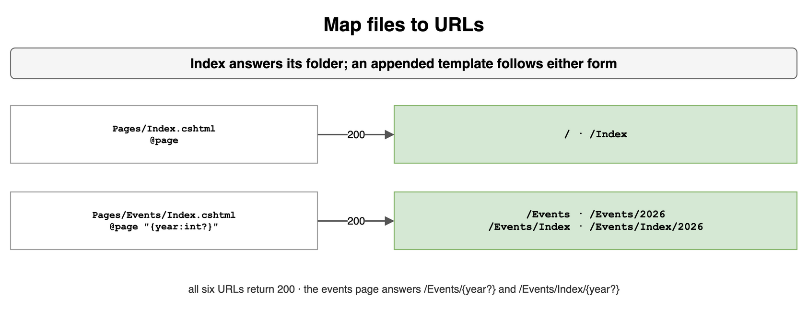
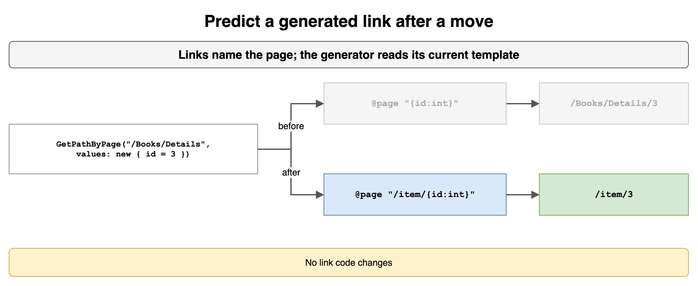

# Razor Pages Routing — Drills

Predict the result before running the example.

## Map files to URLs

The app has the two pages below. Which of `/`, `/Index`, `/Events`, `/Events/Index`, `/Events/Index/2026`, and `/Events/2026` return 200?

```csharp
var builder = WebApplication.CreateBuilder(args);
builder.Services.AddRazorPages();
var app = builder.Build();
app.MapRazorPages();
app.Run();
```

```cshtml
@* Pages/Index.cshtml *@
@page
<p>Home</p>
```

```cshtml
@* Pages/Events/Index.cshtml *@
@page "{year:int?}"
<p>Events @ViewContext.RouteData.Values["year"]</p>
```

**Answer**

All six return 200. The root `Index` page answers `/` and `/Index`. The events page answers both `/Events/{year?}` and `/Events/Index/{year?}`, so the year can follow either form.



*Source: [`diagrams/razor-pages-routing-drills.drawio`](/content/12_ASP.NET_Core/14_Razor_Pages_Routing/diagrams/razor-pages-routing-drills.drawio), page 1.*

## Predict a generated link after a move

A teammate replaces the route of `Pages/Books/Details.cshtml`. What does `/links` return before and after the change, and does any link code need editing?

```csharp
var builder = WebApplication.CreateBuilder(args);
builder.Services.AddRazorPages();
var app = builder.Build();
app.MapRazorPages();
app.MapGet("/links", (LinkGenerator links) =>
    links.GetPathByPage("/Books/Details", values: new { id = 3 }));
app.Run();
```

```cshtml
@* Pages/Books/Details.cshtml *@
@page "{id:int}"
```

The changed directive is `@page "/item/{id:int}"`.

**Answer**

Before the change, `/links` returns `/Books/Details/3`. After it, `/links` returns `/item/3`. No link code changes, because links name the page and the generator reads the page's current template.



*Source: [`diagrams/razor-pages-routing-drills.drawio`](/content/12_ASP.NET_Core/14_Razor_Pages_Routing/diagrams/razor-pages-routing-drills.drawio), page 2.*
