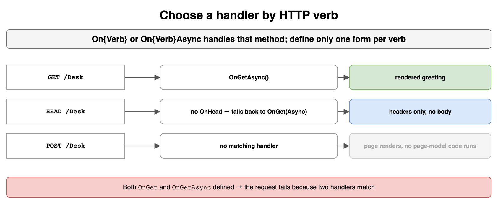
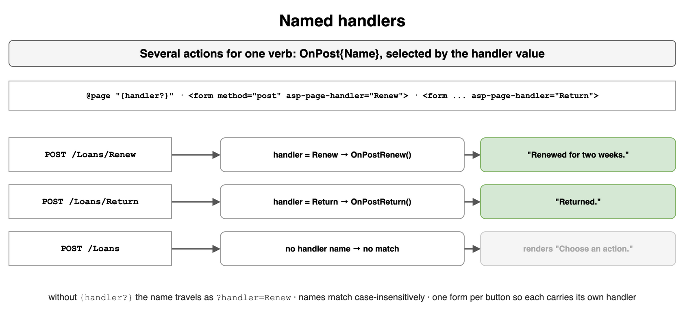
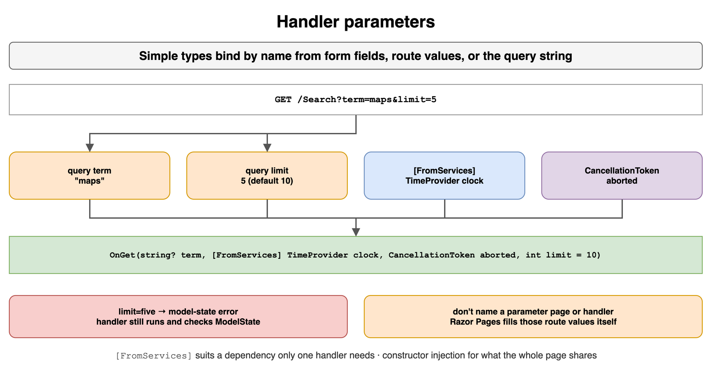
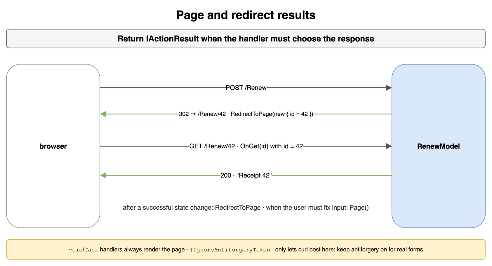
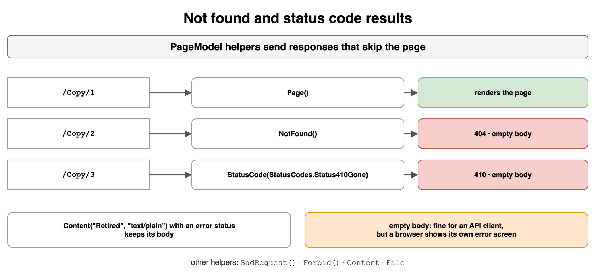
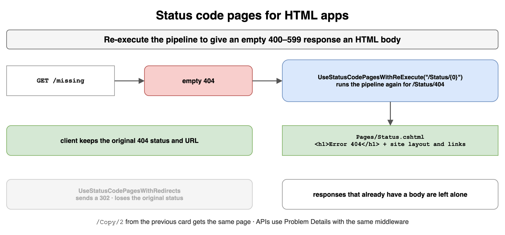

# Page Handlers

## Choose a handler by HTTP verb

Razor Pages finds handlers by name. A method named `On{Verb}` or `On{Verb}Async` handles that HTTP method, so `OnGet` serves GET and `OnPostAsync` serves POST. A HEAD request falls back to `OnGet` when the page has no `OnHead`. Define either the synchronous or the async form for a verb. If both exist, the request fails because two handlers match.

A page does not need a handler for every verb. If no handler matches, Razor Pages still renders the page without running any page-model code. In this example, request `/Desk` with GET and with HEAD. GET returns the rendered greeting. HEAD runs the same handler and sends the headers without a body.

```csharp
using Microsoft.AspNetCore.Mvc.RazorPages;

var builder = WebApplication.CreateBuilder(args);
builder.Services.AddRazorPages();
var app = builder.Build();
app.MapRazorPages();
app.Run();

public class DeskModel : PageModel
{
    public string Greeting { get; private set; } = "";
    public async Task OnGetAsync()
    {
        await Task.Delay(10);
        Greeting = $"Desk opened at {DateTime.UtcNow:HH:mm} UTC";
    }
}
```

```cshtml
@* Pages/Desk.cshtml *@
@page
@model DeskModel
<p>@Model.Greeting</p>
```

[Microsoft Learn](https://learn.microsoft.com/en-us/aspnet/core/razor-pages/?view=aspnetcore-10.0#write-a-basic-form)



*Source: [`diagrams/page-handlers.drawio`](/content/12_ASP.NET_Core/15_Page_Handlers/diagrams/page-handlers.drawio), page 1.*

## Named handlers

A page can offer several actions for the same verb by naming handlers: `OnPostRenew` and `OnPostReturn` are both POST handlers, named `Renew` and `Return`. The request selects one with a `handler` value, normally the query string `?handler=Renew`. The Form Tag Helper's `asp-page-handler` attribute adds it for you. Adding `{handler?}` to the `@page` template moves the name into the path.

With the template below, the two buttons post to `/Loans/Renew` and `/Loans/Return`. The handler name is matched case-insensitively. A POST without a handler name finds no matching handler, so it just renders the page. Each button sits in its own form so each one carries its own handler.

```csharp
using Microsoft.AspNetCore.Mvc;
using Microsoft.AspNetCore.Mvc.RazorPages;

var builder = WebApplication.CreateBuilder(args);
builder.Services.AddRazorPages();
var app = builder.Build();
app.MapRazorPages();
app.Run();

public class LoansModel : PageModel
{
    public string Message { get; private set; } = "Choose an action.";
    public void OnPostRenew() => Message = "Renewed for two weeks.";
    public void OnPostReturn() => Message = "Returned.";
}
```

```cshtml
@* Pages/Loans.cshtml *@
@page "{handler?}"
@model LoansModel
<p>@Model.Message</p>
<form method="post" asp-page-handler="Renew"><button>Renew</button></form>
<form method="post" asp-page-handler="Return"><button>Return</button></form>
```

[Microsoft Learn](https://learn.microsoft.com/en-us/aspnet/core/razor-pages/?view=aspnetcore-10.0#multiple-handlers-per-page)



*Source: [`diagrams/page-handlers.drawio`](/content/12_ASP.NET_Core/15_Page_Handlers/diagrams/page-handlers.drawio), page 2.*

## Handler parameters

Handler parameters bind like action parameters in MVC. Simple types come from form fields, route values, or the query string, matched by name. A `CancellationToken` receives the request-aborted token. `[FromServices]` injects a registered service into one handler, which suits a dependency only that handler needs. Use constructor injection for dependencies the whole page shares.

Request `/Search?term=maps&limit=5`. A missing `limit` falls back to its default. A value that can't convert, such as `limit=five`, adds a model-state error instead of failing the request. The handler still runs and should check `ModelState`. Don't name a parameter `page` or `handler`, because Razor Pages fills those route values itself, and `page` would bind the page name `/Search`. [Binding and validation](#12_ASP.NET_Core/16_Razor_Pages_Binding_and_Validation/concepts/simple-type-binding-and-model-state) covers the rules.

```csharp
using Microsoft.AspNetCore.Mvc;
using Microsoft.AspNetCore.Mvc.RazorPages;

var builder = WebApplication.CreateBuilder(args);
builder.Services.AddRazorPages();
builder.Services.AddSingleton(TimeProvider.System);
var app = builder.Build();
app.MapRazorPages();
app.Run();

public class SearchModel : PageModel
{
    public string Result { get; private set; } = "";

    public void OnGet(string? term, [FromServices] TimeProvider clock,
        CancellationToken aborted, int limit = 10) =>
        Result = ModelState.IsValid
            ? $"'{term}' top {limit} at {clock.GetUtcNow():T}"
            : "Limit must be a number.";
}
```

```cshtml
@* Pages/Search.cshtml *@
@page
@model SearchModel
<p>@Model.Result</p>
```

[Microsoft Learn](https://learn.microsoft.com/en-us/aspnet/core/mvc/models/model-binding?view=aspnetcore-10.0)



*Source: [`diagrams/page-handlers.drawio`](/content/12_ASP.NET_Core/15_Page_Handlers/diagrams/page-handlers.drawio), page 3.*

## Page and redirect results

A handler that returns `void` or `Task` always renders its page. Return `IActionResult` or `Task<IActionResult>` when the handler must choose a response. `Page()` renders the current page and is the usual result after a failed validation. `RedirectToPage` sends a 302 to another page, or to this one when you pass no name, and takes route values for the target.

Here a POST to `/Renew` redirects to `/Renew/42`, and the GET handler reads the receipt id from the route. Choose `RedirectToPage` after a successful state change, and `Page()` when the user must fix the input on the same screen. `[IgnoreAntiforgeryToken]` lets `curl` post without a token. Keep antiforgery on for real forms.

```csharp
using Microsoft.AspNetCore.Mvc;
using Microsoft.AspNetCore.Mvc.RazorPages;

var builder = WebApplication.CreateBuilder(args);
builder.Services.AddRazorPages();
var app = builder.Build();
app.MapRazorPages();
app.Run();

[IgnoreAntiforgeryToken]
public class RenewModel : PageModel
{
    public int? Receipt { get; private set; }
    public void OnGet(int? id) => Receipt = id;
    public IActionResult OnPost() => RedirectToPage(new { id = 42 });
}
```

```cshtml
@* Pages/Renew.cshtml *@
@page "{id:int?}"
@model RenewModel
<p>@(Model.Receipt is int id ? $"Receipt {id}" : "No renewal yet")</p>
```

[Microsoft Learn](https://learn.microsoft.com/en-us/aspnet/core/razor-pages/?view=aspnetcore-10.0)



*Source: [`diagrams/page-handlers.drawio`](/content/12_ASP.NET_Core/15_Page_Handlers/diagrams/page-handlers.drawio), page 4.*

## Not found and status code results

`PageModel` has helpers for responses that skip the page: `NotFound()`, `BadRequest()`, `Forbid()`, `StatusCode(int)`, `Content`, and `File`. `NotFound()` and `StatusCode(int)` send a status code with an empty body. That is fine for an API client, but a browser shows its own error screen. The next card turns those empty responses into HTML.

Request `/Copy/1` for the page, `/Copy/2` for a 404, and `/Copy/3` for a 410 Gone. Results with a body, such as `Content("Retired", "text/plain")`, keep that body even when you set an error status.

```csharp
using Microsoft.AspNetCore.Mvc;
using Microsoft.AspNetCore.Mvc.RazorPages;

var builder = WebApplication.CreateBuilder(args);
builder.Services.AddRazorPages();
var app = builder.Build();
app.MapRazorPages();
app.Run();

public class CopyModel : PageModel
{
    public IActionResult OnGet(int id) => id switch
    {
        1 => Page(),
        3 => StatusCode(StatusCodes.Status410Gone),
        _ => NotFound(),
    };
}
```

```cshtml
@* Pages/Copy.cshtml *@
@page "{id:int}"
@model CopyModel
<p>Copy is on the shelf.</p>
```

[Microsoft Learn](https://learn.microsoft.com/en-us/aspnet/core/mvc/controllers/actions?view=aspnetcore-10.0#actions-and-action-results)



*Source: [`diagrams/page-handlers.drawio`](/content/12_ASP.NET_Core/15_Page_Handlers/diagrams/page-handlers.drawio), page 5.*

## Status code pages for HTML apps

Status code pages middleware gives an empty 400–599 response a body. `UseStatusCodePagesWithReExecute("/Status/{0}")` runs the pipeline again for the path, with `{0}` replaced by the status code. The client keeps the original status and URL. Re-execution renders a normal page, so the error page can share the site's layout and links. `UseStatusCodePagesWithRedirects` sends a 302 instead, which loses the original status.

Request `/missing` for a 404 with the status page. Add the `Copy` page and model from the previous card, and `/Copy/2` gets the same page. Responses that already have a body are left alone. For APIs, use [Problem Details](#12_ASP.NET_Core/05_JSON_APIs_with_Minimal_APIs/concepts/problem-details-for-api-errors), which uses the same middleware.

```csharp
var builder = WebApplication.CreateBuilder(args);
builder.Services.AddRazorPages();
var app = builder.Build();
app.UseStatusCodePagesWithReExecute("/Status/{0}");
app.MapRazorPages();
app.Run();
```

```cshtml
@* Pages/Status.cshtml *@
@page "{code:int}"
<h1>Error @ViewContext.RouteData.Values["code"]</h1>
<p><a href="~/">Back to the catalog</a></p>
```

[Microsoft Learn](https://learn.microsoft.com/en-us/aspnet/core/fundamentals/error-handling?view=aspnetcore-10.0#usestatuscodepageswithreexecute)



*Source: [`diagrams/page-handlers.drawio`](/content/12_ASP.NET_Core/15_Page_Handlers/diagrams/page-handlers.drawio), page 6.*
