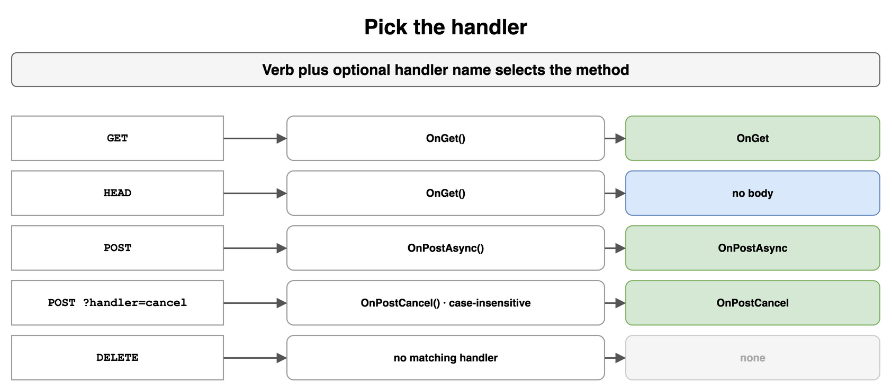
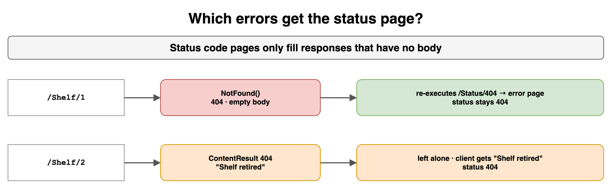

# Page Handlers — Drills

Predict the result before running the example.

## Pick the handler

For each request to `/Holds`, which method runs and what does the response say? GET, HEAD, POST, POST `?handler=cancel`, and DELETE.

```csharp
using Microsoft.AspNetCore.Mvc;
using Microsoft.AspNetCore.Mvc.RazorPages;

var builder = WebApplication.CreateBuilder(args);
builder.Services.AddRazorPages();
var app = builder.Build();
app.MapRazorPages();
app.Run();

[IgnoreAntiforgeryToken]
public class HoldsModel : PageModel
{
    public string Ran { get; private set; } = "none";
    public void OnGet() => Ran = "OnGet";
    public async Task OnPostAsync() { await Task.Yield(); Ran = "OnPostAsync"; }
    public void OnPostCancel() => Ran = "OnPostCancel";
}
```

```cshtml
@* Pages/Holds.cshtml *@
@page
@model HoldsModel
<p>@Model.Ran</p>
```

**Answer**

GET runs `OnGet`. HEAD also runs `OnGet` but sends no body. A plain POST runs `OnPostAsync`. The `cancel` handler name matches `OnPostCancel` regardless of case. DELETE has no matching handler, so the page renders with `none`.



*Source: [`diagrams/page-handlers-drills.drawio`](/content/12_ASP.NET_Core/15_Page_Handlers/diagrams/page-handlers-drills.drawio), page 1.*

## Which errors get the status page?

The app re-executes empty error responses. What do `/Shelf/1` and `/Shelf/2` return?

```csharp
using Microsoft.AspNetCore.Mvc;
using Microsoft.AspNetCore.Mvc.RazorPages;

var builder = WebApplication.CreateBuilder(args);
builder.Services.AddRazorPages();
var app = builder.Build();
app.UseStatusCodePagesWithReExecute("/Status/{0}");
app.MapRazorPages();
app.Run();

public class ShelfModel : PageModel
{
    public IActionResult OnGet(int id) => id == 1
        ? NotFound()
        : new ContentResult { StatusCode = 404, Content = "Shelf retired" };
}
```

```cshtml
@* Pages/Shelf.cshtml *@
@page "{id:int}"
@model ShelfModel
```

```cshtml
@* Pages/Status.cshtml *@
@page "{code:int}"
<h1>Error @ViewContext.RouteData.Values["code"]</h1>
```

**Answer**

Both return 404. `/Shelf/1` has an empty body, so the middleware re-executes `/Status/404` and the client gets the error page. `/Shelf/2` already wrote `Shelf retired`, so the middleware leaves it alone.



*Source: [`diagrams/page-handlers-drills.drawio`](/content/12_ASP.NET_Core/15_Page_Handlers/diagrams/page-handlers-drills.drawio), page 2.*
