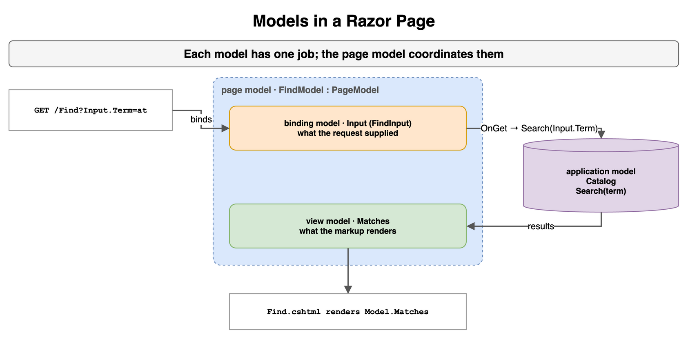
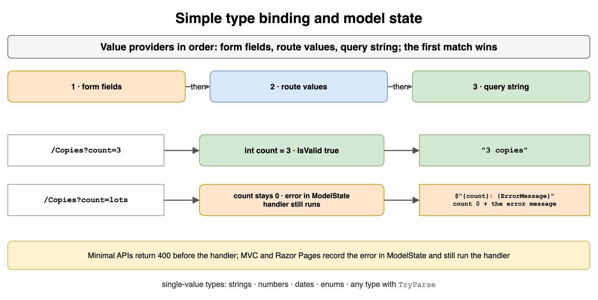
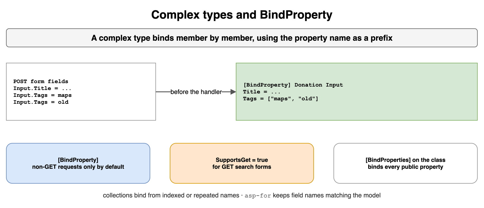
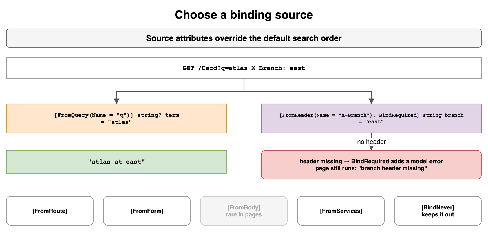
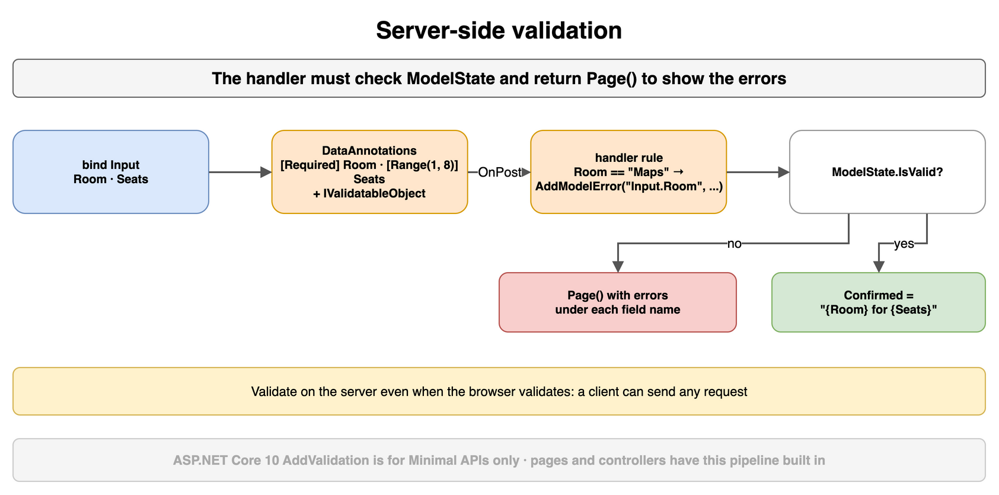
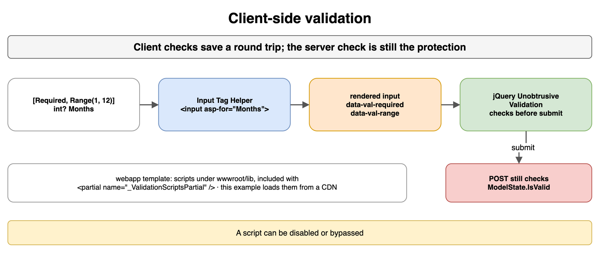
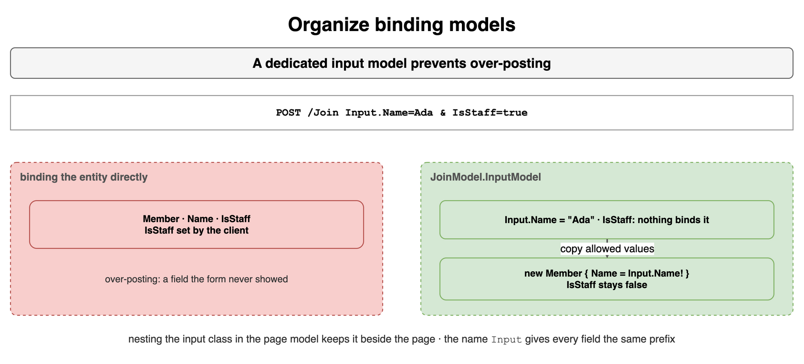

# Razor Pages Binding and Validation

## Models in a Razor Page

A Razor Page works with several models, each with a different job. The binding model holds what the request supplied, usually a small input class. The application model is the services and domain types that do the work. The view model holds what the markup needs to render. The page model is the `PageModel` class that holds the binding and view models as properties and coordinates the application model.

Keeping these apart makes each easier to change. In this example `Input` is the binding model, `Catalog` is the application model, and `Matches` is the view model. Request `/Find?Input.Term=at`. The `Input.` prefix is explained in [complex types and BindProperty](#12_ASP.NET_Core/16_Razor_Pages_Binding_and_Validation/concepts/complex-types-and-bindproperty).

```csharp
using Microsoft.AspNetCore.Mvc;
using Microsoft.AspNetCore.Mvc.RazorPages;

var builder = WebApplication.CreateBuilder(args);
builder.Services.AddRazorPages();
builder.Services.AddSingleton<Catalog>();
var app = builder.Build();
app.MapRazorPages();
app.Run();

public class Catalog
{
    private readonly string[] titles = ["Atlas", "Primer", "Almanac"];
    public string[] Search(string term) =>
        titles.Where(t => t.Contains(term, StringComparison.OrdinalIgnoreCase)).ToArray();
}

public class FindModel(Catalog catalog) : PageModel
{
    [BindProperty(SupportsGet = true)] public FindInput Input { get; set; } = new();
    public string[] Matches { get; private set; } = [];
    public void OnGet() => Matches = catalog.Search(Input.Term ?? "");

    public class FindInput { public string? Term { get; set; } }
}
```

```cshtml
@* Pages/Find.cshtml *@
@page
@model FindModel
<p>@Model.Matches.Length matches for "@Model.Input.Term": @string.Join(", ", Model.Matches)</p>
```

[Microsoft Learn](https://learn.microsoft.com/en-us/aspnet/core/mvc/models/model-binding?view=aspnetcore-10.0)



*Source: [`diagrams/razor-binding.drawio`](/content/12_ASP.NET_Core/16_Razor_Pages_Binding_and_Validation/diagrams/razor-binding.drawio), page 1.*

## Simple type binding and model state

Model binding fills handler parameters and bound properties from value providers, matching by name. It checks form fields first, then route values, then the query string, and takes the first match. Strings, numbers, dates, enums, and any type with a `TryParse` method bind from a single value.

A value that can't be converted doesn't reject the request. Unlike Minimal APIs, which [return 400 before the handler](#12_ASP.NET_Core/06_Endpoint_Routing/concepts/route-constraints-and-binding-errors), MVC and Razor Pages record the error in `ModelState` and still run the handler. Request `/Copies?count=3`, then `/Copies?count=lots`. The second leaves `count` at 0 and makes `ModelState.IsValid` false.

```csharp
using Microsoft.AspNetCore.Mvc.RazorPages;

var builder = WebApplication.CreateBuilder(args);
builder.Services.AddRazorPages();
var app = builder.Build();
app.MapRazorPages();
app.Run();

public class CopiesModel : PageModel
{
    public string Message { get; private set; } = "";
    public void OnGet(int count) => Message = ModelState.IsValid
        ? $"{count} copies"
        : $"{count}: {ModelState["count"]!.Errors[0].ErrorMessage}";
}
```

```cshtml
@* Pages/Copies.cshtml *@
@page
@model CopiesModel
<p>@Model.Message</p>
```

[Microsoft Learn](https://learn.microsoft.com/en-us/aspnet/core/mvc/models/model-binding?view=aspnetcore-10.0#sources)



*Source: [`diagrams/razor-binding.drawio`](/content/12_ASP.NET_Core/16_Razor_Pages_Binding_and_Validation/diagrams/razor-binding.drawio), page 2.*

## Complex types and BindProperty

`[BindProperty]` binds a page-model property from the request before the handler runs. By default it binds only on non-GET requests, so a GET can't overwrite state by accident. Set `SupportsGet = true` for search forms that use GET. `[BindProperties]` on the class binds every public property. A complex type binds member by member, using the property name as a prefix, so `Input.Title` fills `Input.Title`.

Collections bind from indexed or repeated names: `Input.Tags=maps&Input.Tags=old` gives two tags. Use `asp-for` in forms so the field names always match the model. Post this form in a browser, or see the drills for the GET behavior.

```csharp
using Microsoft.AspNetCore.Mvc;
using Microsoft.AspNetCore.Mvc.RazorPages;

var builder = WebApplication.CreateBuilder(args);
builder.Services.AddRazorPages();
var app = builder.Build();
app.MapRazorPages();
app.Run();

public class DonateModel : PageModel
{
    [BindProperty] public Donation Input { get; set; } = new();
    public string Saved { get; private set; } = "";
    public void OnPost() => Saved = $"{Input.Title} [{string.Join(", ", Input.Tags)}]";
}

public class Donation
{
    public string? Title { get; set; }
    public List<string> Tags { get; set; } = [];
}
```

```cshtml
@* Pages/Donate.cshtml *@
@page
@model DonateModel
<form method="post">
    <input asp-for="Input.Title" />
    <input name="Input.Tags" value="maps" /> <input name="Input.Tags" value="old" />
    <button>Donate</button>
</form>
<p>@Model.Saved</p>
```

[Microsoft Learn](https://learn.microsoft.com/en-us/aspnet/core/mvc/models/model-binding?view=aspnetcore-10.0#complex-types)



*Source: [`diagrams/razor-binding.drawio`](/content/12_ASP.NET_Core/16_Razor_Pages_Binding_and_Validation/diagrams/razor-binding.drawio), page 3.*

## Choose a binding source

Source attributes override the default search order. `[FromQuery]`, `[FromRoute]`, `[FromForm]`, and `[FromHeader]` read from one place, and their `Name` property can map a different incoming name. `[FromBody]` reads the request body with an input formatter such as JSON. Razor Pages rarely uses it, because browsers post forms. `[FromServices]` injects a service.

Two attributes control whether a property binds at all. `[BindNever]` keeps a property out of binding, and `[BindRequired]` adds a model error when no value arrives. Send `/Card?q=atlas` with the header `X-Branch: east`. Then drop the header: the page still runs, and `ModelState` reports the missing branch.

```csharp
using Microsoft.AspNetCore.Mvc;
using Microsoft.AspNetCore.Mvc.ModelBinding;
using Microsoft.AspNetCore.Mvc.RazorPages;

var builder = WebApplication.CreateBuilder(args);
builder.Services.AddRazorPages();
var app = builder.Build();
app.MapRazorPages();
app.Run();

public class CardModel : PageModel
{
    public string Text { get; private set; } = "";
    public void OnGet([FromQuery(Name = "q")] string? term,
        [FromHeader(Name = "X-Branch"), BindRequired] string branch) =>
        Text = ModelState.IsValid ? $"{term} at {branch}" : "branch header missing";
}
```

```cshtml
@* Pages/Card.cshtml *@
@page
@model CardModel
<p>@Model.Text</p>
```

[Microsoft Learn](https://learn.microsoft.com/en-us/aspnet/core/mvc/models/model-binding?view=aspnetcore-10.0#attributes-for-complex-type-targets)



*Source: [`diagrams/razor-binding.drawio`](/content/12_ASP.NET_Core/16_Razor_Pages_Binding_and_Validation/diagrams/razor-binding.drawio), page 4.*

## Server-side validation

After binding, MVC validates the bound models against their DataAnnotations attributes, such as `[Required]`, `[Range]`, `[StringLength]`, and `[EmailAddress]`. It also validates any type that implements `IValidatableObject`. Failures go into `ModelState` under each field's name. A Razor Page doesn't reject invalid input on its own: the handler must check `ModelState.IsValid` and usually return `Page()` to show the errors.

Validate on the server even when the browser also validates, because a client can send any request. Rules that need data, like a full room, belong in the handler. Add them with `ModelState.AddModelError`. ASP.NET Core 10's `AddValidation` is for Minimal APIs only. Pages and controllers have always had this pipeline built in.

```csharp
using System.ComponentModel.DataAnnotations;
using Microsoft.AspNetCore.Mvc;
using Microsoft.AspNetCore.Mvc.RazorPages;

var builder = WebApplication.CreateBuilder(args);
builder.Services.AddRazorPages();
var app = builder.Build();
app.MapRazorPages();
app.Run();

public class BookRoomModel : PageModel
{
    [BindProperty] public Booking Input { get; set; } = new();
    public string? Confirmed { get; private set; }

    public IActionResult OnPost()
    {
        if (Input.Room == "Maps") ModelState.AddModelError("Input.Room", "Maps is full today.");
        if (!ModelState.IsValid) return Page();
        Confirmed = $"{Input.Room} for {Input.Seats}";
        return Page();
    }
}

public class Booking
{
    [Required] public string? Room { get; set; }
    [Range(1, 8)] public int Seats { get; set; }
}
```

```cshtml
@* Pages/BookRoom.cshtml *@
@page
@model BookRoomModel
<form method="post">
    <input asp-for="Input.Room" /> <span asp-validation-for="Input.Room"></span>
    <input asp-for="Input.Seats" /> <span asp-validation-for="Input.Seats"></span>
    <button>Book</button>
</form>
<p>@Model.Confirmed</p>
```

[Microsoft Learn](https://learn.microsoft.com/en-us/aspnet/core/mvc/models/validation?view=aspnetcore-10.0)



*Source: [`diagrams/razor-binding.drawio`](/content/12_ASP.NET_Core/16_Razor_Pages_Binding_and_Validation/diagrams/razor-binding.drawio), page 5.*

## Client-side validation

The Input Tag Helper turns each validation attribute into `data-val-*` attributes on the rendered input. The jQuery Unobtrusive Validation library reads those attributes and checks the form in the browser before it is submitted. The `webapp` template ships the scripts under `wwwroot/lib` and includes them on a page through `<partial name="_ValidationScriptsPartial" />`. This example loads the same libraries from a CDN.

Client-side checks save a round trip but give no protection, because a script can be disabled or bypassed. Keep the `ModelState.IsValid` check from [server-side validation](#12_ASP.NET_Core/16_Razor_Pages_Binding_and_Validation/concepts/server-side-validation). View the page source to see the generated `data-val-required` and `data-val-range` attributes.

```csharp
using System.ComponentModel.DataAnnotations;
using Microsoft.AspNetCore.Mvc;
using Microsoft.AspNetCore.Mvc.RazorPages;

var builder = WebApplication.CreateBuilder(args);
builder.Services.AddRazorPages();
var app = builder.Build();
app.MapRazorPages();
app.Run();

public class RenewCardModel : PageModel
{
    [BindProperty, Required, Range(1, 12)] public int? Months { get; set; }
    public IActionResult OnPost() => ModelState.IsValid ? RedirectToPage() : Page();
}
```

```cshtml
@* Pages/RenewCard.cshtml *@
@page
@model RenewCardModel
<form method="post">
    <input asp-for="Months" /> <span asp-validation-for="Months"></span>
    <button>Renew</button>
</form>
<script src="https://cdnjs.cloudflare.com/ajax/libs/jquery/3.7.1/jquery.min.js"></script>
<script src="https://cdnjs.cloudflare.com/ajax/libs/jquery-validate/1.21.0/jquery.validate.min.js"></script>
<script src="https://cdnjs.cloudflare.com/ajax/libs/jquery-validation-unobtrusive/4.0.0/jquery.validate.unobtrusive.min.js"></script>
```

[Microsoft Learn](https://learn.microsoft.com/en-us/aspnet/core/mvc/models/validation?view=aspnetcore-10.0#client-side-validation)



*Source: [`diagrams/razor-binding.drawio`](/content/12_ASP.NET_Core/16_Razor_Pages_Binding_and_Validation/diagrams/razor-binding.drawio), page 6.*

## Organize binding models

Give each page its own input class that contains only the fields the form edits. Binding a domain entity directly allows over-posting. A client can add fields that the form never showed, such as `IsStaff`, and binding will set them. A dedicated input model leaves those properties out, and the handler copies the allowed values onto the entity.

Nesting the input class inside the page model keeps it next to the page that uses it, and the name `Input` gives every field the same prefix. Post `Input.Name=Ada&IsStaff=true` in this example. `IsStaff` stays false because nothing binds it.

```csharp
using System.ComponentModel.DataAnnotations;
using Microsoft.AspNetCore.Mvc;
using Microsoft.AspNetCore.Mvc.RazorPages;

var builder = WebApplication.CreateBuilder(args);
builder.Services.AddRazorPages();
var app = builder.Build();
app.MapRazorPages();
app.Run();

public class Member { public string Name { get; set; } = ""; public bool IsStaff { get; set; } }

[IgnoreAntiforgeryToken]
public class JoinModel : PageModel
{
    [BindProperty] public InputModel Input { get; set; } = new();
    public Member? Created { get; private set; }

    public void OnPost()
    {
        if (ModelState.IsValid) Created = new Member { Name = Input.Name! };
    }

    public class InputModel { [Required, StringLength(60)] public string? Name { get; set; } }
}
```

```cshtml
@* Pages/Join.cshtml *@
@page
@model JoinModel
<p>@(Model.Created is { } m ? $"{m.Name}, staff: {m.IsStaff}" : "Not joined")</p>
```

[Microsoft Learn](https://learn.microsoft.com/en-us/aspnet/core/data/ef-rp/crud?view=aspnetcore-10.0#overposting)



*Source: [`diagrams/razor-binding.drawio`](/content/12_ASP.NET_Core/16_Razor_Pages_Binding_and_Validation/diagrams/razor-binding.drawio), page 7.*
