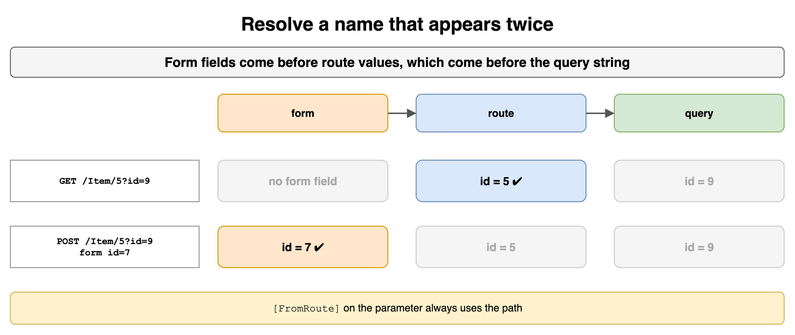
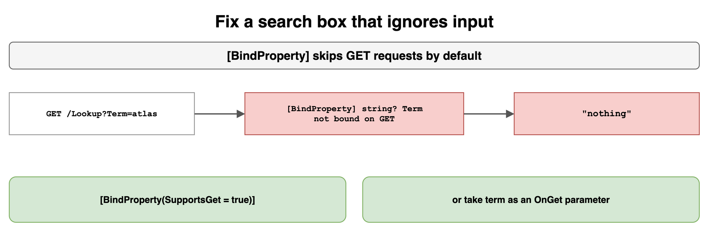

# Razor Pages Binding and Validation — Drills

Predict the result before running the example.

## Resolve a name that appears twice

The page route has an `id`, and the request also sends one in the query string and one in the form. What does each request show? Requests are `GET /Item/5?id=9` and a form POST to `/Item/5?id=9` with `id=7`.

```csharp
using Microsoft.AspNetCore.Mvc;
using Microsoft.AspNetCore.Mvc.RazorPages;

var builder = WebApplication.CreateBuilder(args);
builder.Services.AddRazorPages();
var app = builder.Build();
app.MapRazorPages();
app.Run();

[IgnoreAntiforgeryToken]
public class ItemModel : PageModel
{
    public int Id { get; private set; }
    public void OnGet(int id) => Id = id;
    public void OnPost(int id) => Id = id;
}
```

```cshtml
@* Pages/Item.cshtml *@
@page "{id:int}"
@model ItemModel
<p>@Model.Id</p>
```

**Answer**

The GET shows 5, because route values come before the query string. The POST shows 7, because form fields are checked first. Add `[FromRoute]` to the parameter to always use the path.



*Source: [`diagrams/razor-binding-drills.drawio`](/content/12_ASP.NET_Core/16_Razor_Pages_Binding_and_Validation/diagrams/razor-binding-drills.drawio), page 1.*

## Fix a search box that ignores input

`GET /Lookup?Term=atlas` always shows `nothing`. Why, and what is the smallest fix?

```csharp
using Microsoft.AspNetCore.Mvc;
using Microsoft.AspNetCore.Mvc.RazorPages;

var builder = WebApplication.CreateBuilder(args);
builder.Services.AddRazorPages();
var app = builder.Build();
app.MapRazorPages();
app.Run();

public class LookupModel : PageModel
{
    [BindProperty] public string? Term { get; set; }
}
```

```cshtml
@* Pages/Lookup.cshtml *@
@page
@model LookupModel
<p>@(Model.Term ?? "nothing")</p>
```

**Answer**

`[BindProperty]` skips GET requests by default, so `Term` stays null. Use `[BindProperty(SupportsGet = true)]`, or take `term` as an `OnGet` parameter. Opting in keeps a GET from changing posted state unless you choose to allow it.



*Source: [`diagrams/razor-binding-drills.drawio`](/content/12_ASP.NET_Core/16_Razor_Pages_Binding_and_Validation/diagrams/razor-binding-drills.drawio), page 2.*
