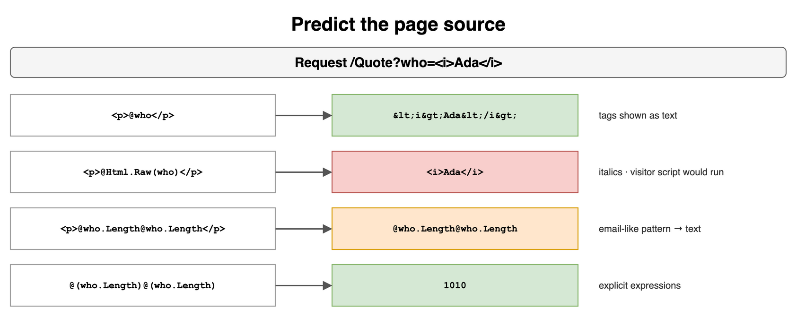
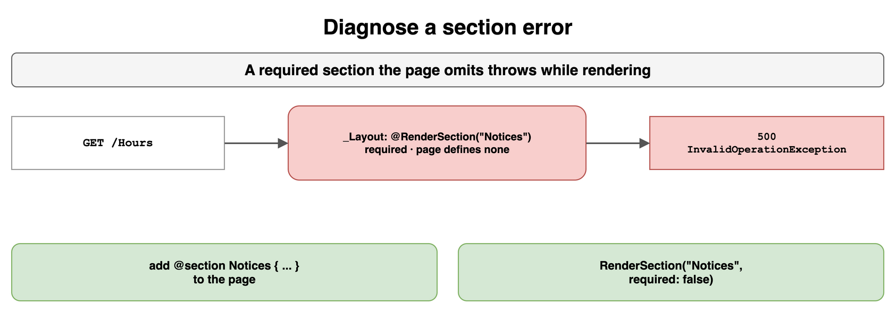

# Razor Views — Drills

Predict the result before running the example.

## Predict the page source

Request `/Quote?who=<i>Ada</i>`. What HTML does the browser receive for each paragraph?

```csharp
var builder = WebApplication.CreateBuilder(args);
builder.Services.AddRazorPages();
var app = builder.Build();
app.MapRazorPages();
app.Run();
```

```cshtml
@* Pages/Quote.cshtml *@
@page
@{ var who = HttpContext.Request.Query["who"].ToString(); }
<p>@who</p>
<p>@Html.Raw(who)</p>
<p>@who.Length@who.Length</p>
```

**Answer**

The first paragraph is encoded as `&lt;i&gt;Ada&lt;/i&gt;`, so the tags show as text. The second sends `<i>Ada</i>` unchanged, so the browser renders italics. Any visitor-supplied script would run there. The third shows `@who.Length@who.Length` as plain text. Razor reads it as an email-like pattern rather than code. Write `@(who.Length)@(who.Length)` to get `1010`.



*Source: [`diagrams/razor-views-drills.drawio`](/content/12_ASP.NET_Core/17_Razor_Views/diagrams/razor-views-drills.drawio), page 1.*

## Diagnose a section error

The layout requires a `Notices` section. What does `/Hours` return, and what are two ways to fix it?

```csharp
var builder = WebApplication.CreateBuilder(args);
builder.Services.AddRazorPages();
var app = builder.Build();
app.MapRazorPages();
app.Run();
```

```cshtml
@* Pages/Shared/_Layout.cshtml *@
<html><body>@RenderBody()<footer>@RenderSection("Notices")</footer></body></html>
```

```cshtml
@* Pages/Hours.cshtml *@
@page
@{ Layout = "_Layout"; }
<p>Open 9 to 5.</p>
```

**Answer**

It returns 500. Rendering throws `InvalidOperationException` because the page doesn't define the required `Notices` section. Either add `@section Notices { ... }` to the page, or make the slot optional with `RenderSection("Notices", required: false)`.



*Source: [`diagrams/razor-views-drills.drawio`](/content/12_ASP.NET_Core/17_Razor_Views/diagrams/razor-views-drills.drawio), page 2.*
