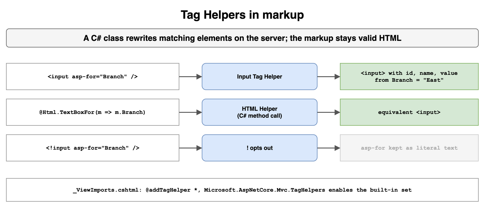
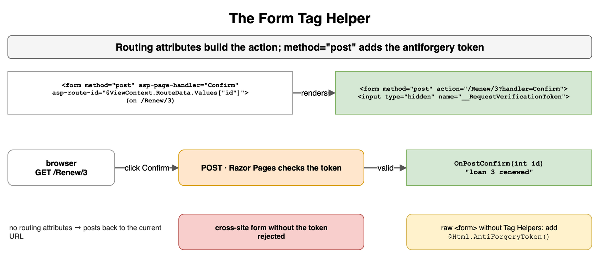
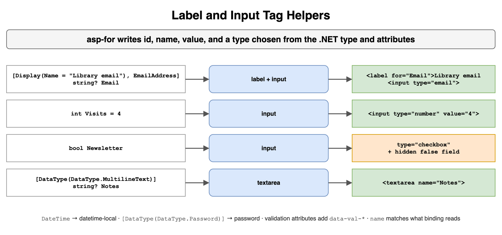
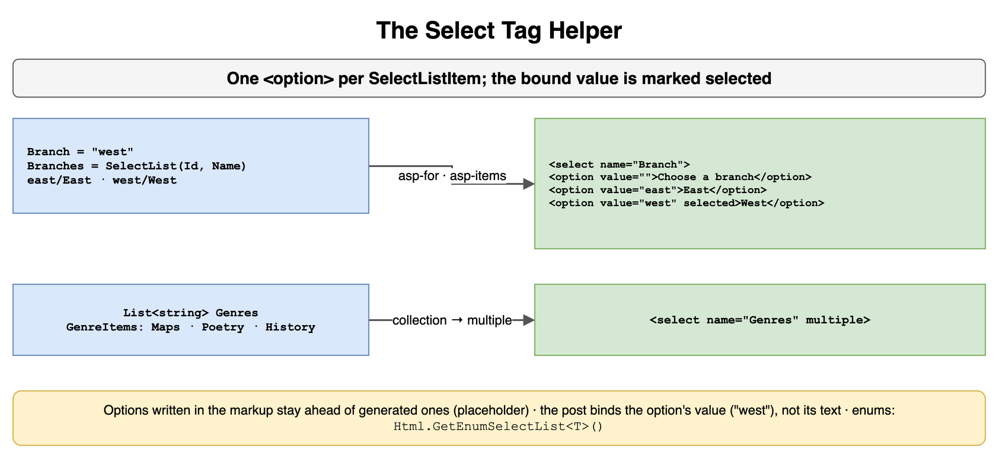
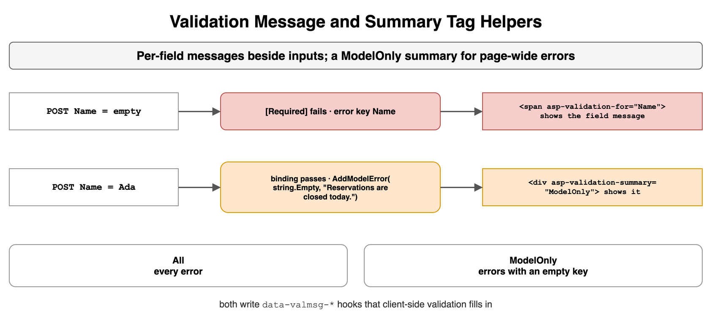
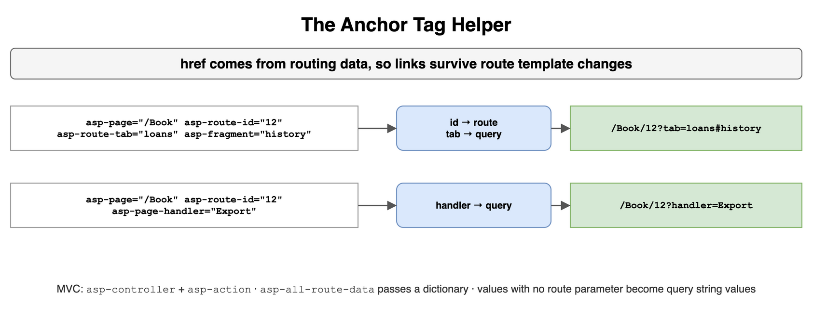
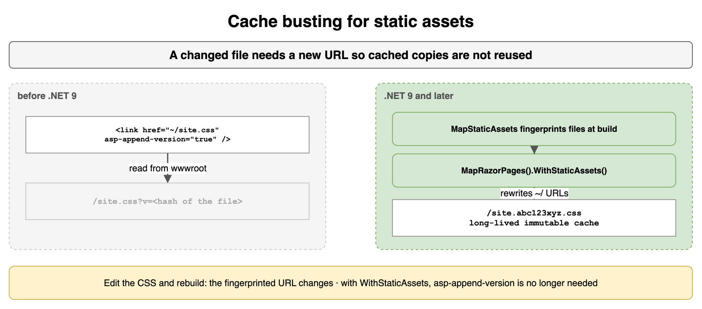
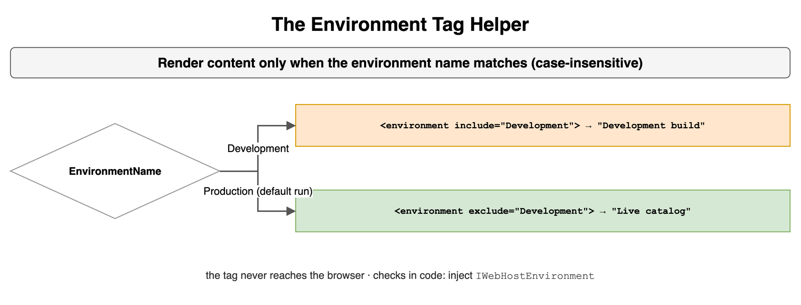

# Tag Helpers and Forms

## Tag Helpers in markup

A Tag Helper is a C# class that runs on the server when Razor renders a matching HTML element. It reads `asp-` attributes and rewrites the element. The markup stays valid HTML, so editors and designers can work with it. `@addTagHelper *, Microsoft.AspNetCore.Mvc.TagHelpers` in `_ViewImports.cshtml` enables the built-in set. The older HTML Helpers, such as `@Html.TextBoxFor`, produce the same output from C# method calls.

The example renders one field both ways, and the two inputs are equivalent. Prefix an element with `!` to stop Tag Helpers on it. The opted-out `<!input>` below keeps its `asp-for` attribute as literal text.

```csharp
using Microsoft.AspNetCore.Mvc.RazorPages;

var builder = WebApplication.CreateBuilder(args);
builder.Services.AddRazorPages();
var app = builder.Build();
app.MapRazorPages();
app.Run();

public class CardModel : PageModel { public string Branch { get; set; } = "East"; }
```

```cshtml
@* Pages/Card.cshtml *@
@page
@model CardModel
<input asp-for="Branch" />
@Html.TextBoxFor(m => m.Branch)
<!input asp-for="Branch" />
```

[Microsoft Learn](https://learn.microsoft.com/en-us/aspnet/core/mvc/views/tag-helpers/intro?view=aspnetcore-10.0)



*Source: [`diagrams/tag-helpers.drawio`](/content/12_ASP.NET_Core/18_Tag_Helpers_and_Forms/diagrams/tag-helpers.drawio), page 1.*

## The Form Tag Helper

The Form Tag Helper builds the `action` URL from routing attributes: `asp-page`, `asp-page-handler`, `asp-route-{name}`, or `asp-controller` and `asp-action`. On a form with `method="post"` it also adds a hidden `__RequestVerificationToken` field. Razor Pages checks that token on POST, so a cross-site form can't submit as the user. Without routing attributes, the form posts back to the current URL.

Request `/Renew/3` and view the source. The form posts to `/Renew/3?handler=Confirm` and carries the token. If you write a raw `<form>` without Tag Helpers, add `@Html.AntiForgeryToken()` yourself.

```csharp
using Microsoft.AspNetCore.Mvc.RazorPages;

var builder = WebApplication.CreateBuilder(args);
builder.Services.AddRazorPages();
var app = builder.Build();
app.MapRazorPages();
app.Run();

public class RenewModel : PageModel
{
    public string Status { get; private set; } = "pending";
    public void OnPostConfirm(int id) => Status = $"loan {id} renewed";
}
```

```cshtml
@* Pages/Renew.cshtml *@
@page "{id:int}"
@model RenewModel
<form method="post" asp-page-handler="Confirm" asp-route-id="@ViewContext.RouteData.Values["id"]">
    <button>Confirm</button>
</form>
<p>@Model.Status</p>
```

[Microsoft Learn](https://learn.microsoft.com/en-us/aspnet/core/mvc/views/working-with-forms?view=aspnetcore-10.0#the-form-tag-helper)



*Source: [`diagrams/tag-helpers.drawio`](/content/12_ASP.NET_Core/18_Tag_Helpers_and_Forms/diagrams/tag-helpers.drawio), page 2.*

## Label and Input Tag Helpers

`asp-for` binds an element to a model expression. The Label Tag Helper writes a `for` attribute and the display name, from `[Display(Name = ...)]` or else the property name. The Input Tag Helper writes `id`, `name`, and the current `value`, and chooses `type` from the .NET type and attributes. `bool` becomes a checkbox plus a hidden `false` field, numbers become `number`, `DateTime` becomes `datetime-local`, `[EmailAddress]` becomes `email`, and `[DataType(DataType.Password)]` becomes `password`. Validation attributes add `data-val-*` attributes for client checks.

`<textarea asp-for>` does the same for multi-line text. Because `name` comes from the same expression that binding reads, posted values land back in the matching properties. Request `/Profile` and compare each generated `type`.

```csharp
using System.ComponentModel.DataAnnotations;
using Microsoft.AspNetCore.Mvc.RazorPages;

var builder = WebApplication.CreateBuilder(args);
builder.Services.AddRazorPages();
var app = builder.Build();
app.MapRazorPages();
app.Run();

public class ProfileModel : PageModel
{
    [Display(Name = "Library email"), EmailAddress] public string? Email { get; set; }
    public int Visits { get; set; } = 4;
    public bool Newsletter { get; set; }
    [DataType(DataType.MultilineText)] public string? Notes { get; set; }
}
```

```cshtml
@* Pages/Profile.cshtml *@
@page
@model ProfileModel
<label asp-for="Email"></label> <input asp-for="Email" />
<input asp-for="Visits" /> <input asp-for="Newsletter" />
<textarea asp-for="Notes"></textarea>
```

[Microsoft Learn](https://learn.microsoft.com/en-us/aspnet/core/mvc/views/working-with-forms?view=aspnetcore-10.0#the-input-tag-helper)



*Source: [`diagrams/tag-helpers.drawio`](/content/12_ASP.NET_Core/18_Tag_Helpers_and_Forms/diagrams/tag-helpers.drawio), page 3.*

## The Select Tag Helper

`<select asp-for="..." asp-items="...">` renders one `<option>` per `SelectListItem` and marks the item that matches the bound property as selected. Build the items in the page model, from a `SelectList`, a list of `SelectListItem`, or `Html.GetEnumSelectList<T>()` for an enum. If `asp-for` points to a collection, the helper adds `multiple`, and the post binds every chosen value.

Options written directly in the markup are kept ahead of the generated ones, which suits a placeholder such as "Choose a branch". Request `/Pickup` and view the selected option. Then post the form: the handler receives the option's value, not its text.

```csharp
using Microsoft.AspNetCore.Mvc;
using Microsoft.AspNetCore.Mvc.RazorPages;
using Microsoft.AspNetCore.Mvc.Rendering;

var builder = WebApplication.CreateBuilder(args);
builder.Services.AddRazorPages();
var app = builder.Build();
app.MapRazorPages();
app.Run();

public class PickupModel : PageModel
{
    [BindProperty] public string Branch { get; set; } = "west";
    [BindProperty] public List<string> Genres { get; set; } = [];
    public SelectList Branches { get; } = new(
        new[] { new { Id = "east", Name = "East" }, new { Id = "west", Name = "West" } }, "Id", "Name");
    public SelectList GenreItems { get; } = new(new[] { "Maps", "Poetry", "History" });
    public void OnPost() { }
}
```

```cshtml
@* Pages/Pickup.cshtml *@
@page
@model PickupModel
<form method="post">
    <select asp-for="Branch" asp-items="Model.Branches"><option value="">Choose a branch</option></select>
    <select asp-for="Genres" asp-items="Model.GenreItems"></select>
    <button>Save</button>
</form>
<p>@Model.Branch: @string.Join(", ", Model.Genres)</p>
```

[Microsoft Learn](https://learn.microsoft.com/en-us/aspnet/core/mvc/views/working-with-forms?view=aspnetcore-10.0#the-select-tag-helper)



*Source: [`diagrams/tag-helpers.drawio`](/content/12_ASP.NET_Core/18_Tag_Helpers_and_Forms/diagrams/tag-helpers.drawio), page 4.*

## Validation Message and Summary Tag Helpers

`<span asp-validation-for="Field">` shows the first `ModelState` error for one field, and is empty when the field is valid. `<div asp-validation-summary="...">` lists several errors at once. `All` lists every error, and `ModelOnly` lists only errors that aren't tied to a property, which you add with an empty key. Both write the `data-valmsg-*` hooks that client-side validation fills in.

A common layout puts a message next to each field and a `ModelOnly` summary at the top for page-wide problems. Submit this form empty, then with `Ada`. The first shows the field message. The second passes binding but fails the page-wide rule, so the error appears only in the summary.

```csharp
using System.ComponentModel.DataAnnotations;
using Microsoft.AspNetCore.Mvc;
using Microsoft.AspNetCore.Mvc.RazorPages;

var builder = WebApplication.CreateBuilder(args);
builder.Services.AddRazorPages();
var app = builder.Build();
app.MapRazorPages();
app.Run();

public class ReserveModel : PageModel
{
    [BindProperty, Required] public string? Name { get; set; }

    public void OnPost()
    {
        if (ModelState.IsValid) ModelState.AddModelError(string.Empty, "Reservations are closed today.");
    }
}
```

```cshtml
@* Pages/Reserve.cshtml *@
@page
@model ReserveModel
<form method="post">
    <div asp-validation-summary="ModelOnly"></div>
    <input asp-for="Name" /> <span asp-validation-for="Name"></span>
    <button>Reserve</button>
</form>
```

[Microsoft Learn](https://learn.microsoft.com/en-us/aspnet/core/mvc/views/working-with-forms?view=aspnetcore-10.0#the-validation-tag-helpers)



*Source: [`diagrams/tag-helpers.drawio`](/content/12_ASP.NET_Core/18_Tag_Helpers_and_Forms/diagrams/tag-helpers.drawio), page 5.*

## The Anchor Tag Helper

The Anchor Tag Helper builds `href` from the same routing data as `Url.Page` and `Url.Action`. Use `asp-page`, `asp-page-handler`, and `asp-route-{name}` for pages, or `asp-controller` and `asp-action` for MVC. Add `asp-fragment` for a `#section` and `asp-all-route-data` to pass a dictionary. Values that don't match a route parameter become query string values.

Because links name a page, not a path, they stay correct when a page's route template changes. Request `/Links`. The detail link uses the route parameter, the extra `tab` value becomes a query string, and the handler link adds `handler=Export`.

```csharp
var builder = WebApplication.CreateBuilder(args);
builder.Services.AddRazorPages();
var app = builder.Build();
app.MapRazorPages();
app.Run();
```

```cshtml
@* Pages/Links.cshtml *@
@page
<a asp-page="/Book" asp-route-id="12" asp-route-tab="loans" asp-fragment="history">Book 12</a>
<a asp-page="/Book" asp-route-id="12" asp-page-handler="Export">Export</a>
```

```cshtml
@* Pages/Book.cshtml *@
@page "{id:int}"
```

[Microsoft Learn](https://learn.microsoft.com/en-us/aspnet/core/mvc/views/tag-helpers/built-in/anchor-tag-helper?view=aspnetcore-10.0)



*Source: [`diagrams/tag-helpers.drawio`](/content/12_ASP.NET_Core/18_Tag_Helpers_and_Forms/diagrams/tag-helpers.drawio), page 6.*

## Cache busting for static assets

Browsers cache CSS and script files, so a changed file needs a new URL. Before .NET 9, `asp-append-version="true"` on `<link>`, `<script>`, or `` added a `?v=` hash of the file read from `wwwroot`. Since .NET 9, `MapStaticAssets` fingerprints files at build time. Chaining `WithStaticAssets()` on the page endpoints lets Razor rewrite every `~/` asset URL to its fingerprinted name, such as `/site.abc123xyz.css`, and serve it with a long-lived immutable cache header.

The `webapp` template keeps `asp-append-version` on its own files, but with `WithStaticAssets` the fingerprinted name already does the job. Create the stylesheet below, run the app, and view `/Styled`. Rebuild after editing the CSS and the URL changes. See [build-time static files](#12_ASP.NET_Core/04_Middleware/concepts/build-time-and-runtime-static-files) for the manifest.

```sh
mkdir -p wwwroot && echo 'body { color: navy; }' > wwwroot/site.css
```

```csharp
var builder = WebApplication.CreateBuilder(args);
builder.Services.AddRazorPages();
var app = builder.Build();
app.MapStaticAssets();
app.MapRazorPages().WithStaticAssets();
app.Run();
```

```cshtml
@* Pages/Styled.cshtml *@
@page
<link rel="stylesheet" href="~/site.css" asp-append-version="true" />
<p>Styled page</p>
```

[Microsoft Learn](https://learn.microsoft.com/en-us/aspnet/core/fundamentals/static-files?view=aspnetcore-10.0)



*Source: [`diagrams/tag-helpers.drawio`](/content/12_ASP.NET_Core/18_Tag_Helpers_and_Forms/diagrams/tag-helpers.drawio), page 7.*

## The Environment Tag Helper

`<environment include="...">` renders its content only when the app's `IWebHostEnvironment.EnvironmentName` is in the comma-separated list. `exclude` does the opposite. The comparison ignores case. Typical uses are an unminified script in Development, a production analytics snippet, or a banner that marks a staging site.

Run the app as usual and request `/Banner`. With the course's default run command, the environment is Production. Restart with `ASPNETCORE_ENVIRONMENT=Development` and the banner changes. The tag itself never reaches the browser. For checks in code, inject `IWebHostEnvironment` instead.

```csharp
var builder = WebApplication.CreateBuilder(args);
builder.Services.AddRazorPages();
var app = builder.Build();
app.MapRazorPages();
app.Run();
```

```cshtml
@* Pages/Banner.cshtml *@
@page
<environment include="Development"><p>Development build</p></environment>
<environment exclude="Development"><p>Live catalog</p></environment>
```

[Microsoft Learn](https://learn.microsoft.com/en-us/aspnet/core/mvc/views/tag-helpers/built-in/environment-tag-helper?view=aspnetcore-10.0)



*Source: [`diagrams/tag-helpers.drawio`](/content/12_ASP.NET_Core/18_Tag_Helpers_and_Forms/diagrams/tag-helpers.drawio), page 8.*
