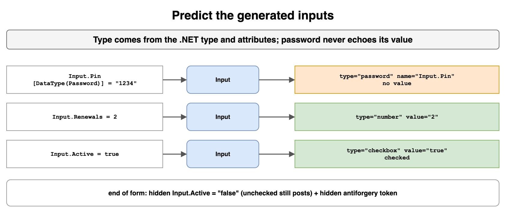
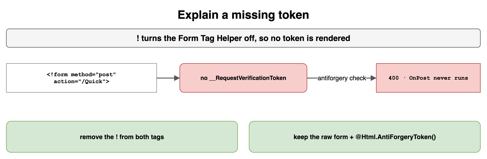

# Tag Helpers and Forms — Drills

Predict the result before running the example.

## Predict the generated inputs

What `type`, `name`, and `value` attributes does each input get on `/Edit`? What extra element appears after the checkbox?

```csharp
using System.ComponentModel.DataAnnotations;
using Microsoft.AspNetCore.Mvc.RazorPages;

var builder = WebApplication.CreateBuilder(args);
builder.Services.AddRazorPages();
var app = builder.Build();
app.MapRazorPages();
app.Run();

public class EditModel : PageModel
{
    public Member Input { get; } = new() { Pin = "1234", Renewals = 2, Active = true };
}

public class Member
{
    [DataType(DataType.Password)] public string? Pin { get; set; }
    public int Renewals { get; set; }
    public bool Active { get; set; }
}
```

```cshtml
@* Pages/Edit.cshtml *@
@page
@model EditModel
<form method="post">
    <input asp-for="Input.Pin" /> <input asp-for="Input.Renewals" /> <input asp-for="Input.Active" />
</form>
```

**Answer**

The PIN gets `type="password"` and `name="Input.Pin"` with no `value`, because password inputs never echo the current value. Renewals gets `type="number"` and `value="2"`. Active gets `type="checkbox"`, `value="true"`, and `checked`. The form ends with a hidden `Input.Active` field set to `false`, so an unchecked box still posts a value, plus the hidden antiforgery token.



*Source: [`diagrams/tag-helpers-drills.drawio`](/content/12_ASP.NET_Core/18_Tag_Helpers_and_Forms/diagrams/tag-helpers-drills.drawio), page 1.*

## Explain a missing token

A teammate writes this form by hand to skip the Tag Helpers. Submitting it returns 400. Why, and what are two fixes?

```csharp
using Microsoft.AspNetCore.Mvc.RazorPages;

var builder = WebApplication.CreateBuilder(args);
builder.Services.AddRazorPages();
var app = builder.Build();
app.MapRazorPages();
app.Run();

public class QuickModel : PageModel { public void OnPost() { } }
```

```cshtml
@* Pages/Quick.cshtml *@
@page
@model QuickModel
<!form method="post" action="/Quick"><button>Go</button></!form>
```

**Answer**

The `!` turns the Form Tag Helper off, so no hidden `__RequestVerificationToken` field is rendered. Razor Pages rejects the POST during antiforgery validation, before `OnPost` runs. Remove the `!` from both tags, or keep the raw form and add `@Html.AntiForgeryToken()` inside it.



*Source: [`diagrams/tag-helpers-drills.drawio`](/content/12_ASP.NET_Core/18_Tag_Helpers_and_Forms/diagrams/tag-helpers-drills.drawio), page 2.*
