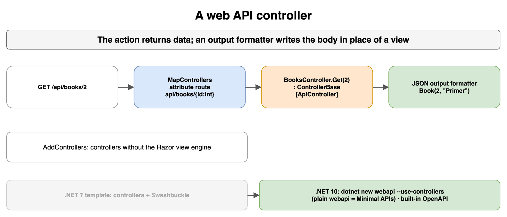
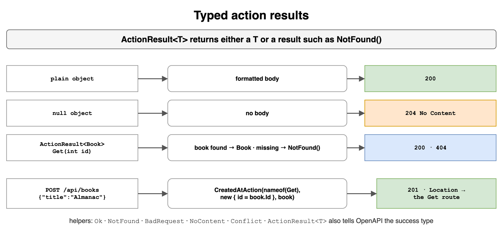
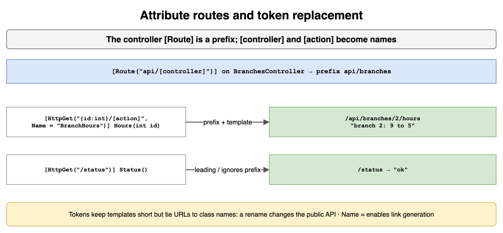
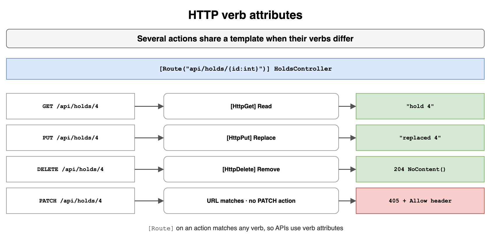
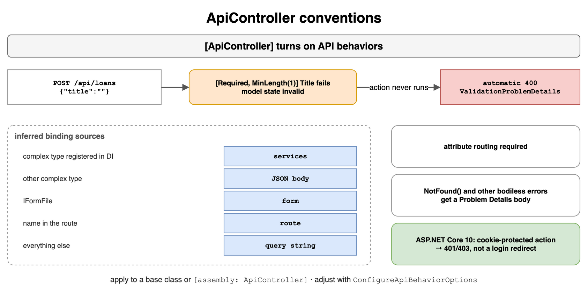
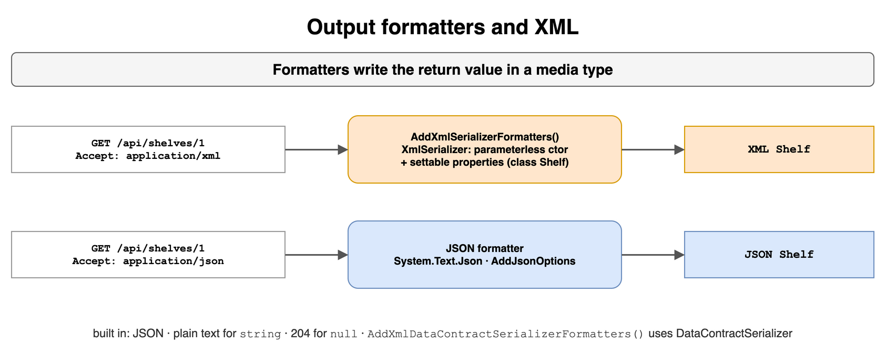
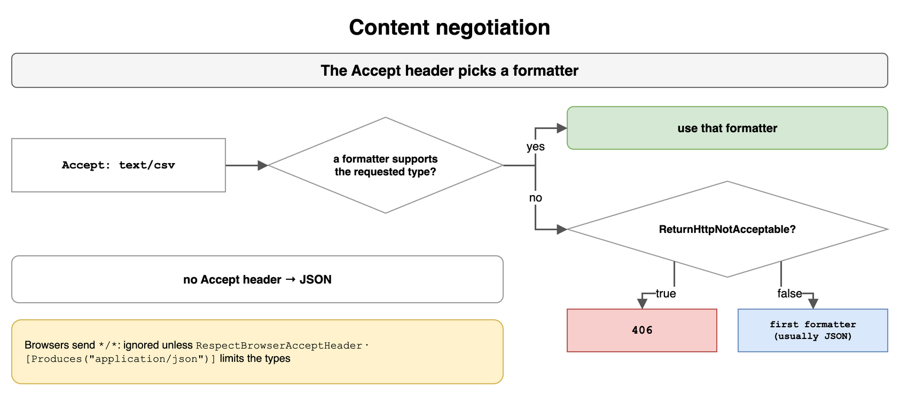
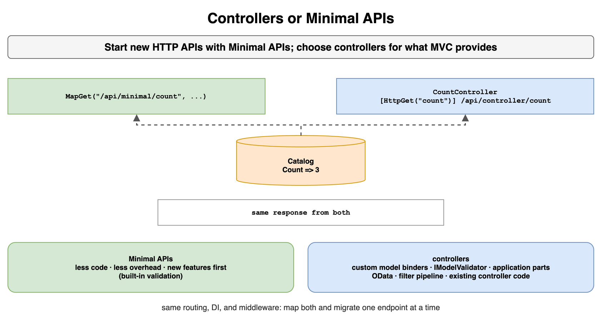

# Web API Controllers

## A web API controller

A web API controller derives from `ControllerBase`, which has the request helpers but no view support, and is marked `[ApiController]`. `AddControllers` registers controllers without the Razor view engine, and `MapControllers` maps their attribute routes. The MVC pattern still applies, with one change: the action returns data, and an output formatter such as the JSON formatter turns it into the response body in place of a view.

In .NET 10, `dotnet new webapi` creates Minimal API endpoints, and `dotnet new webapi --use-controllers` creates a controller project. The .NET 7 template used controllers by default and added Swashbuckle. Current templates use [built-in OpenAPI](#12_ASP.NET_Core/11_OpenAPI/concepts/built-in-openapi-document-generation) instead. Request `/api/books` and `/api/books/2`.

```csharp
using Microsoft.AspNetCore.Mvc;

var builder = WebApplication.CreateBuilder(args);
builder.Services.AddControllers();
var app = builder.Build();
app.MapControllers();
app.Run();

public record Book(int Id, string Title);

[ApiController]
[Route("api/books")]
public class BooksController : ControllerBase
{
    private static readonly Book[] Books = [new(1, "Atlas"), new(2, "Primer")];

    [HttpGet] public Book[] List() => Books;
    [HttpGet("{id:int}")] public Book? Get(int id) => Books.FirstOrDefault(b => b.Id == id);
}
```

[Microsoft Learn](https://learn.microsoft.com/en-us/aspnet/core/web-api/?view=aspnetcore-10.0)



*Source: [`diagrams/web-api-controllers.drawio`](/content/12_ASP.NET_Core/20_Web_API_Controllers/diagrams/web-api-controllers.drawio), page 1.*

## Typed action results

An action can return a plain object, an `IActionResult`, or `ActionResult<T>`. A plain object becomes a 200 with a formatted body, but a `null` object becomes 204 No Content, which is rarely what a client expects for a missing item. `ActionResult<T>` lets one signature return either a `T` or a result such as `NotFound()`. It also tells OpenAPI the success type.

`ControllerBase` has helpers for common responses. `Ok`, `NotFound`, `BadRequest`, `NoContent`, and `Conflict` set the status. `CreatedAtAction` returns 201 with a `Location` header built from another action's route. POST `{"title":"Almanac"}` to `/api/books` and read the `Location` header.

```csharp
using Microsoft.AspNetCore.Mvc;

var builder = WebApplication.CreateBuilder(args);
builder.Services.AddControllers();
var app = builder.Build();
app.MapControllers();
app.Run();

public record Book(int Id, string Title);
public record NewBook(string Title);

[ApiController]
[Route("api/books")]
public class BooksController : ControllerBase
{
    private static readonly List<Book> Books = [new(1, "Atlas")];

    [HttpGet("{id:int}")]
    public ActionResult<Book> Get(int id) =>
        Books.FirstOrDefault(b => b.Id == id) is { } book ? book : NotFound();

    [HttpPost]
    public ActionResult<Book> Create(NewBook input)
    {
        var book = new Book(Books.Count + 1, input.Title);
        Books.Add(book);
        return CreatedAtAction(nameof(Get), new { id = book.Id }, book);
    }
}
```

[Microsoft Learn](https://learn.microsoft.com/en-us/aspnet/core/web-api/action-return-types?view=aspnetcore-10.0)



*Source: [`diagrams/web-api-controllers.drawio`](/content/12_ASP.NET_Core/20_Web_API_Controllers/diagrams/web-api-controllers.drawio), page 2.*

## Attribute routes and token replacement

With attribute routing, a `[Route]` on the controller acts as a prefix, and each action's template is appended to it. A template that starts with `/` or `~/` ignores the prefix. Tokens in square brackets are replaced with names, so `[controller]` becomes the controller name without `Controller`, and `[action]` becomes the method name. This keeps templates short but ties URLs to class names, so a rename changes the public API.

Here the prefix becomes `api/branches`. `/api/branches/2/hours` reaches `Hours`, and `/status` reaches `Status` because its template starts with `/`. Name a route with `Name =` when other code generates links to it.

```csharp
using Microsoft.AspNetCore.Mvc;

var builder = WebApplication.CreateBuilder(args);
builder.Services.AddControllers();
var app = builder.Build();
app.MapControllers();
app.Run();

[ApiController]
[Route("api/[controller]")]
public class BranchesController : ControllerBase
{
    [HttpGet("{id:int}/[action]", Name = "BranchHours")]
    public string Hours(int id) => $"branch {id}: 9 to 5";

    [HttpGet("/status")]
    public string Status() => "ok";
}
```

[Microsoft Learn](https://learn.microsoft.com/en-us/aspnet/core/mvc/controllers/routing?view=aspnetcore-10.0#token-replacement-in-route-templates-controller-action-area)



*Source: [`diagrams/web-api-controllers.drawio`](/content/12_ASP.NET_Core/20_Web_API_Controllers/diagrams/web-api-controllers.drawio), page 3.*

## HTTP verb attributes

`[HttpGet]`, `[HttpPost]`, `[HttpPut]`, `[HttpPatch]`, and `[HttpDelete]` each restrict an action to one method and can carry a route template. Several actions can share a template if their verbs differ, which is the usual REST shape. `[Route]` on an action matches any verb, so APIs should use verb attributes.

When a URL matches but its verb doesn't, routing returns 405 Method Not Allowed. Send GET, PUT, and DELETE to `/api/holds/4`, then a PATCH. The first three reach their actions, and the PATCH gets 405 with an `Allow` header that lists the supported methods.

```csharp
using Microsoft.AspNetCore.Mvc;

var builder = WebApplication.CreateBuilder(args);
builder.Services.AddControllers();
var app = builder.Build();
app.MapControllers();
app.Run();

[ApiController]
[Route("api/holds/{id:int}")]
public class HoldsController : ControllerBase
{
    [HttpGet] public string Read(int id) => $"hold {id}";
    [HttpPut] public string Replace(int id) => $"replaced {id}";
    [HttpDelete] public IActionResult Remove(int id) => NoContent();
}
```

[Microsoft Learn](https://learn.microsoft.com/en-us/aspnet/core/mvc/controllers/routing?view=aspnetcore-10.0#http-verb-templates)



*Source: [`diagrams/web-api-controllers.drawio`](/content/12_ASP.NET_Core/20_Web_API_Controllers/diagrams/web-api-controllers.drawio), page 4.*

## ApiController conventions

`[ApiController]` turns on API behaviors. Attribute routing becomes required. Invalid model state returns an automatic 400 with a `ValidationProblemDetails` body, so actions don't check `ModelState`. Binding sources are inferred: complex types registered in DI come from services, other complex types from the JSON body, and `IFormFile` from the form. Parameters named in the route come from the route, and everything else from the query string. Error results without a body, such as `NotFound()`, get a Problem Details body.

Apply the attribute to a base class or the whole assembly with `[assembly: ApiController]`. Change these behaviors with `ConfigureApiBehaviorOptions`. ASP.NET Core 10 adds one more: an unauthenticated request to an `[ApiController]` action protected by cookie authentication now gets 401 or 403 instead of a redirect to the login page. POST `{"title":""}` to `/api/loans` to see the automatic 400.

```csharp
using System.ComponentModel.DataAnnotations;
using Microsoft.AspNetCore.Mvc;

var builder = WebApplication.CreateBuilder(args);
builder.Services.AddControllers();
var app = builder.Build();
app.MapControllers();
app.Run();

public record LoanRequest([Required, MinLength(1)] string Title, [Range(1, 30)] int Days = 14);

[ApiController]
[Route("api/loans")]
public class LoansController : ControllerBase
{
    [HttpPost] public IActionResult Create(LoanRequest request) => Ok(request);
    [HttpGet("{id:int}")] public IActionResult Get(int id) => NotFound();
}
```

[Microsoft Learn](https://learn.microsoft.com/en-us/aspnet/core/web-api/?view=aspnetcore-10.0#apicontroller-attribute)



*Source: [`diagrams/web-api-controllers.drawio`](/content/12_ASP.NET_Core/20_Web_API_Controllers/diagrams/web-api-controllers.drawio), page 5.*

## Output formatters and XML

Output formatters write an action's return value in a media type. `AddControllers` includes formatters for JSON (System.Text.Json), plain text for `string` results, and 204 for `null`. `AddXmlSerializerFormatters()` adds XML input and output with `XmlSerializer`, and `AddXmlDataContractSerializerFormatters()` uses `DataContractSerializer` instead. Configure the JSON formatter with `AddJsonOptions`.

`XmlSerializer` needs a public parameterless constructor and settable properties, so this example uses a class rather than a positional record. Request `/api/shelves/1` with `Accept: application/xml` and then with `Accept: application/json` to get each format.

```csharp
using Microsoft.AspNetCore.Mvc;

var builder = WebApplication.CreateBuilder(args);
builder.Services.AddControllers().AddXmlSerializerFormatters();
var app = builder.Build();
app.MapControllers();
app.Run();

public class Shelf { public int Id { get; set; } public string Label { get; set; } = ""; }

[ApiController]
[Route("api/shelves")]
public class ShelvesController : ControllerBase
{
    [HttpGet("{id:int}")] public Shelf Get(int id) => new() { Id = id, Label = "Maps" };
}
```

[Microsoft Learn](https://learn.microsoft.com/en-us/aspnet/core/web-api/advanced/formatting?view=aspnetcore-10.0)



*Source: [`diagrams/web-api-controllers.drawio`](/content/12_ASP.NET_Core/20_Web_API_Controllers/diagrams/web-api-controllers.drawio), page 6.*

## Content negotiation

Content negotiation picks a formatter from the request's `Accept` header. If no formatter supports any requested type, MVC falls back to the first formatter that can write the object, usually JSON. Set `ReturnHttpNotAcceptable = true` to return 406 instead. Browsers send `*/*` in `Accept`, and MVC ignores that header unless `RespectBrowserAcceptHeader` is true.

`[Produces("application/json")]` limits an action or controller to listed types, whatever the client asks for. Here a request with `Accept: text/csv` gets 406 because no formatter writes CSV. A request without an `Accept` header still gets JSON.

```csharp
using Microsoft.AspNetCore.Mvc;

var builder = WebApplication.CreateBuilder(args);
builder.Services.AddControllers(options => options.ReturnHttpNotAcceptable = true);
var app = builder.Build();
app.MapControllers();
app.Run();

public record Visit(string Branch, int Count);

[ApiController]
[Route("api/visits")]
public class VisitsController : ControllerBase
{
    [HttpGet] public Visit[] List() => [new("East", 120), new("West", 85)];
}
```

[Microsoft Learn](https://learn.microsoft.com/en-us/aspnet/core/web-api/advanced/formatting?view=aspnetcore-10.0#content-negotiation)



*Source: [`diagrams/web-api-controllers.drawio`](/content/12_ASP.NET_Core/20_Web_API_Controllers/diagrams/web-api-controllers.drawio), page 7.*

## Controllers or Minimal APIs

Microsoft's guidance for new HTTP APIs is to start with Minimal APIs. They need less code, run with less overhead, and get new features such as built-in validation first. Choose controllers when you need what MVC provides out of the box. That includes custom model binders, `IModelValidator`, application parts and the application model, OData, the filter pipeline, or an existing controller codebase.

Both run on the same routing, DI, and middleware, so one app can map both and you can migrate one endpoint at a time. `/api/minimal/count` and `/api/controller/count` return the same response.

```csharp
using Microsoft.AspNetCore.Mvc;

var builder = WebApplication.CreateBuilder(args);
builder.Services.AddControllers();
builder.Services.AddSingleton<Catalog>();
var app = builder.Build();
app.MapGet("/api/minimal/count", (Catalog catalog) => new { catalog.Count });
app.MapControllers();
app.Run();

public class Catalog { public int Count => 3; }

[ApiController]
[Route("api/controller")]
public class CountController(Catalog catalog) : ControllerBase
{
    [HttpGet("count")] public object Get() => new { catalog.Count };
}
```

[Microsoft Learn](https://learn.microsoft.com/en-us/aspnet/core/fundamentals/apis?view=aspnetcore-10.0)



*Source: [`diagrams/web-api-controllers.drawio`](/content/12_ASP.NET_Core/20_Web_API_Controllers/diagrams/web-api-controllers.drawio), page 8.*
