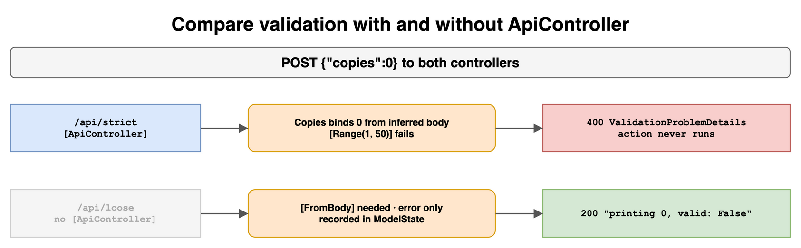
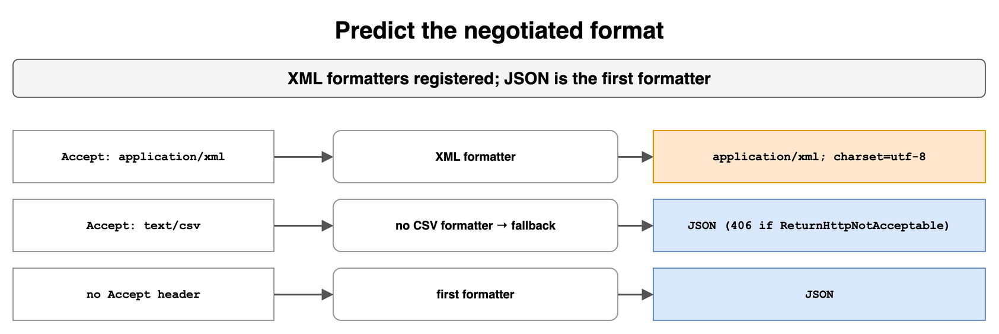

# Web API Controllers — Drills

Predict the result before running the example.

## Compare validation with and without ApiController

POST `{"copies":0}` with `Content-Type: application/json` to `/api/strict` and to `/api/loose`. What does each return?

```csharp
using System.ComponentModel.DataAnnotations;
using Microsoft.AspNetCore.Mvc;

var builder = WebApplication.CreateBuilder(args);
builder.Services.AddControllers();
var app = builder.Build();
app.MapControllers();
app.Run();

public class PrintJob { [Range(1, 50)] public int Copies { get; set; } }

[ApiController]
[Route("api/strict")]
public class StrictController : ControllerBase
{
    [HttpPost] public string Print(PrintJob job) => $"printing {job.Copies}";
}

[Route("api/loose")]
public class LooseController : ControllerBase
{
    [HttpPost] public string Print([FromBody] PrintJob job) => $"printing {job.Copies}, valid: {ModelState.IsValid}";
}
```

**Answer**

`/api/strict` returns 400 with a `ValidationProblemDetails` body listing the `Copies` error, and the action never runs. `/api/loose` returns 200 with `printing 0, valid: False`. Without `[ApiController]`, the action must check `ModelState` itself. It also needs `[FromBody]` because the source isn't inferred.



*Source: [`diagrams/web-api-controllers-drills.drawio`](/content/12_ASP.NET_Core/20_Web_API_Controllers/diagrams/web-api-controllers-drills.drawio), page 1.*

## Predict the negotiated format

The app registers XML formatters. Predict the `Content-Type` for requests with `Accept: application/xml`, `Accept: text/csv`, and no `Accept` header. What changes if you set `ReturnHttpNotAcceptable = true`?

```csharp
using Microsoft.AspNetCore.Mvc;

var builder = WebApplication.CreateBuilder(args);
builder.Services.AddControllers().AddXmlSerializerFormatters();
var app = builder.Build();
app.MapControllers();
app.Run();

public class Branch { public string Name { get; set; } = "East"; }

[ApiController]
[Route("api/branch")]
public class BranchController : ControllerBase
{
    [HttpGet] public Branch Get() => new();
}
```

**Answer**

XML is honored with `application/xml; charset=utf-8`. The CSV request falls back to the first formatter that can write the object, which is JSON, and so does the request with no `Accept` header. With `ReturnHttpNotAcceptable = true`, the CSV request gets 406, and the other two are unchanged.



*Source: [`diagrams/web-api-controllers-drills.drawio`](/content/12_ASP.NET_Core/20_Web_API_Controllers/diagrams/web-api-controllers-drills.drawio), page 2.*
