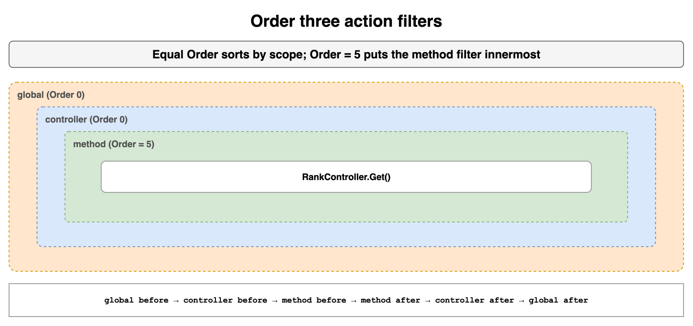
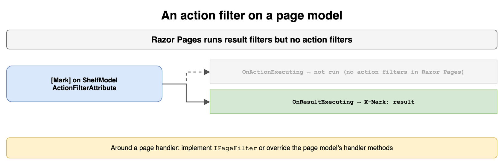

# Filter Pipeline — Drills

Predict the result before running the example.

## Order three action filters

A global filter, a controller filter, and a method filter with `Order = 5` all log to the console. What does `/api/rank` print?

```csharp
using Microsoft.AspNetCore.Mvc;
using Microsoft.AspNetCore.Mvc.Filters;

var builder = WebApplication.CreateBuilder(args);
builder.Services.AddControllers(options => options.Filters.Add(new LogAttribute("global")));
var app = builder.Build();
app.MapControllers();
app.Run();

public class LogAttribute(string name) : ActionFilterAttribute
{
    public override void OnActionExecuting(ActionExecutingContext c) => Console.WriteLine($"{name} before");
    public override void OnActionExecuted(ActionExecutedContext c) => Console.WriteLine($"{name} after");
}

[ApiController, Log("controller")]
public class RankController : ControllerBase
{
    [HttpGet("/api/rank"), Log("method", Order = 5)] public string Get() => "ok";
}
```

**Answer**

`global before`, `controller before`, `method before`, then `method after`, `controller after`, `global after`. The global and controller filters both have `Order` 0, so scope orders them, and `Order = 5` places the method filter innermost. The result matches the default here, but a global filter with `Order = 10` would now run inside the method filter.



*Source: [`diagrams/filter-pipeline-drills.drawio`](/content/12_ASP.NET_Core/21_Filter_Pipeline/diagrams/filter-pipeline-drills.drawio), page 1.*

## An action filter on a page model

A teammate puts an `ActionFilterAttribute` on a page model. `ActionFilterAttribute` also implements the result filter interface. Which of the two overridden methods run on `/Shelf`?

```csharp
using Microsoft.AspNetCore.Mvc.Filters;
using Microsoft.AspNetCore.Mvc.RazorPages;

var builder = WebApplication.CreateBuilder(args);
builder.Services.AddRazorPages();
var app = builder.Build();
app.MapRazorPages();
app.Run();

public class MarkAttribute : ActionFilterAttribute
{
    public override void OnActionExecuting(ActionExecutingContext c) =>
        c.HttpContext.Response.Headers.Append("X-Mark", "action");
    public override void OnResultExecuting(ResultExecutingContext c) =>
        c.HttpContext.Response.Headers.Append("X-Mark", "result");
}

[Mark]
public class ShelfModel : PageModel { }
```

```cshtml
@* Pages/Shelf.cshtml *@
@page
@model ShelfModel
<p>Shelf</p>
```

**Answer**

Only `OnResultExecuting` runs, so the response has `X-Mark: result`. Razor Pages runs no action filters, but it does run result filters. For logic around a page handler, implement `IPageFilter` or override the page model's handler methods.



*Source: [`diagrams/filter-pipeline-drills.drawio`](/content/12_ASP.NET_Core/21_Filter_Pipeline/diagrams/filter-pipeline-drills.drawio), page 2.*
