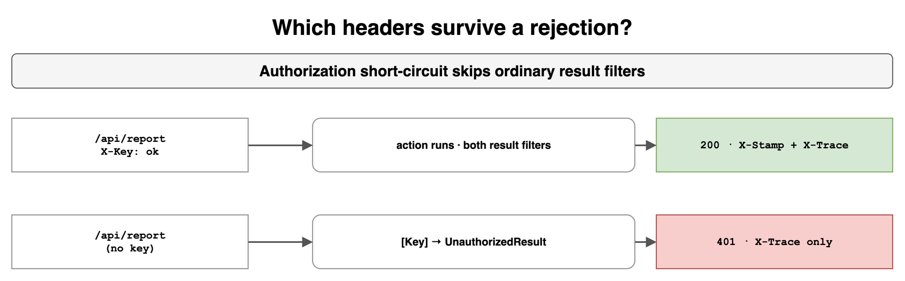
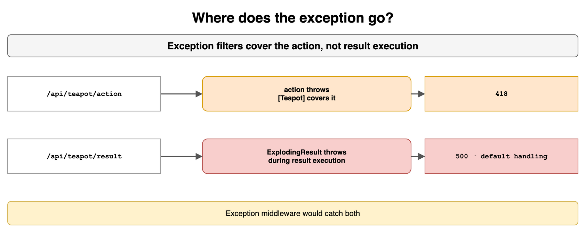

# Custom Filters — Drills

Predict the result before running the example.

## Which headers survive a rejection?

The app has an ordinary result filter and an always-run result filter. Request `/api/report` with and without `X-Key: ok`. Which headers does each response carry?

```csharp
using Microsoft.AspNetCore.Mvc;
using Microsoft.AspNetCore.Mvc.Filters;

var builder = WebApplication.CreateBuilder(args);
builder.Services.AddControllers(options =>
{
    options.Filters.Add(new StampFilter());
    options.Filters.Add(new TraceFilter());
});
var app = builder.Build();
app.MapControllers();
app.Run();

public class StampFilter : IResultFilter
{
    public void OnResultExecuting(ResultExecutingContext c) => c.HttpContext.Response.Headers["X-Stamp"] = "1";
    public void OnResultExecuted(ResultExecutedContext c) { }
}

public class TraceFilter : IAlwaysRunResultFilter
{
    public void OnResultExecuting(ResultExecutingContext c) => c.HttpContext.Response.Headers["X-Trace"] = "1";
    public void OnResultExecuted(ResultExecutedContext c) { }
}

public class KeyAttribute : Attribute, IAuthorizationFilter
{
    public void OnAuthorization(AuthorizationFilterContext c)
    {
        if (c.HttpContext.Request.Headers["X-Key"] != "ok") c.Result = new UnauthorizedResult();
    }
}

[ApiController, Key]
public class ReportController : ControllerBase
{
    [HttpGet("/api/report")] public string Get() => "report";
}
```

**Answer**

With the key, the response is 200 with both `X-Stamp` and `X-Trace`. Without it, the authorization filter short-circuits with 401. Ordinary result filters are skipped, so only `X-Trace` appears, from the `IAlwaysRunResultFilter`.



*Source: [`diagrams/custom-filters-drills.drawio`](/content/12_ASP.NET_Core/22_Custom_Filters/diagrams/custom-filters-drills.drawio), page 1.*

## Where does the exception go?

An exception filter on the controller turns exceptions into 418 responses. Predict `/api/teapot/action` and `/api/teapot/result`.

```csharp
using Microsoft.AspNetCore.Mvc;
using Microsoft.AspNetCore.Mvc.Filters;

var builder = WebApplication.CreateBuilder(args);
builder.Services.AddControllers();
var app = builder.Build();
app.MapControllers();
app.Run();

public class TeapotAttribute : ExceptionFilterAttribute
{
    public override void OnException(ExceptionContext context) =>
        context.Result = new StatusCodeResult(StatusCodes.Status418ImATeapot);
}

public class ExplodingResult : IActionResult
{
    public Task ExecuteResultAsync(ActionContext context) => throw new InvalidOperationException("render failed");
}

[ApiController, Teapot]
public class TeapotController : ControllerBase
{
    [HttpGet("/api/teapot/action")] public IActionResult Action() => throw new InvalidOperationException("action failed");
    [HttpGet("/api/teapot/result")] public IActionResult Result() => new ExplodingResult();
}
```

**Answer**

`/api/teapot/action` returns 418, because the exception filter covers the action. `/api/teapot/result` returns 500. The action succeeded and the exception came from executing the result, which exception filters don't cover, so it reaches the server's default handling. Exception middleware would catch both.



*Source: [`diagrams/custom-filters-drills.drawio`](/content/12_ASP.NET_Core/22_Custom_Filters/diagrams/custom-filters-drills.drawio), page 2.*
