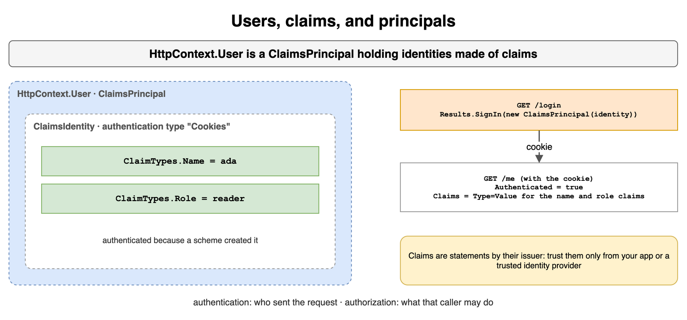
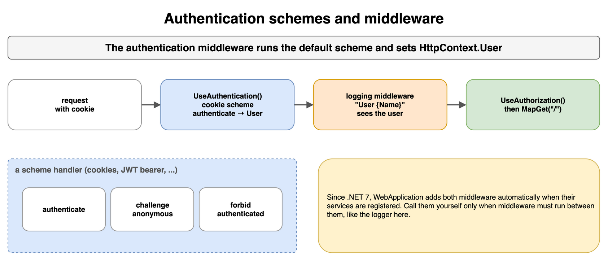
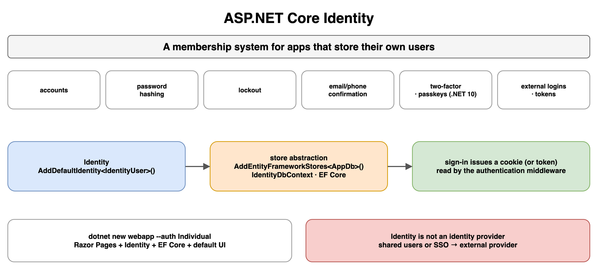
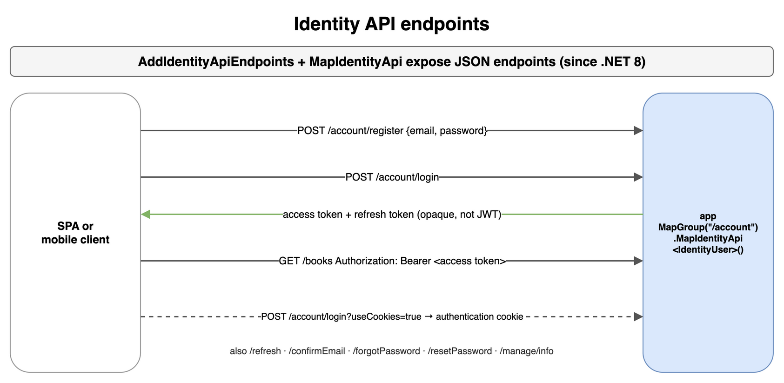
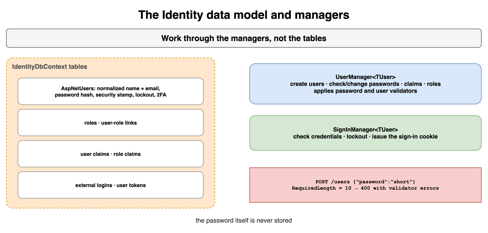
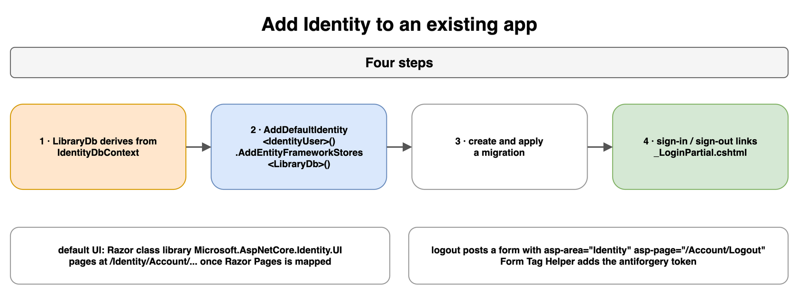
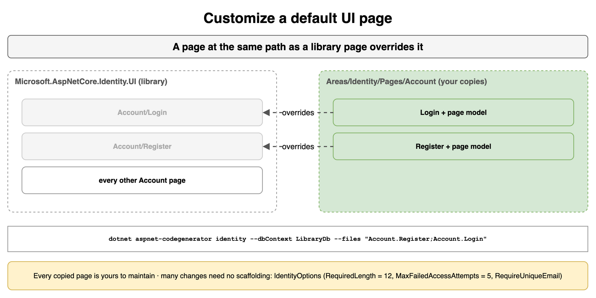
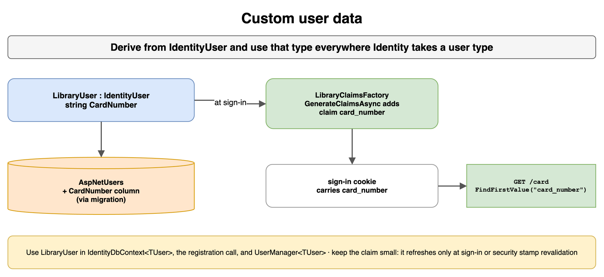

# Identity

## Users, claims, and principals

Authentication answers who sent a request. Authorization decides what that caller may do. ASP.NET Core represents the caller as a `ClaimsPrincipal` on `HttpContext.User`. A principal holds one or more `ClaimsIdentity` objects, and each identity is a list of claims, which are type-value pairs such as a name, an email address, or a role. An identity counts as authenticated when it was created by an authentication scheme.

Claims are statements made by whoever issued them, so trust them only when your app or a trusted identity provider issued them. In this example, `/login` signs in a fixed reader with a cookie and `/me` lists the claims the cookie carries. Request `/me` before and after `/login` with a cookie jar.

```csharp
using System.Security.Claims;
using Microsoft.AspNetCore.Authentication.Cookies;

var builder = WebApplication.CreateBuilder(args);
builder.Services.AddAuthentication(CookieAuthenticationDefaults.AuthenticationScheme).AddCookie();
var app = builder.Build();
app.MapGet("/login", () =>
{
    var identity = new ClaimsIdentity(
        [new Claim(ClaimTypes.Name, "ada"), new Claim(ClaimTypes.Role, "reader")],
        CookieAuthenticationDefaults.AuthenticationScheme);
    return Results.SignIn(new ClaimsPrincipal(identity));
});
app.MapGet("/me", (ClaimsPrincipal user) => new
{
    Authenticated = user.Identity?.IsAuthenticated ?? false,
    Claims = user.Claims.Select(c => $"{c.Type}={c.Value}")
});
app.Run();
```

[Microsoft Learn](https://learn.microsoft.com/en-us/aspnet/core/security/authentication/?view=aspnetcore-10.0)



*Source: [`diagrams/identity.drawio`](/content/12_ASP.NET_Core/23_Identity/diagrams/identity.drawio), page 1.*

## Authentication schemes and middleware

`AddAuthentication` registers authentication services and names a default scheme. Each scheme is a handler, such as cookies or JWT bearer, that can authenticate a request, challenge an anonymous caller, and forbid an authenticated one. The authentication middleware runs the default scheme's authenticate step and sets `HttpContext.User`. Authorization later uses that principal.

Since .NET 7, `WebApplication` adds the authentication and authorization middleware automatically when their services are registered. Call `UseAuthentication` and `UseAuthorization` yourself only when other middleware must run between them, for example custom middleware that reads `User`. Here the explicit calls make the order visible: the logging middleware sees the user because it runs after authentication.

```csharp
using Microsoft.AspNetCore.Authentication.Cookies;

var builder = WebApplication.CreateBuilder(args);
builder.Services.AddAuthentication(CookieAuthenticationDefaults.AuthenticationScheme).AddCookie();
builder.Services.AddAuthorization();
var app = builder.Build();
app.UseAuthentication();
app.Use(async (context, next) =>
{
    app.Logger.LogInformation("User {Name}", context.User.Identity?.Name ?? "anonymous");
    await next();
});
app.UseAuthorization();
app.MapGet("/", () => "catalog");
app.Run();
```

[Microsoft Learn](https://learn.microsoft.com/en-us/aspnet/core/security/authentication/?view=aspnetcore-10.0#authentication-scheme)



*Source: [`diagrams/identity.drawio`](/content/12_ASP.NET_Core/23_Identity/diagrams/identity.drawio), page 2.*

## ASP.NET Core Identity

ASP.NET Core Identity is a membership system for apps that store their own users. It manages accounts, password hashing, lockout, email and phone confirmation, two-factor authentication, external logins, and security tokens. It stores data through a store abstraction, usually EF Core with `IdentityDbContext`. After sign-in it issues the cookie (or token) that the authentication middleware reads on later requests.

Templates can generate it: `dotnet new webapp --auth Individual` creates a Razor Pages app with Identity, EF Core, and the default UI. Identity is not an identity provider. When several apps share users, or you need single sign-on, use an external provider instead. [Authentication for APIs](#12_ASP.NET_Core/25_API_Authentication/concepts/identity-providers-and-tokens) covers that. In .NET 10, Identity also supports passkeys, which the Blazor Web App template uses.

```csharp
using Microsoft.AspNetCore.Identity;
using Microsoft.AspNetCore.Identity.EntityFrameworkCore;
using Microsoft.EntityFrameworkCore;

var builder = WebApplication.CreateBuilder(args);
builder.Services.AddDbContext<AppDb>(options => options.UseSqlite("Data Source=identity.db"));
builder.Services.AddDefaultIdentity<IdentityUser>(options => options.SignIn.RequireConfirmedAccount = false)
    .AddEntityFrameworkStores<AppDb>();
builder.Services.AddRazorPages();
var app = builder.Build();
using (var scope = app.Services.CreateScope())
    scope.ServiceProvider.GetRequiredService<AppDb>().Database.EnsureCreated();
app.MapRazorPages();
app.MapGet("/", (HttpContext context) => context.User.Identity?.Name ?? "anonymous");
app.Run();

public class AppDb(DbContextOptions<AppDb> options) : IdentityDbContext(options);
```

[Microsoft Learn](https://learn.microsoft.com/en-us/aspnet/core/security/authentication/identity?view=aspnetcore-10.0)



*Source: [`diagrams/identity.drawio`](/content/12_ASP.NET_Core/23_Identity/diagrams/identity.drawio), page 3.*

## Identity API endpoints

Since .NET 8, Identity can expose JSON endpoints instead of Razor pages, for single-page apps and mobile clients. `AddIdentityApiEndpoints<TUser>()` registers Identity with a cookie scheme and a bearer token scheme. `MapIdentityApi<TUser>()` maps `/register`, `/login`, `/refresh`, `/confirmEmail`, `/forgotPassword`, `/resetPassword`, and `/manage/info`, among others.

`POST /login` returns an access token and refresh token by default. Add `?useCookies=true` to get an authentication cookie instead. These tokens are opaque values protected by ASP.NET Core and readable only by this app, not standard JWTs. Map the endpoints under a group such as `/account` to keep them apart from your API. Register with `{"email":"ada@example.org","password":"Passw0rd!"}`, log in, and call `/books` with the returned bearer token.

```csharp
using Microsoft.AspNetCore.Identity;
using Microsoft.AspNetCore.Identity.EntityFrameworkCore;
using Microsoft.EntityFrameworkCore;

var builder = WebApplication.CreateBuilder(args);
builder.Services.AddDbContext<AppDb>(options => options.UseSqlite("Data Source=identity.db"));
builder.Services.AddIdentityApiEndpoints<IdentityUser>().AddEntityFrameworkStores<AppDb>();
builder.Services.AddAuthorization();
var app = builder.Build();
using (var scope = app.Services.CreateScope())
    scope.ServiceProvider.GetRequiredService<AppDb>().Database.EnsureCreated();
app.MapGroup("/account").MapIdentityApi<IdentityUser>();
app.MapGet("/books", () => new[] { "Atlas", "Primer" }).RequireAuthorization();
app.Run();

public class AppDb(DbContextOptions<AppDb> options) : IdentityDbContext(options);
```

[Microsoft Learn](https://learn.microsoft.com/en-us/aspnet/core/security/authentication/identity-api-authorization?view=aspnetcore-10.0)



*Source: [`diagrams/identity.drawio`](/content/12_ASP.NET_Core/23_Identity/diagrams/identity.drawio), page 4.*

## The Identity data model and managers

`IdentityDbContext` adds tables for users (`AspNetUsers`), roles, user-role links, user claims, role claims, external logins, and user tokens. A user row stores a normalized user name and email, a password hash, a security stamp, and lockout and two-factor fields. It never stores the password itself.

Work with Identity through its managers rather than the tables. `UserManager<TUser>` creates users, checks and changes passwords, and manages claims and roles, and it applies the configured password and user validators. `SignInManager<TUser>` checks credentials, applies lockout, and issues the sign-in cookie. Post `{"email":"ada@example.org","password":"short"}` to `/users` to see the validator errors.

```csharp
using Microsoft.AspNetCore.Identity;
using Microsoft.AspNetCore.Identity.EntityFrameworkCore;
using Microsoft.EntityFrameworkCore;

var builder = WebApplication.CreateBuilder(args);
builder.Services.AddDbContext<AppDb>(options => options.UseSqlite("Data Source=identity.db"));
builder.Services.AddIdentityCore<IdentityUser>(options => options.Password.RequiredLength = 10)
    .AddEntityFrameworkStores<AppDb>();
var app = builder.Build();
using (var scope = app.Services.CreateScope())
    scope.ServiceProvider.GetRequiredService<AppDb>().Database.EnsureCreated();
app.MapPost("/users", async (NewUser input, UserManager<IdentityUser> users) =>
{
    var user = new IdentityUser { UserName = input.Email, Email = input.Email };
    var result = await users.CreateAsync(user, input.Password);
    return result.Succeeded
        ? Results.Created($"/users/{user.Id}", new { user.Id })
        : Results.BadRequest(result.Errors.Select(e => e.Description));
});
app.Run();

public record NewUser(string Email, string Password);
public class AppDb(DbContextOptions<AppDb> options) : IdentityDbContext(options);
```

[Microsoft Learn](https://learn.microsoft.com/en-us/aspnet/core/security/authentication/customize-identity-model?view=aspnetcore-10.0)



*Source: [`diagrams/identity.drawio`](/content/12_ASP.NET_Core/23_Identity/diagrams/identity.drawio), page 5.*

## Add Identity to an existing app

Adding Identity to an app takes four steps. Change the app's context to derive from `IdentityDbContext`, so its migrations include the Identity tables. Register Identity with `AddDefaultIdentity` (or `AddIdentity` with roles) and `AddEntityFrameworkStores`. Create and apply a migration. Then add sign-in and sign-out links to the layout. The templates put those links in a `_LoginPartial.cshtml` partial.

The default UI ships as a Razor class library, `Microsoft.AspNetCore.Identity.UI`. Its pages appear under `/Identity/Account/...` as soon as the app maps Razor Pages. The partial below links to them and posts the logout form with the antiforgery token that the Form Tag Helper adds.

```csharp
using Microsoft.AspNetCore.Identity;
using Microsoft.AspNetCore.Identity.EntityFrameworkCore;
using Microsoft.EntityFrameworkCore;

var builder = WebApplication.CreateBuilder(args);
builder.Services.AddDbContext<LibraryDb>(options => options.UseSqlite("Data Source=library.db"));
builder.Services.AddDefaultIdentity<IdentityUser>().AddEntityFrameworkStores<LibraryDb>();
builder.Services.AddRazorPages();
var app = builder.Build();
app.MapRazorPages();
app.Run();

public class LibraryDb(DbContextOptions<LibraryDb> options) : IdentityDbContext(options)
{
    public DbSet<Book> Books => Set<Book>();
}

public class Book { public int Id { get; set; } public string Title { get; set; } = ""; }
```

```cshtml
@* Pages/Shared/_LoginPartial.cshtml *@
@if (User.Identity?.IsAuthenticated == true)
{
    <form method="post" asp-area="Identity" asp-page="/Account/Logout"><button>Sign out @User.Identity.Name</button></form>
}
else
{
    <a asp-area="Identity" asp-page="/Account/Login">Sign in</a>
}
```

[Microsoft Learn](https://learn.microsoft.com/en-us/aspnet/core/security/authentication/scaffold-identity?view=aspnetcore-10.0)



*Source: [`diagrams/identity.drawio`](/content/12_ASP.NET_Core/23_Identity/diagrams/identity.drawio), page 6.*

## Customize a default UI page

A page in your app at the same path as a library page overrides it, so you can replace one Identity page without forking the rest. The scaffolder copies the pages you choose into `Areas/Identity/Pages/Account`, including their page models, and leaves the rest in the library. Edit the copy, for example to add a field to registration or change wording.

Scaffold only the pages you need. Every copied page is yours to maintain when the library changes. Run the commands from the project folder. The `--files` list takes page names, and `--dbContext` names your existing Identity context. Many changes need no scaffolding at all. `IdentityOptions` sets password, lockout, and user rules, as the C# block shows. Merge it into the previous card's `Program.cs`.

```sh
dotnet tool install -g dotnet-aspnet-codegenerator
dotnet add package Microsoft.VisualStudio.Web.CodeGeneration.Design --version '10.*'
dotnet aspnet-codegenerator identity --dbContext LibraryDb --files "Account.Register;Account.Login"
```

```csharp
using Microsoft.AspNetCore.Identity;

var builder = WebApplication.CreateBuilder(args);
builder.Services.Configure<IdentityOptions>(options =>
{
    options.Password.RequiredLength = 12;
    options.Lockout.MaxFailedAccessAttempts = 5;
    options.User.RequireUniqueEmail = true;
});
var app = builder.Build();
app.Run();
```

[Microsoft Learn](https://learn.microsoft.com/en-us/aspnet/core/security/authentication/scaffold-identity?view=aspnetcore-10.0)



*Source: [`diagrams/identity.drawio`](/content/12_ASP.NET_Core/23_Identity/diagrams/identity.drawio), page 7.*

## Custom user data

To store more about each user, derive a class from `IdentityUser` and add properties, then use that type everywhere Identity takes a user type: `IdentityDbContext<TUser>`, the registration call, and `UserManager<TUser>`. A migration adds the columns to `AspNetUsers`. Choose the user type early, because changing it later means touching every reference.

Data that pages need on each request can travel in the cookie as a claim. Override `UserClaimsPrincipalFactory<TUser>.GenerateClaimsAsync` to add it at sign-in. Keep the claim small, and remember it only refreshes when the user signs in again or the security stamp is revalidated.

```csharp
using System.Security.Claims;
using Microsoft.AspNetCore.Identity;
using Microsoft.AspNetCore.Identity.EntityFrameworkCore;
using Microsoft.EntityFrameworkCore;
using Microsoft.Extensions.Options;

var builder = WebApplication.CreateBuilder(args);
builder.Services.AddDbContext<AppDb>(options => options.UseSqlite("Data Source=identity.db"));
builder.Services.AddDefaultIdentity<LibraryUser>().AddEntityFrameworkStores<AppDb>()
    .AddClaimsPrincipalFactory<LibraryClaimsFactory>();
builder.Services.AddRazorPages();
var app = builder.Build();
app.MapRazorPages();
app.MapGet("/card", (ClaimsPrincipal user) => user.FindFirstValue("card_number") ?? "no card");
app.Run();

public class LibraryUser : IdentityUser { public string CardNumber { get; set; } = ""; }

public class AppDb(DbContextOptions<AppDb> options) : IdentityDbContext<LibraryUser>(options);

public class LibraryClaimsFactory(UserManager<LibraryUser> users, IOptions<IdentityOptions> options)
    : UserClaimsPrincipalFactory<LibraryUser>(users, options)
{
    protected override async Task<ClaimsIdentity> GenerateClaimsAsync(LibraryUser user)
    {
        var identity = await base.GenerateClaimsAsync(user);
        identity.AddClaim(new Claim("card_number", user.CardNumber));
        return identity;
    }
}
```

[Microsoft Learn](https://learn.microsoft.com/en-us/aspnet/core/security/authentication/add-user-data?view=aspnetcore-10.0)



*Source: [`diagrams/identity.drawio`](/content/12_ASP.NET_Core/23_Identity/diagrams/identity.drawio), page 8.*
