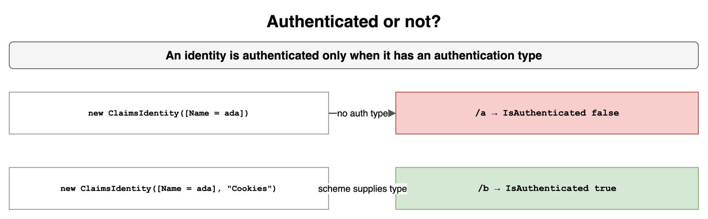
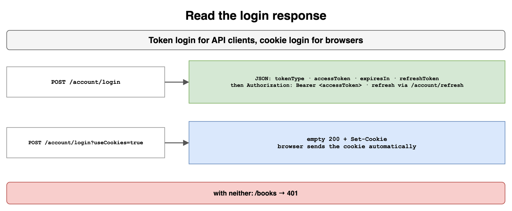

# Identity — Drills

Predict the result before running the example.

## Authenticated or not?

Both endpoints build a principal with a name claim. What do `/a` and `/b` return, and why do they differ?

```csharp
using System.Security.Claims;

var app = WebApplication.CreateBuilder(args).Build();
app.MapGet("/a", () => new ClaimsIdentity([new Claim(ClaimTypes.Name, "ada")]).IsAuthenticated);
app.MapGet("/b", () => new ClaimsIdentity([new Claim(ClaimTypes.Name, "ada")], "Cookies").IsAuthenticated);
app.Run();
```

**Answer**

`/a` returns `false` and `/b` returns `true`. An identity is authenticated only when it has an authentication type, which a scheme supplies. Claims alone don't make a caller authenticated.



*Source: [`diagrams/identity-drills.drawio`](/content/12_ASP.NET_Core/23_Identity/diagrams/identity-drills.drawio), page 1.*

## Read the login response

The app maps the Identity API endpoints. A registered user posts valid credentials to `/account/login` and to `/account/login?useCookies=true`. What does each response contain, and how should the client call `/books` afterward?

```csharp
using Microsoft.AspNetCore.Identity;
using Microsoft.AspNetCore.Identity.EntityFrameworkCore;
using Microsoft.EntityFrameworkCore;

var builder = WebApplication.CreateBuilder(args);
builder.Services.AddDbContext<AppDb>(options => options.UseSqlite("Data Source=identity.db"));
builder.Services.AddIdentityApiEndpoints<IdentityUser>().AddEntityFrameworkStores<AppDb>();
builder.Services.AddAuthorization();
var app = builder.Build();
using (var scope = app.Services.CreateScope())
    scope.ServiceProvider.GetRequiredService<AppDb>().Database.EnsureCreated();
app.MapGroup("/account").MapIdentityApi<IdentityUser>();
app.MapGet("/books", () => "books").RequireAuthorization();
app.Run();

public class AppDb(DbContextOptions<AppDb> options) : IdentityDbContext(options);
```

**Answer**

The plain login returns JSON with `tokenType`, `accessToken`, `expiresIn`, and `refreshToken`. The client sends `Authorization: Bearer <accessToken>` and later posts the refresh token to `/account/refresh`. The cookie login returns an empty 200 with a `Set-Cookie` header, so a browser sends the cookie automatically. Without either, `/books` returns 401.



*Source: [`diagrams/identity-drills.drawio`](/content/12_ASP.NET_Core/23_Identity/diagrams/identity-drills.drawio), page 2.*
