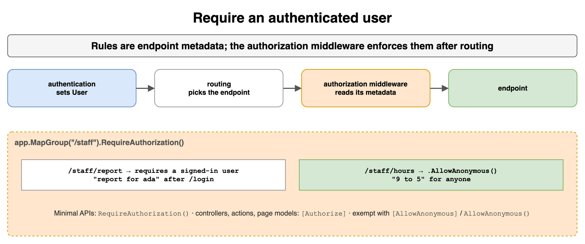
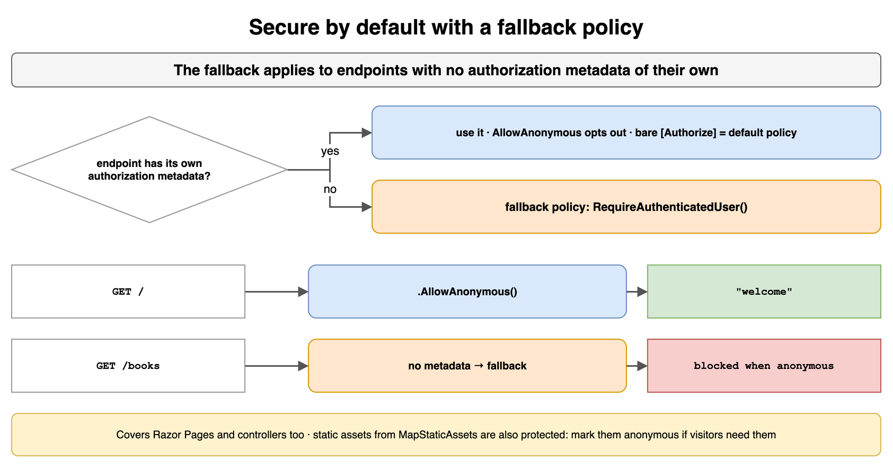
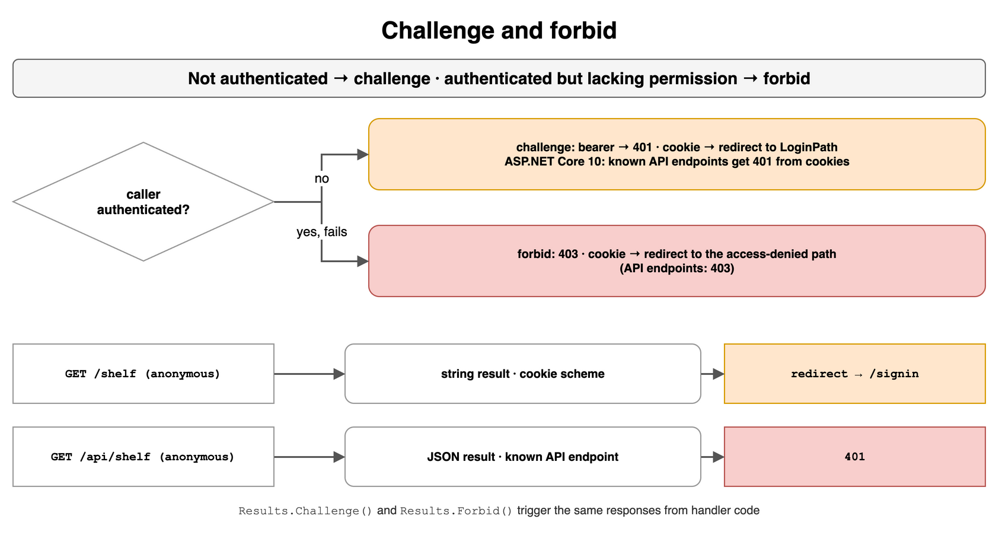
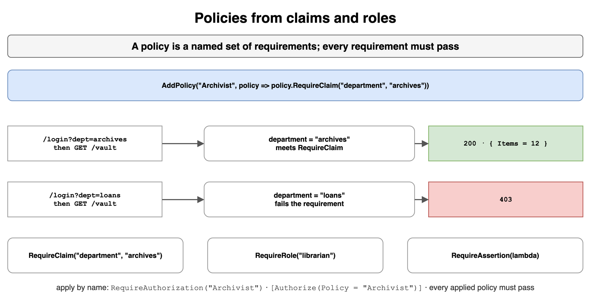
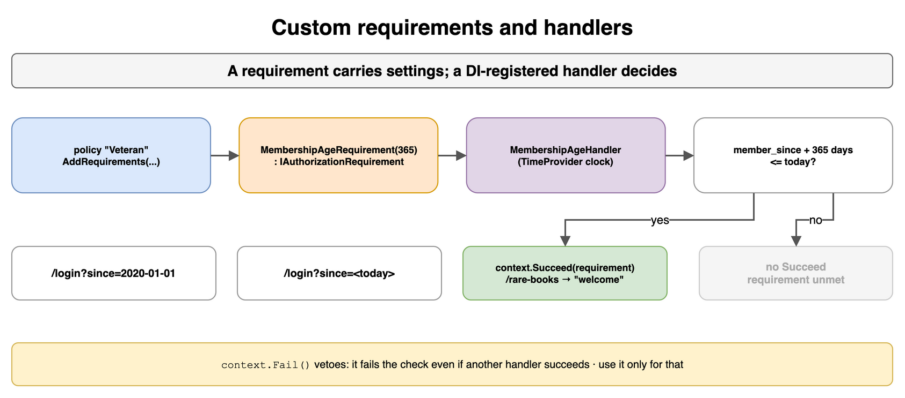
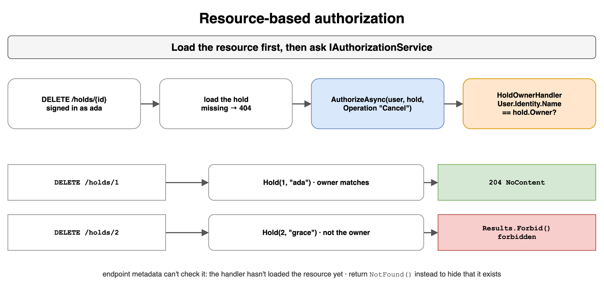
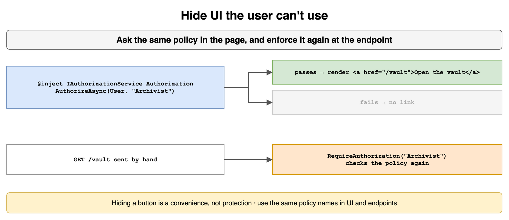

# Authorization

## Require an authenticated user

Authorization runs after authentication and decides whether the current principal may use an endpoint. The simplest rule is "any signed-in user". Mark Minimal API endpoints with `RequireAuthorization()` and controllers, actions, or page models with `[Authorize]`. `[AllowAnonymous]` or `AllowAnonymous()` exempts an endpoint, for example a sign-in page inside a protected folder.

Rules attach to endpoints as metadata, and the authorization middleware enforces them after routing has picked the endpoint. Route groups let one call protect many endpoints. Here every endpoint under `/staff` requires a signed-in user except `/staff/hours`. Request `/staff/report` before and after visiting `/login`.

```csharp
using System.Security.Claims;
using Microsoft.AspNetCore.Authentication.Cookies;

var builder = WebApplication.CreateBuilder(args);
builder.Services.AddAuthentication(CookieAuthenticationDefaults.AuthenticationScheme).AddCookie();
builder.Services.AddAuthorization();
var app = builder.Build();
app.MapGet("/login", () => Results.SignIn(new ClaimsPrincipal(new ClaimsIdentity(
    [new Claim(ClaimTypes.Name, "ada")], CookieAuthenticationDefaults.AuthenticationScheme))));
var staff = app.MapGroup("/staff").RequireAuthorization();
staff.MapGet("/report", (ClaimsPrincipal user) => $"report for {user.Identity!.Name}");
staff.MapGet("/hours", () => "9 to 5").AllowAnonymous();
app.Run();
```

[Microsoft Learn](https://learn.microsoft.com/en-us/aspnet/core/security/authorization/simple?view=aspnetcore-10.0)



*Source: [`diagrams/authorization.drawio`](/content/12_ASP.NET_Core/24_Authorization/diagrams/authorization.drawio), page 1.*

## Secure by default with a fallback policy

Adding `RequireAuthorization` to each endpoint is easy to forget. A fallback policy applies to every endpoint that has no authorization metadata of its own, so new endpoints start protected and public ones opt out with `AllowAnonymous`. A default policy is different. It is what a bare `[Authorize]` or `RequireAuthorization()` means, and it doesn't apply to unmarked endpoints.

`AddAuthorizationBuilder`, added in .NET 7, configures both fluently. The fallback policy also covers Razor Pages and controllers. Static assets mapped with `MapStaticAssets` would be protected too, so mark them anonymous if anonymous visitors need them. Request `/` and `/books` without signing in.

```csharp
using Microsoft.AspNetCore.Authentication.Cookies;
using Microsoft.AspNetCore.Authorization;

var builder = WebApplication.CreateBuilder(args);
builder.Services.AddAuthentication(CookieAuthenticationDefaults.AuthenticationScheme).AddCookie();
builder.Services.AddAuthorizationBuilder()
    .SetFallbackPolicy(new AuthorizationPolicyBuilder().RequireAuthenticatedUser().Build());
var app = builder.Build();
app.MapGet("/", () => "welcome").AllowAnonymous();
app.MapGet("/books", () => new[] { "Atlas" });
app.Run();
```

[Microsoft Learn](https://learn.microsoft.com/en-us/aspnet/core/security/authorization/secure-data?view=aspnetcore-10.0#require-authenticated-users)



*Source: [`diagrams/authorization.drawio`](/content/12_ASP.NET_Core/24_Authorization/diagrams/authorization.drawio), page 2.*

## Challenge and forbid

A failed authorization check produces one of two outcomes. If the caller isn't authenticated, the scheme challenges: a bearer scheme returns 401, and a cookie scheme redirects to its login path. If the caller is authenticated but lacks permission, the scheme forbids: 403, or a redirect to the access-denied path for cookies. `Results.Challenge()` and `Results.Forbid()` trigger the same responses from handler code.

Redirects suit browsers, not API clients. In ASP.NET Core 10, cookie authentication returns 401 and 403 instead of redirecting for known API endpoints. Those are `[ApiController]` actions, Minimal API endpoints that read or write JSON, and endpoints with `TypedResults` return types. This app sets the login path, so `/shelf` (a string result) redirects, while `/api/shelf` (JSON) gets 401.

```csharp
using Microsoft.AspNetCore.Authentication.Cookies;

var builder = WebApplication.CreateBuilder(args);
builder.Services.AddAuthentication(CookieAuthenticationDefaults.AuthenticationScheme)
    .AddCookie(options => options.LoginPath = "/signin");
builder.Services.AddAuthorization();
var app = builder.Build();
app.MapGet("/signin", () => "sign in here");
app.MapGet("/shelf", () => "shelf page").RequireAuthorization();
app.MapGet("/api/shelf", () => new { Books = 3 }).RequireAuthorization();
app.Run();
```

[Microsoft Learn](https://learn.microsoft.com/en-us/aspnet/core/breaking-changes/10/cookie-authentication-api-endpoints?view=aspnetcore-10.0)



*Source: [`diagrams/authorization.drawio`](/content/12_ASP.NET_Core/24_Authorization/diagrams/authorization.drawio), page 3.*

## Policies from claims and roles

A policy is a named set of requirements. `RequireClaim("department", "archives")` needs a claim with that value, `RequireRole("librarian")` needs a role claim, and `RequireAssertion` accepts a lambda for simple custom checks. Apply a policy by name with `RequireAuthorization("Archivist")` or `[Authorize(Policy = "Archivist")]`. Every requirement in a policy must pass, and every policy applied to an endpoint must pass.

Naming policies after permissions keeps endpoints readable and puts the claim details in one place. `/login?dept=archives` signs in a user who passes. Any other department signs in a user who gets 403 from `/vault`.

```csharp
using System.Security.Claims;
using Microsoft.AspNetCore.Authentication.Cookies;

var builder = WebApplication.CreateBuilder(args);
builder.Services.AddAuthentication(CookieAuthenticationDefaults.AuthenticationScheme).AddCookie();
builder.Services.AddAuthorizationBuilder()
    .AddPolicy("Archivist", policy => policy.RequireClaim("department", "archives"));
var app = builder.Build();
app.MapGet("/login", (string dept) => Results.SignIn(new ClaimsPrincipal(new ClaimsIdentity(
    [new Claim(ClaimTypes.Name, "ada"), new Claim("department", dept)],
    CookieAuthenticationDefaults.AuthenticationScheme))));
app.MapGet("/vault", () => new { Items = 12 }).RequireAuthorization("Archivist");
app.Run();
```

[Microsoft Learn](https://learn.microsoft.com/en-us/aspnet/core/security/authorization/claims?view=aspnetcore-10.0)



*Source: [`diagrams/authorization.drawio`](/content/12_ASP.NET_Core/24_Authorization/diagrams/authorization.drawio), page 4.*

## Custom requirements and handlers

When a rule needs data or logic, model it as a requirement plus a handler. A requirement is a class implementing `IAuthorizationRequirement` that carries its settings. A handler derives from `AuthorizationHandler<TRequirement>` and calls `context.Succeed(requirement)` when the user meets it. Handlers are registered in DI, so they can depend on services such as a clock or a database.

A handler that doesn't call `Succeed` simply leaves the requirement unmet. Call `context.Fail()` only to veto, because it fails the check even if another handler succeeds. Here a requirement checks that the user's `member_since` claim is at least a year old. Sign in with `/login?since=2020-01-01` and with today's date.

```csharp
using System.Security.Claims;
using Microsoft.AspNetCore.Authentication.Cookies;
using Microsoft.AspNetCore.Authorization;

var builder = WebApplication.CreateBuilder(args);
builder.Services.AddAuthentication(CookieAuthenticationDefaults.AuthenticationScheme).AddCookie();
builder.Services.AddSingleton(TimeProvider.System);
builder.Services.AddSingleton<IAuthorizationHandler, MembershipAgeHandler>();
builder.Services.AddAuthorizationBuilder()
    .AddPolicy("Veteran", policy => policy.AddRequirements(new MembershipAgeRequirement(365)));
var app = builder.Build();
app.MapGet("/login", (DateOnly since) => Results.SignIn(new ClaimsPrincipal(new ClaimsIdentity(
    [new Claim("member_since", since.ToString("O"))], CookieAuthenticationDefaults.AuthenticationScheme))));
app.MapGet("/rare-books", () => "welcome").RequireAuthorization("Veteran");
app.Run();

public record MembershipAgeRequirement(int Days) : IAuthorizationRequirement;

public class MembershipAgeHandler(TimeProvider clock) : AuthorizationHandler<MembershipAgeRequirement>
{
    protected override Task HandleRequirementAsync(AuthorizationHandlerContext context,
        MembershipAgeRequirement requirement)
    {
        var since = context.User.FindFirstValue("member_since");
        var today = DateOnly.FromDateTime(clock.GetUtcNow().UtcDateTime);
        if (since is not null && DateOnly.Parse(since).AddDays(requirement.Days) <= today)
            context.Succeed(requirement);
        return Task.CompletedTask;
    }
}
```

[Microsoft Learn](https://learn.microsoft.com/en-us/aspnet/core/security/authorization/policies?view=aspnetcore-10.0)



*Source: [`diagrams/authorization.drawio`](/content/12_ASP.NET_Core/24_Authorization/diagrams/authorization.drawio), page 5.*

## Resource-based authorization

Some decisions depend on the thing being accessed, such as "only the member who placed a hold may cancel it". The endpoint doesn't have the resource until the handler loads it, so attribute and endpoint metadata can't check it. Inject `IAuthorizationService` and call `AuthorizeAsync(user, resource, policyOrRequirement)` after loading the resource. Write a handler deriving from `AuthorizationHandler<TRequirement, TResource>`.

Return `Forbid()` when the check fails, or `NotFound()` if you don't want to reveal that the resource exists. Sign in as `ada` with `/login?name=ada`. Cancelling hold 1, which belongs to ada, succeeds, and hold 2, which belongs to grace, is forbidden.

```csharp
using System.Security.Claims;
using Microsoft.AspNetCore.Authentication.Cookies;
using Microsoft.AspNetCore.Authorization;
using Microsoft.AspNetCore.Authorization.Infrastructure;

var builder = WebApplication.CreateBuilder(args);
builder.Services.AddAuthentication(CookieAuthenticationDefaults.AuthenticationScheme).AddCookie();
builder.Services.AddAuthorization();
builder.Services.AddSingleton<IAuthorizationHandler, HoldOwnerHandler>();
var app = builder.Build();
var holds = new Dictionary<int, Hold> { [1] = new(1, "ada"), [2] = new(2, "grace") };
app.MapGet("/login", (string name) => Results.SignIn(new ClaimsPrincipal(new ClaimsIdentity(
    [new Claim(ClaimTypes.Name, name)], CookieAuthenticationDefaults.AuthenticationScheme))));
app.MapDelete("/holds/{id:int}", async (int id, ClaimsPrincipal user, IAuthorizationService auth) =>
{
    if (!holds.TryGetValue(id, out var hold)) return Results.NotFound();
    var result = await auth.AuthorizeAsync(user, hold, new OperationAuthorizationRequirement { Name = "Cancel" });
    return result.Succeeded ? Results.NoContent() : Results.Forbid();
}).RequireAuthorization();
app.Run();

public record Hold(int Id, string Owner);

public class HoldOwnerHandler : AuthorizationHandler<OperationAuthorizationRequirement, Hold>
{
    protected override Task HandleRequirementAsync(AuthorizationHandlerContext context,
        OperationAuthorizationRequirement requirement, Hold hold)
    {
        if (context.User.Identity?.Name == hold.Owner) context.Succeed(requirement);
        return Task.CompletedTask;
    }
}
```

[Microsoft Learn](https://learn.microsoft.com/en-us/aspnet/core/security/authorization/resourcebased?view=aspnetcore-10.0)



*Source: [`diagrams/authorization.drawio`](/content/12_ASP.NET_Core/24_Authorization/diagrams/authorization.drawio), page 6.*

## Hide UI the user can't use

Pages and views can ask the same authorization questions as endpoints. Inject `IAuthorizationService` with `@inject` and call `AuthorizeAsync` before rendering a link or button, so users don't see actions that would fail. Use the same policy names as the endpoints so the UI and the rules stay in step.

Hiding a button is a convenience, not protection. A user can still send the request by hand, so the endpoint must enforce the policy as well. In this page, only users who pass `Archivist` see the vault link, and the vault endpoint checks the same policy again.

```csharp
using Microsoft.AspNetCore.Authentication.Cookies;

var builder = WebApplication.CreateBuilder(args);
builder.Services.AddAuthentication(CookieAuthenticationDefaults.AuthenticationScheme).AddCookie();
builder.Services.AddAuthorizationBuilder()
    .AddPolicy("Archivist", policy => policy.RequireClaim("department", "archives"));
builder.Services.AddRazorPages();
var app = builder.Build();
app.MapRazorPages();
app.MapGet("/vault", () => "vault").RequireAuthorization("Archivist");
app.Run();
```

```cshtml
@* Pages/Index.cshtml *@
@page
@using Microsoft.AspNetCore.Authorization
@inject IAuthorizationService Authorization
<h1>Catalog</h1>
@if ((await Authorization.AuthorizeAsync(User, "Archivist")).Succeeded)
{
    <a href="/vault">Open the vault</a>
}
```

[Microsoft Learn](https://learn.microsoft.com/en-us/aspnet/core/security/authorization/views?view=aspnetcore-10.0)



*Source: [`diagrams/authorization.drawio`](/content/12_ASP.NET_Core/24_Authorization/diagrams/authorization.drawio), page 7.*
