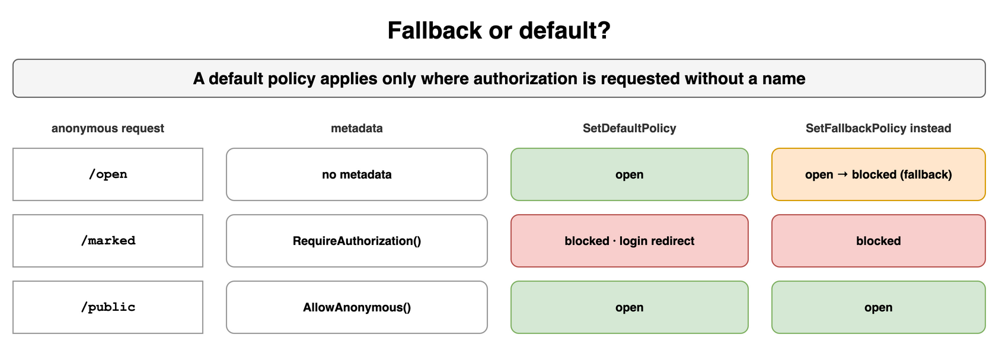
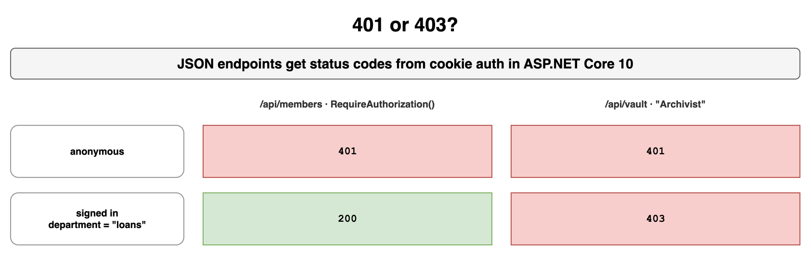

# Authorization — Drills

Predict the result before running the example.

## Fallback or default?

The app sets a default policy, not a fallback policy. An anonymous caller requests `/open`, `/marked`, and `/public`. Which ones are blocked?

```csharp
using Microsoft.AspNetCore.Authentication.Cookies;
using Microsoft.AspNetCore.Authorization;

var builder = WebApplication.CreateBuilder(args);
builder.Services.AddAuthentication(CookieAuthenticationDefaults.AuthenticationScheme).AddCookie();
builder.Services.AddAuthorizationBuilder()
    .SetDefaultPolicy(new AuthorizationPolicyBuilder().RequireAuthenticatedUser().Build());
var app = builder.Build();
app.MapGet("/open", () => "open");
app.MapGet("/marked", () => "marked").RequireAuthorization();
app.MapGet("/public", () => "public").AllowAnonymous();
app.Run();
```

**Answer**

Only `/marked` is blocked. It challenges, which redirects to the cookie login path. A default policy applies only where authorization is requested without a named policy. `/open` has no authorization metadata, so it stays open. With `SetFallbackPolicy` instead, `/open` would be blocked too, and `/public` would still be open.



*Source: [`diagrams/authorization-drills.drawio`](/content/12_ASP.NET_Core/24_Authorization/diagrams/authorization-drills.drawio), page 1.*

## 401 or 403?

A user signs in with a `department` claim of `loans` and calls each endpoint below. An anonymous caller does the same. Predict all four status codes.

```csharp
using System.Security.Claims;
using Microsoft.AspNetCore.Authentication.Cookies;

var builder = WebApplication.CreateBuilder(args);
builder.Services.AddAuthentication(CookieAuthenticationDefaults.AuthenticationScheme).AddCookie();
builder.Services.AddAuthorizationBuilder()
    .AddPolicy("Archivist", policy => policy.RequireClaim("department", "archives"));
var app = builder.Build();
app.MapGet("/login", () => Results.SignIn(new ClaimsPrincipal(new ClaimsIdentity(
    [new Claim("department", "loans")], CookieAuthenticationDefaults.AuthenticationScheme))));
app.MapGet("/api/members", () => new { Count = 40 }).RequireAuthorization();
app.MapGet("/api/vault", () => new { Items = 12 }).RequireAuthorization("Archivist");
app.Run();
```

**Answer**

Anonymous callers get 401 from both endpoints. These are JSON endpoints, so ASP.NET Core 10 cookie authentication returns a status code instead of redirecting. The signed-in loans user gets 200 from `/api/members` and 403 from `/api/vault`, because the user is authenticated but fails the claim requirement.



*Source: [`diagrams/authorization-drills.drawio`](/content/12_ASP.NET_Core/24_Authorization/diagrams/authorization-drills.drawio), page 2.*
