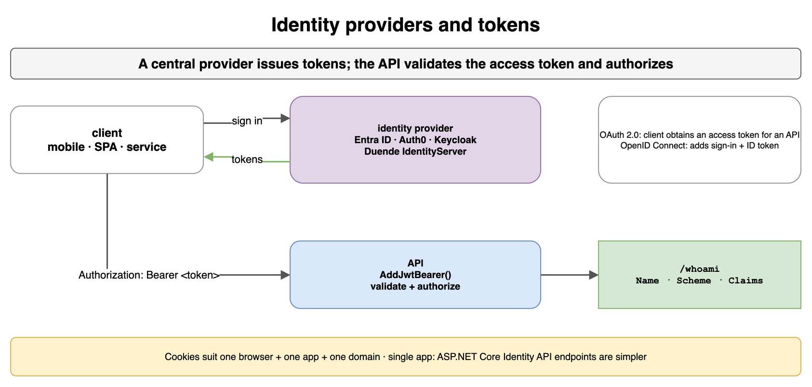
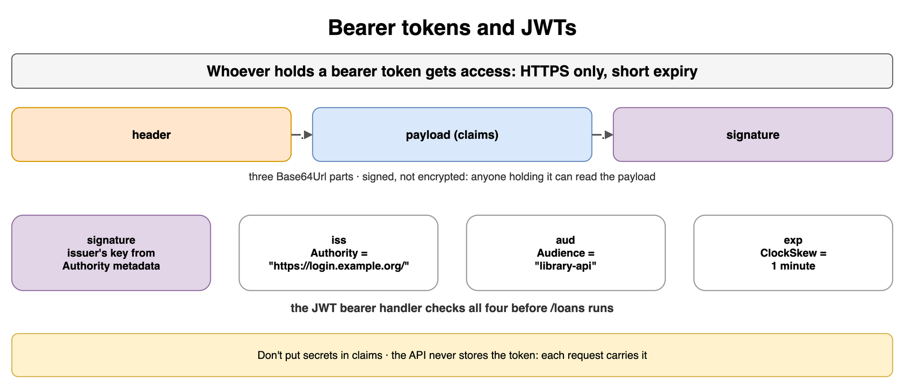
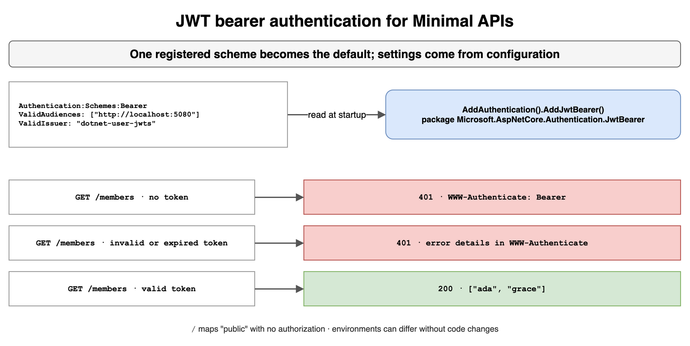
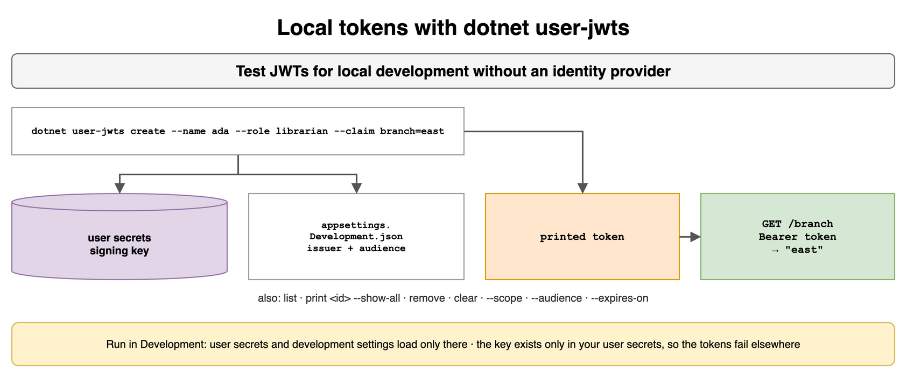
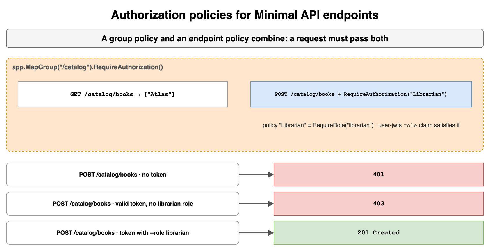
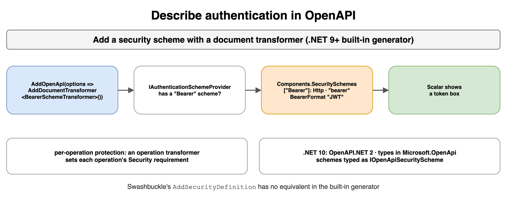

# API Authentication

## Identity providers and tokens

Cookies work well when one browser talks to one app on one domain. APIs called by mobile apps, single-page apps on other origins, or other services need credentials that any client can send and any API can check. The usual answer is a token in the `Authorization` header. When several apps share users, a central identity provider signs users in once and issues tokens that every app trusts. Examples include Microsoft Entra ID, Auth0, Keycloak, and Duende IdentityServer.

OAuth 2.0 defines how a client obtains an access token that grants access to an API. OpenID Connect adds sign-in on top, with an ID token describing the user. The API's job is narrow: validate the access token and authorize the request. ASP.NET Core Identity's API endpoints are a simpler option for a single app, as shown in [Identity API endpoints](#12_ASP.NET_Core/23_Identity/concepts/identity-api-endpoints). The example shows how an API reads the result once a token is validated.

```csharp
using System.Security.Claims;

var builder = WebApplication.CreateBuilder(args);
builder.Services.AddAuthentication().AddJwtBearer();
builder.Services.AddAuthorization();
var app = builder.Build();
app.MapGet("/whoami", (ClaimsPrincipal user) => new
{
    user.Identity!.Name,
    Scheme = user.Identity.AuthenticationType,
    Claims = user.Claims.Select(c => $"{c.Type}={c.Value}")
}).RequireAuthorization();
app.Run();
```

[Microsoft Learn](https://learn.microsoft.com/en-us/aspnet/core/security/authentication/configure-jwt-bearer-authentication?view=aspnetcore-10.0)



*Source: [`diagrams/api-authentication.drawio`](/content/12_ASP.NET_Core/25_API_Authentication/diagrams/api-authentication.drawio), page 1.*

## Bearer tokens and JWTs

A bearer token grants access to whoever holds it, so it must only travel over HTTPS and should expire quickly. Clients send it as `Authorization: Bearer <token>`. Many providers issue JSON Web Tokens (JWTs): three Base64Url parts, a header, a payload of claims, and a signature. The API validates the signature with the issuer's key. It also checks the issuer (`iss`), the audience (`aud`, which must name this API), and the expiry (`exp`).

A JWT is signed, not encrypted, so anyone holding it can read the payload. Don't put secrets in claims. The API never stores the token. Each request carries it, and validation needs only the signing keys, which the JWT bearer handler can download from the provider's OpenID Connect metadata through `Authority`.

```csharp
var builder = WebApplication.CreateBuilder(args);
builder.Services.AddAuthentication().AddJwtBearer(options =>
{
    options.Authority = "https://login.example.org/";
    options.Audience = "library-api";
    options.TokenValidationParameters.ClockSkew = TimeSpan.FromMinutes(1);
});
builder.Services.AddAuthorization();
var app = builder.Build();
app.MapGet("/loans", () => new[] { "Atlas" }).RequireAuthorization();
app.Run();
```

[Microsoft Learn](https://learn.microsoft.com/en-us/aspnet/core/security/authentication/configure-jwt-bearer-authentication?view=aspnetcore-10.0)



*Source: [`diagrams/api-authentication.drawio`](/content/12_ASP.NET_Core/25_API_Authentication/diagrams/api-authentication.drawio), page 2.*

## JWT bearer authentication for Minimal APIs

Install `Microsoft.AspNetCore.Authentication.JwtBearer`, call `AddAuthentication().AddJwtBearer()`, and protect endpoints with `RequireAuthorization`. Since .NET 7, a single registered scheme becomes the default automatically. The handler also reads settings from configuration under `Authentication:Schemes:Bearer`, such as `ValidIssuer`, `ValidAudiences`, and signing keys. Environments can then differ without code changes.

With no token, a protected endpoint returns 401 with a `WWW-Authenticate: Bearer` header. With an invalid or expired token, it returns 401 with error details in that header. The configuration below matches what `dotnet user-jwts` writes for local development.

```json
{
  "Authentication": {
    "Schemes": {
      "Bearer": {
        "ValidAudiences": [ "http://localhost:5080" ],
        "ValidIssuer": "dotnet-user-jwts"
      }
    }
  }
}
```

```csharp
var builder = WebApplication.CreateBuilder(args);
builder.Services.AddAuthentication().AddJwtBearer();
builder.Services.AddAuthorization();
var app = builder.Build();
app.MapGet("/", () => "public");
app.MapGet("/members", () => new[] { "ada", "grace" }).RequireAuthorization();
app.Run();
```

[Microsoft Learn](https://learn.microsoft.com/en-us/aspnet/core/security/authentication/jwt-authn?view=aspnetcore-10.0)



*Source: [`diagrams/api-authentication.drawio`](/content/12_ASP.NET_Core/25_API_Authentication/diagrams/api-authentication.drawio), page 3.*

## Local tokens with dotnet user-jwts

The `dotnet user-jwts` tool, added in .NET 7, issues test JWTs for local development without an identity provider. `create` generates a signing key and stores it in user secrets. It also adds the issuer and audience settings to `appsettings.Development.json` and prints a token. Options shape the token: `--name`, `--role`, `--claim name=value`, `--scope`, `--audience`, and `--expires-on`.

`list` shows issued tokens, `print <id>` shows one with its claims, and `remove` and `clear` delete them. The key lives only in your user secrets, so these tokens are rejected anywhere else. Run the app in Development, because user secrets and the development settings load only there.

```sh
dotnet user-jwts create --name ada --role librarian --claim branch=east
dotnet user-jwts list
dotnet user-jwts print <id> --show-all
```

```csharp
using System.Security.Claims;

var builder = WebApplication.CreateBuilder(args);
builder.Services.AddAuthentication().AddJwtBearer();
builder.Services.AddAuthorization();
var app = builder.Build();
app.MapGet("/branch", (ClaimsPrincipal user) => user.FindFirstValue("branch") ?? "none")
    .RequireAuthorization();
app.Run();
```

[Microsoft Learn](https://learn.microsoft.com/en-us/aspnet/core/security/authentication/jwt-authn?view=aspnetcore-10.0#use-dotnet-user-jwts-to-improve-development-time-testing)



*Source: [`diagrams/api-authentication.drawio`](/content/12_ASP.NET_Core/25_API_Authentication/diagrams/api-authentication.drawio), page 4.*

## Authorization policies for Minimal API endpoints

Minimal API endpoints take the same policies as controllers. `RequireAuthorization("Librarian")` applies a named policy, and `RequireAuthorization(policy => ...)` builds an unnamed one inline. Put the call on a route group to protect a whole area of the API. A group policy and an endpoint policy combine, so a request must pass both.

Token claims drive the policies. With the default inbound claim mapping, a `role` claim from user-jwts satisfies `RequireRole`. Create tokens with and without `--role librarian` and call `POST /catalog/books`. A valid token without the role gets 403, and no token gets 401.

```csharp
var builder = WebApplication.CreateBuilder(args);
builder.Services.AddAuthentication().AddJwtBearer();
builder.Services.AddAuthorizationBuilder()
    .AddPolicy("Librarian", policy => policy.RequireRole("librarian"));
var app = builder.Build();
var catalog = app.MapGroup("/catalog").RequireAuthorization();
catalog.MapGet("/books", () => new[] { "Atlas" });
catalog.MapPost("/books", (NewBook book) => TypedResults.Created($"/catalog/books/1", book))
    .RequireAuthorization("Librarian");
app.Run();

public record NewBook(string Title);
```

[Microsoft Learn](https://learn.microsoft.com/en-us/aspnet/core/fundamentals/minimal-apis/security?view=aspnetcore-10.0)



*Source: [`diagrams/api-authentication.drawio`](/content/12_ASP.NET_Core/25_API_Authentication/diagrams/api-authentication.drawio), page 5.*

## Describe authentication in OpenAPI

Clients and interactive tools need to know how to authenticate. In the built-in OpenAPI generator (.NET 9 and later), add a security scheme with a document transformer. The book's Swashbuckle `AddSecurityDefinition` call has no equivalent there. In .NET 10 the generator uses OpenAPI.NET 2, so the model types live in the `Microsoft.OpenApi` namespace and schemes are typed as `IOpenApiSecurityScheme`.

The transformer below adds an HTTP bearer scheme when the app registers a `Bearer` authentication scheme. Interactive tools such as Scalar then show a token box. To mark individual operations as protected, add an operation transformer that sets each operation's `Security` requirement.

```csharp
using Microsoft.AspNetCore.Authentication;
using Microsoft.AspNetCore.OpenApi;
using Microsoft.OpenApi;

var builder = WebApplication.CreateBuilder(args);
builder.Services.AddAuthentication().AddJwtBearer();
builder.Services.AddAuthorization();
builder.Services.AddOpenApi(options => options.AddDocumentTransformer<BearerSchemeTransformer>());
var app = builder.Build();
app.MapOpenApi();
app.MapGet("/members", () => new[] { "ada" }).RequireAuthorization();
app.Run();

public class BearerSchemeTransformer(IAuthenticationSchemeProvider schemes) : IOpenApiDocumentTransformer
{
    public async Task TransformAsync(OpenApiDocument document, OpenApiDocumentTransformerContext context,
        CancellationToken cancellationToken)
    {
        if (!(await schemes.GetAllSchemesAsync()).Any(s => s.Name == "Bearer")) return;
        document.Components ??= new OpenApiComponents();
        document.Components.SecuritySchemes = new Dictionary<string, IOpenApiSecurityScheme>
        {
            ["Bearer"] = new OpenApiSecurityScheme
            {
                Type = SecuritySchemeType.Http, Scheme = "bearer", BearerFormat = "JWT"
            }
        };
    }
}
```

[Microsoft Learn](https://learn.microsoft.com/en-us/aspnet/core/fundamentals/openapi/customize-openapi?view=aspnetcore-10.0)



*Source: [`diagrams/api-authentication.drawio`](/content/12_ASP.NET_Core/25_API_Authentication/diagrams/api-authentication.drawio), page 6.*
