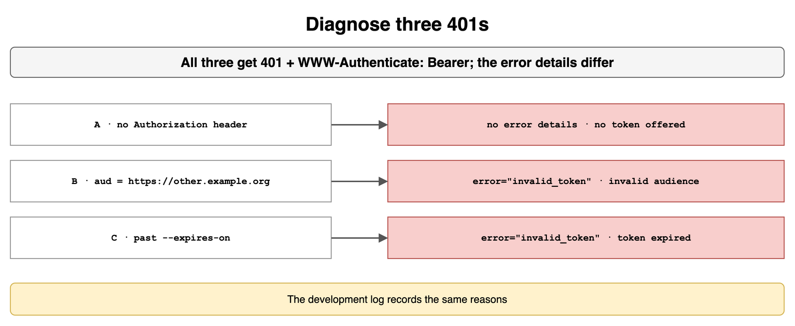
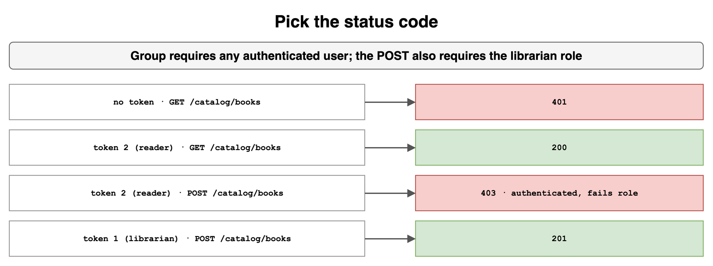

# API Authentication — Drills

Predict the result before running the example.

## Diagnose three 401s

Running in Development with user-jwts configuration, three requests to `/members` return 401. Request A has no header. Request B sends a token created for the audience `https://other.example.org`. Request C sends a valid token that ran past its `--expires-on` time. What tells them apart?

```csharp
var builder = WebApplication.CreateBuilder(args);
builder.Services.AddAuthentication().AddJwtBearer();
builder.Services.AddAuthorization();
var app = builder.Build();
app.MapGet("/members", () => new[] { "ada" }).RequireAuthorization();
app.Run();
```

**Answer**

All three get 401 with a `WWW-Authenticate: Bearer` header. A has no error details, because no token was offered. B adds `error="invalid_token"` with a description of an invalid audience, and C adds `error="invalid_token"` with an expired-token description. The development log records the same reasons.



*Source: [`diagrams/api-authentication-drills.drawio`](/content/12_ASP.NET_Core/25_API_Authentication/diagrams/api-authentication-drills.drawio), page 1.*

## Pick the status code

Token 1 was created with `--role librarian` and token 2 with `--role reader`. Predict the status for each request: no token on `GET /catalog/books`, token 2 on `GET /catalog/books`, token 2 on `POST /catalog/books`, and token 1 on `POST /catalog/books`.

```csharp
var builder = WebApplication.CreateBuilder(args);
builder.Services.AddAuthentication().AddJwtBearer();
builder.Services.AddAuthorizationBuilder()
    .AddPolicy("Librarian", policy => policy.RequireRole("librarian"));
var app = builder.Build();
var catalog = app.MapGroup("/catalog").RequireAuthorization();
catalog.MapGet("/books", () => new[] { "Atlas" });
catalog.MapPost("/books", (NewBook book) => TypedResults.Created("/catalog/books/1", book))
    .RequireAuthorization("Librarian");
app.Run();

public record NewBook(string Title);
```

**Answer**

401, 200, 403, and 201. The group requires any authenticated user, and the POST also requires the librarian role. The reader is authenticated, so the failed role check is a 403, not a 401.



*Source: [`diagrams/api-authentication-drills.drawio`](/content/12_ASP.NET_Core/25_API_Authentication/diagrams/api-authentication-drills.drawio), page 2.*
