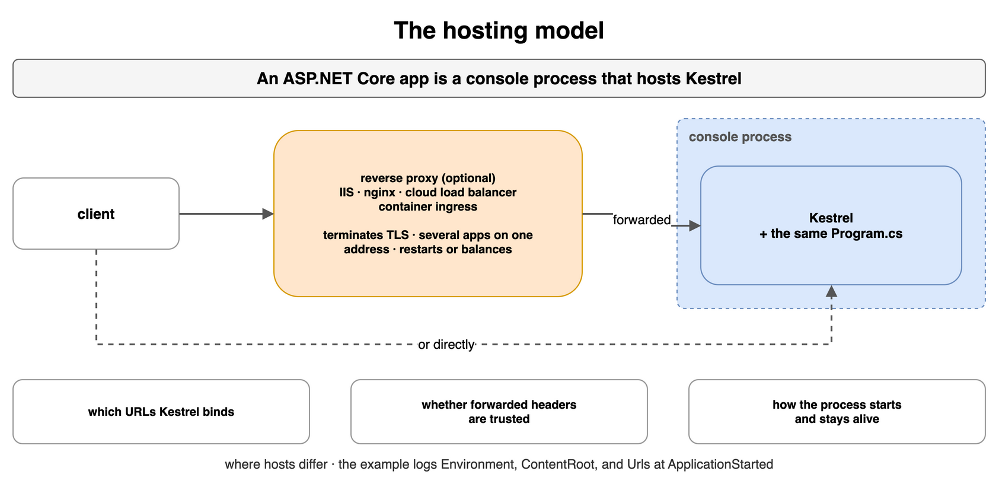
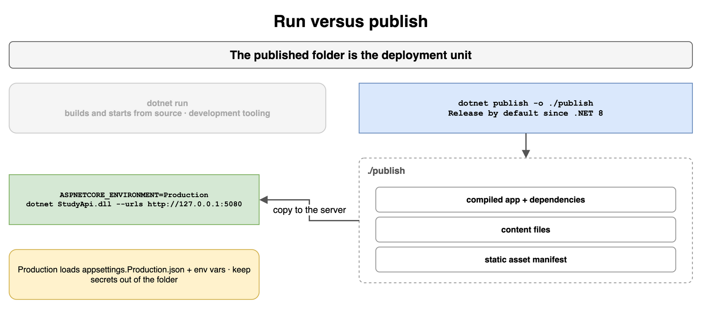
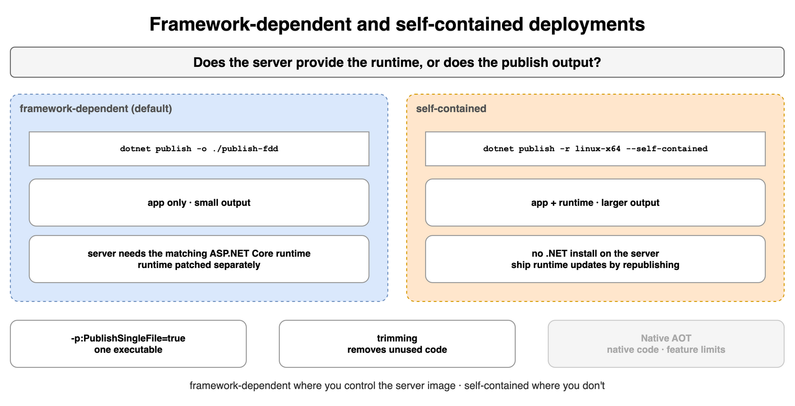
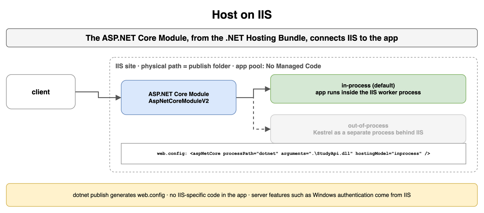
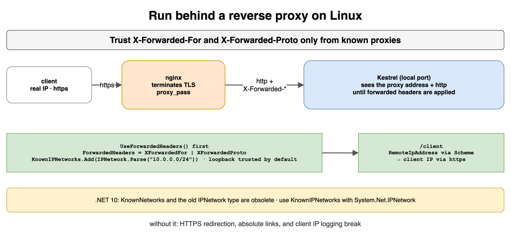
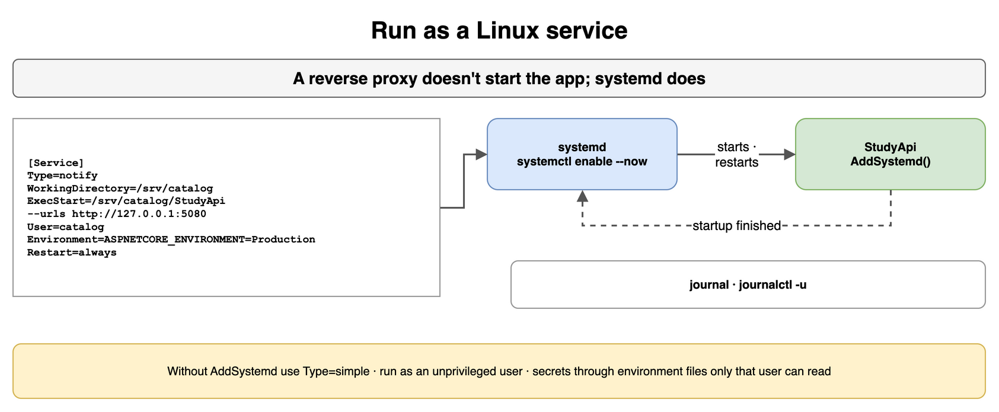
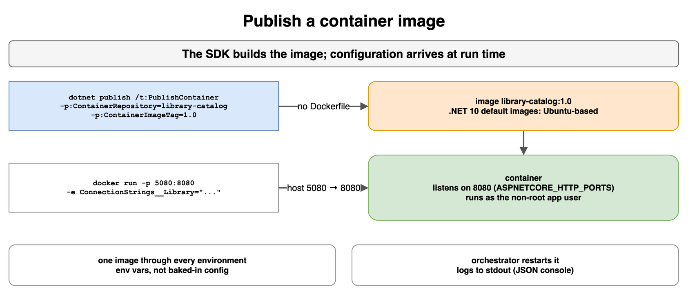
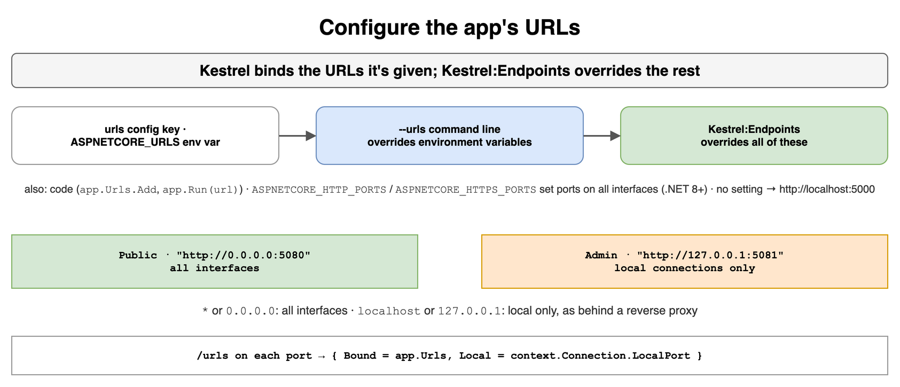

# Publishing and Deployment

## The hosting model

An ASP.NET Core app is a console process that hosts its own web server, Kestrel. Kestrel can face the internet directly. Many deployments still put a reverse proxy in front, such as IIS, nginx, a cloud load balancer, or a container ingress. The proxy terminates TLS, serves several apps on one address, and restarts or balances processes. The app sees requests forwarded from the proxy.

Whatever the host, the same `Program.cs` runs. Hosting differences show up in a few places: which URLs Kestrel binds, whether forwarded headers are trusted, and how the process is started and kept alive. Check the environment at startup when behavior must differ. The example logs where it runs so you can confirm what a host passed in.

```csharp
var builder = WebApplication.CreateBuilder(args);
var app = builder.Build();
app.Lifetime.ApplicationStarted.Register(() => app.Logger.LogInformation(
    "Started in {Environment} from {ContentRoot} on {Urls}",
    app.Environment.EnvironmentName, app.Environment.ContentRootPath, string.Join(", ", app.Urls)));
app.MapGet("/", () => "catalog");
app.Run();
```

[Microsoft Learn](https://learn.microsoft.com/en-us/aspnet/core/host-and-deploy/?view=aspnetcore-10.0)



*Source: [`diagrams/deployment.drawio`](/content/12_ASP.NET_Core/27_Publishing_and_Deployment/diagrams/deployment.drawio), page 1.*

## Run versus publish

`dotnet run` builds and starts the app from source with development tooling, which suits a developer machine. `dotnet publish` produces a folder with everything needed to run the app without the source: the compiled app, its dependencies, content files, and the static asset manifest. Since .NET 8, `dotnet publish` uses the Release configuration by default. Start the published app with `dotnet <App>.dll` or the generated executable.

The published folder is the deployment unit. Copy it to the server, point the host at it, and set the environment, which defaults to Production, so `appsettings.Production.json` and environment variables apply. Don't publish `appsettings.Development.json` secrets, and keep production secrets out of the folder altogether.

```sh
dotnet publish -o ./publish
cd publish
ASPNETCORE_ENVIRONMENT=Production dotnet StudyApi.dll --urls http://127.0.0.1:5080
```

```csharp
var builder = WebApplication.CreateBuilder(args);
var app = builder.Build();
app.MapGet("/env", (IWebHostEnvironment env) => env.EnvironmentName);
app.Run();
```

[Microsoft Learn](https://learn.microsoft.com/en-us/dotnet/core/tools/dotnet-publish)



*Source: [`diagrams/deployment.drawio`](/content/12_ASP.NET_Core/27_Publishing_and_Deployment/diagrams/deployment.drawio), page 2.*

## Framework-dependent and self-contained deployments

A framework-dependent publish, the default, contains only the app and needs the matching ASP.NET Core runtime installed on the server. The output is small, and the runtime can be patched separately. A self-contained publish targets a runtime identifier such as `linux-x64` and includes the runtime, so the server needs no .NET install. The output is larger, and you ship runtime updates by republishing.

`-p:PublishSingleFile=true` bundles a self-contained app into one executable, and trimming removes unused code. Native AOT goes further and compiles to native code, but it limits which features the app may use. Native AOT is covered in Beyond the book. Choose framework-dependent where you control the server image, and self-contained where you don't.

```sh
dotnet publish -o ./publish-fdd
dotnet publish -r linux-x64 --self-contained -o ./publish-scd
dotnet publish -r linux-x64 --self-contained -p:PublishSingleFile=true -o ./publish-single
```

```csharp
using System.Runtime.InteropServices;

var builder = WebApplication.CreateBuilder(args);
var app = builder.Build();
app.MapGet("/runtime", () => new { RuntimeInformation.FrameworkDescription, RuntimeInformation.RuntimeIdentifier });
app.Run();
```

[Microsoft Learn](https://learn.microsoft.com/en-us/dotnet/core/deploying/)



*Source: [`diagrams/deployment.drawio`](/content/12_ASP.NET_Core/27_Publishing_and_Deployment/diagrams/deployment.drawio), page 3.*

## Host on IIS

On Windows, IIS hosts ASP.NET Core through the ASP.NET Core Module, installed by the .NET Hosting Bundle. By default the app runs in-process inside the IIS worker process, which is faster than forwarding. Out-of-process hosting runs Kestrel as a separate process behind IIS. `dotnet publish` generates the `web.config` that tells the module how to start the app.

Create an IIS site whose physical path is the publish folder and set its application pool to No Managed Code, because the module, not the .NET Framework CLR, loads the app. The app needs no IIS-specific code. Server features such as Windows authentication come from IIS. The generated `web.config` looks like this.

```xml
<configuration>
  <location path="." inheritInChildApplications="false">
    <system.webServer>
      <handlers>
        <add name="aspNetCore" path="*" verb="*" modules="AspNetCoreModuleV2" resourceType="Unspecified" />
      </handlers>
      <aspNetCore processPath="dotnet" arguments=".\StudyApi.dll" hostingModel="inprocess" />
    </system.webServer>
  </location>
</configuration>
```

```csharp
var builder = WebApplication.CreateBuilder(args);
var app = builder.Build();
app.MapGet("/", (HttpContext context) => $"Served by {context.Request.Host} at {context.Request.PathBase}");
app.Run();
```

[Microsoft Learn](https://learn.microsoft.com/en-us/aspnet/core/host-and-deploy/iis/?view=aspnetcore-10.0)



*Source: [`diagrams/deployment.drawio`](/content/12_ASP.NET_Core/27_Publishing_and_Deployment/diagrams/deployment.drawio), page 4.*

## Run behind a reverse proxy on Linux

On Linux, a common setup runs Kestrel on a local port with nginx in front. nginx terminates TLS and passes requests on with `proxy_pass`. The app then sees the proxy's address as the client and `http` as the scheme. That breaks HTTPS redirection, absolute links, and client IP logging until the app trusts the `X-Forwarded-For` and `X-Forwarded-Proto` headers through the Forwarded Headers Middleware.

Only trust forwarded headers from known proxies. Loopback is trusted by default. In .NET 10, `ForwardedHeadersOptions.KnownNetworks` and the old `IPNetwork` type are obsolete. Use `KnownIPNetworks` with `System.Net.IPNetwork`. Put the middleware first so later middleware sees the corrected values.

```csharp
using System.Net;
using Microsoft.AspNetCore.HttpOverrides;

var builder = WebApplication.CreateBuilder(args);
builder.Services.Configure<ForwardedHeadersOptions>(options =>
{
    options.ForwardedHeaders = ForwardedHeaders.XForwardedFor | ForwardedHeaders.XForwardedProto;
    options.KnownIPNetworks.Add(IPNetwork.Parse("10.0.0.0/24"));
});
var app = builder.Build();
app.UseForwardedHeaders();
app.MapGet("/client", (HttpContext context) =>
    $"{context.Connection.RemoteIpAddress} via {context.Request.Scheme}");
app.Run();
```

[Microsoft Learn](https://learn.microsoft.com/en-us/aspnet/core/host-and-deploy/proxy-load-balancer?view=aspnetcore-10.0)



*Source: [`diagrams/deployment.drawio`](/content/12_ASP.NET_Core/27_Publishing_and_Deployment/diagrams/deployment.drawio), page 5.*

## Run as a Linux service

A reverse proxy doesn't start the app, so something must. On most Linux servers that is systemd. A unit file names the published executable, the working directory, the user, the environment, and a restart policy. `systemctl enable --now` starts it and keeps it running across reboots. Logs go to the journal, readable with `journalctl -u`.

Adding the `Microsoft.Extensions.Hosting.Systemd` package and calling `AddSystemd()` lets the app tell systemd when startup has finished and send logs in journal format. Without it, use `Type=simple`. Run the service as an unprivileged user and pass secrets through environment files that only that user can read.

```ini
[Unit]
Description=Library catalog

[Service]
Type=notify
WorkingDirectory=/srv/catalog
ExecStart=/srv/catalog/StudyApi --urls http://127.0.0.1:5080
User=catalog
Environment=ASPNETCORE_ENVIRONMENT=Production
Restart=always

[Install]
WantedBy=multi-user.target
```

```csharp
var builder = WebApplication.CreateBuilder(args);
builder.Services.AddSystemd();
var app = builder.Build();
app.MapGet("/", () => "catalog");
app.Run();
```

[Microsoft Learn](https://learn.microsoft.com/en-us/aspnet/core/host-and-deploy/linux-nginx?view=aspnetcore-10.0)



*Source: [`diagrams/deployment.drawio`](/content/12_ASP.NET_Core/27_Publishing_and_Deployment/diagrams/deployment.drawio), page 6.*

## Publish a container image

Since .NET 8, the SDK can build a container image without a Dockerfile: `dotnet publish /t:PublishContainer` builds and loads it into the local Docker or Podman. MSBuild properties such as `ContainerRepository` and `ContainerImageTag` name the image. Official ASP.NET Core images listen on port 8080 by default through `ASPNETCORE_HTTP_PORTS`. They define a non-root `app` user, which SDK-built images run as. In .NET 10 the default images are based on Ubuntu.

Pass configuration through environment variables at run time instead of baking it into the image, so one image moves through every environment. The container's orchestrator, not systemd, restarts it, and logs go to standard output, where JSON console logging works well.

```sh
dotnet publish /t:PublishContainer -p:ContainerRepository=library-catalog -p:ContainerImageTag=1.0
docker run --rm -p 5080:8080 -e ConnectionStrings__Library="Data Source=/data/library.db" library-catalog:1.0
```

```csharp
var builder = WebApplication.CreateBuilder(args);
var app = builder.Build();
app.MapGet("/", () => $"catalog as {Environment.UserName}");
app.Run();
```

[Microsoft Learn](https://learn.microsoft.com/en-us/dotnet/core/containers/sdk-publish)



*Source: [`diagrams/deployment.drawio`](/content/12_ASP.NET_Core/27_Publishing_and_Deployment/diagrams/deployment.drawio), page 7.*

## Configure the app's URLs

Kestrel binds to the URLs it's given. The sources include code (`app.Urls.Add` or `app.Run(url)`), the `--urls` command-line argument, the `ASPNETCORE_URLS` environment variable, and the `urls` configuration key. The command line overrides environment variables, as with any configuration key. Since .NET 8, `ASPNETCORE_HTTP_PORTS` and `ASPNETCORE_HTTPS_PORTS` set ports on all interfaces, which is how the container images choose 8080. A `Kestrel:Endpoints` section in configuration overrides all of these and can also set certificates and protocols per endpoint.

Use `http://*:5080` or `http://0.0.0.0:5080` to listen on all interfaces, and `localhost` or `127.0.0.1` to accept only local connections, as behind a reverse proxy. Without any setting the app uses `http://localhost:5000`. Run the example and request `/urls` on each bound port.

```json
{
  "Kestrel": {
    "Endpoints": {
      "Public": { "Url": "http://0.0.0.0:5080" },
      "Admin": { "Url": "http://127.0.0.1:5081" }
    }
  }
}
```

```csharp
var builder = WebApplication.CreateBuilder(args);
var app = builder.Build();
app.MapGet("/urls", (HttpContext context) => new { Bound = app.Urls, Local = context.Connection.LocalPort });
app.Run();
```

[Microsoft Learn](https://learn.microsoft.com/en-us/aspnet/core/fundamentals/servers/kestrel/endpoints?view=aspnetcore-10.0)



*Source: [`diagrams/deployment.drawio`](/content/12_ASP.NET_Core/27_Publishing_and_Deployment/diagrams/deployment.drawio), page 8.*
