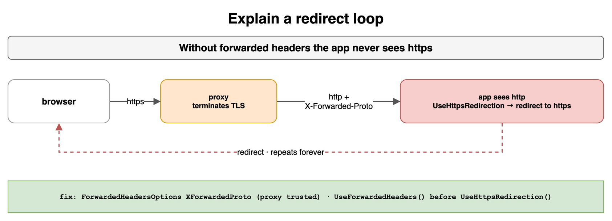
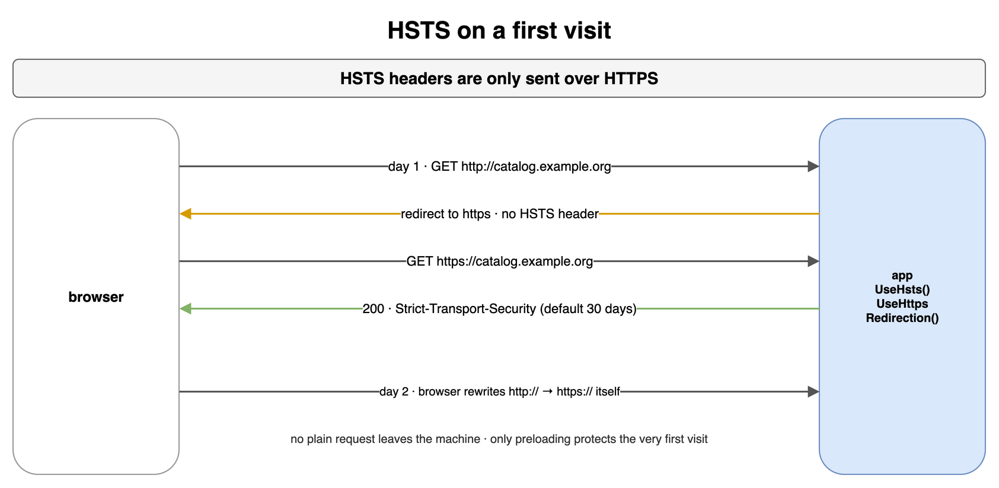

# HTTPS — Drills

Predict the result before running the example.

## Explain a redirect loop

The app runs behind a proxy that terminates TLS and forwards plain HTTP with `X-Forwarded-Proto: https`. Every browser request now ends in "too many redirects". Why, and what is the fix?

```csharp
var builder = WebApplication.CreateBuilder(args);
builder.Services.AddHttpsRedirection(options => options.HttpsPort = 443);
var app = builder.Build();
app.UseHttpsRedirection();
app.MapGet("/", () => "catalog");
app.Run();
```

**Answer**

The app sees every request as `http`, so it redirects to `https`. The proxy then forwards that request as `http` again. Configure `ForwardedHeadersOptions` for `XForwardedProto` with the proxy trusted, and call `UseForwardedHeaders()` before `UseHttpsRedirection()`. The app then sees `https` and stops redirecting.



*Source: [`diagrams/https-drills.drawio`](/content/12_ASP.NET_Core/28_HTTPS/diagrams/https-drills.drawio), page 1.*

## HSTS on a first visit

A new visitor types `http://catalog.example.org`. The app below is deployed in Production with HTTPS on 443. Trace the first visit and the next one a day later. Which response carries `Strict-Transport-Security`?

```csharp
var builder = WebApplication.CreateBuilder(args);
var app = builder.Build();
app.UseHsts();
app.UseHttpsRedirection();
app.MapGet("/", () => "catalog");
app.Run();
```

**Answer**

On the first visit the HTTP request gets a redirect without the header, because HSTS headers are only sent over HTTPS. The HTTPS response then carries the header with the default 30-day max age. A day later the browser rewrites `http://` to `https://` itself, so no plain request leaves the machine. Only preloading protects the very first visit.



*Source: [`diagrams/https-drills.drawio`](/content/12_ASP.NET_Core/28_HTTPS/diagrams/https-drills.drawio), page 2.*
