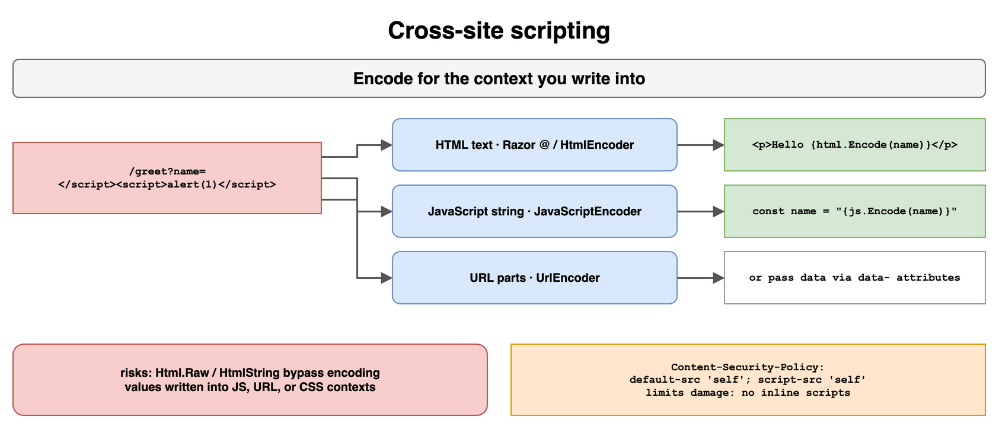
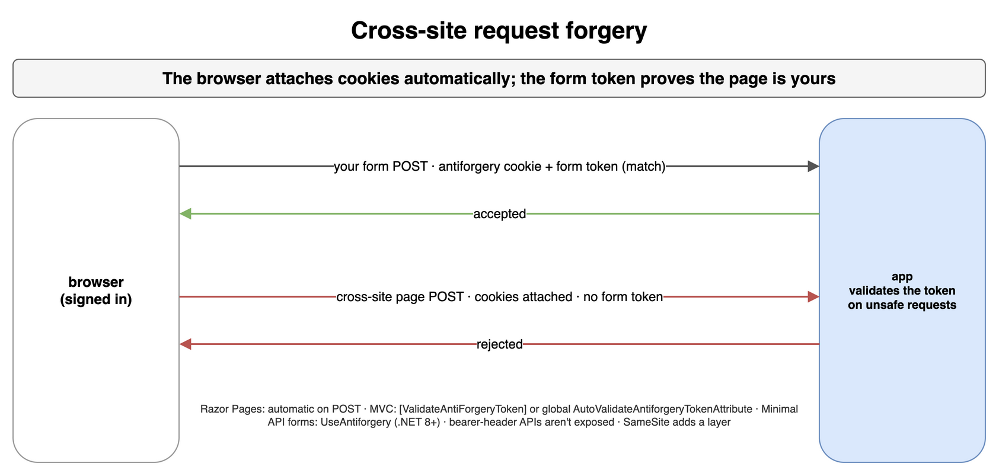
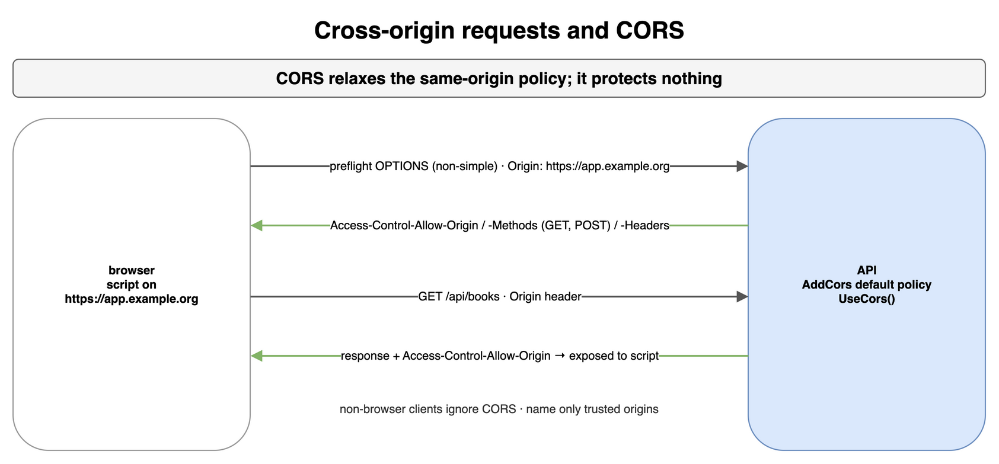
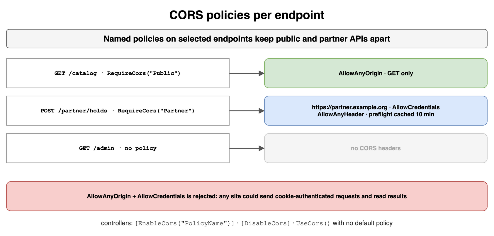
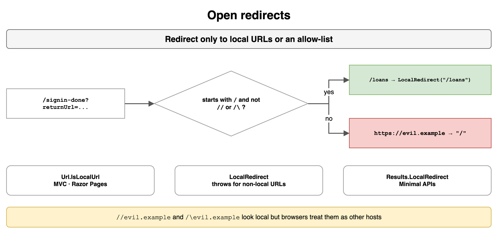
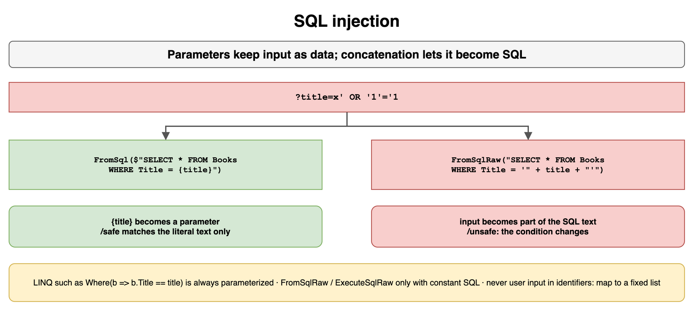
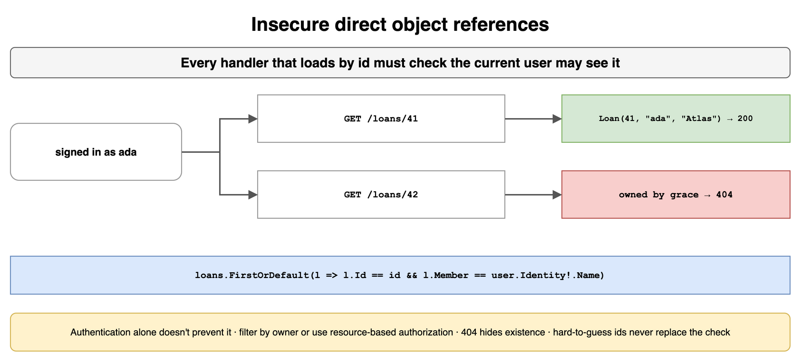
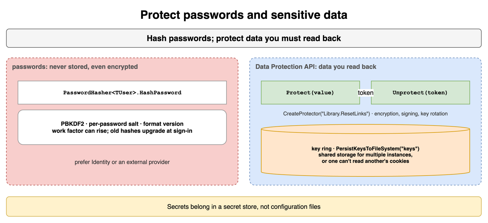

# Security Hardening

## Cross-site scripting

Cross-site scripting (XSS) happens when an app writes attacker-supplied text into a page as markup or script. The attacker's code then runs in other users' browsers with their session. Razor HTML-encodes every `@` value, which covers the common case of text inside HTML. The risks come from bypassing that encoding with `Html.Raw` or `HtmlString`, and from writing values into other contexts such as JavaScript, URLs, or CSS.

Encode for the context you write into. Use `JavaScriptEncoder` for script strings and `UrlEncoder` for URL parts, or better, pass data through `data-` attributes and read it from script. A Content Security Policy header that forbids inline scripts limits the damage when a bug slips through. See [raw HTML output](#12_ASP.NET_Core/17_Razor_Views/concepts/raw-html-output). Request `/greet?name=</script><script>alert(1)</script>` and view the encoded output.

```csharp
using System.Text.Encodings.Web;

var builder = WebApplication.CreateBuilder(args);
var app = builder.Build();
app.Use(async (context, next) =>
{
    context.Response.Headers.ContentSecurityPolicy = "default-src 'self'; script-src 'self'";
    await next();
});
app.MapGet("/greet", (string name, HtmlEncoder html, JavaScriptEncoder js) => Results.Content(
    $"<p>Hello {html.Encode(name)}</p><script>const name = \"{js.Encode(name)}\";</script>", "text/html"));
app.Run();
```

[Microsoft Learn](https://learn.microsoft.com/en-us/aspnet/core/security/cross-site-scripting?view=aspnetcore-10.0)



*Source: [`diagrams/security-hardening.drawio`](/content/12_ASP.NET_Core/29_Security_Hardening/diagrams/security-hardening.drawio), page 1.*

## Cross-site request forgery

Cross-site request forgery (CSRF) tricks a signed-in user's browser into sending a request to your app from another site. The browser attaches your cookies automatically. Any app that authenticates with cookies is exposed. Antiforgery tokens stop it: the app sends a token in a cookie and in the form, and checks on each unsafe request that the two match. A cross-site page can't read the form token.

Razor Pages validates tokens on POST automatically, and the Form Tag Helper adds them. MVC controllers with views need `[ValidateAntiForgeryToken]`, or `AutoValidateAntiforgeryTokenAttribute` added as a global filter. Since .NET 8, Minimal API endpoints that bind forms validate tokens through `UseAntiforgery`. APIs that use bearer tokens in headers aren't exposed, because browsers don't attach those automatically. `SameSite` cookie settings add another layer.

```csharp
using Microsoft.AspNetCore.Mvc;

var builder = WebApplication.CreateBuilder(args);
builder.Services.AddControllersWithViews(options =>
    options.Filters.Add(new AutoValidateAntiforgeryTokenAttribute()));
var app = builder.Build();
app.MapDefaultControllerRoute();
app.Run();

public class LoansController : Controller
{
    [HttpPost] public IActionResult Renew(int id) => Content($"renewed {id}");
    [HttpGet] public IActionResult Index() => Content("GET requests skip validation");
}
```

[Microsoft Learn](https://learn.microsoft.com/en-us/aspnet/core/security/anti-request-forgery?view=aspnetcore-10.0)



*Source: [`diagrams/security-hardening.drawio`](/content/12_ASP.NET_Core/29_Security_Hardening/diagrams/security-hardening.drawio), page 2.*

## Cross-origin requests and CORS

Browsers apply the same-origin policy: script on `https://app.example.org` can't read responses from `https://api.example.org` unless the API allows it. Cross-Origin Resource Sharing (CORS) is how the server allows it. The browser sends an `Origin` header, and for non-simple requests a preflight `OPTIONS` request first. It exposes the response to the script only if the API answers with matching `Access-Control-Allow-*` headers.

CORS relaxes browser security. It doesn't protect anything, and non-browser clients ignore it. Register policies with `AddCors`, add `UseCors` after routing, and name only the origins you trust. A default policy applies to every endpoint. Send a request with `Origin: https://app.example.org` and look for `Access-Control-Allow-Origin`.

```csharp
var builder = WebApplication.CreateBuilder(args);
builder.Services.AddCors(options => options.AddDefaultPolicy(policy =>
    policy.WithOrigins("https://app.example.org").WithMethods("GET", "POST").WithHeaders("Content-Type")));
var app = builder.Build();
app.UseCors();
app.MapGet("/api/books", () => new[] { "Atlas" });
app.Run();
```

[Microsoft Learn](https://learn.microsoft.com/en-us/aspnet/core/security/cors?view=aspnetcore-10.0)



*Source: [`diagrams/security-hardening.drawio`](/content/12_ASP.NET_Core/29_Security_Hardening/diagrams/security-hardening.drawio), page 3.*

## CORS policies per endpoint

Named policies apply to selected endpoints. Use `RequireCors("PolicyName")` on Minimal API endpoints or groups, and `[EnableCors("PolicyName")]` on controllers and actions. `[DisableCors]` turns CORS off for one action. Calling `UseCors()` with no default policy and applying names per endpoint keeps public and partner APIs separate.

Policies are strict on purpose. `AllowAnyOrigin` can't be combined with `AllowCredentials`, because that would let any site send cookie-authenticated requests and read the results. When credentials are needed, list the exact origins. `SetPreflightMaxAge` lets browsers cache preflight answers. In this example only `/partner` answers the partner's origin.

```csharp
var builder = WebApplication.CreateBuilder(args);
builder.Services.AddCors(options =>
{
    options.AddPolicy("Public", policy => policy.AllowAnyOrigin().WithMethods("GET"));
    options.AddPolicy("Partner", policy => policy.WithOrigins("https://partner.example.org")
        .AllowCredentials().AllowAnyHeader().SetPreflightMaxAge(TimeSpan.FromMinutes(10)));
});
var app = builder.Build();
app.UseCors();
app.MapGet("/catalog", () => new[] { "Atlas" }).RequireCors("Public");
app.MapPost("/partner/holds", () => Results.Accepted()).RequireCors("Partner");
app.MapGet("/admin", () => "no CORS here");
app.Run();
```

[Microsoft Learn](https://learn.microsoft.com/en-us/aspnet/core/security/cors?view=aspnetcore-10.0#enable-cors-with-endpoint-routing)



*Source: [`diagrams/security-hardening.drawio`](/content/12_ASP.NET_Core/29_Security_Hardening/diagrams/security-hardening.drawio), page 4.*

## Open redirects

Apps often redirect to a `returnUrl` after sign-in. If the app redirects to any URL it receives, an attacker can send a link to your real login page that ends up on a look-alike site. The user trusts the link because it starts with your domain. That's an open redirect.

Redirect only to local URLs, or to an allow-list of known hosts. `Url.IsLocalUrl` checks a URL in MVC and Razor Pages, `LocalRedirect` throws for non-local URLs, and Minimal APIs have `Results.LocalRedirect`. The check rejects tricks such as `//evil.example` and `/\evil.example`, which browsers treat as other hosts. Try `/signin-done?returnUrl=/loans` and `?returnUrl=https://evil.example`.

```csharp
var builder = WebApplication.CreateBuilder(args);
var app = builder.Build();
app.MapGet("/signin-done", (string? returnUrl) =>
{
    var target = returnUrl is { Length: > 0 } && returnUrl.StartsWith('/')
        && !returnUrl.StartsWith("//") && !returnUrl.StartsWith("/\\") ? returnUrl : "/";
    return Results.LocalRedirect(target);
});
app.Run();
```

[Microsoft Learn](https://learn.microsoft.com/en-us/aspnet/core/security/preventing-open-redirects?view=aspnetcore-10.0)



*Source: [`diagrams/security-hardening.drawio`](/content/12_ASP.NET_Core/29_Security_Hardening/diagrams/security-hardening.drawio), page 5.*

## SQL injection

SQL injection happens when user input is concatenated into SQL text, letting an attacker change the query. EF Core's LINQ queries are always parameterized, so `Where(b => b.Title == title)` is safe. For raw SQL, `FromSql` and `ExecuteSql` take an interpolated string and turn each `{value}` into a parameter. That makes them safe even though they look like string interpolation.

The danger is `FromSqlRaw` and `ExecuteSqlRaw` with strings you build yourself. Use them only with constant SQL and explicit parameters. Never put user input in identifiers such as column names. Map it to a fixed list instead. Compare the safe and unsafe endpoints with `?title=x' OR '1'='1`.

```csharp
using Microsoft.EntityFrameworkCore;

var builder = WebApplication.CreateBuilder(args);
builder.Services.AddDbContext<LibraryDb>(options => options.UseSqlite("Data Source=library.db"));
var app = builder.Build();
using (var scope = app.Services.CreateScope())
    scope.ServiceProvider.GetRequiredService<LibraryDb>().Database.EnsureCreated();
app.MapGet("/safe", (string title, LibraryDb db) =>
    db.Books.FromSql($"SELECT * FROM Books WHERE Title = {title}").ToListAsync());
app.MapGet("/unsafe", (string title, LibraryDb db) =>
    db.Books.FromSqlRaw("SELECT * FROM Books WHERE Title = '" + title + "'").ToListAsync());
app.Run();

public class Book { public int Id { get; set; } public string Title { get; set; } = ""; }
public class LibraryDb(DbContextOptions<LibraryDb> options) : DbContext(options)
{
    public DbSet<Book> Books => Set<Book>();
}
```

[Microsoft Learn](https://learn.microsoft.com/en-us/ef/core/querying/sql-queries)



*Source: [`diagrams/security-hardening.drawio`](/content/12_ASP.NET_Core/29_Security_Hardening/diagrams/security-hardening.drawio), page 6.*

## Insecure direct object references

An insecure direct object reference lets a user reach someone else's data by changing an identifier in the URL, such as `/loans/41` to `/loans/42`. Authentication alone doesn't prevent it: the attacker is a real, signed-in user. Every handler that loads data by id must also check that the current user may see it.

Filter queries by owner, so other users' rows can't be loaded at all, or use [resource-based authorization](#12_ASP.NET_Core/24_Authorization/concepts/resource-based-authorization). Return 404 rather than 403 when you don't want to confirm the record exists. Hard-to-guess ids help, but never replace the check.

```csharp
using System.Security.Claims;
using Microsoft.AspNetCore.Authentication.Cookies;

var builder = WebApplication.CreateBuilder(args);
builder.Services.AddAuthentication(CookieAuthenticationDefaults.AuthenticationScheme).AddCookie();
builder.Services.AddAuthorization();
var app = builder.Build();
var loans = new[] { new Loan(41, "ada", "Atlas"), new Loan(42, "grace", "Primer") };
app.MapGet("/login", (string name) => Results.SignIn(new ClaimsPrincipal(new ClaimsIdentity(
    [new Claim(ClaimTypes.Name, name)], CookieAuthenticationDefaults.AuthenticationScheme))));
app.MapGet("/loans/{id:int}", (int id, ClaimsPrincipal user) =>
    loans.FirstOrDefault(l => l.Id == id && l.Member == user.Identity!.Name) is { } loan
        ? Results.Ok(loan) : Results.NotFound()).RequireAuthorization();
app.Run();

public record Loan(int Id, string Member, string Title);
```

[Microsoft Learn](https://learn.microsoft.com/en-us/aspnet/core/security/authorization/resourcebased?view=aspnetcore-10.0)



*Source: [`diagrams/security-hardening.drawio`](/content/12_ASP.NET_Core/29_Security_Hardening/diagrams/security-hardening.drawio), page 7.*

## Protect passwords and sensitive data

Never store passwords, even encrypted. Store a slow, salted hash. Identity's `PasswordHasher<TUser>` uses PBKDF2 with a per-password salt and a format version, so the work factor can be raised later and old hashes are upgraded at sign-in. Prefer Identity or an external provider over writing your own credential storage.

For other data the app must read back, such as tokens in URLs or values in cookies, use the Data Protection API. It handles encryption, signing, and key rotation. In a multi-instance deployment, persist the key ring to shared storage, or one instance can't read another's cookies. Keep secrets in a secret store, not in configuration files, as covered in [configuration](#12_ASP.NET_Core/10_Application_Configuration/concepts/development-secrets-and-production-overrides).

```csharp
using Microsoft.AspNetCore.DataProtection;
using Microsoft.AspNetCore.Identity;

var builder = WebApplication.CreateBuilder(args);
builder.Services.AddDataProtection().PersistKeysToFileSystem(new DirectoryInfo("keys"));
var app = builder.Build();
var hasher = new PasswordHasher<object>();
app.MapGet("/hash", (string password) => hasher.HashPassword(new object(), password));
app.MapGet("/protect", (string value, IDataProtectionProvider provider) =>
    provider.CreateProtector("Library.ResetLinks").Protect(value));
app.MapGet("/unprotect", (string token, IDataProtectionProvider provider) =>
    provider.CreateProtector("Library.ResetLinks").Unprotect(token));
app.Run();
```

[Microsoft Learn](https://learn.microsoft.com/en-us/aspnet/core/security/data-protection/introduction?view=aspnetcore-10.0)



*Source: [`diagrams/security-hardening.drawio`](/content/12_ASP.NET_Core/29_Security_Hardening/diagrams/security-hardening.drawio), page 8.*
