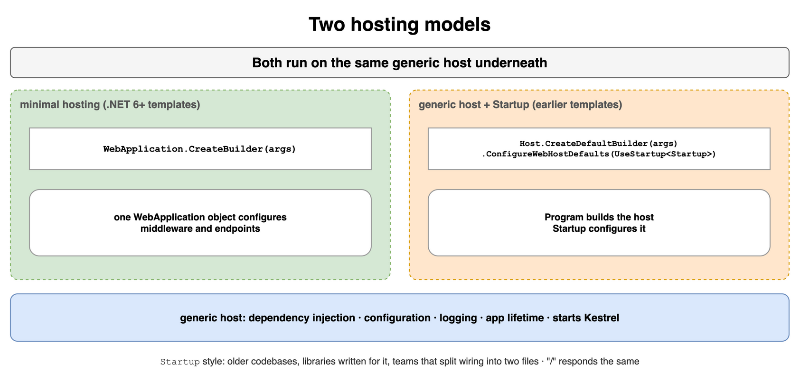
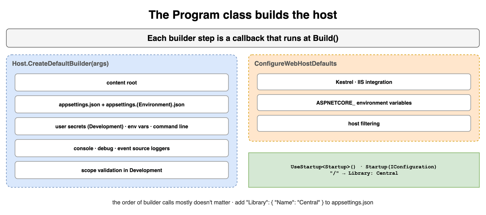
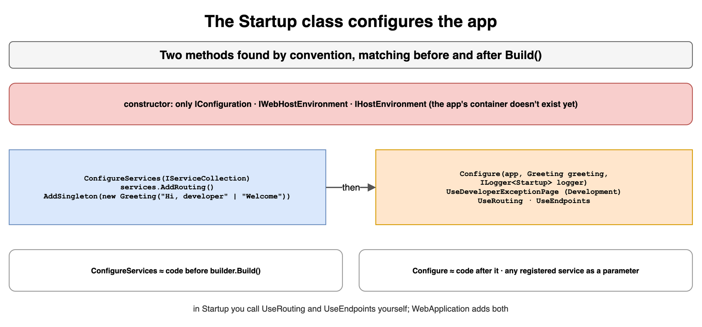
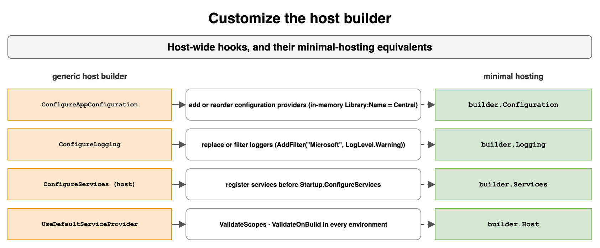
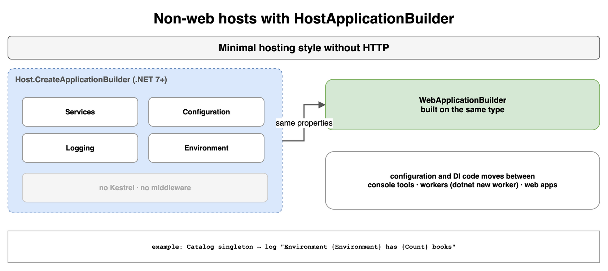
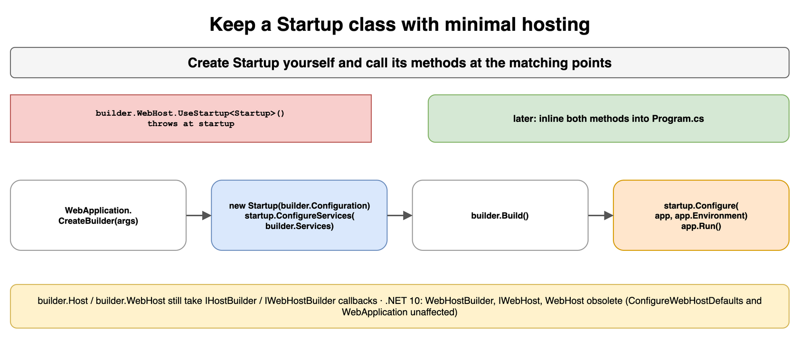
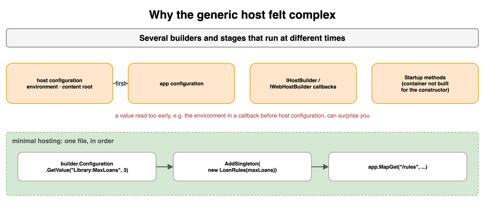

# Generic Host and Startup

## Two hosting models

Every ASP.NET Core app runs inside a host. The host owns dependency injection, configuration, logging, and the lifetime of the app, and it starts the Kestrel server. Since .NET 6, templates use the minimal hosting model: `WebApplication.CreateBuilder` builds the host, and the same `WebApplication` object configures middleware and endpoints. Earlier templates used the generic host directly, with a `Program` class that built the host and a separate `Startup` class that configured it.

Both models run on the same generic host underneath, so services, configuration, and middleware behave the same way. You'll meet the `Startup` style in older codebases, in libraries written for it, and in teams that prefer to split the app's wiring into two files. The example runs a `Startup`-style app. Request `/` and the response is identical to a minimal hosting app.

```csharp
var builder = Host.CreateDefaultBuilder(args)
    .ConfigureWebHostDefaults(web => web.UseStartup<Startup>());
builder.Build().Run();

public class Startup
{
    public void ConfigureServices(IServiceCollection services) => services.AddRouting();

    public void Configure(IApplicationBuilder app)
    {
        app.UseRouting();
        app.UseEndpoints(endpoints => endpoints.MapGet("/", () => "Hello from Startup"));
    }
}
```

[Microsoft Learn](https://learn.microsoft.com/en-us/aspnet/core/fundamentals/host/generic-host?view=aspnetcore-10.0)



*Source: [`diagrams/generic-host.drawio`](/content/12_ASP.NET_Core/30_Generic_Host_and_Startup/diagrams/generic-host.drawio), page 1.*

## The Program class builds the host

In the generic host model, `Program` only builds and runs the host. `Host.CreateDefaultBuilder` sets the content root, loads `appsettings.json`, `appsettings.{Environment}.json`, user secrets in Development, environment variables, and command-line arguments. It also adds the console, debug, and event source loggers and turns on scope validation in Development.

`ConfigureWebHostDefaults` adds the web layer on top: Kestrel, IIS integration, the `ASPNETCORE_` environment variables, and host filtering. `UseStartup<T>` names the class that configures services and the pipeline. Because each step is a callback that runs at `Build()`, the order in which you call them on the builder mostly doesn't matter. Add `"Library": { "Name": "Central" }` to `appsettings.json`, run the example, and request `/`.

```csharp
var host = Host.CreateDefaultBuilder(args)
    .ConfigureWebHostDefaults(web => web.UseStartup<Startup>())
    .Build();
host.Run();

public class Startup(IConfiguration configuration)
{
    public void ConfigureServices(IServiceCollection services) => services.AddRouting();

    public void Configure(IApplicationBuilder app)
    {
        app.UseRouting();
        app.UseEndpoints(endpoints => endpoints.MapGet("/", () =>
            $"Library: {configuration["Library:Name"] ?? "(not set)"}"));
    }
}
```

[Microsoft Learn](https://learn.microsoft.com/en-us/aspnet/core/fundamentals/host/generic-host?view=aspnetcore-10.0#default-builder-settings)



*Source: [`diagrams/generic-host.drawio`](/content/12_ASP.NET_Core/30_Generic_Host_and_Startup/diagrams/generic-host.drawio), page 2.*

## The Startup class configures the app

`Startup` has two methods found by convention, not by an interface. `ConfigureServices(IServiceCollection)` registers services, like the code before `builder.Build()` in a minimal app. `Configure(IApplicationBuilder, ...)` builds the middleware pipeline, like the code after it. `Configure` can take any registered service as an extra parameter, such as `IWebHostEnvironment` or `ILogger<Startup>`.

The constructor is more limited. The generic host can inject only `IConfiguration`, `IWebHostEnvironment`, and `IHostEnvironment` there, because the app's own container doesn't exist yet. In `Startup`, you also call `UseRouting` and `UseEndpoints` yourself, while `WebApplication` adds both automatically. Run the example in Development and Production and compare `/`.

```csharp
var builder = Host.CreateDefaultBuilder(args)
    .ConfigureWebHostDefaults(web => web.UseStartup<Startup>());
builder.Build().Run();

public class Startup(IWebHostEnvironment env)
{
    public void ConfigureServices(IServiceCollection services)
    {
        services.AddRouting();
        services.AddSingleton(new Greeting(env.IsDevelopment() ? "Hi, developer" : "Welcome"));
    }

    public void Configure(IApplicationBuilder app, Greeting greeting, ILogger<Startup> logger)
    {
        logger.LogInformation("Configuring pipeline for {Environment}", env.EnvironmentName);
        if (env.IsDevelopment()) app.UseDeveloperExceptionPage();
        app.UseRouting();
        app.UseEndpoints(endpoints => endpoints.MapGet("/", () => greeting.Text));
    }
}

public record Greeting(string Text);
```

[Microsoft Learn](https://learn.microsoft.com/en-us/aspnet/core/fundamentals/startup?view=aspnetcore-10.0)



*Source: [`diagrams/generic-host.drawio`](/content/12_ASP.NET_Core/30_Generic_Host_and_Startup/diagrams/generic-host.drawio), page 3.*

## Customize the host builder

The generic host builder has hooks for every part of the host. `ConfigureAppConfiguration` adds or reorders configuration providers. `ConfigureLogging` replaces or filters loggers. `ConfigureServices` on the host builder registers services before `Startup.ConfigureServices` runs. `UseDefaultServiceProvider` turns on scope and build validation outside Development.

Use these for host-wide concerns that don't belong in `Startup`. In a minimal app the same hooks are properties: `builder.Configuration`, `builder.Logging`, `builder.Services`, and `builder.Host`. The example adds an in-memory configuration source, keeps only warnings from Microsoft categories, and validates the container in every environment.

```csharp
var builder = Host.CreateDefaultBuilder(args)
    .ConfigureAppConfiguration(config => config.AddInMemoryCollection(
        new Dictionary<string, string?> { ["Library:Name"] = "Central" }))
    .ConfigureLogging(logging => logging.AddFilter("Microsoft", LogLevel.Warning))
    .UseDefaultServiceProvider(options =>
    {
        options.ValidateScopes = true;
        options.ValidateOnBuild = true;
    })
    .ConfigureWebHostDefaults(web => web.UseStartup<Startup>());
builder.Build().Run();

public class Startup(IConfiguration configuration)
{
    public void ConfigureServices(IServiceCollection services) => services.AddRouting();

    public void Configure(IApplicationBuilder app)
    {
        app.UseRouting();
        app.UseEndpoints(endpoints => endpoints.MapGet("/", () => configuration["Library:Name"]));
    }
}
```

[Microsoft Learn](https://learn.microsoft.com/en-us/aspnet/core/fundamentals/host/generic-host?view=aspnetcore-10.0#host-configuration)



*Source: [`diagrams/generic-host.drawio`](/content/12_ASP.NET_Core/30_Generic_Host_and_Startup/diagrams/generic-host.drawio), page 4.*

## Non-web hosts with HostApplicationBuilder

`Host.CreateApplicationBuilder`, added in .NET 7, brings the minimal hosting style to apps without HTTP. It returns a `HostApplicationBuilder` with the same `Services`, `Configuration`, `Logging`, and `Environment` properties as `WebApplicationBuilder`, but no Kestrel and no middleware. The `dotnet new worker` template uses it, as covered in [background services](#12_ASP.NET_Core/34_Background_Services/concepts/worker-services).

`WebApplicationBuilder` is built on the same type, which is why configuration and DI code moves between console tools, workers, and web apps without changes. The example is a console app that loads configuration and logs one message. It runs in the `StudyApi` project too, because the web SDK includes the hosting packages.

```csharp
var builder = Host.CreateApplicationBuilder(args);
builder.Services.AddSingleton<Catalog>();
using var host = builder.Build();

var catalog = host.Services.GetRequiredService<Catalog>();
var logger = host.Services.GetRequiredService<ILogger<Program>>();
logger.LogInformation("Environment {Environment} has {Count} books",
    builder.Environment.EnvironmentName, catalog.Titles.Length);

public class Catalog { public string[] Titles { get; } = ["Atlas", "Primer"]; }
```

[Microsoft Learn](https://learn.microsoft.com/en-us/dotnet/core/extensions/generic-host)



*Source: [`diagrams/generic-host.drawio`](/content/12_ASP.NET_Core/30_Generic_Host_and_Startup/diagrams/generic-host.drawio), page 5.*

## Keep a Startup class with minimal hosting

`WebApplicationBuilder` doesn't support `UseStartup`. Calling `builder.WebHost.UseStartup<Startup>()` throws at startup. To move an older app to minimal hosting without rewriting it at once, create the `Startup` instance yourself and call its methods at the matching points.

`IHostBuilder` and `IWebHostBuilder` callbacks still work on `builder.Host` and `builder.WebHost` for code that needs them. Later you can inline the two methods into `Program.cs`. In .NET 10, `WebHostBuilder`, `IWebHost`, and `WebHost` are obsolete. The generic host's `ConfigureWebHostDefaults` and `WebApplication` are unaffected.

```csharp
var builder = WebApplication.CreateBuilder(args);
var startup = new Startup(builder.Configuration);
startup.ConfigureServices(builder.Services);
var app = builder.Build();
startup.Configure(app, app.Environment);
app.Run();

public class Startup(IConfiguration configuration)
{
    public void ConfigureServices(IServiceCollection services) =>
        services.AddSingleton(new Banner(configuration["Banner"] ?? "Library"));

    public void Configure(WebApplication app, IWebHostEnvironment env)
    {
        if (!env.IsDevelopment()) app.UseExceptionHandler("/error");
        app.MapGet("/", (Banner banner) => banner.Text);
        app.MapGet("/error", () => Results.Problem());
    }
}

public record Banner(string Text);
```

[Microsoft Learn](https://learn.microsoft.com/en-us/aspnet/core/migration/50-to-60?view=aspnetcore-10.0)



*Source: [`diagrams/generic-host.drawio`](/content/12_ASP.NET_Core/30_Generic_Host_and_Startup/diagrams/generic-host.drawio), page 6.*

## Why the generic host felt complex

The generic host has several builders and two configuration stages. Host configuration (environment, content root) loads first, then app configuration. The `IHostBuilder` callbacks, the `IWebHostBuilder` callbacks, and the `Startup` methods all run at different times. A value read too early, such as the environment inside a `ConfigureServices` callback that runs before host configuration, can surprise you. Services can't be injected into `Startup`'s constructor because the container doesn't exist yet.

Minimal hosting removes most of this. Configuration is ready when you read it from `builder.Configuration`, services are registered in order in one file, and the app object is both the middleware builder and the endpoint builder. The example reads configuration, registers a service that depends on it, and builds the pipeline in one place.

```csharp
var builder = WebApplication.CreateBuilder(args);
var maxLoans = builder.Configuration.GetValue("Library:MaxLoans", 3);
builder.Services.AddSingleton(new LoanRules(maxLoans));
var app = builder.Build();
app.MapGet("/rules", (LoanRules rules) => rules);
app.Run();

public record LoanRules(int MaxLoans);
```

[Microsoft Learn](https://learn.microsoft.com/en-us/aspnet/core/fundamentals/minimal-apis/webapplication?view=aspnetcore-10.0)



*Source: [`diagrams/generic-host.drawio`](/content/12_ASP.NET_Core/30_Generic_Host_and_Startup/diagrams/generic-host.drawio), page 7.*

## Choosing between the models

New apps should use `WebApplication`. It's what the templates, documentation, and newer features such as Native AOT target. `WebApplication.CreateSlimBuilder` and `CreateEmptyBuilder` start with fewer defaults, and `Host.CreateApplicationBuilder` covers non-web apps.

Keep `Startup` when an existing app works and a migration would only move code around. Use it also when you need `IHostBuilder` APIs that libraries haven't adapted yet. Both models share services, middleware, and configuration, so the choice is about structure, not features. The example uses `CreateSlimBuilder`, which leaves out HTTPS configuration, IIS integration, and some logging providers.

```csharp
var builder = WebApplication.CreateSlimBuilder(args);
var app = builder.Build();
app.MapGet("/", () => "Slim host");
app.Run();
```

[Microsoft Learn](https://learn.microsoft.com/en-us/aspnet/core/fundamentals/host/generic-host?view=aspnetcore-10.0)
