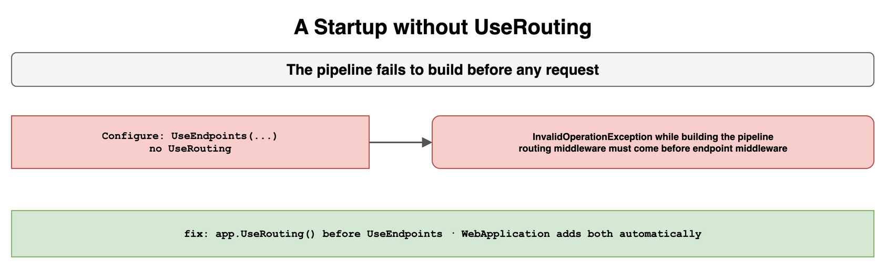
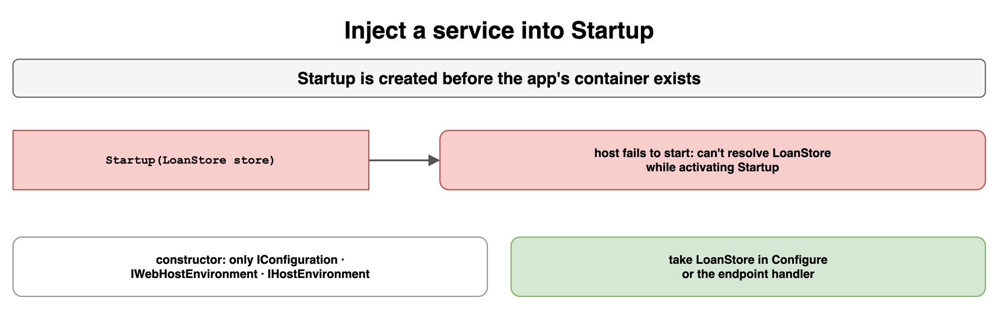

# Generic Host and Startup — Drills

Predict the result before running the example.

## A Startup without UseRouting

The `Configure` method below maps an endpoint but never calls `UseRouting`. What happens when the app starts, and what is the fix?

```csharp
var builder = Host.CreateDefaultBuilder(args)
    .ConfigureWebHostDefaults(web => web.UseStartup<Startup>());
builder.Build().Run();

public class Startup
{
    public void ConfigureServices(IServiceCollection services) => services.AddRouting();

    public void Configure(IApplicationBuilder app) =>
        app.UseEndpoints(endpoints => endpoints.MapGet("/", () => "catalog"));
}
```

**Answer**

The app fails while building the pipeline, before it serves any request. `UseEndpoints` throws an `InvalidOperationException` saying the routing middleware must be added before the endpoint middleware. Add `app.UseRouting()` before `UseEndpoints`. `WebApplication` adds both for you, which is why minimal apps never hit this error.



*Source: [`diagrams/generic-host-drills.drawio`](/content/12_ASP.NET_Core/30_Generic_Host_and_Startup/diagrams/generic-host-drills.drawio), page 1.*

## Inject a service into Startup

A developer adds `LoanStore` to the `Startup` constructor so both methods can use it. What happens at startup?

```csharp
var builder = Host.CreateDefaultBuilder(args)
    .ConfigureWebHostDefaults(web => web.UseStartup<Startup>());
builder.Build().Run();

public class Startup(LoanStore store)
{
    public void ConfigureServices(IServiceCollection services) => services.AddSingleton<LoanStore>();

    public void Configure(IApplicationBuilder app)
    {
        app.UseRouting();
        app.UseEndpoints(endpoints => endpoints.MapGet("/", () => store.Count));
    }
}

public class LoanStore { public int Count => 2; }
```

**Answer**

The host fails to start with an error that it can't resolve `LoanStore` while activating `Startup`. The generic host creates `Startup` before the app's container exists, so the constructor can take only `IConfiguration`, `IWebHostEnvironment`, and `IHostEnvironment`. Take `LoanStore` as a parameter of `Configure` or of the endpoint handler instead.



*Source: [`diagrams/generic-host-drills.drawio`](/content/12_ASP.NET_Core/30_Generic_Host_and_Startup/diagrams/generic-host-drills.drawio), page 2.*
