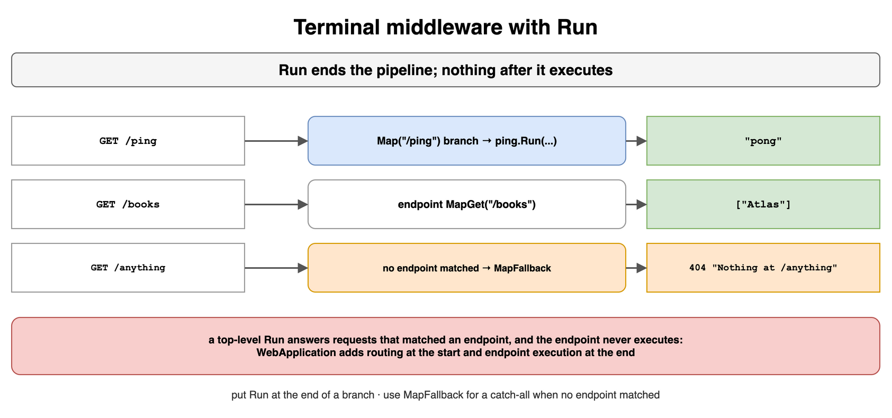
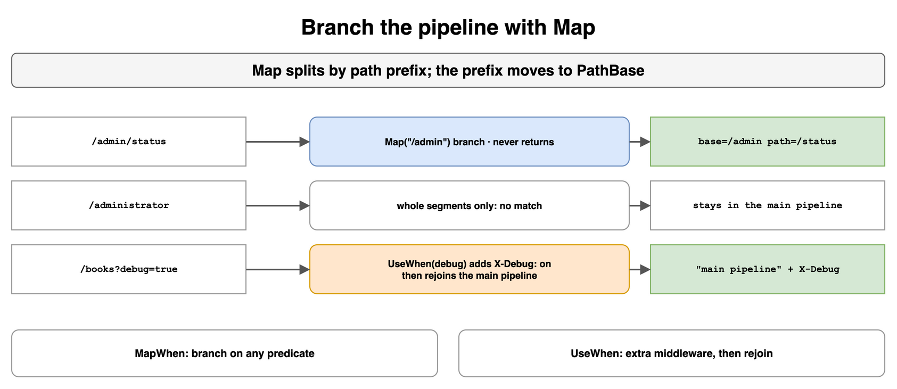
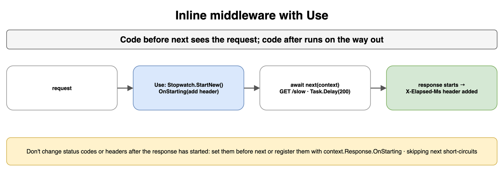
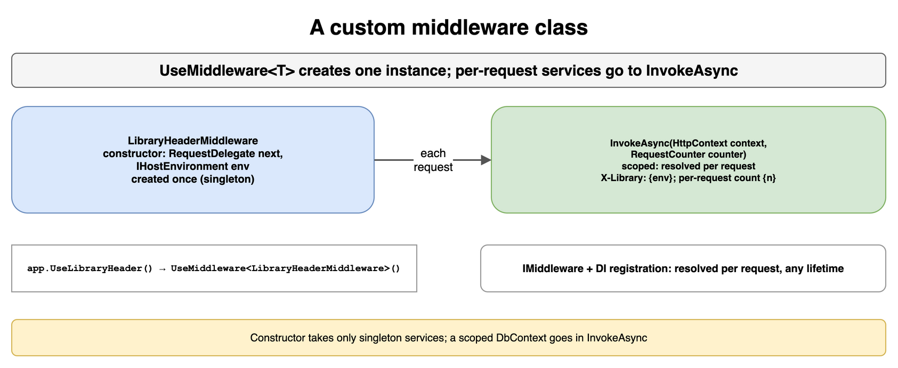
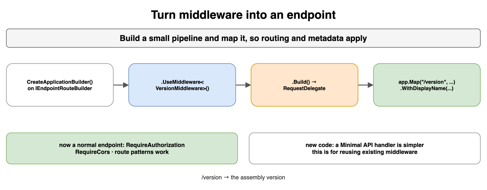
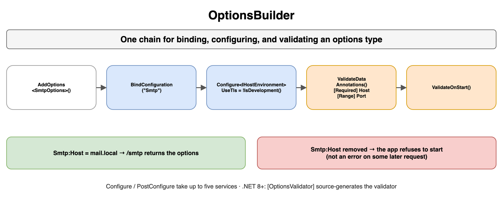
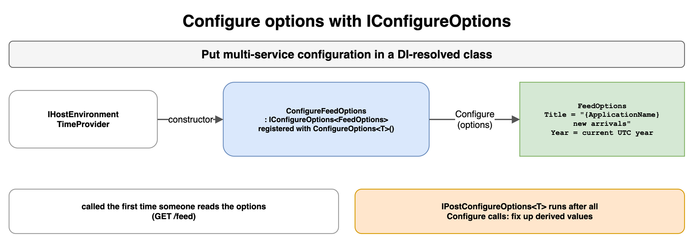
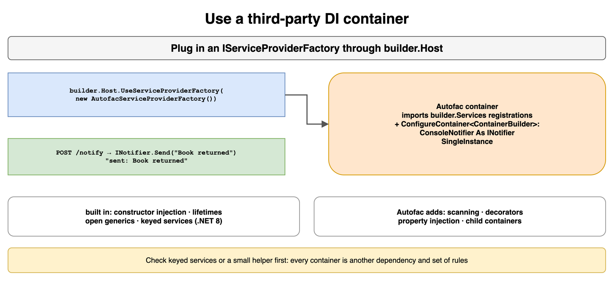

# Advanced Configuration

## Terminal middleware with Run

`Run` adds middleware that always ends the pipeline. It receives the `HttpContext` but no `next` delegate, so nothing after it executes. It's useful for tiny apps and for the end of a branch.

Because `Run` never calls on, anything after it is unreachable, and that includes endpoints. `WebApplication` adds routing at the start of the pipeline and endpoint execution at the end. A top-level `Run` therefore answers requests that matched a mapped endpoint, and the endpoint never executes. Put `Run` at the end of a branch, and use `MapFallback` for a catch-all that should apply only when no endpoint matched. Request `/ping`, `/books`, and `/anything`.

```csharp
var builder = WebApplication.CreateBuilder(args);
var app = builder.Build();
app.Map("/ping", ping => ping.Run(context => context.Response.WriteAsync("pong")));
app.MapGet("/books", () => new[] { "Atlas" });
app.MapFallback((HttpContext context) => Results.NotFound($"Nothing at {context.Request.Path}"));
app.Run();
```

[Microsoft Learn](https://learn.microsoft.com/en-us/aspnet/core/fundamentals/middleware/?view=aspnetcore-10.0#create-a-middleware-pipeline-with-webapplication)



*Source: [`diagrams/advanced-configuration.drawio`](/content/12_ASP.NET_Core/31_Advanced_Configuration/diagrams/advanced-configuration.drawio), page 1.*

## Branch the pipeline with Map

`Map` splits the pipeline by path prefix. Requests whose path starts with the prefix go into a separate branch with its own middleware, and never return to the main pipeline. Inside the branch, the matched prefix moves from `Request.Path` to `Request.PathBase`. The branch therefore sees `/status` for a request to `/admin/status`.

Matching works on whole segments, so `/admin` doesn't match `/administrator`. `MapWhen` branches on any predicate, such as a header or query value. `UseWhen` runs extra middleware for matching requests and then rejoins the main pipeline. Compare `/admin/status`, `/administrator`, and `/books?debug=true`.

```csharp
var builder = WebApplication.CreateBuilder(args);
var app = builder.Build();
app.Map("/admin", admin => admin.Run(context =>
    context.Response.WriteAsync($"admin branch: base={context.Request.PathBase} path={context.Request.Path}")));
app.UseWhen(context => context.Request.Query.ContainsKey("debug"), debug => debug.Use(async (context, next) =>
{
    context.Response.Headers["X-Debug"] = "on";
    await next(context);
}));
app.MapGet("/books", () => "main pipeline");
app.Run();
```

[Microsoft Learn](https://learn.microsoft.com/en-us/aspnet/core/fundamentals/middleware/?view=aspnetcore-10.0#branch-the-middleware-pipeline)



*Source: [`diagrams/advanced-configuration.drawio`](/content/12_ASP.NET_Core/31_Advanced_Configuration/diagrams/advanced-configuration.drawio), page 2.*

## Inline middleware with Use

`Use` adds middleware that can work before and after the rest of the pipeline. The lambda gets the context and a `next` delegate. Code before `await next(context)` sees the request on the way in, and code after it runs on the way out. Skipping `next` short-circuits the pipeline.

Don't change status codes or headers after the response has started, because they've already been sent. Set headers before calling `next`, or register them with `context.Response.OnStarting`. The example times every request and adds the elapsed time as a header just before the response starts.

```csharp
using System.Diagnostics;

var builder = WebApplication.CreateBuilder(args);
var app = builder.Build();
app.Use(async (context, next) =>
{
    var watch = Stopwatch.StartNew();
    context.Response.OnStarting(() =>
    {
        context.Response.Headers["X-Elapsed-Ms"] = watch.ElapsedMilliseconds.ToString();
        return Task.CompletedTask;
    });
    await next(context);
});
app.MapGet("/slow", async () => { await Task.Delay(200); return "done"; });
app.Run();
```

[Microsoft Learn](https://learn.microsoft.com/en-us/aspnet/core/fundamentals/middleware/?view=aspnetcore-10.0#create-a-middleware-pipeline-with-webapplication)



*Source: [`diagrams/advanced-configuration.drawio`](/content/12_ASP.NET_Core/31_Advanced_Configuration/diagrams/advanced-configuration.drawio), page 3.*

## A custom middleware class

Larger middleware belongs in a class. By convention the class takes a `RequestDelegate` in its constructor and has an `InvokeAsync(HttpContext)` method. `UseMiddleware<T>` creates the instance once, as a singleton, so the constructor should take only singleton services. Scoped services, such as a `DbContext`, go in as extra parameters of `InvokeAsync`, which are resolved for each request.

Alternatively, implement `IMiddleware` and register the class in DI. That style is resolved per request, so it can have any lifetime. Add an extension method such as `UseLibraryHeader` so callers don't need to know the class name. Request `/` and look at the headers.

```csharp
var builder = WebApplication.CreateBuilder(args);
builder.Services.AddScoped<RequestCounter>();
var app = builder.Build();
app.UseLibraryHeader();
app.MapGet("/", () => "catalog");
app.Run();

public class LibraryHeaderMiddleware(RequestDelegate next, IHostEnvironment env)
{
    public async Task InvokeAsync(HttpContext context, RequestCounter counter)
    {
        counter.Count++;
        context.Response.Headers["X-Library"] = $"{env.EnvironmentName}; per-request count {counter.Count}";
        await next(context);
    }
}

public class RequestCounter { public int Count { get; set; } }

public static class LibraryHeaderExtensions
{
    public static IApplicationBuilder UseLibraryHeader(this IApplicationBuilder app) =>
        app.UseMiddleware<LibraryHeaderMiddleware>();
}
```

[Microsoft Learn](https://learn.microsoft.com/en-us/aspnet/core/fundamentals/middleware/write?view=aspnetcore-10.0)



*Source: [`diagrams/advanced-configuration.drawio`](/content/12_ASP.NET_Core/31_Advanced_Configuration/diagrams/advanced-configuration.drawio), page 4.*

## Turn middleware into an endpoint

Middleware that answers one path, such as a version or ping handler, is invisible to routing. It can't take authorization policies, CORS, or other endpoint metadata. To fix that, build a small pipeline from the middleware and map it as an endpoint. `CreateApplicationBuilder` on the endpoint route builder gives you a fresh `IApplicationBuilder`, and `Build()` turns it into a `RequestDelegate`.

The mapped delegate is a normal endpoint, so `RequireAuthorization`, `RequireCors`, and route patterns all work. In new code, a Minimal API handler is usually simpler. This technique is for reusing middleware you already have. Request `/version` to see the assembly version.

```csharp
var builder = WebApplication.CreateBuilder(args);
var app = builder.Build();
var versionPipeline = ((IEndpointRouteBuilder)app).CreateApplicationBuilder()
    .UseMiddleware<VersionMiddleware>()
    .Build();
app.Map("/version", versionPipeline).WithDisplayName("Version endpoint");
app.Run();

public class VersionMiddleware(RequestDelegate next)
{
    public Task InvokeAsync(HttpContext context) =>
        context.Response.WriteAsync(typeof(Program).Assembly.GetName().Version?.ToString() ?? "unknown");
}
```

[Microsoft Learn](https://learn.microsoft.com/en-us/aspnet/core/fundamentals/routing?view=aspnetcore-10.0#endpoints)



*Source: [`diagrams/advanced-configuration.drawio`](/content/12_ASP.NET_Core/31_Advanced_Configuration/diagrams/advanced-configuration.drawio), page 5.*

## OptionsBuilder

`AddOptions<T>()` returns an `OptionsBuilder<T>` that chains everything about one options type. `BindConfiguration` binds a section, `Configure` applies code, and `Validate` or `ValidateDataAnnotations` adds checks. `ValidateOnStart` runs those checks when the host starts instead of on first use. That turns a missing setting into a startup failure rather than an error on some later request.

`Configure` and `PostConfigure` overloads take up to five services as extra parameters, which lets an options value depend on the environment or another service. Since .NET 8, the `[OptionsValidator]` source generator can produce the validator at compile time. Remove `Smtp:Host` from configuration and the app refuses to start.

```csharp
using System.ComponentModel.DataAnnotations;
using Microsoft.Extensions.Options;

var builder = WebApplication.CreateBuilder(args);
builder.Configuration.AddInMemoryCollection(new Dictionary<string, string?> { ["Smtp:Host"] = "mail.local" });
builder.Services.AddOptions<SmtpOptions>()
    .BindConfiguration("Smtp")
    .Configure<IHostEnvironment>((options, env) => options.UseTls = !env.IsDevelopment())
    .ValidateDataAnnotations()
    .ValidateOnStart();
var app = builder.Build();
app.MapGet("/smtp", (IOptions<SmtpOptions> options) => options.Value);
app.Run();

public class SmtpOptions
{
    [Required] public string Host { get; set; } = "";
    [Range(1, 65535)] public int Port { get; set; } = 587;
    public bool UseTls { get; set; }
}
```

[Microsoft Learn](https://learn.microsoft.com/en-us/dotnet/core/extensions/options#options-validation)



*Source: [`diagrams/advanced-configuration.drawio`](/content/12_ASP.NET_Core/31_Advanced_Configuration/diagrams/advanced-configuration.drawio), page 6.*

## Configure options with IConfigureOptions

When configuring an options type needs several services, a lambda gets crowded. Put the logic in a class that implements `IConfigureOptions<T>` and register it with `ConfigureOptions<TSetup>()`. The class is resolved from DI, so it can take any singleton service in its constructor. The options system calls `Configure` the first time someone reads the options.

Libraries use this pattern to set sensible defaults that apps can still override. `IPostConfigureOptions<T>` runs after all `Configure` calls, which suits fixing up derived values. Request `/feed` to see a value computed from another service.

```csharp
using Microsoft.Extensions.Options;

var builder = WebApplication.CreateBuilder(args);
builder.Services.AddSingleton(TimeProvider.System);
builder.Services.ConfigureOptions<ConfigureFeedOptions>();
var app = builder.Build();
app.MapGet("/feed", (IOptions<FeedOptions> options) => options.Value);
app.Run();

public class FeedOptions
{
    public string Title { get; set; } = "";
    public int Year { get; set; }
}

public class ConfigureFeedOptions(IHostEnvironment env, TimeProvider time) : IConfigureOptions<FeedOptions>
{
    public void Configure(FeedOptions options)
    {
        options.Title = $"{env.ApplicationName} new arrivals";
        options.Year = time.GetUtcNow().Year;
    }
}
```

[Microsoft Learn](https://learn.microsoft.com/en-us/dotnet/core/extensions/options#use-di-services-to-configure-options)



*Source: [`diagrams/advanced-configuration.drawio`](/content/12_ASP.NET_Core/31_Advanced_Configuration/diagrams/advanced-configuration.drawio), page 7.*

## Use a third-party DI container

The built-in container covers constructor injection, the three lifetimes, open generics, and, since .NET 8, keyed services. Third-party containers such as Autofac add features like convention-based assembly scanning, decorators, property injection, and child containers. To use one, plug in its `IServiceProviderFactory` through `builder.Host`.

Registrations made with `builder.Services` still work, because the third-party container imports them. Container-specific registrations go in `ConfigureContainer`. Check whether keyed services or a small helper meet your need first, because every extra container is another dependency and another set of rules. Add the `Autofac.Extensions.DependencyInjection` package to run the example.

```csharp
using Autofac;
using Autofac.Extensions.DependencyInjection;

var builder = WebApplication.CreateBuilder(args);
builder.Host.UseServiceProviderFactory(new AutofacServiceProviderFactory());
builder.Host.ConfigureContainer<ContainerBuilder>(container =>
    container.RegisterType<ConsoleNotifier>().As<INotifier>().SingleInstance());
var app = builder.Build();
app.MapPost("/notify", (INotifier notifier) => notifier.Send("Book returned"));
app.Run();

public interface INotifier { string Send(string message); }
public class ConsoleNotifier : INotifier { public string Send(string message) => $"sent: {message}"; }
```

[Microsoft Learn](https://learn.microsoft.com/en-us/aspnet/core/fundamentals/dependency-injection?view=aspnetcore-10.0#default-service-container-replacement)



*Source: [`diagrams/advanced-configuration.drawio`](/content/12_ASP.NET_Core/31_Advanced_Configuration/diagrams/advanced-configuration.drawio), page 8.*
